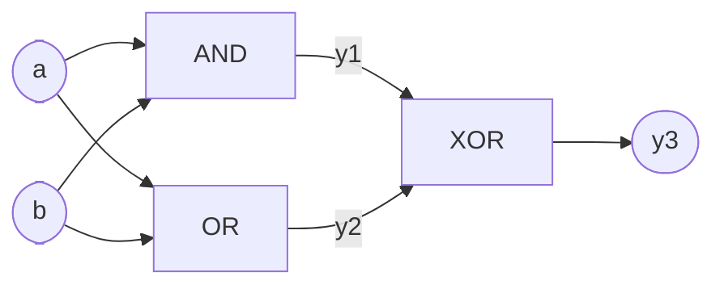

# ハードウェアは並列

C、Python、JavaScript から来た学生は皆、同じメンタルモデルを内面化している:「コードは上から下へ、1 文ずつ実行される」。VHDL は、正しいメンタルモデルを構築するまで、この仮定を罰し続ける。

## 大きな転換

このアーキテクチャを見て:

```vhdl
architecture rtl of demo is
begin
  y1 <= a and b;
  y2 <= a or  b;
  y3 <= y1 xor y2;
end architecture rtl;
```

ソフトウェア言語ならこれは 3 つの逐次ステップと読む。VHDL では、3 行すべてが**同時に存在する配線**を記述している。順番に実行されるのではない — それらは存在している。

シンセサイザは次のように構築する:



3 つのゲートが同時に通電している。`a` または `b` が変わると、出力 `y3` は最も長い経路の伝搬遅延の後で新しい値に落ち着く。「最初」も「次」もない。

## なぜ順序は重要でないか

3 行はどんな順序で書いてもよい:

```vhdl
y3 <= y1 xor y2;   -- 「宣言」前の参照?
y1 <= a and b;
y2 <= a or  b;
```

これも有効な VHDL。3 つの代入は 3 本の配線を記述するもので、配線は回路図をどの順序で描いたかなど気にしない。ツールは 3 つすべてを読んで配線する。

## 「逐次」が忍び込んでくる場所

`process` の内部では、確かに **逐次的**だ — その process の中では 1 文ずつ、上から下へ。しかし process 全体は、他のものと並ぶ別の並行ユニットにすぎない。

```vhdl
architecture rtl of demo is
begin

  -- 並行 1
  y1 <= a and b;

  -- 並行 2(process、内部は逐次)
  process(clk)
  begin
    if rising_edge(clk) then
      counter <= counter + 1;
    end if;
  end process;

  -- 並行 3
  y2 <= a or b;

end architecture rtl;
```

3 つの並行ユニットは同時に生きている。それぞれは入力が変わるたびに動く。process の中では本体は順番に読まれるが、それは process のローカルな性質であって、アーキテクチャの性質ではない。

## 具体的な帰結

この設計には微妙な競合がある:

```vhdl
architecture wrong of demo is
  signal a, b : std_logic;
begin
  a <= not b;
  b <= not a;
end architecture wrong;
```

ソフトウェアとして読めば「`a` を not-b に、次に `b` を not-a に」— 問題なさそう。ハードウェアとして読めば、2 つのインバータがループに配線されている。これは**発振器** — 決して安定しないフィードバックループ。シミュレーションは文句を言い、合成は(時々)それを最適化で消し、ボードは予測不能にグリッチする。

## 頭の中の配線替え

- 「何が最初に動く?」と考えるのをやめる。
- 「どんな配線が存在する?」と考え始める。
- process の内部では、古い「一度に一つ」モデルが戻ってくる — ただしそこだけ。

これが腑に落ちると、VHDL はあなたと戦うのをやめる。アーキテクチャを読めば、それが表す回路図がすぐ見える — 以前に思い描いていた「プログラムの実行」ではなく。
