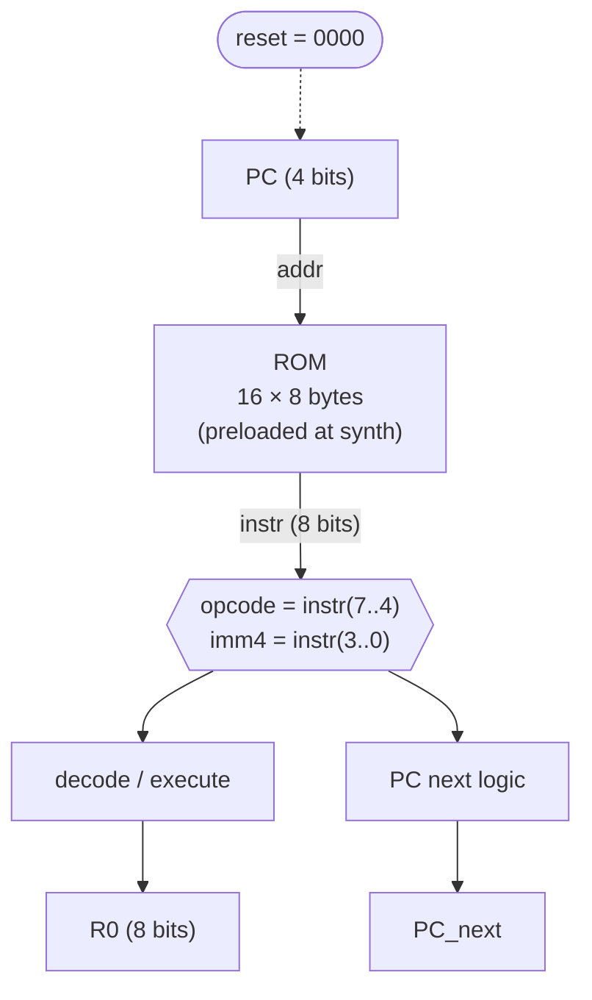

# プロジェクト:シングルサイクル 8 ビット CPU

これが集大成だ。これまでのモジュールで作ってきたすべて — ROM、レジスタ、ALU、FSM 風の制御 — を組み上げて、実際にプログラムを走らせる小さな機械にする。

## この機械



これは ESCOM の *Arquitectura de Computadoras*(計算機アーキテクチャ)コースのトピック 3.5 だ — これまでのブロックの ALU、レジスタ、ROM、制御論理が、1 つの動く RISC 機械へとまとまる地点だ。

## シングルサイクルの約束

すべては 1 つのルールにかかっている:**シングルサイクル設計では、1 つの命令がクロック周期ごとに完了する。** 1 ティックの中で、ハードウェアは組合せ的に、PC が指す命令をフェッチし、デコードし、ALU に通し、次の PC を計算し終えなければならない — そして立ち上がりエッジでだけ、*状態* 要素(PC、R0、halt フラグ)が新しい値をラッチする。

だからこそ ROM の読み出しは組合せでなければならない:アドレス(PC)とデータ(instr)は、同じサイクルの中で、クロックエッジの *前に* 両方とも有効でなければならない。したがってクロック周期は、機械全体を通る最も長い経路、フェッチからライトバックまでをカバーしなければならない。考えるのは簡単だが、クロック速度に上限をかける — それがまさに、あとでパイプライン化する動機だ。

## 雛形が与えるもの

完全に動作する CPU だ。スタータを注意深く読もう:

```vhdl
process(clk, reset)
begin
  if reset = '1' then
    pc   <= (others => '0');
    r0   <= (others => '0');
    halt <= '0';
  elsif rising_edge(clk) then
    if halt = '0' then
      case instr(7 downto 4) is
        when "0000" => r0 <= resize(unsigned(instr(3 downto 0)), 8); pc <= pc + 1;
        when "0001" => r0 <= r0 + resize(unsigned(instr(3 downto 0)), 8); pc <= pc + 1;
        when "0010" => pc <= unsigned(instr(3 downto 0));
        when "1111" => halt <= '1';
        when others => pc <= pc + 1;
      end case;
    end if;
  end if;
end process;
```

これはすでに実装している:

- LOAD (`0000`)
- ADD  (`0001`)
- JUMP (`0010`)
- HALT (`1111`)

プリロードされた ROM は `R0 = 3; R0 += 4; R0 += 2; HALT` を走らせる。

## あなたの仕事

まずはそのまま走らせよう。付属のクロック + reset スティミュラスで 200 µs シミュレートする。Waveforms タブで、`r0_out` が `3 → 7 → 9` と進み、それから `halted` が High になって保持されるのが見えるはずだ。

ベースラインが動いたら、ISA を **拡張** しよう:

### 課題 1:SUB

opcode `0011`。`R0 <= R0 - imm4`。1 行の変更だ。

### 課題 2:条件ジャンプ

opcode `0100`:`JZ addr` — `R0 = 0` なら `addr` へジャンプ、そうでなければ `pc <= pc + 1`。

`R0` を 0 までカウントダウンして止まる、動作確認済みのループを示す。毎回 1 を引き、`R0` が 0 になったら `JZ` が `HALT` へ落ちる:

```
0: 03   LOAD R0, #3     -- R0 = 3
1: 31   SUB  R0, #1     -- R0 = R0 - 1   (課題 1 の opcode 0011)
2: 44   JZ   #4         -- R0 = 0 ならアドレス 4 へジャンプ、そうでなければ素通り
3: 21   JUMP #1         -- 戻ってもう一度引く
4: F0   HALT
```

たどってみよう:R0 は 3 → 2 → 1 → 0 と進み、R0 が 0 に達した回だけ `JZ` が `HALT` への分岐を取る。分岐論理を信じる前に、Waveforms タブで `r0_out` を見てカウントダウンを確認しよう。

`JZ` のデコードは、条件付きの次 PC にすぎない:

```vhdl
when "0100" =>
  if r0 = 0 then
    pc <= unsigned(instr(3 downto 0));   -- 分岐を取る
  else
    pc <= pc + 1;                        -- 素通り
  end if;
```

### 課題 3:2 つ目のレジスタ

`r1` を 2 つ目の 8 ビットレジスタとして追加する。`LOAD R1, #i` を opcode `0101` に、`ADD R0, R1`(即値なし)を opcode `0110` に定義する。デコードの case を広げ、可視化のために 2 つ目の出力ポートを追加する必要がある。

### 課題 4:外部データメモリ

Memories トラックの RAM モジュールをこの CPU につなぐ。`LOAD R0, [addr]` と `STORE R0, [addr]` の opcode を追加する。ここに本物の罠があり、過去をコピーするのではなく理解する価値がある:シングルサイクルの `LOAD` は、アドレスを発行する *のと同じサイクルに* RAM のデータが有効である必要がある。それは **組合せ(非同期)読み出し** でしか成り立たない — アドレスが入ると、間にクロックエッジを挟まずデータが出てくる(FPGA の小さな分散/LUT RAM ならこれができる)。block RAM が与える **同期(レジスタ付き)読み出し** は、データを *次の* クロックエッジで返すので — あなたの `LOAD` は古いデータをラッチして、黙って間違った値を読んでしまう。どうしても block RAM を使うなら、誠実な直し方は `LOAD` に 1 サイクル余分に取らせること(ミニ・マルチサイクル命令)で、読み出しが間に合っているふりをしないことだ。ストアはもっと簡単だ:書き込みはそもそもエッジトリガのイベントなので、レジスタ付き書き込みはシングルサイクルモデルにきれいに収まる。

## なぜこれをやるのか?

自分の CPU が、自分で書いたプログラム(自分で ROM に書き込んだバイト)を 1 歩ずつ進んでいくのを初めて見たとき、何かがカチッとはまる。その上に積まれるあらゆる抽象 — アセンブラ、コンパイラ、OS — は、ことごとくこの仕組みの上に立っている。そしてそのどれもが、先週あなたが書いた JavaScript を走らせる Web ブラウザに至るまで、同じトリックがより大きなスケールで繰り返されているだけなのだ。

## さらに進めるなら

- 同じ ISA の上に、古典的な 5 段パイプラインを実装する。ハザード検出とフォワーディングユニットを追加する。これで、RISC-V の教科書が教えるもののマイクロスケール版を手にする。
- ROM を差し替える:定数の代わりに、シミュレーション時に外部ファイルから読み込み、テキストをそれらのバイトにアセンブルするツールチェーンを作る。
- 前のプロジェクトの UART TX を組み込み、CPU に波形上で `'HI'` を「印字」させる。おめでとう — SoC の出来上がりだ。

## 覚えておくべきこと

- シングルサイクル CPU は、フェッチからライトバックまでの旅全体を 1 クロック周期の中で組合せ的に行う。立ち上がりエッジでラッチするのは PC、R0、halt だけだ。
- 命令を追加するのは、opcode の `case` に新しい分岐を足すことだ — デコードを拡張し、新しい状態(レジスタ)と、可視化のための出力ポートを追加する。
- 条件分岐(`JZ`)は、フラグを読む次 PC 論理にすぎない:ターゲットを取るか、`pc + 1` へ素通りする。
- メモリのタイミングは、シングルサイクルの古典的な落とし穴だ:同サイクルのロードには組合せ読み出しを。同期 block RAM の読み出しはデータを 1 サイクル遅れて返すので、それを勘定に入れなければならない。
