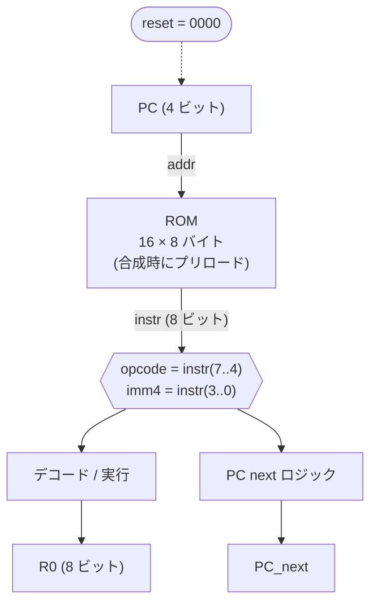

# プロジェクト:シングルサイクル 8 ビット CPU

これが集大成。以前のモジュールに出てきたすべて — ROM、レジスタ、ALU、FSM ふうの制御 — を、実際にプログラムを走らせる小さな機械に組み上げる。

## この機械



## 雛形が与えるもの

完全に動作する CPU。スタータをよく読んで:

```vhdl
process(clk, reset)
begin
  if reset = '1' then
    pc   <= (others => '0');
    r0   <= (others => '0');
    halt <= '0';
  elsif rising_edge(clk) then
    if halt = '0' then
      case instr(7 downto 4) is
        when "0000" => r0 <= resize(unsigned(instr(3 downto 0)), 8); pc <= pc + 1;
        when "0001" => r0 <= r0 + resize(unsigned(instr(3 downto 0)), 8); pc <= pc + 1;
        when "0010" => pc <= unsigned(instr(3 downto 0));
        when "1111" => halt <= '1';
        when others => pc <= pc + 1;
      end case;
    end if;
  end if;
end process;
```

これはすでに実装している:

- LOAD (`0000`)
- ADD  (`0001`)
- JUMP (`0010`)
- HALT (`1111`)

プリロードされた ROM は `R0 = 3; R0 += 4; R0 += 2; HALT` を走らせる。

## あなたの仕事

まずそのまま走らせる。付属のクロック + reset スティミュラスで 200 µs シミュレート。Waveforms タブで `r0_out` が `3 → 7 → 9` と進み、それから `halted` が High になり保持されるのが見えるはず。

ベースラインが動いたら、ISA を **拡張** する:

### 課題 1:SUB

opcode `0011`。`R0 <= R0 - imm4`。1 行変更。

### 課題 2:条件ジャンプ

opcode `0100`:`JZ addr` — `R0 = 0` なら `addr` にジャンプ、そうでなければ `pc <= pc + 1`。

ある値からカウントダウンし、0 になったら最初に戻る小さなプログラムを書く。ループの脱出に `JZ` を使う。

### 課題 3:2 つ目のレジスタ

`r1` を 2 つ目の 8 ビットレジスタとして追加。`LOAD R1, #i` を opcode `0101` に、`ADD R0, R1`(即値なし)を opcode `0110` に定義。デコード case を広げ、可視化のために 2 つ目の出力ポートを追加する必要がある。

### 課題 4:外部データメモリ

Memories トラックの RAM モジュールをこの CPU に接続。`LOAD R0, [addr]` と `STORE R0, [addr]` の opcode を追加。注意:シングルサイクル設計では、アドレスを発行するのと同じサイクル内でメモリ読み出しポートの出力が有効である必要がある — ROM には組合せ読み出し、データ RAM にはレジスタ付き読み出しを使い、パイプラインを慎重に計画する。

## なぜこれをやるのか?

自分の CPU が、自分が書いたプログラム(ROM に自分で書き込んだバイト)を進んでいくのを初めて見たとき、何かがカチッとはまる。上に積まれるあらゆる抽象 — アセンブラ、コンパイラ、OS — はすべてこの仕組みの上に立つ。そして先週あなたが書いた JavaScript を実行するブラウザに至るまで、すべて同じトリックがより大きなスケールで繰り返されているだけ。

## さらに進めるなら

- 同じ ISA 上で古典的な 5 段パイプラインを実装。ハザード検出とフォワーディングユニットを追加。これで RISC-V の教科書が教えるもののマイクロ版を手にする。
- ROM を切り替える:定数の代わりにシミュレーション時に外部ファイルから読み込み、テキストをそれらのバイトにアセンブルするツールチェーンを作る。
- 前のプロジェクトの UART TX を組み込み、CPU に波形上で `'HI'` を出力させる。おめでとう — SoC ができた。
