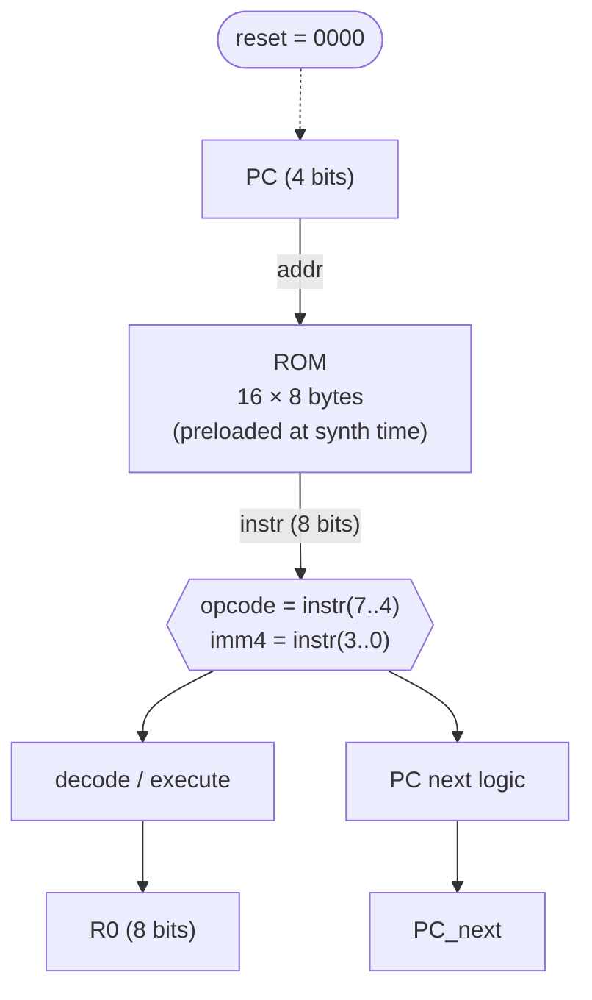

# プロジェクト: シングルサイクル 8ビット CPU

これがキャップストーン(最終課題)です。これまでのモジュールのすべて — ROM、レジスタ、ALU、FSM 的な制御 — を組み合わせて、実際にプログラムを走らせる小さな機械を組み立てます。

## 機械



## スキャフォールドが提供するもの

完全に動く CPU。スターターコードを注意深く読んでください:

```vhdl
process(clk, reset)
begin
  if reset = '1' then
    pc   <= (others => '0');
    r0   <= (others => '0');
    halt <= '0';
  elsif rising_edge(clk) then
    if halt = '0' then
      case instr(7 downto 4) is
        when "0000" => r0 <= resize(unsigned(instr(3 downto 0)), 8); pc <= pc + 1;
        when "0001" => r0 <= r0 + resize(unsigned(instr(3 downto 0)), 8); pc <= pc + 1;
        when "0010" => pc <= unsigned(instr(3 downto 0));
        when "1111" => halt <= '1';
        when others => pc <= pc + 1;
      end case;
    end if;
  end if;
end process;
```

すでに以下を実装しています:

- LOAD (`0000`)
- ADD  (`0001`)
- JUMP (`0010`)
- HALT (`1111`)

プリロードされた ROM は `R0 = 3; R0 += 4; R0 += 2; HALT` を実行します。

## あなたの仕事

まずそのまま動かしてください。付属のクロック + リセット刺激で 200 µs シミュレートします。Waveforms タブでは `r0_out` が `3 → 7 → 9` と変化するのが見え、その後 `halted` がハイになり保持されるのが見えるはずです。

ベースラインが動いたら、ISA を **拡張** します。

### タスク 1: SUB

オペコード `0011`。`R0 <= R0 - imm4`。1 行の変更。

### タスク 2: 条件ジャンプ

オペコード `0100`: `JZ addr` — `R0 = 0` のとき `addr` にジャンプ、そうでなければ `pc <= pc + 1`。

何らかの値からカウントダウンし、終わったら 0 に戻るジャンプをする小さなプログラムを書いてください。ループ終了には `JZ` を使います。

### タスク 3: 2 つ目のレジスタ

2 つ目の 8 ビットレジスタとして `r1` を追加します。オペコード `0101` として `LOAD R1, #i` を、オペコード `0110` として `ADD R0, R1` (即値なし)を定義します。デコードの case を広げて、可視性のための 2 つ目の出力ポートを追加する必要があります。

### タスク 4: 外部データメモリ

メモリトラックの RAM モジュールをこの CPU に接続します。`LOAD R0, [addr]` と `STORE R0, [addr]` オペコードを追加します。注意: シングルサイクル設計では、メモリの読み出しポートはアドレスを発行する同じサイクル内で出力が有効である必要があります — ROM には組合せ読み出し、データ RAM にはレジスタ付き読み出しを使い、パイプラインを注意深く計画してください。

## なぜこれをやるのか?

初めて、あなたが書いたプログラム(あなたが ROM に書き込んだバイト列)を CPU がステップ実行するのを見ると、何かが腑に落ちるからです。その上のあらゆる抽象化 — アセンブラ、コンパイラ、オペレーティングシステム — はまさにこのメカニズムの上に立っています。そして、先週あなたが書いた JavaScript を動かすウェブブラウザに至るまで、どれも同じトリックをより大きなスケールで繰り返しているだけです。

## さらに進める

- この同じ ISA で古典的な 5 ステージパイプラインを実装する。ハザード検出とフォワーディングユニットを追加する。これで RISC-V の教科書が教えるもののマイクロスケール版ができます。
- ROM をリターゲットする: 定数ではなく、シミュレーション時に外部ファイルから読み込み、テキストをそれらのバイトにアセンブルするツールチェーンを構築する。
- 以前のプロジェクトの UART TX をドロップインし、CPU に波形に `'HI'` を印刷させる。おめでとう — SoC ができました。
