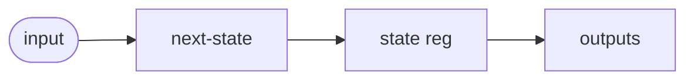
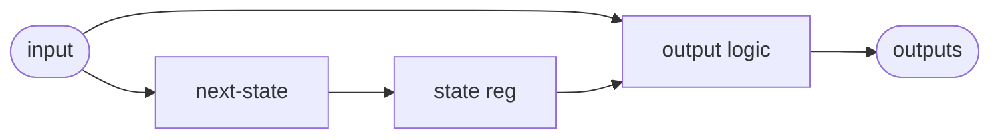

# Mealy マシンと Moore マシン

有限状態機械(FSM)とは、自分が今何をしているかを覚えている制御ロジックだ。形式的には決定的オートマトン、つまり有限個の状態、現在の状態と入力から次の状態を選ぶ遷移関数、そして出力関数からなる。あなたが作るすべての同期 FSM は 3 つの部分でできている:

- **状態レジスタ**(フリップフロップの集まり) — メモリを持つ唯一の要素だ。
- **次状態論理**(組合せ論理。次のクロックエッジで状態がどうなるかを決める)。
- **出力論理**(組合せ論理。今この瞬間の出力が何かを決める)。

出力論理が入力をどこから取ってくるかで、FSM は 2 つの系統に分かれる。

## Moore:出力は状態だけに依存する



状態が決まれば、出力は固定だ。`S_GREEN` にいるなら `green = '1'`。常にそうだ。入力がどう見えようと関係ない。

**長所**
- 出力はクロックエッジでしか変わらない → グリッチがない。
- 考えやすく、デバッグしやすく、検証しやすい。

**短所**
- 入力から出力まで最低 1 クロック分のレイテンシがある(まず状態が遷移しなければならない)。
- 同じ振る舞いを Mealy マシンで表すよりも多くの状態が必要になることがある。

## Mealy:出力は状態 + 入力に依存する



出力は現在の状態 **と** 現在の入力の関数だ。クロックエッジの合間にも変化しえる。

**長所**
- 速い — 出力は次のサイクルではなく、同じサイクル内で入力に反応できる。
- 必要な状態数が少なくて済むことが多い。

**短所**
- 出力がグリッチする可能性がある(組合せ入力に追従するため)。
- 出力がクロックエッジに揃わないため、デバッグが難しい。

違いを手早く体感する例:同じ「入力に `1` が来たら検出する」という仕事は、Mealy なら 1 状態で済む(`1` を *見た* 遷移の上で出力を立てる)。しかし Moore では「今ちょうど 1 を見た」という余分な状態が必要になる(出力をその状態に *いる* ことに結びつけるため)。同じ振る舞いでも状態数が違い、タイミングは 1 サイクルずれる。

## 1 プロセス、2 プロセス、3 プロセス

VHDL では同じ機械を何通りかの書き方で書ける。どれも同じハードウェアに合成されるが、読みやすさと、間違えやすさの点で違う。

- **1 プロセス:** 状態レジスタ *と* 出力が 1 つのクロック付きプロセスの中にある。すべてがレジスタに入るので、出力は自然にグリッチフリー(Moore 風、レジスタ付き)になる。コンパクトだが、次状態論理と出力論理が絡み合ってしまう。
- **2 プロセス(おすすめのデフォルト):** 1 つのクロック付きプロセスが状態レジスタを持ち、もう 1 つの組合せプロセスが `next_state` と出力を計算する。これは Kmila のサンプルが使っているパターンで、上の 3 部構成の図にきれいに対応する。
- **3 プロセス:** 状態レジスタ、次状態論理、出力論理がそれぞれ独立したプロセスを持つ。最も冗長だが、分離が最も明快で、うっかり壊してしまうのが最も難しい。

## 誰もが引っかかる唯一の落とし穴:推論ラッチ

*組合せ* プロセスでは、あなたが駆動するすべての信号が、プロセスを通るすべての経路で値を得なければならない。`case` や `if` のどこか 1 つの分岐で `next_state`(や出力)の代入を忘れると、合成ツールは古い値を *覚えておく* しかなく、組合せ論理の中で覚えておけるものは **ラッチ** だけだ。ラッチはほとんど常に望んだものではない:レベルセンシティブで、タイミングを取りづらく、「シミュレーションでは動くのにシリコンでは失敗する」の古典的な原因だ。

直し方は 1 行だ:`case` の前、プロセスの先頭ですべての信号に **デフォルト値** を代入しよう。

```vhdl
process(state, input)
begin
  next_state <= state;   -- デフォルト:その場に留まる
  green      <= '0';     -- 出力にもすべてデフォルトを与える
  case state is
    when S_IDLE  => if input = '1' then next_state <= S_RUN; end if;
    when S_RUN   => green <= '1';
                    next_state <= S_IDLE;
  end case;
end process;
```

こうすれば、ある分岐が代入を「忘れた」としてもデフォルトが肩代わりしてくれる — ラッチは生まれない。(なお VHDL は `case` の選択肢が網羅的であることを要求するので、よく `when others =>` を付け足す。それはコンパイラを満足させるが、実際にラッチから救ってくれるのは *デフォルト代入* の方だ。)

## 状態のエンコード

状態には列挙型で名前を付け、ビットの割り当てはツールに任せる:

```vhdl
type state_t is (S_IDLE, S_RUN, S_DONE);
signal state, next_state : state_t;
```

シンセサイザがエンコードを選ぶ — **2 進**(フリップフロップ最少)、**ワンホット**(1 状態につき 1 フリップフロップ、高速で FPGA 向き)、**グレイ**(1 ステップで 1 ビットだけ変わる、低ノイズ遷移に向く)。FPGA ではフリップフロップが豊富で次状態論理を浅く保てるため、ワンホットがデフォルトになることがよくある。手でエンコードする必要はめったにない。理由がない限り、ツールに決めさせよう。

## どちらを使うべきか?

**デフォルトは Moore。** グリッチがなくエッジに揃った出力は、設計を予測可能にする。CPU 内部の制御ロジック、メモリコントローラ、安全に関わるものには、Moore のほうが安全な選択だ。

**Mealy に手を伸ばすのは** 同じクロックサイクル内に反応する必要があるとき、あるいは余分な Moore 状態で設計が膨れ上がってしまうときだ。UART やプロトコルエンジンは、反応時間の理由から Mealy になることがよくある。Mealy の状態数は欲しいが Moore のきれいなタイミングも欲しいなら、**Mealy の出力をレジスタに通そう**(もう 1 つフリップフロップを挟む) — 避けようとしていた 1 サイクルのレイテンシと引き換えに、グリッチフリーな出力が戻ってくる。

## コースとのつながり

これは単元 II *Diseño de sistemas digitales*(デジタルシステム設計)の核心だ:出力のある/ない決定的オートマトン、Mealy モデルと Moore モデル、そしてそれらの HDL での記述。紙の上では JK / SR / T / D フリップフロップからこれらを組み立て、状態簡約(主項法 / 表形式法)で縮める練習もする — ここで使う列挙型のスタイルは、まさにその同じ状態遷移図の HDL 版だ。

## 覚えておくべきこと

- Moore:出力は状態だけの関数。グリッチフリーで、1 サイクルのレイテンシがある。
- Mealy:出力は状態 + 入力の関数。より速いがグリッチしうる — 気になるなら出力をレジスタに通す。
- 2 プロセスパターンを使い、推論ラッチを避けるために組合せプロセスの先頭で **すべての信号にデフォルトを与える**。
- 状態エンコードはツールに選ばせる(FPGA ではワンホットがよくある)。まず Moore で始め、具体的な理由があるときだけ Mealy に移る。
