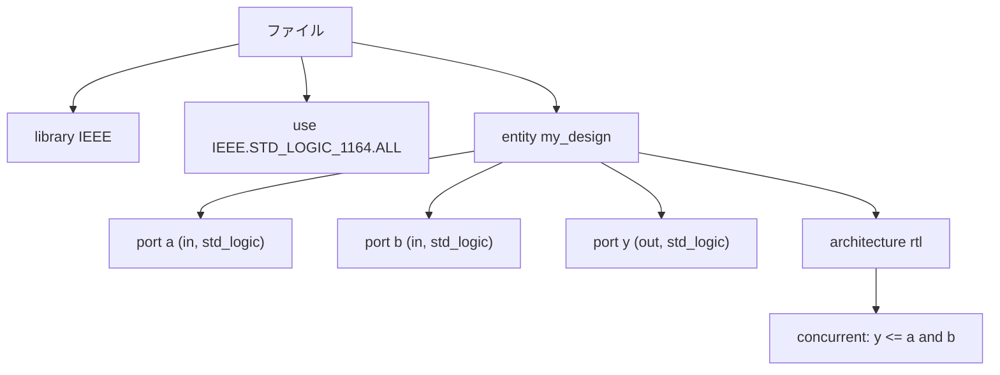

# VHDL ファイルの構造

すべての VHDL ファイルは同じ 4 つのセクションを、常に同じ順序で持つ。形を認識できれば、未知のコードを読むのは怖くなくなる — 各部分をどこに探せばいいか分かる。

## 4 つのセクション

```vhdl
library IEEE;                          -- 1. ライブラリ
use IEEE.STD_LOGIC_1164.ALL;           -- 2. 使用パッケージ

entity my_design is                    -- 3. entity(「ヘッダ」)
  port (
    a : in  std_logic;
    b : in  std_logic;
    y : out std_logic
  );
end entity my_design;

architecture rtl of my_design is       -- 4. architecture(「本体」)
begin
  y <= a and b;
end architecture rtl;
```

それぞれを見ていく。

### 1. `library`

`library IEEE;` は標準 IEEE ライブラリをインポートする。デジタル設計における `#include <stdio.h>` の同等物 — あなたが書くほぼすべてのファイルがこれで始まる。

### 2. `use`

`use IEEE.STD_LOGIC_1164.ALL;` は `STD_LOGIC_1164` パッケージのすべての名前をスコープに引き込む。これによって `std_logic`、`std_logic_vector`、`rising_edge()` などが使える。

しばしば 2 つ目の `use` も見る:

```vhdl
use IEEE.NUMERIC_STD.ALL;
```

これは `unsigned`、`signed`、`to_integer`、`resize`、ベクトル型の算術を与える。ベクトルに算術するときはいつでも追加する。

### 3. `entity`

entity は**ブラックボックスインタフェース**。それが述べるのは:

- 設計の名前(`my_design`)
- どんなポートを持つか
- 各ポートの**方向**(`in`、`out`、`inout`、`buffer`)と**型**

`port (…)` 内のすべてが外の世界が見るもの。設計がどう動くかについては、ここでは何も宣言されない。

### 4. `architecture`

architecture は**実装**。1 つの entity に複数の architecture が可能(同じインタフェースに対して)— 同じ `cpu` entity に `rtl`、`behavioral`、`tb` の architecture があり、コンフィギュレーションごとに 1 つを選ぶことができる。実際にはほとんどのファイルは正確に 1 つ持つ。

`begin` と `end architecture` の間の本体が、信号とゲートが実際に記述される場所。

## Kmila はこれをどう解析するか

Kmila の VHDL パーサはファイルを上から下に読み、ツリーを構築する:



**Build** をクリックすると、ポートは dock の **Ports** タブのエントリになり、entity は **Entities** のエントリになり、architecture 内の代入はシミュレータが実行する配線になる。

## 命名規則

VHDL は大文字小文字を区別しない。`SIGNAL`、`Signal`、`signal` は同じキーワード。しかし 1 つのファイル内では単一のスタイルを保つ — 多くのチームはキーワードや信号名に**小文字**、識別子に **snake_case**、定数に **UPPER_CASE** を使う。

## 覚えておくべきこと

- `library` + `use` — あなたのインポート。
- `entity` — インタフェース(ポートと方向)。
- `architecture` — 実装(実際に何が起こるか)。
- 1 つの entity に複数の architecture が可能;ほとんどのプロジェクトは `rtl` という 1 つを出荷する。
