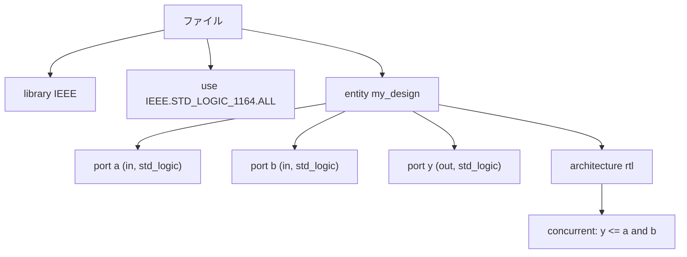

# VHDL ファイルの構造

すべての VHDL ファイルは、同じ 4 つのセクションを、常に同じ順序で持っている。この形を一度覚えてしまえば、見慣れないコードを読むのも怖くなくなる。それぞれの要素をどこに探せばよいか分かるからだ。これはまさに、コースが「何か役に立つものを書く前にマスターしておきなさい」と言っている「HDL プログラムの構造(estructura de un programa en HDL)」そのものだ。

## 4 つのセクション

```vhdl
library IEEE;                          -- 1. ライブラリ
use IEEE.STD_LOGIC_1164.ALL;           -- 2. 使用するパッケージ

entity my_design is                    -- 3. entity(「ヘッダ」)
  port (
    a : in  std_logic;
    b : in  std_logic;
    y : out std_logic
  );
end entity my_design;

architecture rtl of my_design is       -- 4. architecture(「本体」)
begin
  y <= a and b;
end architecture rtl;
```

それぞれを順番に見ていこう。

### 1. `library`

`library IEEE;` は、`IEEE` という名前の論理ライブラリをあなたのファイルから見えるようにする。これはデジタル設計における `#include <stdio.h>` に相当するもので、あなたがこれから書くほとんどすべてのファイルがこの行で始まる。

早めに知っておくとよい細かな点が一つある。組み込み型(`boolean`、`integer`、`character`、`bit` など)を定義する `STD` ライブラリと、あなた自身の `WORK` ライブラリは *常に* 見えている。`library STD;` と書くことはない。`IEEE` だけを明示するのは、実際に使いたいロジック型がそこにあるからだ。

### 2. `use`

`use IEEE.STD_LOGIC_1164.ALL;` は、`STD_LOGIC_1164` パッケージのすべての名前をスコープに引き込む。これによって `std_logic`、`std_logic_vector`、`rising_edge()`、そしてそれらの型に対するロジック演算子が使えるようになる。

2 つ目の `use` もよく見かける。

```vhdl
use IEEE.NUMERIC_STD.ALL;
```

これは `unsigned`、`signed`、`to_integer`、`resize`、そしてベクトル型の算術を与えてくれる。ベクトルに対して算術を行うときはいつでも追加しよう。なお、ネット上のチュートリアルで見かけるかもしれない古い `std_logic_arith` / `std_logic_unsigned` パッケージは避けよう。これらはそもそも IEEE 標準の一部ではなく、`numeric_std` と混在させると曖昧なオーバーロードの原因になる。

### 3. `entity`

entity は **ブラックボックスのインタフェース** だ。ここで述べるのは次のことだ。

- 設計の名前(`my_design`)
- どんなポートを持つか
- 各ポートの **モード**(`in`、`out`、`inout`、`buffer`)と **型**

| モード | 内部で読めるか | 駆動できるか |
|------|-------------------------|-------------------|
| `in`     | はい | いいえ |
| `out`    | はい(VHDL-2008 以降) | はい |
| `inout`  | はい | はい(双方向 / トライステート) |
| `buffer` | はい | はい(内部ドライバは 1 つ) |

`port (…)` の中にあるものはすべて、外の世界から見えるものだ。設計が *どう* 動くかについては、ここでは何も宣言されない。entity は **generic**(バス幅などのコンパイル時パラメータ)を持つこともあり、これは後で設計を再利用可能にするために使う。

### 4. `architecture`

architecture は **実装** だ。1 つの entity は、同じインタフェースに対して複数の architecture を持つことができる。たとえば同じ `cpu` entity に `rtl`、`behavioral`、`tb` の architecture を用意し、コンフィギュレーションごとに 1 つを選ぶ、といった具合だ。実際には、ほとんどのファイルは正確に 1 つだけ持つ。

`architecture` の行と `begin` の間は **宣言領域** で、内部信号・定数・型がここに置かれる。`begin` と `end architecture` の間は **文領域** で、信号とゲートが実際に記述される場所だ。

## Kmila はこれをどう解析するか

Kmila の VHDL パーサは、ファイルを上から下へ読み、ツリーを構築する。



**Build** をクリックすると、ポートは dock の **Ports** タブのエントリになり、entity は **Entities** のエントリになり、architecture 内の代入はシミュレータが実行する配線になる。

## 命名規則

VHDL は大文字小文字を区別しない。`SIGNAL`、`Signal`、`signal` は同じキーワードだし、`My_Design` と `my_design` は同じものを指す。(唯一の例外は文字列リテラルと文字リテラルの中の文字だ — `'0'` と `'1'` はリテラル値であり、キーワードではない。)1 つのファイル内では単一のスタイルを保とう。多くのチームは、キーワードや信号名に **小文字**、識別子に **snake_case**、定数に **UPPER_CASE** を使う。

## 最初のファイルでよくある間違い

- **`use` 句を忘れる。** `library IEEE;` だけでは `std_logic` は使えるようにならない。`use IEEE.STD_LOGIC_1164.ALL;` の行がないと、コンパイラは「不明な型 `std_logic`」というエラーを報告する。
- **閉じる名前の不一致。** `end entity foo;` は `entity foo` と一致していなければならない。`end` の後の名前は省略できるが、書く場合は正しくなければならない。
- **最後のポートの末尾にセミコロンやカンマ。** `port (…)` リストの最後のポートは、閉じ括弧の前に末尾の `;` を付けない。

## 覚えておくべきこと

- `library` + `use` — あなたのインポートだ。`library IEEE;` だけでは不十分で、`use` 句も必要だ。
- `entity` — インタフェースだ。ポート、そのモード、そして generic。
- `architecture` — 実装だ。宣言領域(`begin` の前)と文領域(その後)に分かれる。
- 1 つの entity は複数の architecture を持てるが、ほとんどのプロジェクトは `rtl` という 1 つを出荷する。
