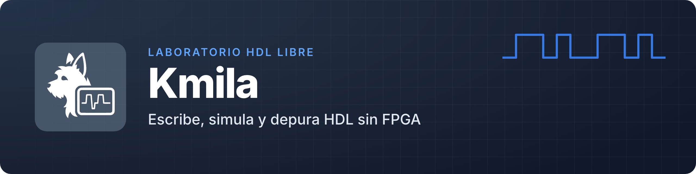
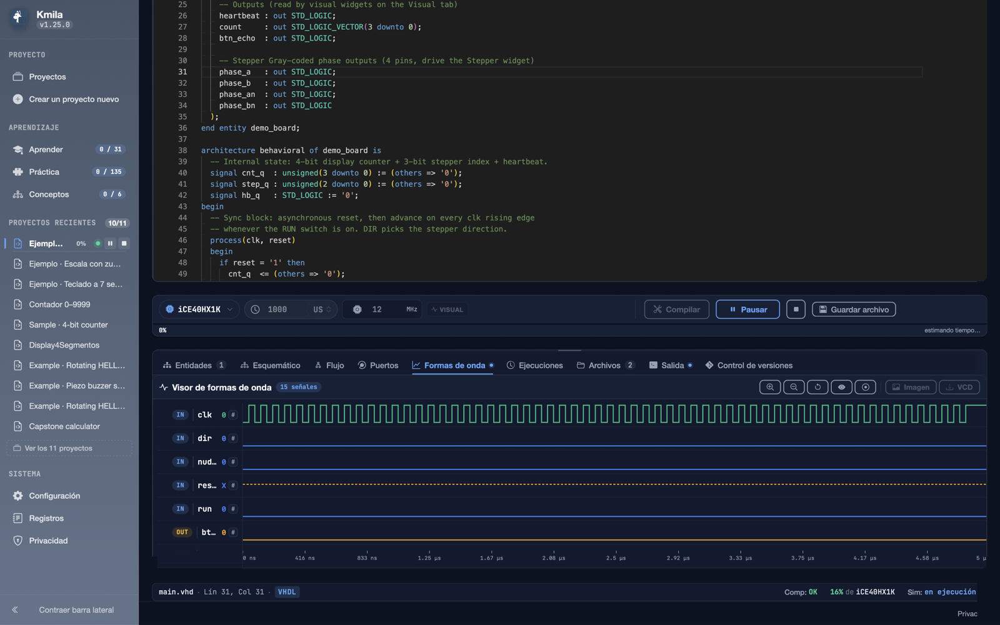
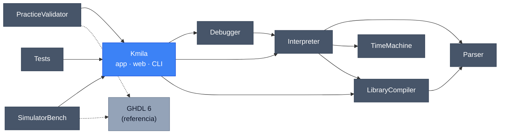

<p align="right"><a href="README.md">English</a></p>

<p align="center"></p>

<p align="center"><a href="LICENSE"></a> <a href="https://dotnet.microsoft.com/"></a> <a href="https://kmila.com.mx"></a> <a href="https://github.com/Kmila9s/Kmila/releases"></a></p>

<p align="center">
  <a href="https://kmila.com.mx/demo"><b>Prueba la demo en el navegador</b></a> · <a href="https://kmila.com.mx">Sitio web</a> · <a href="https://github.com/Kmila9s/Documentation/releases">Manual de usuario (PDF) y tesis</a>
</p>

## Qué es

Kmila es un laboratorio local para lenguajes de descripción de hardware. Escribe VHDL, simúlalo y mira lo que hace: formas de onda, un tablero visual interactivo, el esquemático sintetizado, repetición paso a paso y diagramas de flujo. También enseña: lecciones de conceptos con figuras animadas, ejercicios de bloques y prácticas autocalificadas. Sin FPGA y sin cuenta.

- **Cabezas:** escritorio y móvil (.NET MAUI: Windows, macOS, Android, iOS), web (Blazor Server, Docker), demo en el navegador (WebAssembly) y terminal (`kmila sim`, `kmila ui`, `kmila check`, `kmila diff`).
- **Comparado contra GHDL:** el banco de exactitud simula cada caso en ambos simuladores y compara las formas de onda de forma estricta; cada práctica se valida igual.
- **Sin telemetría:** todo corre en tu equipo.

<p align="center"></p>

## Inicio rápido

```bash
git clone https://github.com/Kmila9s/Kmila.git
Kmila/build.sh --native --run      # clona los repos del motor, compila y sirve http://localhost:8080
# o bien: Kmila/build.sh --docker

# cabeza de terminal
cd Kmila && dotnet run --project Kmila.CLI -- sim --top-file design.vhd --duration 200ns
```

## Dónde encaja



<sub>Las flechas van de un proyecto a lo que usa (referencias de proyecto). El recuadro resaltado es este repositorio.</sub>

## Documentación

- [Referencia técnica (arquitectura, API, historial de cambios)](docs/reference.md)
- [Manual de usuario (PDF) y tesis](https://github.com/Kmila9s/Documentation/releases)

## La familia Kmila

| | | |
|---|---|---|
|  | [**Parser**](https://github.com/Kmila9s/Parser) | Analizador léxico y sintáctico de VHDL para Kmila |
|  | [**Interpreter**](https://github.com/Kmila9s/Interpreter) | Motor de simulación por ciclos delta y síntesis |
|  | [**Debugger**](https://github.com/Kmila9s/Debugger) | Validación estructural y lint de diseños VHDL |
|  | [**LibraryCompiler**](https://github.com/Kmila9s/LibraryCompiler) | Librerías IEEE, cláusulas use y primitivas |
|  | [**TimeMachine**](https://github.com/Kmila9s/TimeMachine) | Base de tiempo discreta: ticks, relojes y eventos |
|  | [**PracticeValidator**](https://github.com/Kmila9s/PracticeValidator) | Valida cada práctica contra GHDL |
|  | [**SimulatorBench**](https://github.com/Kmila9s/SimulatorBench) | Banco de exactitud Kmila contra GHDL |
|  | [**Tests**](https://github.com/Kmila9s/Tests) | Pruebas unitarias, de extremo a extremo y de rendimiento |
|  | [**Documentation**](https://github.com/Kmila9s/Documentation/releases) | Tesis y manual de usuario (PDF) |

## Contribuir

Se aceptan issues y merge requests; consulta [CONTRIBUTING.es.md](CONTRIBUTING.es.md).

## Licencia

MIT © 2026 Ulrich Tamayo Daniel. Consulta [LICENSE](LICENSE).

<sub>Desarrollado como Trabajo Terminal TT 2026-B059 en el IPN ESCOM (México).</sub>
