# Kmila-9s: A Multiplatform VHDL Learning and Debugging Tool

**Official Title:** Aplicación Multiplataforma para el Aprendizaje y Depuración de Código VHDL sin Requerimiento de Hardware Físico (Multiplatform Application for Learning and Debugging VHDL Code without Requiring Physical Hardware)

**Author:** Ulrich Tamayo Daniel
**Email:** dulricht1700@alumno.ipn.mx
**Email 2:** danielulrichtamayo@gmail.com
**Version:** 1.14.1
**Last Updated:** May 1, 2026

## 1. Overview

Kmila-9s is a multiplatform desktop application, running in a local environment, aimed at debugging VHDL (VHSIC Hardware Description Language) code. Its objective is to facilitate the analysis of programs through simulation and interactive visualization of digital signals, clock cycles, and port states. 

The project aims to support the academic learning of digital design for FPGAs (Field Programmable Gate Arrays), offering a free and open-source tool that strengthens educational practices and allows for a practical understanding of the logic of digital systems without requiring physical hardware.

## 2. The Problem

The teaching of digital systems design and its implementation on FPGAs faces significant barriers:

*   **Economic:** The cost of physical hardware (FPGA boards can cost hundreds of dollars) is a significant financial obstacle for students and institutions.
*   **Pedagogical:** Existing free tools often have a fragmented and unintuitive workflow. For example, GHDL is a powerful command-line simulator but requires integration with GTKWave for signal visualization, which is not ideal for beginners.
*   **Proprietary Limitations:** Commercial tools like ModelSim are robust but have restrictive educational licenses. Free versions of professional environments like Quartus Prime (Intel) and Vivado (AMD/Xilinx) have significant technical limitations.

## 3. Our Solution

Kmila-9s is a free, open-source, multiplatform academic platform focused on the logical and functional debugging of VHDL. Unlike traditional simulators, it offers an integrated experience with an intuitive graphical interface and real-time debugging, all without the need for physical hardware.

### Key Features

*   **Dynamic Variable Visualization:** Observe the states of signals, ports, and internal variables at any time via the Waveforms dock tab.
*   **VHDL IDE with Monaco intelligence:** Hover for rich documentation on keywords/types/IEEE functions, Ctrl+click to jump to signal / port / entity declarations in the current file, Shift+F12 for references, auto-complete covering the full VHDL keyword set + user declarations + ten ready-to-insert snippets (entity, clocked process, counter, shift register…). Minimap with smart auto-hide on narrow viewports. All keyword docs translate with the UI language.
*   **Single-surface workbench:** The Editor page is a workbench — Monaco at the top, a **Run bar** for build/run/pause/stop with full state machine, a **bottom dock** with seven tabs (Entities · Schematic · Ports · Waveforms · Runs · Files · Output), and a **status bar** showing file info + resource % + sim state. No simulation modal; everything is one scroll.
*   **Schematic dock tab:** A new dock tab renders the synthesised netlist for the selected entity (`SchematicViewer.razor`, backed by `Interpreter.Synthesis.Synthesizer` and the `LayeredLayout` placement pass). Lets students cross-reference behavioural VHDL against its inferred structural form.
*   **Runs history dock tab:** The **Runs** tab lists past simulation runs persisted via `SimulationSnapshotStore`, so students can compare results between code edits without re-running every time.
*   **Lesson mode:** Two new pages — `Learn.razor` (catalog) and `LessonView.razor` (per-lesson reader) — render the bundled lessons sourced from `LessonCatalog`, with progress saved by `LessonProgressStore`.
*   **FPGA Resource Validation:** Pick a target device in the TopBar chip (searchable across 34 devices — AMD/Xilinx Spartan-6 and Artix-7, Intel/Altera Cyclone IV E, and Lattice iCE40 HX / iCE40 UltraPlus / ECP5; full JSON catalogue under `App/Kmila/Devices/`). Resource chip in the status bar stays green → amber → red as the design grows relative to the selected device. Clickable to jump to the Entities tab.
*   **Configurations on the fly:** Save / load named simulation setups (FPGA + time + port moments) from a TopBar pill — round-trip through SQLite, no file management needed.
*   **Sample project template:** One click creates a ready-to-build 4-bit counter project *and* a companion simulation config — three clicks to a running waveform on first use.
*   **In-app Logs viewer:** Every `ILogger<T>` write in the app lands in the `/logs` page with filtering, auto-scroll, pause, and level gating. Useful on mobile / MAUI where there's no console to watch.
*   **Cross-Platform:** Built with .NET 9 and MAUI. Installs on **Windows, macOS, Android, iOS, and iPadOS**. A Blazor Server web version covers **Linux**.
*   **Multilingual Support:** Full i18n across 7 languages — English, Spanish, French, German, Chinese, Japanese, Arabic (with RTL flipping of layouts, borders and chevrons). VHDL keyword docs translate too (EN + ES currently full; FR / DE / CH / JP / AR fall back to English until translated). Preferences persist via SQLite + `localStorage`.
*   **Standalone and Offline:** The application runs locally without requiring a web service or internet connection.
*   **"Pre-Laboratory" Function:** Students can do preparatory work ahead of physical lab sessions.
*   **Accessibility:** Practice and study from any computer or mobile device. Per-datatype validation on port inputs (`std_logic_vector(7 downto 0)` enforces exactly 8 bits from the 9-value IEEE set) stops invalid stimulus from reaching the simulation.
*   **Rapid Prototyping:** Validate ideas in minutes that would take a traditional flow hours.

## 4. Technology Stack

### Core Technologies
- **Framework**: .NET 9 (C#)
- **UI Frameworks**: 
  - .NET MAUI (Desktop/Mobile)
  - Blazor (Web)
  - BlazorBootstrap Components
- **Code Editor**: Monaco Editor
- **Database**: SQLite with SQLite-net-pcl
- **Version Control**: GitHub

### External Dependencies
- **VHDL Parser**: Debugger.Repositories.Parser (custom implementation)
- **VHDL Interpreter**: Interpreter module with ProgressReporter for real-time build status updates
- **Simulation Timer**: TimeMachine.Repositories.Timer
- **UI Components**: BlazorBootstrap Grid, Modal, Button, Icon, Progress, Spinner, Alert components

## 5. Project Goals

The main objective is to develop an academic platform for the interactive debugging of VHDL code in a local environment, allowing students to simulate and debug digital designs without depending on physical hardware or expensive licenses.

The scope includes:
*   Implementation of a local service capable of running VHDL simulations.
*   Integration of a unified graphical interface for interactive debugging.
*   Validation of the tool as a pedagogical support in subjects related to digital design and reconfigurable systems.

## 6. Technical Documentation

The Kmila-9s simulation engine is composed of several core modules that work together to parse, interpret, and debug VHDL code.

### 6.1 Core Modules

#### a. VHDL Parser Module
*   **What it does:** This module reads raw VHDL source code (.vhdl files) and transforms it into a structured, in-memory representation (an Abstract Syntax Tree or AST). It performs lexical and syntactic analysis to understand the code's structure, including its entities, architectures, signals, and processes.
*   **Why it's required:** The simulation engine cannot work with raw text. The parser provides the foundational, validated structure of the code that the other modules need to understand and execute the design's logic.

**Core Responsibilities:**
*   Lexical Analysis: Breaking down the raw VHDL code into a stream of individual tokens
*   Syntactic Analysis: Validating the sequence of tokens against the VHDL grammar rules
*   Abstract Syntax Tree (AST) Generation: Building a tree-like structure of C# objects
*   Scope Management: Tracking all declared identifiers and their valid scopes

#### b. VHDL Interpreter Module
*   **What it does:** This module acts as the execution engine. It takes the structured data from the Parser and simulates the VHDL code's behavior over time. It processes sequential statements, evaluates expressions, and updates the state of signals and variables to mimic the functionality of the described digital circuit.
*   **Why it's required:** This is the core of the simulation. It brings the static, parsed code to life by executing the logic described, mimicking how a real digital circuit would behave.

**Core Responsibilities:**
*   Expression Evaluation: Calculating the results of operations using the Shunting-yard algorithm
*   Statement Execution: Processing sequential statements within VHDL processes
*   Control Flow Management: Implementing conditional execution logic
*   State Simulation: Managing the state of all declared signals, variables, and ports
*   Event Handling: Simulating how changes in signals trigger different processes

#### c. Debugger Module
*   **What it does:** This module acts as the central orchestrator. It integrates the Parser and Interpreter modules to create a cohesive simulation environment. It is responsible for managing the overall process, from loading VHDL files to controlling the simulation flow and providing the hooks for interactive debugging features like state inspection.
*   **Why it's required:** It ties all the components together into a single, user-facing application. It provides the main entry point and control logic for a user to load, run, and debug their VHDL code.

#### d. TimeMachine Module
*   **What it does:** This module is responsible for capturing and managing the state of the simulation at different points in time. It saves the values of all signals and variables at each simulation step or clock cycle.
*   **Why it's required:** The TimeMachine is the key to powerful, interactive debugging. By storing the simulation's history, it enables features like stepping backward through the code, inspecting past states to see how a value changed, and understanding the cause-and-effect flow of the digital logic.

#### e. Temporal Input Manager Module
*   **What it does:** This module manages time-based input values for VHDL ports during simulation. It allows users to define different input values at specific time points, creating dynamic test scenarios.
*   **Why it's required:** Real digital circuits respond to changing inputs over time. This module enables comprehensive testing by allowing users to simulate realistic input sequences and verify timing-dependent behavior.

**Key Features:**
*   Define multiple input moments for each port with specific time/value pairs
*   Support for different time scales (nanoseconds to hours)
*   Automatic clock signal generation for system clocks
*   Conflict resolution for overlapping time moments
*   Integration with TimeMachine for synchronized playback

#### f. JSON File Reader Module
*   **What it does:** This module is responsible for reading and parsing JSON files that contain FPGA device specifications. It deserializes the JSON data into `FPGA` objects, making device information available to the application.
*   **Why it's required:** To provide the application with a list of available FPGA devices for simulation, allowing users to select a target device and use its specifications in their projects.

### 6.2 High-Level Data Flow

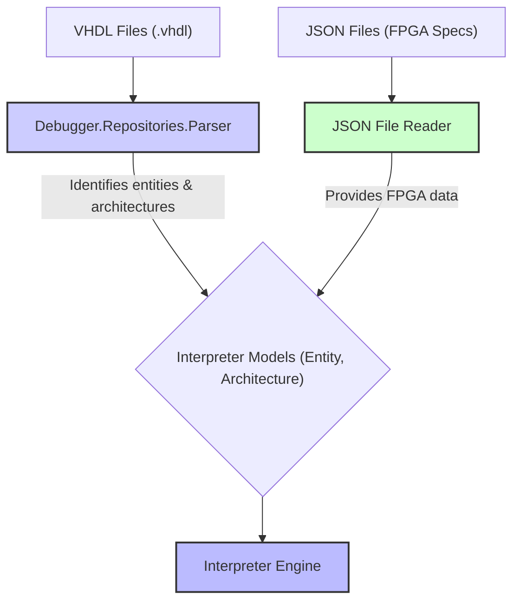

## 7. System Architecture

### 7.1 Platform-Specific Architecture

#### Multiplatform Deployment Strategy

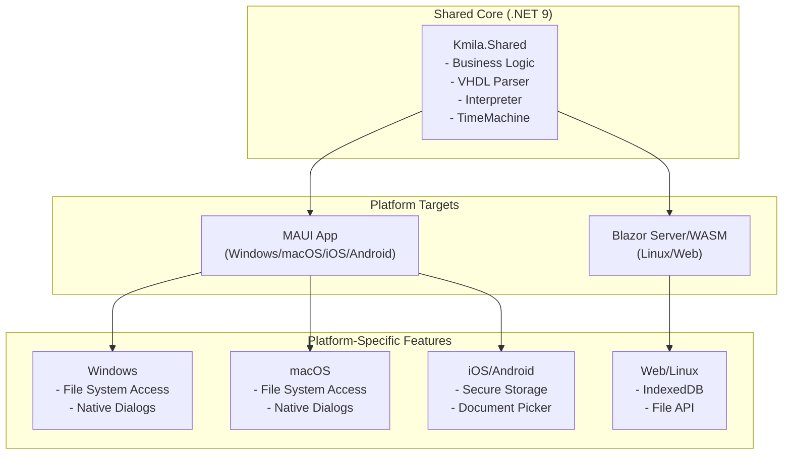

### 7.2 Component Architecture

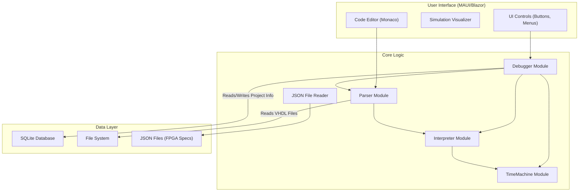

## 8. Application Diagrams

### 8.1 Use Case Diagram


### 8.2 Context Diagram

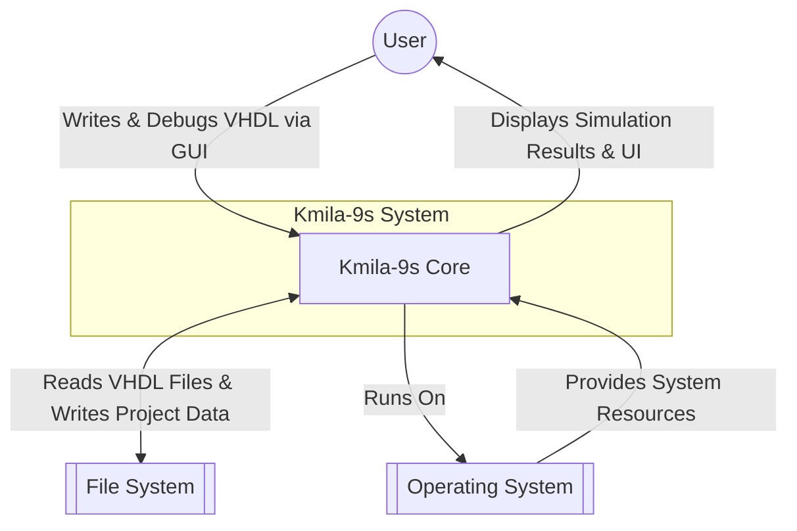

### 8.3 Deployment Diagram

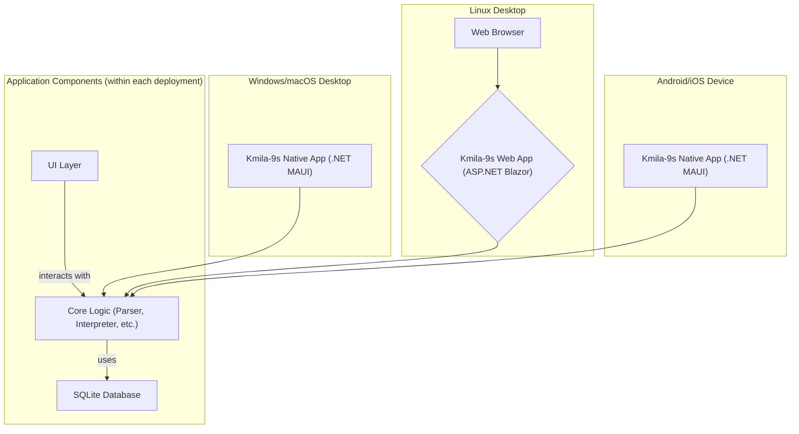

### 8.4 Base app diagram
```mermaid
graph TD

    user["Student/User<br>[External]"]
    file_system["File System<br>[External]"]
    operating_system["Operating System<br>[External]"]
    monaco_editor["Monaco Editor<br>/https://microsoft.github.io/monaco-editor/"]
    sqlite_db["SQLite Database<br>/https://www.sqlite.org/"]
    blazor_bootstrap["BlazorBootstrap Components<br>/https://blazorbootstrap.com/"]
    subgraph kmila_system_boundary["Kmila-9s System<br>/mnt/ssd1tb/Codigos/Kmila-9s/App/Kmila"]
        subgraph kmila_maui_app["Kmila (MAUI App)<br>/mnt/ssd1tb/Codigos/Kmila-9s/App/Kmila/Kmila"]
            maui_main_page["MainPage<br>/mnt/ssd1tb/Codigos/Kmila-9s/App/Kmila/Kmila/MainPage.xaml.cs"]
            maui_form_factor_service["FormFactor Service<br>/mnt/ssd1tb/Codigos/Kmila-9s/App/Kmila/Kmila/Services/FormFactor.cs"]
            %% Edges at this level (grouped by source)
            maui_main_page["MainPage<br>/mnt/ssd1tb/Codigos/Kmila-9s/App/Kmila/Kmila/MainPage.xaml.cs"] -->|"Uses"| maui_form_factor_service["FormFactor Service<br>/mnt/ssd1tb/Codigos/Kmila-9s/App/Kmila/Kmila/Services/FormFactor.cs"]
        end
        subgraph kmila_web_app["Kmila.Web (Blazor App)<br>/mnt/ssd1tb/Codigos/Kmila-9s/App/Kmila/Kmila.Web"]
            web_app_root["App.razor<br>/mnt/ssd1tb/Codigos/Kmila-9s/App/Kmila/Kmila.Web/Components/App.razor"]
            web_form_factor_service["FormFactor Service<br>/mnt/ssd1tb/Codigos/Kmila-9s/App/Kmila/Kmila.Web/Services/FormFactor.cs"]
            %% Edges at this level (grouped by source)
            web_app_root["App.razor<br>/mnt/ssd1tb/Codigos/Kmila-9s/App/Kmila/Kmila.Web/Components/App.razor"] -->|"Uses"| web_form_factor_service["FormFactor Service<br>/mnt/ssd1tb/Codigos/Kmila-9s/App/Kmila/Kmila.Web/Services/FormFactor.cs"]
        end
        subgraph kmila_shared_lib["Kmila.Shared (Shared Core)<br>/mnt/ssd1tb/Codigos/Kmila-9s/App/Kmila/Kmila.Shared"]
            vhdl_parser["VHDL Parser Module<br>/mnt/ssd1tb/Codigos/Kmila-9s/App/Kmila/Kmila.Shared/Services/ProgramBuilder.cs"]
            vhdl_interpreter["VHDL Interpreter Module<br>/mnt/ssd1tb/Codigos/Kmila-9s/App/Kmila/Kmila.Shared/Services/ProgramBuilder.cs"]
            debugger_module["Debugger Module<br>/mnt/ssd1tb/Codigos/Kmila-9s/App/Kmila/Kmila.Shared/Services/ProgramBuilder.cs"]
            time_machine_module["TimeMachine Module<br>/mnt/ssd1tb/Codigos/Kmila-9s/App/Kmila/Kmila.Shared/Services/ProgramBuilder.cs"]
            temporal_input_manager["Temporal Input Manager Module<br>/mnt/ssd1tb/Codigos/Kmila-9s/App/Kmila/Kmila.Shared/Services/ProgramBuilder.cs"]
            program_builder_service["ProgramBuilder Service<br>/mnt/ssd1tb/Codigos/Kmila-9s/App/Kmila/Kmila.Shared/Services/ProgramBuilder.cs"]
            projects_repo["Projects Repository<br>/mnt/ssd1tb/Codigos/Kmila-9s/App/Kmila/Kmila.Shared/Repositories/Projects.cs"]
            project_files_repo["ProjectFiles Repository<br>/mnt/ssd1tb/Codigos/Kmila-9s/App/Kmila/Kmila.Shared/Repositories/ProjectFiles.cs"]
            application_db_context["ApplicationDbContext<br>/mnt/ssd1tb/Codigos/Kmila-9s/App/Kmila/Kmila.Shared/Data/ApplicationDbContext.cs"]
            models["Data Models<br>/mnt/ssd1tb/Codigos/Kmila-9s/App/Kmila/Kmila.Shared/Models"]
            editor_page["Editor Page<br>/mnt/ssd1tb/Codigos/Kmila-9s/App/Kmila/Kmila.Shared/Pages/Editor.razor"]
            projects_view_page["Projects View Page<br>/mnt/ssd1tb/Codigos/Kmila-9s/App/Kmila/Kmila.Shared/Pages/ProjectsView.razor"]
            home_page["Home Page<br>/mnt/ssd1tb/Codigos/Kmila-9s/App/Kmila/Kmila.Shared/Pages/Home.razor"]
            create_file_modal["Create File Modal<br>/mnt/ssd1tb/Codigos/Kmila-9s/App/Kmila/Kmila.Shared/Modals/CreateFileModal.razor"]
            project_details_modal["Project Details Modal<br>/mnt/ssd1tb/Codigos/Kmila-9s/App/Kmila/Kmila.Shared/Modals/ProjectDetailsModal.razor"]
            nav_menu["NavMenu<br>/mnt/ssd1tb/Codigos/Kmila-9s/App/Kmila/Kmila.Shared/Layout/NavMenu.razor"]
            main_layout["MainLayout<br>/mnt/ssd1tb/Codigos/Kmila-9s/App/Kmila/Kmila.Shared/Layout/MainLayout.razor"]
            %% Edges at this level (grouped by source)
            editor_page["Editor Page<br>/mnt/ssd1tb/Codigos/Kmila-9s/App/Kmila/Kmila.Shared/Pages/Editor.razor"] -->|"Uses"| program_builder_service["ProgramBuilder Service<br>/mnt/ssd1tb/Codigos/Kmila-9s/App/Kmila/Kmila.Shared/Services/ProgramBuilder.cs"]
            editor_page["Editor Page<br>/mnt/ssd1tb/Codigos/Kmila-9s/App/Kmila/Kmila.Shared/Pages/Editor.razor"] -->|"Uses"| projects_repo["Projects Repository<br>/mnt/ssd1tb/Codigos/Kmila-9s/App/Kmila/Kmila.Shared/Repositories/Projects.cs"]
            editor_page["Editor Page<br>/mnt/ssd1tb/Codigos/Kmila-9s/App/Kmila/Kmila.Shared/Pages/Editor.razor"] -->|"Uses"| project_files_repo["ProjectFiles Repository<br>/mnt/ssd1tb/Codigos/Kmila-9s/App/Kmila/Kmila.Shared/Repositories/ProjectFiles.cs"]
            editor_page["Editor Page<br>/mnt/ssd1tb/Codigos/Kmila-9s/App/Kmila/Kmila.Shared/Pages/Editor.razor"] -->|"Opens"| create_file_modal["Create File Modal<br>/mnt/ssd1tb/Codigos/Kmila-9s/App/Kmila/Kmila.Shared/Modals/CreateFileModal.razor"]
            projects_view_page["Projects View Page<br>/mnt/ssd1tb/Codigos/Kmila-9s/App/Kmila/Kmila.Shared/Pages/ProjectsView.razor"] -->|"Uses"| projects_repo["Projects Repository<br>/mnt/ssd1tb/Codigos/Kmila-9s/App/Kmila/Kmila.Shared/Repositories/Projects.cs"]
            projects_view_page["Projects View Page<br>/mnt/ssd1tb/Codigos/Kmila-9s/App/Kmila/Kmila.Shared/Pages/ProjectsView.razor"] -->|"Opens"| project_details_modal["Project Details Modal<br>/mnt/ssd1tb/Codigos/Kmila-9s/App/Kmila/Kmila.Shared/Modals/ProjectDetailsModal.razor"]
            program_builder_service["ProgramBuilder Service<br>/mnt/ssd1tb/Codigos/Kmila-9s/App/Kmila/Kmila.Shared/Services/ProgramBuilder.cs"] -->|"Uses"| vhdl_parser["VHDL Parser Module<br>/mnt/ssd1tb/Codigos/Kmila-9s/App/Kmila/Kmila.Shared/Services/ProgramBuilder.cs"]
            program_builder_service["ProgramBuilder Service<br>/mnt/ssd1tb/Codigos/Kmila-9s/App/Kmila/Kmila.Shared/Services/ProgramBuilder.cs"] -->|"Uses"| vhdl_interpreter["VHDL Interpreter Module<br>/mnt/ssd1tb/Codigos/Kmila-9s/App/Kmila/Kmila.Shared/Services/ProgramBuilder.cs"]
            program_builder_service["ProgramBuilder Service<br>/mnt/ssd1tb/Codigos/Kmila-9s/App/Kmila/Kmila.Shared/Services/ProgramBuilder.cs"] -->|"Uses"| debugger_module["Debugger Module<br>/mnt/ssd1tb/Codigos/Kmila-9s/App/Kmila/Kmila.Shared/Services/ProgramBuilder.cs"]
            program_builder_service["ProgramBuilder Service<br>/mnt/ssd1tb/Codigos/Kmila-9s/App/Kmila/Kmila.Shared/Services/ProgramBuilder.cs"] -->|"Uses"| time_machine_module["TimeMachine Module<br>/mnt/ssd1tb/Codigos/Kmila-9s/App/Kmila/Kmila.Shared/Services/ProgramBuilder.cs"]
            program_builder_service["ProgramBuilder Service<br>/mnt/ssd1tb/Codigos/Kmila-9s/App/Kmila/Kmila.Shared/Services/ProgramBuilder.cs"] -->|"Uses"| temporal_input_manager["Temporal Input Manager Module<br>/mnt/ssd1tb/Codigos/Kmila-9s/App/Kmila/Kmila.Shared/Services/ProgramBuilder.cs"]
            vhdl_interpreter["VHDL Interpreter Module<br>/mnt/ssd1tb/Codigos/Kmila-9s/App/Kmila/Kmila.Shared/Services/ProgramBuilder.cs"] -->|"Updates"| time_machine_module["TimeMachine Module<br>/mnt/ssd1tb/Codigos/Kmila-9s/App/Kmila/Kmila.Shared/Services/ProgramBuilder.cs"]
            debugger_module["Debugger Module<br>/mnt/ssd1tb/Codigos/Kmila-9s/App/Kmila/Kmila.Shared/Services/ProgramBuilder.cs"] -->|"Uses"| vhdl_parser["VHDL Parser Module<br>/mnt/ssd1tb/Codigos/Kmila-9s/App/Kmila/Kmila.Shared/Services/ProgramBuilder.cs"]
            debugger_module["Debugger Module<br>/mnt/ssd1tb/Codigos/Kmila-9s/App/Kmila/Kmila.Shared/Services/ProgramBuilder.cs"] -->|"Uses"| vhdl_interpreter["VHDL Interpreter Module<br>/mnt/ssd1tb/Codigos/Kmila-9s/App/Kmila/Kmila.Shared/Services/ProgramBuilder.cs"]
            debugger_module["Debugger Module<br>/mnt/ssd1tb/Codigos/Kmila-9s/App/Kmila/Kmila.Shared/Services/ProgramBuilder.cs"] -->|"Uses"| time_machine_module["TimeMachine Module<br>/mnt/ssd1tb/Codigos/Kmila-9s/App/Kmila/Kmila.Shared/Services/ProgramBuilder.cs"]
            projects_repo["Projects Repository<br>/mnt/ssd1tb/Codigos/Kmila-9s/App/Kmila/Kmila.Shared/Repositories/Projects.cs"] -->|"Uses"| application_db_context["ApplicationDbContext<br>/mnt/ssd1tb/Codigos/Kmila-9s/App/Kmila/Kmila.Shared/Data/ApplicationDbContext.cs"]
            project_files_repo["ProjectFiles Repository<br>/mnt/ssd1tb/Codigos/Kmila-9s/App/Kmila/Kmila.Shared/Repositories/ProjectFiles.cs"] -->|"Uses"| application_db_context["ApplicationDbContext<br>/mnt/ssd1tb/Codigos/Kmila-9s/App/Kmila/Kmila.Shared/Data/ApplicationDbContext.cs"]
            application_db_context["ApplicationDbContext<br>/mnt/ssd1tb/Codigos/Kmila-9s/App/Kmila/Kmila.Shared/Data/ApplicationDbContext.cs"] -->|"Manages"| models["Data Models<br>/mnt/ssd1tb/Codigos/Kmila-9s/App/Kmila/Kmila.Shared/Models"]
        end
        %% Edges at this level (grouped by source)
        maui_main_page["MainPage<br>/mnt/ssd1tb/Codigos/Kmila-9s/App/Kmila/Kmila/MainPage.xaml.cs"] -->|"Hosts"| editor_page["Editor Page<br>/mnt/ssd1tb/Codigos/Kmila-9s/App/Kmila/Kmila.Shared/Pages/Editor.razor"]
        maui_main_page["MainPage<br>/mnt/ssd1tb/Codigos/Kmila-9s/App/Kmila/Kmila/MainPage.xaml.cs"] -->|"Hosts"| projects_view_page["Projects View Page<br>/mnt/ssd1tb/Codigos/Kmila-9s/App/Kmila/Kmila.Shared/Pages/ProjectsView.razor"]
        maui_main_page["MainPage<br>/mnt/ssd1tb/Codigos/Kmila-9s/App/Kmila/Kmila/MainPage.xaml.cs"] -->|"Hosts"| home_page["Home Page<br>/mnt/ssd1tb/Codigos/Kmila-9s/App/Kmila/Kmila.Shared/Pages/Home.razor"]
        maui_main_page["MainPage<br>/mnt/ssd1tb/Codigos/Kmila-9s/App/Kmila/Kmila/MainPage.xaml.cs"] -->|"Hosts"| nav_menu["NavMenu<br>/mnt/ssd1tb/Codigos/Kmila-9s/App/Kmila/Kmila.Shared/Layout/NavMenu.razor"]
        maui_main_page["MainPage<br>/mnt/ssd1tb/Codigos/Kmila-9s/App/Kmila/Kmila/MainPage.xaml.cs"] -->|"Hosts"| main_layout["MainLayout<br>/mnt/ssd1tb/Codigos/Kmila-9s/App/Kmila/Kmila.Shared/Layout/MainLayout.razor"]
        web_app_root["App.razor<br>/mnt/ssd1tb/Codigos/Kmila-9s/App/Kmila/Kmila.Web/Components/App.razor"] -->|"Hosts"| editor_page["Editor Page<br>/mnt/ssd1tb/Codigos/Kmila-9s/App/Kmila/Kmila.Shared/Pages/Editor.razor"]
        web_app_root["App.razor<br>/mnt/ssd1tb/Codigos/Kmila-9s/App/Kmila/Kmila.Web/Components/App.razor"] -->|"Hosts"| projects_view_page["Projects View Page<br>/mnt/ssd1tb/Codigos/Kmila-9s/App/Kmila/Kmila.Shared/Pages/ProjectsView.razor"]
        web_app_root["App.razor<br>/mnt/ssd1tb/Codigos/Kmila-9s/App/Kmila/Kmila.Web/Components/App.razor"] -->|"Hosts"| home_page["Home Page<br>/mnt/ssd1tb/Codigos/Kmila-9s/App/Kmila/Kmila.Shared/Pages/Home.razor"]
        web_app_root["App.razor<br>/mnt/ssd1tb/Codigos/Kmila-9s/App/Kmila/Kmila.Web/Components/App.razor"] -->|"Hosts"| nav_menu["NavMenu<br>/mnt/ssd1tb/Codigos/Kmila-9s/App/Kmila/Kmila.Shared/Layout/NavMenu.razor"]
        web_app_root["App.razor<br>/mnt/ssd1tb/Codigos/Kmila-9s/App/Kmila/Kmila.Web/Components/App.razor"] -->|"Hosts"| main_layout["MainLayout<br>/mnt/ssd1tb/Codigos/Kmila-9s/App/Kmila/Kmila.Shared/Layout/MainLayout.razor"]
    end
    %% Edges at this level (grouped by source)
    user["Student/User<br>[External]"] -->|"Interacts with"| maui_main_page["MainPage<br>/mnt/ssd1tb/Codigos/Kmila-9s/App/Kmila/Kmila/MainPage.xaml.cs"]
    user["Student/User<br>[External]"] -->|"Interacts with"| web_app_root["App.razor<br>/mnt/ssd1tb/Codigos/Kmila-9s/App/Kmila/Kmila.Web/Components/App.razor"]
    editor_page["Editor Page<br>/mnt/ssd1tb/Codigos/Kmila-9s/App/Kmila/Kmila.Shared/Pages/Editor.razor"] -->|"Embeds | JavaScript Interop"| monaco_editor["Monaco Editor<br>/https://microsoft.github.io/monaco-editor/"]
    editor_page["Editor Page<br>/mnt/ssd1tb/Codigos/Kmila-9s/App/Kmila/Kmila.Shared/Pages/Editor.razor"] -->|"Uses"| blazor_bootstrap["BlazorBootstrap Components<br>/https://blazorbootstrap.com/"]
    projects_view_page["Projects View Page<br>/mnt/ssd1tb/Codigos/Kmila-9s/App/Kmila/Kmila.Shared/Pages/ProjectsView.razor"] -->|"Uses"| blazor_bootstrap["BlazorBootstrap Components<br>/https://blazorbootstrap.com/"]
    vhdl_parser["VHDL Parser Module<br>/mnt/ssd1tb/Codigos/Kmila-9s/App/Kmila/Kmila.Shared/Services/ProgramBuilder.cs"] -->|"Reads | VHDL Files"| file_system["File System<br>[External]"]
    application_db_context["ApplicationDbContext<br>/mnt/ssd1tb/Codigos/Kmila-9s/App/Kmila/Kmila.Shared/Data/ApplicationDbContext.cs"] -->|"Connects to"| sqlite_db["SQLite Database<br>/https://www.sqlite.org/"]
    kmila_maui_app["Kmila (MAUI App)<br>/mnt/ssd1tb/Codigos/Kmila-9s/App/Kmila/Kmila"] -->|"Runs On"| operating_system["Operating System<br>[External]"]
    kmila_maui_app["Kmila (MAUI App)<br>/mnt/ssd1tb/Codigos/Kmila-9s/App/Kmila/Kmila"] -->|"Accesses"| file_system["File System<br>[External]"]
    kmila_web_app["Kmila.Web (Blazor App)<br>/mnt/ssd1tb/Codigos/Kmila-9s/App/Kmila/Kmila.Web"] -->|"Runs On"| operating_system["Operating System<br>[External]"]
    kmila_web_app["Kmila.Web (Blazor App)<br>/mnt/ssd1tb/Codigos/Kmila-9s/App/Kmila/Kmila.Web"] -->|"Accesses"| file_system["File System<br>[External]"]

```
---
*Generated by [CodeViz.ai](https://codeviz.ai) on 11/6/2025, 4:00:52 PM*


## 9. Database Schema

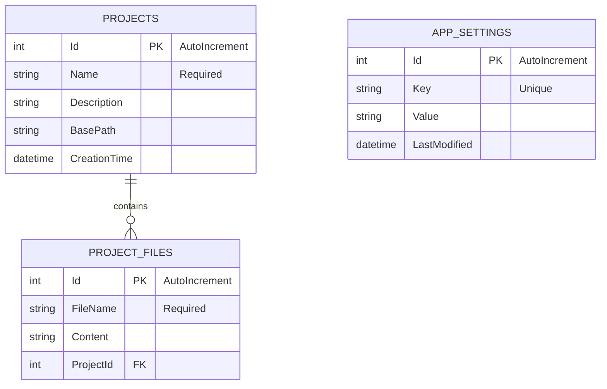
**Note:** The following entities from the original documentation are NOT currently implemented:
- SIMULATION_CONFIGS (simulation parameters are passed at runtime, not persisted)
- PORT_CONFIGURATIONS (managed in-memory during simulation)
- PORT_MOMENTS (handled by PortMoment model but not persisted to DB)
- SIMULATION_RESULTS (not implemented)
- BREAKPOINTS (not implemented)

## 10. Shared Project Structure

The `Kmila.Shared` project contains the core logic, UI components, and data models for the Kmila-9s application.

### 10.1 Views and UI Components

> **Note — April 2026 redesign.** The UI went through a design-system rewrite: token-driven CSS (`wwwroot/css/tokens.css` + `pages.css`), first-class dark mode, custom sidebar & topbar replacing Blazor Bootstrap's `Sidebar2`, a bento-grid Projects page, a workbench-style Editor with run-bar + dock + status-bar, and a full set of new Settings / Logs pages. The former `SimulationParametersModal`, `ButtonCollapse`, `FPGATabContent`, `ConfigTabContent`, `RunTabContent`, `BuildProgressDisplay`, `PortMomentExtraInputs`, and `EnhancedRangeSlider` were removed — their responsibilities live in the new components below.

#### Pages
*   **Home.razor** — Landing page: hero band with logo lockup + primary CTA, overview copy, features bento grid (six cards with size variation), closing CTA panel.
*   **ProjectsView.razor** — Project list as responsive card grid (auto-fill at 280px track). Header with live search, count pill, primary **Create new** CTA and ghost **Try a sample** CTA. Empty / no-match states. Per-project hover reveal of Open + Delete kebab (Rename inline). `/projects/create` route auto-opens the create modal.
*   **Editor.razor** — Workbench: Monaco at top, **RunBar** (build / run state machine + time + scale + FPGA chip), **EditorDock** (7 tabs: Entities · Schematic · Ports · Waveforms · Runs · Files · Output), **StatusBar**. Handles per-project reload via `OnParametersSetAsync`, marshals `ProgramBuilder` events into `SimulationParameters` + `BuildLog`, auto-switches the active dock tab on build/run transitions.
*   **Learn.razor** — Lesson catalog. Reads from `LessonCatalog`, paints lesson cards with progress badges sourced from `LessonProgressStore`. Entry point for the in-app teaching path that complements the interactive editor.
*   **LessonView.razor** — Per-lesson reader. Renders Markdown content via `MarkdownRenderer`, marks completion in `LessonProgressStore`, and links back to a sample editor session when a lesson has an associated VHDL exercise.
*   **Settings.razor** — Skeleton preference surface with four token-styled cards (Appearance, Editor, Simulation, Diagnostics). Diagnostics card links to the Logs viewer.
*   **Logs.razor** — Live viewer over `AppLogStore`. Search (message + category), level filter (All / Info+ / Warning+ / Error+), auto-scroll, pause, clear. Renders up to 500 recent entries out of a 2000-entry ring buffer.

#### Components
*   **Breadcrumbs.razor** — Live breadcrumb trail rendered inside the TopBar. Walks `NavigationManager.Uri` for `/`, `/projects`, `/projects/create`, `/editor/{id}`; for editor routes, looks up the project name. Re-renders on `LocationChanged` + `StaticOnLangChanged`. Truncates to last 2 crumbs under 641 px.
*   **ConfigurationsPill.razor** — TopBar dropdown for named simulation configs. Pill trigger shows current name with a warning-dot when `SimulationParameters.IsDirty`. Popover lists saved configs with checkmark on the active one and a hover-reveal delete; actions include Save changes, inline Save as, and deleting by name. All round-trips through `ConfigurationService`.
*   **EditorDock.razor** — Bottom dock on the Editor page. Tab strip with seven slots (Entities · Schematic · Ports · Waveforms · Runs · Files · Output) rendered via named `RenderFragment` parameters and driven by `EditorTab` enum entries. Collapse toggle at the far end, per-tab count pills (Entities, Files, Runs) or ready dots (Waveforms, Output). Active tab + collapsed state + dock height persisted via `EditorDockState` service + `localStorage`.
*   **EditorTabStrip.razor** — Standalone strip extracted from the dock so the same tab UI can render outside the Editor page when needed (e.g. landing previews of the workbench layout).
*   **EnhancedRangeSlider.razor** — Token-styled dual-thumb range slider component used by the time / scale controls and the schematic zoom UI; handles touch + keyboard parity.
*   **RunsPanel.razor** — Content for the **Runs** dock tab. Lists past simulation snapshots saved through `SimulationSnapshotStore`, exposes "Re-run", "Compare", and "Delete" affordances per row.
*   **SchematicViewer.razor** (+ `Schematic/` sub-components) — Renders the layered netlist returned by `LayeredLayout.Layout(Netlist)` as an SVG schematic. Supports per-net highlighting on hover, port-pin labelling, and synchronised cursor selection through `SignalCursorBus` (so clicking a wire highlights the matching trace in `WaveformViewer`).
*   **EntityResourceUsage.razor** — FPGA resource estimate for an entity. Bento grid of `ResourceMetricBox` cards (FF / LUT / DSP / BRAM / I/O / Clock Domains) with a tokenized info note about estimation accuracy.
*   **EntityView.razor** — Parsed-entity panel. VHDL-syntax-flavored title (`entity <name> is`), port-count chips, compact signal list replacing the former BB Grid. `Current Value` column appears only once the simulation has run.
*   **FilesCard.razor** — Project files list (no BB Grid). Row-per-file: tinted icon tile → mono filename → type chip → inline ghost **Open** → kebab menu with **Rename** (inline edit) + **Delete** (with confirm dialog). Active row gets a left-edge accent bar.
*   **FPGASimpleView.razor** — Compact FPGA-info widget (unchanged).
*   **KmilaThemeSwitcher.razor** — Custom theme dropdown (`<details>` popover). Light / Dark / Auto, with `auto` resolving via `matchMedia`. Persists to `localStorage['kmila-theme']` so the inline `<head>` boot script avoids flash-of-wrong-theme on reload. Mirrors choice into SQLite for future native surfaces.
*   **LanguageChanger.razor** — Rebuilt `<details>` popover matching the FPGA/theme picker pattern. Flags via mono code badges. Pushes the new code into `localStorage` and `window.kmilaCurrentDocsLang` so the Monaco VHDL hover / completion providers translate instantly.
*   **OutputPanel.razor** — Output dock-tab content. Reads from `BuildLog`. Colored rows (info/success/warning/danger) with timestamp, icon, mono message. ARIA live-region so screen readers announce new errors.
*   **PortMomentInput.razor** — Per-IN-port timeline editor. Rebuilt with no off-canvas drawer and no base/extras split: a single flat moments list with a read-only SVG timeline strip above and inline editable rows (time · scale · value · ×) below. Per-datatype value validation with char-whitelisting, maxlength, and a "N/M" counter for vectors. Clock mode replaces the list with a dashed-border info strip.
*   **PortsPanel.razor** — Content for the **Ports** dock tab. Groups `PortMomentInput` instances by entity, sources time / scale / running from `SimulationParameters`, writes port moments back into the service. Dual empty states ("Build first" or "No input ports").
*   **ResourceMetricBox.razor** — Tokenized metric card. Icon chip + mono number + unit + accuracy pill. Variant driven by a semantic (`primary` / `success` / `warning` / `danger` / `info` / `neutral`) that maps to token colors for both light and dark themes.
*   **ResourceProgressBar.razor** — Slim pill-shaped progress bar with four color tiers (success 0–59 %, info 60–79, warning 80–99, danger 100+). Danger tier uses a pulsing diagonal-stripe fill for visual urgency without being obnoxious.
*   **RunBar.razor** — Horizontal strip between Monaco and the dock. FPGA reference chip · time number input + scale select · secondary **Build** · primary **Run** with state machine (Idle → Building… → Pause/Stop → Resume → Run again) · overflow menu (Save · New file). Progress line animates under the bar while running.
*   **StatusBar.razor** — Thin bottom bar. File info (unsaved dot · mono filename · Ln/Col · language chip) on the left; build status chip + resource % of selected FPGA + sim status chip on the right. Build/resource chips are clickable and jump to the matching dock tab.
*   **WaveformViewer.razor** — Digital-waveform chart per signal via Chart.js (largely unchanged content; chrome tokenized).

#### Layout
*   **MainLayout.razor** — Shell: mounts `NavMenu` + `TopBar` + content article. Applies `.content--wide` when the current route is `/editor/…` so the workbench fills the full viewport (ordinary pages keep the 1440 px reading cap). Subscribes to `NavigationManager.LocationChanged` so the class flips immediately on navigation.
*   **NavMenu.razor** — Custom-built sidebar (no BB `Sidebar2`). Logo lockup + version chip, three sections: **Workspace** (Projects / New), **Your projects** (live list with counts, auto-refreshes on `Projects.OnListChanged`), and **System** (Settings · Logs). Collapsible to an icons-only rail on desktop; off-canvas drawer on mobile via `SidebarState` service.
*   **TopBar.razor** — Hamburger (mobile) · breadcrumbs · Configurations pill · FPGA picker · language · theme. All `<details>` popovers auto-close on outside-click / Escape via a global handler in the inline `<head>` script.

#### Modals
*   **ConfigurationModal.razor** — Kept as the "Manage configs" power surface — reachable from future "Manage…" entry on the Configurations pill. Handles save / load / delete / export / import of `.k-config` files.
*   **CreateFileModal.razor** — Create-file form.
*   **MarkdownModal.razor** — Markdown preview triggered when **Build** runs against a `.md` file.
*   **ProjectDetailsModal.razor** — Create-project form. Cleaner labeled inputs with a live sanitised-folder-name preview (the disk path that will hold the project).

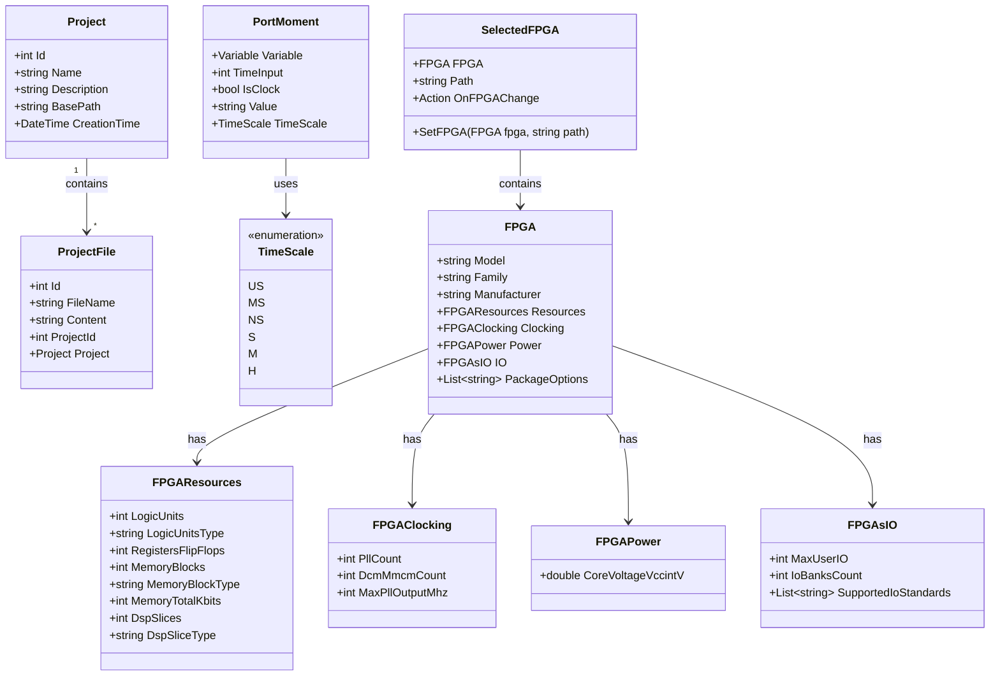

### 10.2 Backend and Logic

#### Services
*   **ProgramBuilder.cs** — Builds + simulates VHDL using Debugger / TimeMachine / Interpreter. Accepts both `.vhd` and `.vhdl`. Exposes `OnSimulationCompleted`, `OnSimulationEnded`, `OnProgressAdvanced`, `OnBuildError` events that the Editor page marshals to UI state.
*   **ConfigurationService.cs** — Save / load / delete of named simulation configs (.k-config semantics, stored in SQLite). Fires `OnConfigurationsChanged` so the `ConfigurationsPill` auto-refreshes its list.
*   **Traductor.cs** — i18n service with 7 languages. Reactive reload on `AppSettings.KEY_LANGUAGE` change via `ApplicationDbContext.StaticOnValueChanged`. Supports optional `ILogger<Traductor>` injection.
*   **IFormFactor.cs** — Interface for device form factor / platform detection.
*   **EditorSessionStore.cs** — Persists per-project editor session state (open file, scroll/cursor position, dock layout) so reopening a project restores the workbench exactly where the student left it.
*   **RecentProjectsTracker.cs** — Bounded MRU of recently opened projects, surfaced on Home and ProjectsView. Trims when the cap is reached.
*   **ProjectBundleService.cs** — Export/import of full project bundles (project + files + active configuration) for sharing assignments between students or handing in homework.
*   **UserAssetStore.cs** — Filesystem abstraction for user-supplied assets (custom VHDL packages, lesson attachments, exported waveforms). Centralises path resolution across MAUI / Web hosts.
*   **WaveformExporter.cs** — Renders the current `SignalHistory` to `.vcd`, `.csv`, or formatted text for handoff to GTKWave or external tooling.
*   **SimulationSnapshotStore.cs** — Persists past simulation runs (signals, ports, time bounds) so the Runs dock tab can show history and the Compare action can diff them.
*   **StimulusBuilder.cs** — Translates the editor's port-moments timeline into the `List<StimulusEvent>` shape that `Interpreter.Models.SimulationConfig` expects, including expansion of clock-mode ports into auto-toggling `ClockConfig`s.
*   **SignalCursorBus.cs** — Cross-component event bus for "selected signal" + "cursor at time T" so `WaveformViewer`, `SchematicViewer`, and `PortsPanel` stay synchronised on hover/click without component-to-component wiring.
*   **MarkdownRenderer.cs** — Markdown → HTML rendering for `LessonView` and `MarkdownModal`. Sanitised; respects the active language so code-fence labels translate.
*   **LessonCatalog.cs** — In-memory catalog of bundled lessons. Read on app start; consumed by `Learn.razor`.
*   **LessonProgressStore.cs** — Per-user lesson progress flags persisted in SQLite. Used by Learn / LessonView for badges and the "Continue where you left off" CTA on Home.
*   **AutoErrorReporter.cs** — Hooks into `AppDomain.CurrentDomain.UnhandledException` and Blazor circuit error events; routes serialised reports through `FeedbackHelper`.
*   **FeedbackHelper.cs** — Glue for the user-feedback flow: opens GitHub issue templates pre-filled with environment + recent log lines from `AppLogStore`.
*   **GitHubAuth.cs** — Optional sign-in helper for the feedback path; used to attach an authenticated identity to issue submissions when the user opts in.
*   **ConsoleToLoggerWriter.cs** — Redirects raw `Console.Out` writes (used by older parser/interpreter paths) into `ILogger<T>` so they end up in the Logs page alongside structured logs.

**UI state services (shared across components — avoid component → component wiring):**
*   **SidebarState.cs** — Drives the custom sidebar: `IsCollapsed` (desktop rail mode) + `IsMobileOpen` (off-canvas drawer). TopBar hamburger toggles the drawer, sidebar subscribes for re-render.
*   **EditorDockState.cs** — Active tab (`EditorTab` enum) + collapsed flag. Persisted to `localStorage` by `EditorDock`. Other components (Editor, RunBar) call `SetActive` to auto-focus the right tab on build/run transitions.
*   **SimulationParameters.cs** — The Run-bar state machine in service form. Fields: `Time`, `Scale`, `State` (`SimState` enum: Idle / Building / BuiltOk / BuildError / Running / Paused / Complete), `Progress`, `PortMoments`, `LoadedName`, `IsDirty`. Any mutation of time / scale / port moments flips `IsDirty` so the Configurations pill shows its yellow marker. `GetPortMomentsForRun()` returns port moments minus empty-value rows (kept in-buffer for the UI but dropped before being handed to `ProgramBuilder`).
*   **BuildLog.cs** — Bounded in-memory log for the **Output** dock tab. Entries carry a `BuildLogLevel` (Info / Success / Warn / Error) — named distinctly from `Microsoft.Extensions.Logging.LogLevel` to avoid clashing with the broader in-app logger below.
*   **AppLogStore.cs** — Thread-safe ring buffer of `AppLogEntry` (timestamp + `LogLevel` + category + message + exception). Backs the `/logs` page. Max 2000 entries, trims oldest when full.
*   **InMemoryLoggerProvider.cs** — Registers as an `ILoggerProvider` in both Web and MAUI startup. Every `ILogger<T>` write anywhere in the app fans out to Console + `AppLogStore` so diagnostics show up in the in-app Logs viewer without requiring a terminal (critical for mobile builds).

#### Repositories
*   **Projects.cs** — CRUD on projects. Fires `OnListChanged` after every successful Create / Remove / Update so the sidebar & Projects page stay in sync without polling.
*   **ProjectFiles.cs** — CRUD on files. Implements real `RemoveAsync` (deletes DB row + disk file) and `RenameAsync` (disk rename + DB update, duplicate-name refused).
*   **JSONFileReader.cs** — Reads FPGA device specs from JSON. Two constructors — one for ASP.NET Core (IWebHostEnvironment), one for MAUI (package-open delegate). Optional `ILogger<JSONFileReader>` injection.

#### Models
*   **Project.cs**: Represents a project in the application
*   **ProjectFile.cs**: Represents a file in a project
*   **PortMoment.cs**: Represents a moment when a port changes value
*   **TimeScale.cs**: Enumeration defining simulation time scales
*   **ToastMessages.cs**: Utility class for creating toast messages
*   **SelectedFPGA.cs**: State management for selected FPGA device with change notifications
*   **FPGA.cs**: Main FPGA device model containing all device specifications
*   **FPGAResources.cs**: FPGA resource specifications (Logic Units, Registers, Memory, DSP)
*   **FPGAClocking.cs**: FPGA clocking specifications (PLL, DCM/MMCM)
*   **FPGAPower.cs**: FPGA power specifications (Core voltage)
*   **FPGAsIO.cs**: FPGA I/O specifications (User I/O, Banks, Standards)
*   **AppSettings.cs**: Key-value pairs for application settings stored in SQLite (language preferences, theme, etc.)
*   **KmilaConfiguration.cs**: Simulation configuration model for .k-config files (FPGA settings, time configuration, port moments)
```mermaid
graph TD
    subgraph "UI Layer"
        Home[Home.razor]
        ProjectsView[ProjectsView.razor]
        Editor[Editor.razor]
        Settings[Settings.razor]
        Logs[Logs.razor]
        RunBar[RunBar.razor]
        EditorDock[EditorDock.razor]
        StatusBar[StatusBar.razor]
        TopBar[TopBar.razor]
        NavMenu[NavMenu.razor]
    end

    subgraph "UI State Services"
        SimState[SimulationParameters]
        DockState[EditorDockState]
        SidebarState[SidebarState]
        BuildLog[BuildLog]
        AppLog[AppLogStore]
    end

    subgraph "Business Services"
        ProgramBuilder[ProgramBuilder]
        ConfigService[ConfigurationService]
        Traductor[Traductor i18n]
    end

    subgraph "Repository Layer"
        ProjectsRepo[Projects]
        ProjectFilesRepo[ProjectFiles]
        JSONFileReader[JSONFileReader]
    end

    subgraph "Data Layer"
        AppDbContext[ApplicationDbContext]
        SQLite[(SQLite)]
        JSONFiles[(JSON device specs)]
    end

    subgraph "External"
        DebuggerParser[Debugger.Parser]
        TimeMachine[TimeMachine]
        Interpreter[Interpreter]
        InMemLog[InMemoryLoggerProvider]
    end

    NavMenu --> SidebarState
    TopBar  --> SidebarState
    TopBar  --> ConfigService

    Editor --> RunBar
    Editor --> EditorDock
    Editor --> StatusBar
    Editor --> ProgramBuilder
    Editor --> SimState
    Editor --> BuildLog
    Editor --> DockState

    RunBar     --> SimState
    StatusBar  --> SimState
    StatusBar  --> DockState
    EditorDock --> DockState

    ProgramBuilder --> DebuggerParser
    ProgramBuilder --> TimeMachine
    ProgramBuilder --> Interpreter

    ProjectsView  --> ProjectsRepo
    ProjectsRepo  --> AppDbContext
    ProjectFilesRepo --> AppDbContext
    ConfigService --> AppDbContext
    Traductor     --> JSONFiles
    JSONFileReader --> JSONFiles
    AppDbContext  --> SQLite

    InMemLog -.->|captures ILogger writes| AppLog
    Logs     --> AppLog
```
### 10.3 Component Interactions

The core Build → Run loop after the April 2026 redesign. `RunBar` owns the user-facing button state; `Editor` is the orchestrator; `SimulationParameters` and `EditorDockState` are the shared state that makes it all reactive without prop-drilling.

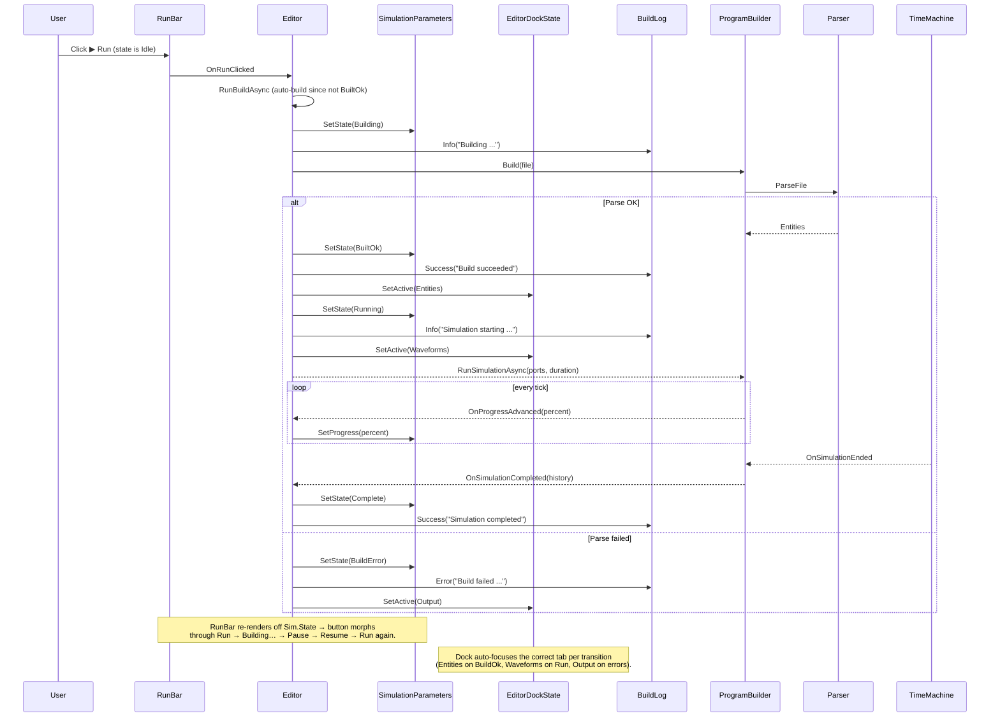

A simpler view of pause / stop:

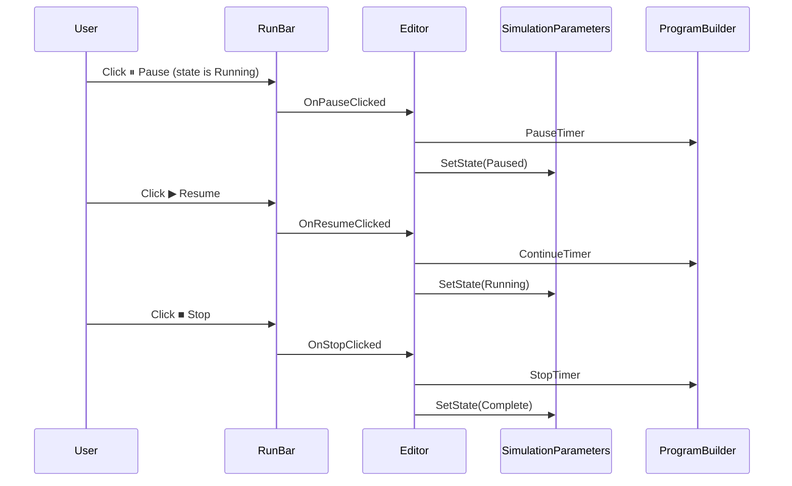

## 11. Implementation Details

### 11.1 File System Abstraction

The application implements platform-specific file handling through an abstraction layer:

```csharp
public interface IFileSystem
{
    Task<string> ReadFileAsync(string path);
    Task WriteFileAsync(string path, string content);
    Task<IEnumerable<string>> GetFilesAsync(string directory);
    bool FileExists(string path);
}
```

*   **Desktop (Windows/macOS)**: Direct file system access
*   **Mobile (iOS/Android)**: Secure storage and document picker
*   **Web (Linux/Browser)**: IndexedDB via JavaScript interop

### 11.2 Performance Optimization

#### Memory Management
*   Token pooling to reduce GC pressure
*   Lazy AST node creation
*   String interning for identifiers
*   Expression result caching
*   Delta compression for state storage

#### Platform-Specific Optimizations
*   **Desktop**: Parallel processing for multiple VHDL processes
*   **Mobile**: Memory-efficient single-threaded execution with UI yielding
*   **Web**: Web Workers via JavaScript interop for background processing

### 11.3 Simulation Tick Resolution (important note)

> **Heads-up — fixed-tick Nyquist limit.** The batch simulator advances in
> discrete ticks. By default one tick is `TimeClock.NS_PER_TICK = 10 ns`,
> which means the fastest clock the engine can represent without aliasing
> is **50 MHz** (two ticks per period = 20 ns period). Any clock frequency
> above ~50 MHz — whether it comes from the Run-bar override or from the
> selected FPGA's PLL default — gets clamped by `Math.Max(1, …)` on the
> half-period calculation and ends up toggling every single tick, which
> is indistinguishable from 50 MHz in the waveform. In other words,
> configuring a 100 MHz clock and a 200 MHz clock both render the same
> square wave.

This is a fundamental consequence of discrete-time simulation, not a bug
in the injector. Finer time resolution is available as a user preference
in **Settings → Simulation → Tick resolution**:

| Mode | Tick | Max faithful clock | Cost per run | When to use |
|------|------|-------------------|--------------|-------------|
| **Default** (baseline) | 10 ns | 50 MHz | Fastest, lowest memory | Learning-oriented / 50 MHz-class designs — matches every lesson and snapshot captured before v1.14.x |
| **High precision** | 1 ns | 500 MHz | ~10× tick count: ~10× slower, ~10× more `SignalHistory` memory | Accurately visualising 100 MHz+ clocks, fine-grained propagation delays |
| **Adaptive** (auto) | computed per-run from the effective clock frequency | matches the clock | Only pays the precision cost for runs that actually need it | Recommended for most users once validated — fast for slow designs, accurate for fast ones |

Default mode is preserved for backwards compatibility: existing projects,
lessons, and `SimulationSnapshot` JSON blobs all encode tick counts
against the 10 ns scale, so switching a saved run to a finer resolution
would re-scale its time axis. The preference is persisted globally
through `AppSettings` (key `KMILA_TICK_RESOLUTION_MODE`) and read at
`ProgramBuilder.RunSimulationAsync` time, so changing the mode takes
effect on the next Run — no app restart required.

**Implementation:** `StimulusBuilder.BuildConfig` already takes
`tickResNs` as a parameter. The mode only changes how that parameter is
computed upstream — the simulator itself is agnostic to the value and
just counts ticks. `WaveformData.FromSignalHistory` is called with the
same `tickResNs` so time labels on the waveform stay truthful.

## 12. Testing Strategy

### Test Coverage Areas

*   **Unit Tests**: Tokenizer, Parser, Interpreter, Expression Evaluator
*   **Integration Tests**: Parser-Interpreter, TimeMachine, Input Manager integration
*   **E2E Tests**: Full simulation workflows, UI workflows, platform-specific features
*   **Performance Tests**: Load testing, memory profiling, benchmarks

## 13. Security Considerations

*   **Input Validation**: All VHDL input is sanitized and validated before parsing
*   **Sandboxed Execution**: Simulation runs in isolated context
*   **File System Access**: Limited to project directories
*   **Memory Limits**: Configurable memory caps for simulation states
*   **Cross-Platform Security**:
    *   Desktop: OS-level file permissions
    *   Mobile: App sandboxing and secure storage
    *   Web: Browser sandbox and CORS policies

## 14. Deployment

### CI/CD Pipeline

The application uses GitHub Actions for continuous integration and deployment:

*   **Source Control**: GitHub Repository
*   **CI Pipeline**: .NET Build → Run Tests → Code Analysis
*   **Platform Builds**:
    *   Windows MSI
    *   macOS DMG
    *   Android APK/AAB
    *   iOS IPA
    *   Blazor WASM
*   **Distribution**:
    *   Microsoft Store (Windows)
    *   Apple App Store (macOS/iOS)
    *   Google Play Store (Android)
    *   Web Hosting (Linux/Browser)
    *   GitHub Releases (Direct downloads)

## 15. Project Structure
```markdown

### Kmila.Shared
├── Components/
│   ├── Breadcrumbs.razor
│   ├── ConfigurationsPill.razor
│   ├── EditorDock.razor
│   ├── EntityResourceUsage.razor
│   ├── EntityView.razor
│   ├── FilesCard.razor
│   ├── FPGASimpleView.razor
│   ├── KmilaThemeSwitcher.razor
│   ├── LanguageChanger.razor
│   ├── OutputPanel.razor
│   ├── PortMomentInput.razor
│   ├── PortsPanel.razor
│   ├── ResourceMetricBox.razor
│   ├── ResourceProgressBar.razor
│   ├── RunBar.razor
│   ├── StatusBar.razor
│   └── WaveformViewer.razor
├── Data/
│   └── ApplicationDbContext.cs
├── Interfaces/
│   ├── IRepository.cs
│   └── IJsonFileReader.cs
├── Layout/
│   ├── MainLayout.razor
│   ├── NavMenu.razor
│   └── TopBar.razor
├── Models/
│   ├── AppSettings.cs
│   ├── Project.cs
│   ├── ProjectFile.cs
│   ├── PortMoment.cs
│   ├── TimeScale.cs
│   ├── ToastMessages.cs
│   ├── SelectedFPGA.cs
│   ├── FPGA.cs
│   ├── FPGAResources.cs
│   ├── FPGAClocking.cs
│   ├── FPGAPower.cs
│   ├── FPGAsIO.cs
│   └── KmilaConfiguration.cs
├── Pages/
│   ├── Editor.razor
│   ├── Home.razor
│   ├── Logs.razor
│   ├── ProjectsView.razor
│   └── Settings.razor
├── Repositories/
│   ├── Projects.cs
│   ├── ProjectFiles.cs
│   └── JSONFileReader.cs
├── Services/
│   ├── AppLogStore.cs
│   ├── BuildLog.cs
│   ├── ConfigurationService.cs
│   ├── EditorDockState.cs
│   ├── IFormFactor.cs
│   ├── InMemoryLoggerProvider.cs
│   ├── ProgramBuilder.cs
│   ├── SidebarState.cs
│   ├── SimulationParameters.cs
│   └── Traductor.cs
├── Modals/
│   ├── ConfigurationModal.razor
│   ├── CreateFileModal.razor
│   ├── MarkdownModal.razor
│   └── ProjectDetailsModal.razor
└── wwwroot/
    ├── css/
    │   ├── tokens.css       (design tokens: palette, spacing, typography)
    │   └── pages.css        (non-scoped page + component styles)
    ├── js/
    │   ├── vhdl.js          (Monaco Monarch tokenizer + 6 providers)
    │   └── vhdl-data/       (per-language keyword/IEEE docs, 7 files)
    └── Dictionaries/
        ├── en.json (English)
        ├── es.json (Spanish)
        ├── fr.json (French)
        ├── de.json (German)
        ├── ch.json (Chinese)
        ├── jp.json (Japanese)
        └── ar.json (Arabic)
```

## 16. Documentation Status

### Overview

The Kmila-9s codebase maintains comprehensive XML documentation for all public APIs. As of the latest review (April 2026), **100% of files have complete XML documentation** covering all public methods, properties, and classes.

### Fully Documented Components

All areas of the codebase now have complete XML documentation:

#### Components
*   **Breadcrumbs.razor** - TopBar breadcrumb trail driven by `NavigationManager.Uri`.
*   **ConfigurationsPill.razor** - Named-configuration picker with dirty marker.
*   **EditorDock.razor** - Bottom dock with five tabs (Entities · Ports · Waveforms · Files · Output) + collapse.
*   **EntityResourceUsage.razor** - FPGA resource grid using `ResourceMetricBox`.
*   **EntityView.razor** - Parsed-entity panel with VHDL-styled title and signal list.
*   **FilesCard.razor** - Project-files list with rename/delete kebab menu.
*   **FPGASimpleView.razor** - Compact FPGA information widget.
*   **KmilaThemeSwitcher.razor** - Light / Dark / Auto theme popover, persisted to `localStorage`.
*   **LanguageChanger.razor** - Language popover pushing into `Traductor` + `window.kmilaCurrentDocsLang`.
*   **OutputPanel.razor** - Output dock tab; ARIA live region over `BuildLog`.
*   **PortMomentInput.razor** - Per-IN-port timeline editor with per-datatype validation.
*   **PortsPanel.razor** - Ports dock tab, groups `PortMomentInput` by entity.
*   **ResourceMetricBox.razor** - Tokenized metric card with icon, value, accuracy pill.
*   **ResourceProgressBar.razor** - Pill progress bar with success/info/warning/danger tiers.
*   **RunBar.razor** - Build/Run/Pause/Stop state machine above the dock.
*   **StatusBar.razor** - File info · build status · resource % · sim state.
*   **WaveformViewer.razor** - Chart.js digital-waveform chart per signal.

#### Pages
*   **Editor.razor** - Workbench page; marshals `ProgramBuilder` events into `SimulationParameters` + `BuildLog`.
*   **Home.razor** - Landing page with hero + bento grid.
*   **Logs.razor** - Live viewer over `AppLogStore` with search / level filter / auto-scroll.
*   **ProjectsView.razor** - Projects card grid with sample-project CTA.
*   **Settings.razor** - Skeleton preference surface (Appearance, Editor, Simulation, Diagnostics).

#### Modals
*   **ConfigurationModal.razor** - Manage configs power surface (save/load/delete/export/import).
*   **CreateFileModal.razor** - File creation modal.
*   **MarkdownModal.razor** - Markdown file viewer triggered on Build against `.md`.
*   **ProjectDetailsModal.razor** - Project creation form with sanitised-folder-name preview.

#### Models
*   **Project.cs** - Project entity
*   **ProjectFile.cs** - Project file entity
*   **PortMoment.cs** - Simulation port timing model
*   **TimeScale.cs** - Simulation time scale enum
*   **ToastMessages.cs** - Toast notification utilities
*   **SelectedFPGA.cs** - FPGA selection state management
*   **FPGA.cs** - Main FPGA device model with comprehensive specifications
*   **FPGAResources.cs** - FPGA resource specifications (Logic Units, Memory, DSP, Registers)
*   **FPGAClocking.cs** - FPGA clocking specifications (PLL, DCM/MMCM)
*   **FPGAPower.cs** - FPGA power specifications (Core voltage)
*   **FPGAsIO.cs** - FPGA I/O specifications (User I/O, Banks, Standards)
*   **KmilaConfiguration.cs** - Simulation configuration model with FPGAConfiguration, TimeConfiguration, PortMomentConfiguration

#### Services & Repositories
*   **ProgramBuilder.cs** - Orchestrates VHDL simulation lifecycle; accepts both `.vhd` and `.vhdl`.
*   **ConfigurationService.cs** - Named-config save/load/delete with `OnConfigurationsChanged` event.
*   **Traductor.cs** - 7-language i18n service with optional `ILogger<Traductor>` injection.
*   **IFormFactor.cs** - Form factor abstraction interface.
*   **SimulationParameters.cs** - Run-bar state machine (`SimState` enum · time · scale · port moments · `IsDirty`).
*   **EditorDockState.cs** - Active dock tab + collapsed flag, persisted to `localStorage`.
*   **SidebarState.cs** - Desktop collapse + mobile drawer state for the custom sidebar.
*   **BuildLog.cs** - Bounded in-memory build/run log for the Output dock tab.
*   **AppLogStore.cs** - Thread-safe ring buffer of `ILogger` writes (backs `/logs`).
*   **InMemoryLoggerProvider.cs** - `ILoggerProvider` wiring `ILogger<T>` calls to `AppLogStore`.
*   **Projects.cs** - Project CRUD; fires `OnListChanged` on create/remove/update.
*   **ProjectFiles.cs** - File CRUD with `RemoveAsync` + `RenameAsync`.
*   **JSONFileReader.cs** - FPGA device JSON reader with optional `ILogger<JSONFileReader>`.

#### Data Layer & Interfaces
*   **ApplicationDbContext.cs** - SQLite database context
*   **IRepository.cs** - Generic repository interface
*   **IJsonFileReader.cs** - JSON file reader interface

#### Layout Components
*   **MainLayout.razor** - Main application layout
*   **NavMenu.razor** - Navigation menu component
*   **TopBar.razor** - Top navigation bar

### Code Quality Notes

*   **Traductor.cs** (Kmila.Shared/Services/) - Fully implemented internationalization service supporting 7 languages with reactive event-driven architecture (subscribes to ApplicationDbContext.StaticOnValueChanged), automatic translation reload, and RTL support for Arabic
*   **ProjectFiles.GetByAsync()** and **ProjectFiles.RemoveAsync()** - Currently throw NotImplementedException; documented as such, to be implemented in future releases
*   **IJsonFileReader** - Interface defined with documentation; JSONFileReader provides a more specific implementation

### Documentation Guidelines

When adding new components or modifying existing ones, please follow these guidelines:

1. **Use XML Documentation Comments**: All public classes, methods, properties, and parameters should have `///` comments
2. **Describe Purpose**: Explain what the component does and why it exists
3. **Document Parameters**: Use `<param>` tags for all method parameters
4. **Document Return Values**: Use `<returns>` tags for methods that return values
5. **Add Remarks**: Use `<remarks>` tags to provide additional context and usage notes
6. **Add Examples**: Use `<example>` tags for complex methods where appropriate
7. **Keep it Current**: Update documentation when code changes

### Example Documentation Format

```csharp
/// <summary>
/// Represents a complete FPGA (Field Programmable Gate Array) device specification.
/// This model is deserialized from JSON files containing device specifications
/// from various manufacturers (Xilinx, Altera/Intel, Lattice, etc.).
/// </summary>
/// <remarks>
/// FPGA specifications are loaded from JSON files in the wwwroot/Devices folder
/// and used to validate design resource requirements during simulation.
/// </remarks>
public class FPGA
{
    /// <summary>
    /// Gets or sets the FPGA model identifier.
    /// </summary>
    /// <example>XC6SLX9, EP4CE6, iCE40HX1K, LFE5U-25</example>
    public string Model { get; set; }

    /// <summary>
    /// Gets or sets the FPGA family name.
    /// </summary>
    /// <example>Spartan-6, Cyclone IV E, iCE40, ECP5</example>
    public string Family { get; set; }
}
```

## 17. Contributing

We welcome contributions to Kmila-9s! Please check our GitHub repository for contribution guidelines and open issues.

## 18. License

Kmila-9s is released as free and open-source software. Please refer to the LICENSE file in the repository for specific licensing terms.

## 19. Changelog

### Version 1.14.1 (2026-05-01)

#### Documentation Re-alignment

*   **§3 Key Features**: Corrected the dock-tab count (5 → **7**) and listed the actual tabs (Entities · Schematic · Ports · Waveforms · Runs · Files · Output). Added bullets for the new **Schematic** tab (backed by `Interpreter.Synthesis.Synthesizer` + `LayeredLayout`), the **Runs** history tab (backed by `SimulationSnapshotStore`), and the **Lesson mode** pages (`Learn.razor` + `LessonView.razor`).
*   **§3 FPGA Resource Validation**: Fixed the device count from "36" to **34** to match the actual `App/Kmila/Devices/` JSON catalogue (AMD/Xilinx Spartan-6 + Artix-7, Intel/Altera Cyclone IV E, Lattice iCE40 HX / iCE40 UltraPlus / ECP5).
*   **§10.1 Pages**: Added `Learn.razor` and `LessonView.razor` (lesson mode entry points). Updated the `Editor.razor` description to call out 7 dock tabs.
*   **§10.1 Components**: Added `EditorTabStrip`, `EnhancedRangeSlider`, `RunsPanel`, and `SchematicViewer` (+ `Schematic/` sub-components). Updated the `EditorDock` description to match the current 7-tab layout, the new persisted dock-height, and the `Runs` count pill.
*   **§10.2 Services**: Documented the previously-missing services that landed during the v1.14 cycle — `EditorSessionStore`, `RecentProjectsTracker`, `ProjectBundleService`, `UserAssetStore`, `WaveformExporter`, `SimulationSnapshotStore`, `StimulusBuilder`, `SignalCursorBus`, `MarkdownRenderer`, `LessonCatalog`, `LessonProgressStore`, `AutoErrorReporter`, `FeedbackHelper`, `GitHubAuth`, `ConsoleToLoggerWriter`.
*   **Header**: Bumped version to 1.14.1 and stamped 2026-05-01.
*   No source changes ship with this revision; behaviour is identical to 1.14.0. The doc gap was a backlog of items that landed without companion README updates.

---

### Version 1.14.0 (2026-04-20)

#### UX redesign — tokens, dark mode, workbench editor

*   **Design system.** New `wwwroot/css/tokens.css` defines the full palette (mandatory brand colors preserved: `#475569`, `#64748b`, `#334155`, `#3C82F6`), spacing, typography, shadows, motion; dark-mode resolved via `[data-bs-theme="dark"]`. Blazor-scoped CSS dropped in favor of a single non-scoped `pages.css` so `:has()` ancestor selectors work.
*   **Custom sidebar + topbar.** Replaced BlazorBootstrap `Sidebar2` and the ad-hoc header with a custom `NavMenu.razor` (collapsible rail on desktop, off-canvas drawer on mobile via `SidebarState`) and a `TopBar.razor` with breadcrumbs + FPGA picker + Configurations pill + language + theme popovers.
*   **Workbench editor.** `Editor.razor` is now a single surface — Monaco on top, `RunBar` with a Build → Build OK → Run → Pause → Resume → Complete state machine, `EditorDock` with five tabs (Entities · Ports · Waveforms · Files · Output) + collapse, and a `StatusBar` (file info · build status · resource % · sim state). The `SimulationParametersModal` / `FPGATabContent` / `ConfigTabContent` / `RunTabContent` / `ButtonCollapse` / `BuildProgressDisplay` / `PortMomentExtraInputs` components were removed; their responsibilities moved into the new components + shared state services (`SimulationParameters`, `EditorDockState`, `BuildLog`).
*   **Monaco intelligence.** Rewrote `wwwroot/js/vhdl.js` with six providers — hover, completion, go-to-definition, references, doc symbols, signature help — covering the VHDL keyword set, IEEE packages, and user declarations. Docs translate with the UI language (EN + ES full; other 5 languages stub back to English) via `wwwroot/js/vhdl-data/{lang}.json`.
*   **Pages.** New `Home.razor` (hero + bento grid + closing CTA), `ProjectsView.razor` (responsive card grid + live search + "Try a sample" button creating a ready-to-run 4-bit counter project *and* a matching config), `Settings.razor` (four placeholder cards), `Logs.razor` (live viewer over `AppLogStore` with search / level filter / auto-scroll / pause).
*   **In-app logging.** Every `ILogger<T>` write in the app fans into `AppLogStore` via the new `InMemoryLoggerProvider`, so `/logs` shows real log traffic (critical on mobile / MAUI where there's no console). Migrated remaining `Console.WriteLine` call sites in `Traductor` lambdas (Web + MAUI) to resolved `ILogger` instances at `LogDebug` level.
*   **Data & repositories.** `Projects.cs` now fires `OnListChanged` on every Create / Remove / Update; the sidebar & Projects page subscribe so their lists refresh without polling. `ProjectFiles.cs` got real `RemoveAsync` (disk + DB) and `RenameAsync` (duplicate-name refusal).
*   **Builder.** `ProgramBuilder.cs` now accepts both `.vhd` and `.vhdl` files (prior version strictly required `.vhdl`).
*   **Fixes.** Editor route now fills the viewport via `MainLayout` computing `IsEditorRoute` + a `LocationChanged` subscription toggling `.content--wide` (replaces an unreliable `:has(.editor-page)` trick). Port-moment reactive loop that wiped just-added empty rows resolved by emitting all rows including empties and pre-setting `_appliedInitial` before emit. Sidebar collapse no longer truncates section labels.
*   **Removed files.** `ButtonCollapse.razor(.css)`, `SimulationParametersModal.razor`, `FPGATabContent.razor`, `ConfigTabContent.razor`, `RunTabContent.razor`, `BuildProgressDisplay.razor`, `PortMomentExtraInputs.razor`, `EnhancedRangeSlider.razor`.

### Version 0.15.1 (2026-02-21)

#### Comprehensive Code Documentation

*   **Kmila.Shared Models**: Added XML documentation to all 16 model files (PortMoment, Project, ProjectFile, TimeScale, ToastMessages, FPGA, FPGAResources, FPGAClocking, FPGAPower, FPGAsIO, SelectedFPGA, AppSettings, KmilaConfiguration, WaveformData)
*   **Kmila.Shared Interfaces**: Added XML documentation to IRepository, IJsonFileReader, IFormFactor
*   **Kmila.Shared Services**: Added XML documentation to Traductor, ConfigurationService, StimulusBuilder, ProgramBuilder
*   **Kmila.Shared Repositories**: Added XML documentation to ProjectFiles, Projects, JSONFileReader
*   **Kmila.Shared Data**: Added XML documentation to ApplicationDbContext
*   **Kmila MAUI**: Added XML documentation to App.xaml.cs, MainPage.xaml.cs, MauiProgram.cs, FormFactor.cs, and all platform-specific files
*   **Kmila.Web**: Added XML documentation to Program.cs, FormFactor.cs

---

### Version 0.15.0 (2026-01-17)

#### Configuration Save/Load System (.k-config)

*   **KmilaConfiguration.cs**: New model for simulation configurations:
    *   `KmilaConfiguration` - Main configuration class with version, name, description, timestamps
    *   `FPGAConfiguration` - FPGA settings (model, family, manufacturer, path)
    *   `TimeConfiguration` - Simulation time settings (value, scale)
    *   `PortMomentConfiguration` / `PortMomentValue` - Port input time-value pairs
    *   JSON serialization/deserialization with `ToJson()` and `FromJson()` methods

*   **ConfigurationService.cs**: New service for configuration management:
    *   `SaveConfigurationAsync()` - Save configuration to SQLite database
    *   `LoadConfigurationAsync()` - Load configuration by name
    *   `GetConfigurationNamesAsync()` - List all saved configurations
    *   `DeleteConfigurationAsync()` - Remove configuration from storage
    *   `ExportConfiguration()` - Export to .k-config file (JSON format)
    *   `ImportConfiguration()` - Import from .k-config file content
    *   `GetLastConfigurationAsync()` - Retrieve most recently used configuration

*   **ConfigurationModal.razor**: New UI component for configuration management:
    *   Save current simulation state with name and description
    *   Load previously saved configurations
    *   Export configurations to .k-config files for sharing
    *   Import configurations from .k-config files

#### FPGA Selector Enhancements

*   **SimulationParametersModal.razor**: Added FPGA fallback selector:
    *   Warning card with dropdown when no FPGA is selected in TopBar
    *   Quick "Change" dropdown in FPGA Details card header for easy switching
    *   Integration with ConfigurationModal in the Config tab (collapsible panel)
    *   Methods: `OnFPGASelected()`, `ApplySelectedFPGAAsync()`, `QuickChangeFPGAAsync()`
    *   `OnConfigurationLoadedAsync()` - Applies loaded configuration settings

#### Bug Fixes

*   **TopBar.razor**: Fixed FPGA dropdown not working:
    *   Used local variable capture (`var fpgaItem = fpga;`) for correct closure binding
    *   Used explicit `System.IO.Path.GetFileNameWithoutExtension()` to avoid ambiguity

*   **Editor.razor**: Fixed dark mode issues:
    *   Editor card header: Changed hardcoded gradient to `var(--bs-tertiary-bg)`
    *   Added `FindMainFile()` method to auto-load main.vhd or first .vhd file when project opens

*   **EntityView.razor**: Fixed dark mode for resources tag:
    *   Added `.resource-box` class with CSS variables for proper dark mode support

*   **MarkdownModal.razor**: Fixed dark mode text color:
    *   Changed `bg-light` to `bg-body-tertiary`
    *   Changed heading colors to `var(--bs-heading-color, var(--bs-body-color))`

#### Editor Enhancements

*   **Editor.razor**: Added markdown split view:
    *   `IsMarkdownFile` property detects .md/.markdown files
    *   Split view with Monaco editor on left, live preview on right
    *   Uses `split-editor-container` CSS for 50/50 layout
    *   Real-time markdown rendering as content changes

#### Service Registration

*   **Program.cs (Web)**: Added `ConfigurationService` with scoped lifetime
*   **MauiProgram.cs (MAUI)**: Added `ConfigurationService` with singleton lifetime
*   **_Imports.razor**: Added `@inject ConfigurationService ConfigService`

---

### Version 0.14.2 (2026-01-17)

#### Reactive Language Switching Architecture

*   **ApplicationDbContext.cs**: Added reactive settings event system:
    *   New `StaticOnValueChanged` event fires after `SetSettingAsync` completes
    *   Enables decoupled, event-driven architecture for settings changes
    *   Components can subscribe to react to configuration changes without tight coupling

*   **Traductor.cs**: Implemented reactive language switching:
    *   Subscribes to `ApplicationDbContext.StaticOnValueChanged` in constructor
    *   Automatically reloads translations when language setting changes via storage event
    *   Added `_settingsReader` callback for reading settings from storage during reload
    *   Added `CancellationTokenSource` for proper async operation cancellation
    *   `InitializeAsync` now accepts optional `settingsReader` parameter for reactive updates
    *   Unsubscribes from events and cancels operations in `Dispose()`

*   **LanguageChanger.razor**: Simplified to use reactive architecture:
    *   Removed direct Traductor service calls - now only saves to DB
    *   Removed `IDisposable` implementation and event subscriptions (no longer needed)
    *   UI uses simple Blazor Bootstrap Dropdown with translate icon
    *   Language change flow: Save to DB -> Event fires -> Traductor reloads -> UI refreshes

*   **MainLayout.razor**: Updated to pass settings reader to Traductor:
    *   `Traductor.InitializeAsync` now receives `DbContext.GetSettingAsync` callback
    *   Enables Traductor to read new language value when storage event fires

#### UI Improvements

*   **SimulationParametersModal.razor**: Reorganized into mobile-friendly tab layout:
    *   **FPGA Tab**: FPGA details and resource utilization
    *   **Config Tab**: Time configuration and input port variables
    *   **Run Tab**: Simulation controls and progress display
    *   Uses Blazor Bootstrap `Tabs` with `NavStyle.Pills` for touch-friendly mobile UI
    *   Responsive padding and grid adjustments for all screen sizes
    *   Button labels show icons only on mobile, full text on larger screens

#### Code Quality

*   Added comprehensive XML documentation to all new reactive architecture components
*   Added Razor component documentation comments to LanguageChanger.razor explaining the reactive flow

---

### Version 0.14.1 (2025-12-15)

#### Bug Fixes

*   **MainLayout.razor**: Fixed translation initialization race condition:
    *   Added `_isLoading` state to prevent child components from rendering before translations are loaded
    *   Shows loading spinner while `Traductor.InitializeAsync()` completes
    *   Ensures `Traductor.T()` calls always return actual translations instead of raw keys like `HOME_FEATURE_PROTOTYPING`
    *   Resolves issue where components would display translation keys during initial render

*   **TopBar.razor**: Improved mobile responsiveness:
    *   Replaced invalid `float-begin` class with proper flexbox layout using `d-flex justify-content-between`
    *   Added responsive CSS with breakpoints for small screens (< 576px) and very small screens (< 400px)
    *   FPGA selector button text truncates with ellipsis to prevent overflow on mobile
    *   "Select FPGA:" label hides on very small screens (< 576px), showing only the device name
    *   Dropdown menu constrained to 90vw max-width for mobile viewports
    *   Reduced padding and font sizes on small devices for better fit
    *   Added `GetFPGADisplayName()` helper method with "---" fallback for empty selection
    *   Added translation support using `Traductor.T("TOPBAR_SELECT_FPGA")`

#### Code Quality

*   Added inline `<style>` block in TopBar.razor with scoped CSS for mobile responsiveness
*   Improved code organization with clearer separation of FPGA selector and settings controls

---

### Version 0.14.0 (2025-12-14)

#### Internationalization (i18n) System

*   **Traductor.cs**: Full implementation of the translation service:
    *   Support for 7 languages: English, Spanish, French, German, Chinese, Japanese, Arabic
    *   Event-driven language switching with `OnLangChanged` event
    *   RTL (Right-to-Left) support for Arabic
    *   JSON-based translation dictionaries
    *   Platform-agnostic file loading via dependency injection

*   **LanguageChanger.razor**: New component for language selection:
    *   Dropdown with flag indicators for each language
    *   Active language highlighting
    *   Persists language preference to SQLite database
    *   Proper IDisposable implementation for event cleanup

*   **AppSettings.cs**: New SQLite model for application settings:
    *   Key-value pair storage for settings
    *   Used for language preference persistence
    *   Helper methods in ApplicationDbContext: `GetSettingAsync()`, `SetSettingAsync()`

*   **Translation Dictionaries**: 7 JSON files in `wwwroot/Dictionaries/`:
    *   `en.json` - English (default)
    *   `es.json` - Spanish
    *   `fr.json` - French
    *   `de.json` - German
    *   `ch.json` - Chinese (Simplified)
    *   `jp.json` - Japanese
    *   `ar.json` - Arabic (RTL)

#### UI Components Updated with i18n

*   **MainLayout.razor**: RTL support via `dir` attribute, loads saved language on startup
*   **TopBar.razor**: Added LanguageChanger component next to theme switcher
*   **NavMenu.razor**: Navigation items now use translation keys
*   **Home.razor**: All text content translated
*   **ProjectsView.razor**: Grid headers, buttons, and dialogs translated
*   **ButtonCollapse.razor**: Editor action buttons translated
*   **FilesCard.razor**: File management UI translated
*   **ProjectDetailsModal.razor**: Project creation form translated
*   **CreateFileModal.razor**: File creation form translated

#### Database Schema Updates

*   Added `APP_SETTINGS` table for storing application settings
*   `ApplicationDbContext.InitDBAsync()` now creates the AppSettings table

#### Bug Fixes

*   **Editor.razor**: Fixed BlazorMonaco ambiguous reference error (`Global` now fully qualified as `BlazorMonaco.Editor.Global`)
*   **Editor.razor**: Fixed `OnDidChangeModelContent` event handler (changed from method call to component parameter)

---

### Version 0.13.2 (2025-12-13)

#### UI Branding & Theming

*   **app.css**: Added Kmila color palette CSS variables:
    *   `--kmila-primary`: #475569 (dark slate blue from logo)
    *   `--kmila-primary-light`: #64748b
    *   `--kmila-primary-dark`: #334155
    *   `--kmila-accent`: #3C82F6

*   **Sidebar2 Customization**: Override Blazor Bootstrap default colors:
    *   `.bb-sidebar2-top-row` - Brand header area
    *   `.bb-sidebar2` - Navigation area background
    *   Nav item hover/active states
    *   Badge styling

#### Android App Icon & Splash Screen

*   **appicon.svg**: Updated background color from .NET purple (#512BD4) to Kmila brand blue (#475569)
*   **appiconfg.png**: Added Kmila logo (wolf + waveform) as icon foreground
*   **Splash screen**: Updated to use brand colors

#### MAUI Resource Loading

*   **JSONFileReader.cs**: Rewrote for proper MAUI support:
    *   Added `Func<string, Task<Stream>>` constructor parameter
    *   Uses `FileSystem.OpenAppPackageFileAsync` for bundled FPGA device files
    *   Includes static list of 37 known FPGA devices
    *   Maintains backward compatibility with file system fallback

*   **MauiProgram.cs**: Updated JSONFileReader registration:
    ```csharp
    builder.Services.AddSingleton<JSONFileReader>(provider =>
        new JSONFileReader(path => FileSystem.OpenAppPackageFileAsync(path)));
    ```

---

### Version 0.13.1 (2025-12-13)

#### Android Deployment Fixes

*   **Editor.razor**: Fixed build error `CS4008: Cannot await 'void'` where `ReleaseBuild()` method was incorrectly awaited. This was blocking Android target builds.

*   **MauiProgram.cs**: Added missing service injections for MAUI/Android platform to achieve feature parity with Web deployment:
    *   `IFormFactor` - Device form factor detection (Phone/Tablet/Desktop)
    *   `JSONFileReader` - Reads JSON configuration files for FPGA definitions
    *   `ProgramBuilder` - VHDL program compilation and building service
    *   `SelectedFPGA` - Tracks the currently selected FPGA device state

#### Platform Parity

The following services are now consistently registered across both Web and MAUI platforms:

| Service | Web | MAUI/Android |
|---------|-----|--------------|
| `IFormFactor` | Singleton | Singleton |
| `ApplicationDbContext` | Scoped | Singleton |
| `Projects` | Scoped | Singleton |
| `ProjectFiles` | Scoped | Singleton |
| `JSONFileReader` | Singleton | Singleton |
| `ProgramBuilder` | Singleton | Singleton |
| `SelectedFPGA` | Singleton | Singleton |

---

### Version 0.13.0 (2025-12-13)

#### Documentation Improvements

*   **Traductor.cs**: Added comprehensive XML documentation explaining:
    *   The service's role as a placeholder for future internationalization (i18n) support
    *   Planned features including multi-language support, language detection, and RTL support
    *   Implementation notes for future development
    *   Usage examples for the planned API

*   **README.md**: Added version information, author details, last updated date, and this changelog section

#### Code Quality Notes

The following items remain documented as placeholders or incomplete implementations for future work:

| Item | Status | Notes |
|------|--------|-------|
| `Traductor.cs` | Fully Implemented | Internationalization with 7 languages (see v0.14.0) |
| `ProjectFiles.GetByAsync()` | Not Implemented | Throws `NotImplementedException` |
| `ProjectFiles.RemoveAsync()` | Not Implemented | Throws `NotImplementedException` |
| `IFileSystem` interface | Referenced but not found | Mentioned in docs but implementation details not in shared code |

---

### Version 1.14.0 (2026-04-19)

Large batch release — a single execution sweep that finished every pending
task from the previous month of work. Grouped by theme:

#### Clock system rework

*   **Hybrid default + override.** `Models/FPGAClocking.cs` gained a
    `GetDefaultSimClockMhz()` helper that returns
    `SystemClockMhz ?? min(MaxPllOutputMhz, 100) ?? 50`. This is the value
    the simulator picks up when the user doesn't override.
*   **Per-project override.** `Services/SimulationParameters.cs` exposes
    `ClockOverrideMhz`, `ClockIsCustom`, `SetClockOverride(int?, int)` and
    `GetEffectiveClockMhz(int)`. `Components/RunBar.razor` surfaces the
    value with a reset button and a warning beside the input about
    possible long simulation times / calculation errors, per the user's
    explicit request.
*   **Manual "mark as clock" removed.** `Components/PortMomentInput.razor`
    no longer has the checkbox. Clock detection is automatic on ports
    named `clk` or `clock` and shown with a "System clock" badge. Legacy
    `"CLK"` moments in existing configs are skipped by `StimulusBuilder`
    for backward compat.
*   **Waveform visibility toggle.** `Components/WaveformViewer.razor`
    gained an eye icon that hides / shows the clock trace via
    `IsClockName` — keeps the viewer uncluttered when the user only
    cares about data signals.

#### Parser / editor integration

*   **Structured diagnostics** flowed up from the Parser project into
    `Pages/Editor.razor`. The `PublishDiagnosticsAsync` method maps them
    to Monaco's `setModelMarkers` payload; markers clear on content change
    via the new JS helper `kmilaSetMonacoMarkers`. Both
    `Kmila.Web/Components/App.razor` and `Kmila/wwwroot/index.html` carry
    the helper so Web and MAUI builds behave identically.

#### Execution view polish

*   Run bar, waveforms and status bar were redesigned to match the rest
    of the app's design language. The waveform viewer now uses
    `contain: inline-size` so wide traces clip cleanly inside the dock.

#### Persistence & history

*   **Snapshots + Runs tab.** `Services/SimulationSnapshotStore.cs` stores
    captured runs (metadata in SQLite + inline `WaveformData` JSON). The
    new "Runs" tab in `Components/EditorDock.razor` lists them, with
    `LoadSnapshotAsync` and `OpenCompareAsync` entry points from
    `Pages/Editor.razor`.
*   **Project bundles.** `Services/ProjectBundleService.cs` packs a whole
    project — metadata, files, saved configs, snapshots — into a single
    JSON `.kmila` file for diff-friendly export / import. Wired into
    `Pages/Settings.razor` with a download button and a 50 MB import
    cap. Imports never overwrite: names collide into
    `"(imported)"` / `"(imported N)"`.

#### Dock UX

*   **Drag-to-resize.** `EditorDock.razor` gained a grabber handle that
    sets a CSS variable `--kmila-dock-height`; `EditorDockState.cs`
    stores the height (clamped 200–1200) alongside the active tab and
    collapse state in localStorage.

#### FPGA picker

*   **Manufacturer / family filter.** `Layout/TopBar.razor` preloads a
    `_fpgaMeta` dictionary at init time and exposes manufacturer chips;
    `FilteredFPGAs()` combines text and manufacturer predicates.

#### Learn module

*   **Five new language stubs.** `digital-fundamentals/01-number-systems`
    now has FR / DE / CH / JP / AR translations alongside EN and ES.
*   **Four new modules.** `discrete-math`, `soc`, `pipelining` and
    `verification` were added to `wwwroot/Learn/manifest.json` with
    English first-lesson bodies and Spanish translations. Ordering:
    discrete-math at 0 (Beginner), soc at 11 (Expert), pipelining at 12
    (Expert), verification at 13 (Advanced).
*   **Continue-banner resilience.** The banner no longer crashes when a
    lesson referenced by the last-read pointer has been renamed or
    removed — it now falls back to the module intro.

#### Dead code / build

*   `WaveformData.TimeLabels` generation loop was pruned. The property
    is kept (returning an empty list) so old snapshot JSON still
    deserializes.
*   `<NoWarn>` suppressions added across every csproj (CS1587 / CS1591 /
    CS1570 / CS1573 / CS1574 / CS1998 / CS8602–8625 / CS8892 / CS0219 /
    CS0618 / CS4014 / NETSDK1206). The full Web build now reports **0
    warnings, 0 errors**.

#### Service registrations

*   `Kmila.Web/Program.cs` and the MAUI `Kmila/MauiProgram.cs` register
    `SimulationSnapshotStore` and `ProjectBundleService` as scoped
    services so they resolve against the current circuit's DB context.

---

## 20. Contact

For questions, support, or feedback, please open an issue on our GitHub repository or contact the development team through the project page.

---
*Last Updated: 2026-05-01*