# Kmila-9s: A Multiplatform VHDL Learning and Debugging Tool

**Official Title:** Aplicación Multiplataforma para el Aprendizaje y Depuración de Código VHDL sin Requerimiento de Hardware Físico (Multiplatform Application for Learning and Debugging VHDL Code without Requiring Physical Hardware)

**Author:** Ulrich Tamayo Daniel
**Email:** dulricht1700@alumno.ipn.mx
**Email 2:** danielulrichtamayo@gmail.com
**Version:** 1.48.0
**Last Updated:** October 11, 2026

> **Note:** the in-app version string (`APP_VERSION`) currently reads `v1.25.0`; this README tracks `1.27.0`. Pre-existing mismatch — reconcile when convenient.

> **Recent changelog highlights** (full details in [`Documentacion/`](../../Documentacion/)):
> - **2026-10-11 Split-editor move semantics + empty-pane collapse (v1.48.0)** — display/UI only; simulation core untouched. Finalizes the two-pane **Split Editor** (`Pages/Editor.razor`, `Components/EditorTabStrip.razor`, `Models/EditorPaneState.cs`) and reverses the earlier shared-buffer design per user request. Three UX fixes: (1) **Splitting now MOVES** the focused pane's active file into the new pane instead of mirroring it — `ToggleSplitAsync` removes the active tab from pane A, re-points pane A to a surviving tab via `ActivateTabAsync`, and focuses pane B, so the file lands in the new pane **only** (no duplicate, no shared `TextModel`). (2) **Split toggle is disabled with <2 open files** (`disabled="@(!IsSplit && _pane.Tabs.Count < 2)"` + `.editor-split-toggle:disabled` dim in `pages.css`) — with one file there'd be nothing left to split off. (3) **Emptying a pane collapses the split** to a single full-width pane (reclaiming the dead half-width band): new `CollapseEmptyPaneAsync` removes a pane whose last tab was **closed** (`CloseTabAsync`) **or dragged out** (`HandleTabMoveAsync`), keeping the "pane 0 survives, index 1 removed" invariant that the markup `@key` + `.editor-pane { flex:1 1 0 }` rely on. Unsplit-merge now dedups by `File.Id`. Tab drag-and-drop is PointerEvents-based (`app.js kmilaSetupTabDrag` + `@onpointerup`), and `kmilaRelayoutMonacoSoon` force-relayouts Monaco with explicit dims after any pane-count change (a no-arg `layout()` reuses Monaco's stale cached size, leaving a white band). Also fixes a FilesCard **double-open** (row `<li>` + inner name/Open buttons both fired `OpenFileAsync` — added `@onclick:stopPropagation`). Verified live on the web host via Chrome MCP. Cache-bust `pages.css?v=50` + `app.js?v=20261011b` in all 3 hosts; `APP_VERSION v1.48.0`.
> - **2026-10-10 Editor-dock resize fix (v1.47.0)** — display/UI only; simulation core untouched. The bottom **EditorDock** grabber highlighted on hover but never resized the dock (collapse worked). Root cause was host-specific: on the **web/Blazor-Server** head every `pointermove` did a full SignalR round-trip (`OnGrabberMove`→`SetHeight`→`OnChange`→`PersistAsync`'s 3 `localStorage` writes + a re-render), flooding the circuit until the dock looked frozen; on the **MAUI macOS/iOS (WKWebView)** head the drag listened on `window` and relied on implicit pointer capture, which WKWebView withholds for trackpad/mouse (its pan recogniser fires `pointercancel`), so the drag never tracked. Fixed in `wwwroot/js/kmila-shared-head.js` (`kmilaDockDragStart`): the grabber now takes **explicit `setPointerCapture`** (passing `e.PointerId` from `EditorDock.razor`), listens for move/up/cancel/`lostpointercapture` **on the grabber** (window fallback), updates `--kmila-dock-height` **directly on the DOM** during the drag, and commits to C# **once** on pointer-up (persist + sync `DockState.Height`); JS clamp aligned to C#'s 200–1200. The previously silent `catch {}` around the interop now logs to the console. Cache-bust `kmila-shared-head.js?v=19` in all 3 hosts.
> - **2026-10-10 Flow-diagram polish (v1.46.0)** — display/UI only; simulation core untouched. The **Flujo (control-flow)** tab (`Components/FlowDiagramViewer.razor` + `Services/PlantUmlFlowEmitter.cs`) overhauled. (1) **Decision-tree rendering** — `if/elsif/else` and `case` now draw as chained diamonds via the "no" edge (`sí`/`no` labels), dropping the redundant `then`/`elsif`/`else`/`when #n` label boxes (the "3× if" bug). (2) **Real selector & `when` values** — case labels read from the AST (`CaseStructure.SelectorName`, `CaseWhenBranch.Choices`/`IsOthers`), fixing the `switch("?")` / `when #1` export placeholders. (3) **Zoom toolbar** (in/out/fit/reset) over the shared pan-zoom lib, attaching only on render-key change so toolbar clicks no longer reset the zoom. (4) **Large diagrams** — Mermaid config in all 3 hosts sets `flowchart.useMaxWidth:false`, `maxEdges:2000`, `maxTextSize:200000`; CSS lets the SVG render at natural size (pan-zoom handles navigation) so wide diagrams no longer clip. (5) **Reliable PNG/SVG export** — PNG now rasterises at a ladder of pixel ratios (crisp 2× first, stepping down) and keeps the first that yields bytes, working around `canvas.toBlob` returning null on large canvases (the misleading "diagram not ready" toast); SVG is always lossless. New i18n keys `FLOW_YES/NO/ZOOM_FIT/PNG_TOO_LARGE/PNG_FAILED` across all 7 dictionaries.
> - **2026-10-08 Schematic interactivity batch (v1.45.0)** — display/UI only; simulation core untouched; builds green on `net9.0` + `net9.0-maccatalyst`. (1) **Obstacle-aware wire routing** for the block styles (RTL/Nodos): new `Interpreter/Synthesis/Layout/OrthogonalRouter.cs` threads every wire through the empty column corridors and a feedback lane so no route crosses a block or overlaps a self-loop (`LayeredLayout.Layout(obstacleRouting:true)`); block positions unchanged. (2) **Unified selection highlighting** across all view modes — one signal-path trace (hide off-path in Naive/Synthesis, dim in Debug); fixed Synthesis-only bugs where pinned constant chips floated and fan-out wires dangled after the owning cell hid (`WireCssClasses`/`BypassWireCssClasses` now require both endpoint cells visible). (3) **Canvas annotations** — movable/resizable post-it notes (free colour, title, body) and pinned component-info cards (full snapshot incl. truth table), in canvas coordinates, persisted per-user per-design in `localStorage`, and rendered into the SVG/PNG export via the shared `Components/Schematic/AnnotationSkins.cs`; new `Models/Schematic/SchematicAnnotation.cs`; drag/resize in `app.js` (`kmilaAttachAnnotations`). The SVG no longer clips to its viewBox (`overflow: visible`) so cards stay visible at the diagram edges. (4) **Restored the multi-select export basket** (orphaned after an earlier refactor). (5) **Adaptive tooltips** — `KmilaTooltip` rewritten to a single body-portal bubble (`kmila-shared-head.js`) that escapes every ancestor stacking context and flips/clamps to the viewport, so tooltips never render hidden or off-screen. (6) **Debug live activity** — components glow when the simulation calls them and fade when idle, animated during a free run via a throttled JS DOM path (`ReplayState.OnLiveRunFrame` + `kmilaSchematicActivity`) with no Blazor re-render; a per-run toggle switches between **focus active path** (dim the rest) and **whole diagram**. New i18n keys across all 7 dictionaries. Also adds a build-stamp (sidebar version-chip shows build time + git commit; `BuildInfo.cs` + `KmilaBuildStamp` MSBuild target).
> - **2026-09-29 Welcome-tour overhaul (v1.30.0)** — additive, shared-UI only (simulation core untouched; `dotnet build Kmila.Web -f net9.0` green). The guided onboarding tour "sometimes showed, sometimes not, and wasn't in every view" — root-caused and fixed. (1) **Skip now dismisses only the current view's tour** (was: one Skip — or an accidental backdrop click — marked *every* tour seen forever, the main failure); added an explicit **"Don't show tours again"** opt-out (`kmila.tutorialsDisabled`). (2) **localStorage fallback** so a blocked store shows each tour once per session instead of never; **orphan-step auto-skip** when a step's target is absent (empty states / mid-hydration). (3) **One-time first-run welcome on any route** (prepended to the view's tour for deep-links). (4) **Full coverage** — new tours for Visual, lesson/concept/practice detail pages, Logs and Privacy; sub-routes resolve to their tour; fixed the Home topbar orphan step and the fragile `:nth-of-type(3)` Settings selector (→ `data-tour`). (5) **77 new i18n keys × 7 languages** (parity 1761 keys each); "Replay tours" also re-enables the opt-out; cache-bust `?v=4`. New manual `Documentacion/WELCOME_TOUR.md` (linked from `INDEX.md`). Files: `Kmila.Shared/wwwroot/js/kmila-tutorial.js`, `Services/TourCatalog.cs`, `Layout/MainLayout.razor`, `Pages/{Settings,LessonView,ConceptView,ConceptExerciseView,Logs,Privacy}.razor`, `wwwroot/Dictionaries/*.json`. See `Documentacion/CHANGELOG.md`.
> - **2026-09-23 Feature batch (v1.27.0)** — additive, simulation core untouched (equivalence + **172/172** unit tests green). (1) **Import-as-sample** + a user-sample store (imported `.kmila` bundles promoted to gallery entries) — `Models/UserSample.cs`, `Services/UserSampleService.cs`, `Modals/ImportModeModal.razor`; **bundle schema v2** now preserves `DirectoryPath` (subfolders survive export/import). (2) **Two built-in counter samples** (`contador_9`, `contador_9999`) with raw `.kviz` wiring + pre-loaded testbenches (`Pages/ProjectsView.Counters.cs`; `CLK_FREQ=50` sim-scaled). (3) **Workbench (VHDL testbench) stimulus mode** — a per-run alternative to the port-moment timeline, reusing the existing `SourceElaborator`/`HeadlessSimulator` path (`ProgramBuilder.RunTestbenchAsync` + `OnReport`, `PortsPanel` selector). (4) **Per-project GitHub source control** — a new **Source Control** dock tab (`Components/VersionControl/SourceControlPanel.razor`, `Services/VersionControl/*`, `Models/VersionControl/*`) using GitHub's Git Data API; link/create repo, status/diff, commit→push, pull-fast-forward, history, opt-in per-project auto-commit; scope configurable (`public_repo`/`repo`). (5) **Feedback links** — "Report to Kmila servers" (Settings + Logs) → `kmila.com.mx/bug-report`, and an occasional satisfaction prompt → `/satisfaction`; both are browser hand-offs (no telemetry). (6) **WASM demo sim notice** — an overlay while a simulation runs explains the single-thread freeze and points to the desktop app. (7) A **Website** button on Home → `https://kmila.com.mx`. See `Documentacion/CHANGELOG.md` + `STATUS.md §0`.
> - **2026-09-21 One-command build/install scripts** — `App/Kmila/build.sh` + `build.ps1` clone all 6 repos into a workspace, force `net9.0` (no MAUI workload), and build native (`dotnet publish`) or Docker; `App/Kmila/install.sh` installs the .NET 9 SDK (or Docker) on Linux and registers a `systemd` service on `:8080`. Container assets moved to `App/Kmila/deploy/`. Verified: native + docker builds on macOS, `install.sh` end-to-end on `ubuntu:24.04`. See §14 + `Documentacion/CHANGELOG.md`.
> - **2026-09-17 Docker web self-hosting** — `Dockerfile` + `docker-compose.yml` + `.dockerignore` at the repo root run `App/Kmila/Kmila.Web` (Blazor Server) in a container on any Docker host, no local .NET needed. Multi-stage `sdk:9.0`→`aspnet:9.0`, net9.0-only build (**no MAUI workload** — the transitive libs multi-target the MAUI heads, so the build forces `-p:TargetFrameworks=net9.0 -f net9.0`), non-root, SQLite + user assets persisted in a `kmila-data` volume at `/data`, healthcheck + `restart: unless-stopped`. Verified end-to-end (HTTP 200, DB in the volume, healthy, data intact across restart). See **§14** + `Documentacion/CHANGELOG.md`.
> - **2026-09-17 Logic-schematic redesign (display-only)** — group-aware **swimlane** layout (`LayeredLayout.cs`) + a pre-layout `SchematicSimplifier.SimplifyNetlist` (passthrough-buffer elision, constants as wire chips, `case` → single `ROM_LOOKUP`/N-way-`MUX` collapse) take the `Contador_9999` clean view from **104 → 34 cells** with **zero** overlapping group boxes; MUX trapezoid + ROM memory-block glyphs. Naive stays byte-for-byte literal and simulation output is unchanged (`Synthesizer` untouched). See `Documentacion/CHANGELOG.md`.
> - **2026-09-17 Mac Catalyst export fix** — schematic/report exports now land in a visible `~/Documents/Kmila/…` instead of the invisible per-app sandbox container: wired `Platforms/MacCatalyst/Entitlements.plist` into `Kmila.csproj` (`<CodesignEntitlements>`) + hardened `MauiFileExportService.ResolveDocumentsRoot()`. Confirmed the signed `.app` now embeds `app-sandbox=false`. See `Documentacion/CHANGELOG.md`.
> - **2026-08-11 Visual-sim background prevention + toolbar polish** — Visual simulations no longer keep ticking when hidden. New `SimMode { Signal, Visual }` enum + `RunningMode` property on `SimulationParameters`, new DI service `Kmila.Shared/Services/VisualRun/VisualRunRegistry.cs` (scoped Web / singleton MAUI), new `[Parameter] bool IsActiveTab` on `VisualPanel` that auto-pauses the coord on tab-switch and stops it on project-switch (with `_autoPausedByTabHide` guarding so a user Pause survives tab flips). `OnStopped` captures per-run pid + coord locals so a fast Stop→Run→new-project sequence can't have an old loop task clear the new run's state. NavMenu / ProjectsView inject the registry, distinguish visual runs via a "Visual" mode chip, and route their Pause/Resume/Stop buttons through `Registry.TryGet` when `Sim.RunningMode == SimMode.Visual`. Seven new dictionary keys (`SIM_MODE_VISUAL`). Phone-verified on device 2eec4397 via CDP: tab-switch pause (125→18→122 ticks/2s windows), manual-pause preservation (0 tick advance across hide/show), editor-unmount full stop, sidebar Stop terminates coord, mode chip renders. **Toolbar polish surfaced during verification**: Unicode emoji prefixes (`⏸`, `▶`, `●`) replaced with Bootstrap-icon components — see `memory/feedback_no_ui_emojis`. Global `html, body { overflow-x: hidden }` closes the "slide" issue where a diagonal pan-zoom gesture on the canvas made `document.body.scrollWidth` exceed viewport and let the browser pan the whole document sideways. Mobile toolbar CTA (`Ejecutar` / `Detener`) is now `position: sticky; inset-inline-start: 0` with a solid background so the primary action stays visible while trailing buttons scroll; `> span` labels hide via CSS on `≤640.98 px` (Wire/Save/Clear-changes retrofitted with icons; Save gets an `.is-dirty::after` pseudo-dot to preserve state feedback). See `Documentacion/CHANGELOG.md` + memories `project_visual_run_bg_prevent_2026-08-11`, `feedback_no_ui_emojis`, `project_maui_fast_deploy_trap_2026-08-11`.
> - **2026-07-20 Ring 5 A3-A7 unblocked + user-fn reactivity CLOSED** — Parked interpreter bug from 2026-07-05 closed. New `Interpreter/Models/DeferredUserFunction.cs` wrapper defers user-declared VHDL function calls to `Operation.Execute` / `ScheduledOperation.Execute` per fire, re-parsing arg expressions against live signal state. Four wiring sites: `Operation.cs::ParseUserDefinedFunctionCall`, `Operation.cs::Execute`, `ScheduledOperation.cs::Execute`, `ShuntingYard.cs` allowlist. Two SimulatorBench fences shipped: `139-lfsr-through-fn` (single-arg) + `140-multiarg-userfn` (two-arg — mirrors capstone `q_mul`/`q_div` shape). Ring 5's A3 (MUL) / A4 (DIV) / A5 (POW) / A6 (POW) / A7 (LN) cases previously flagged "USR-FN GAP" now compute live per clock. **SimulatorBench source 123/123 + --roundtrip 123/123**. See `Documentacion/CHANGELOG.md` + memory `project_user_fn_reactivity_gap`.
> - **2026-07-20 Block editor 1:1 audit + Phases 19/20/21/22/23/23a — SHIPPED, AUDIT COMPLETE** — Corpus **1218 → 36 raws (−97.0 %)**, byte-idem **226/226** (100 %), 133/133 xUnit, Playwright 10/10, SimulatorBench source + --roundtrip both **123/123** (full semantic parity). Silent-loss diagnostics now line-marked in Monaco under owner `"kmila-vhdl-emit"`. Toolbox palette categorized into 6 sections (Top-level/Declarations/Concurrent/Sequential/Expressions/Comments) via real `categoryToolbox`. New block families in schema: `component_decl` / `procedure_decl` / `function_decl` / `param` / `procedure_call` (Phase 19). Byte-idem 6-failure gap closed by `FindArchitectureBegin` walker + `SkipString` in scope walkers + `EntityRe` `\k<name>` backreference. `--roundtrip` gap closed by `NeedsParensForBinop` (mixed and/or preservation) + `JsonSerializerOptions.MaxDepth = 512` (33-arm case JSON depth crash). See `Documentacion/HANDOFF_block_editor_1to1_2026-07-19.md`.
> - **2026-07-19 KmilaTooltip widget-palette width follow-up (Phase 3.5b, v=31)** — Palette chips still didn't fill their column after v=30's `display: block` fix. Root cause was subtler: `<button>` elements have a quirk where `display: flex; width: auto` doesn't fill parent the way `<div>` does, so once the chip became a grandchild of `.visual-page__palette-group-body` (via my wrapper), the block wrapper stretched but the button inside stayed content-sized. Real fix: wrapper is now `display: contents` — the wrapper generates no box, so the button becomes a **direct** flex-item of the palette-group-body again and inherits `align-items: stretch` exactly as before wrapping. Follow-through: hover selectors switched to `:has(:hover)` / `:has(:focus-within)` (a display:contents wrapper has no box to hover), JS anchor uses `firstElementChild` instead of the wrapper (getBoundingClientRect on display:contents returns zeros). DOM structure and Playwright suite unchanged. `pages.css?v=30→v=31`, `kmila-shared-head.js?v=6→v=7`.
> - **2026-07-19 KmilaTooltip visual fixes (Phase 3.5)** — Two bugs closed the same session: (1) tooltip rendering behind cards (Save button on Visual editor was the reproducer) — root cause was `position: absolute` on the bubble getting trapped by both ancestor stacking contexts (canvas card owned one) and ancestor `overflow: hidden` (the toolbar's `overflow-x: auto` implicitly clips y too). (2) Widget palette chips shrinking to content width — root cause was wrapper `display: inline-flex` not stretching under the palette-column's `align-items: stretch`. Fix: bubble + arrow rewritten to `position: fixed` with viewport coordinates driven by CSS custom properties (`--kt-l/--kt-t/…`) that `kmila-shared-head.js` refreshes on every mouseover + focusin delegated at document; wrapper switched to `display: block`. z-index cranked to `2147483000` so tooltips always win over modals. RTL arrow-direction bug closed alongside. `pages.css?v=29→v=30`, `kmila-shared-head.js?v=5→v=6` in both host pages. Zero `.razor` changes — every one of the 180 wrapped buttons picks up the new behavior transparently.
> - **2026-07-19 Universal tooltips + hardcoded-text audit (Phase 1 + 2 + 3)** — Complete tooltip unification pass: (1) i18n audit routed ~20 residual hardcoded strings through Traductor with 17 new common/format keys × 7 languages. (2) Introduced `<KmilaTooltip>` — a new shared wrapper with CSS-only hover/focus reveal, RTL-aware placements, offscreen `role="tooltip"` sibling for a11y, and self-subscription to `Traductor.StaticOnLangChanged` so bubbles retranslate live. Phase 1 + 2 wrapped 60 gap-buttons across 19 files with 59 new behavioral `*_TIP` keys × 7 languages. **Phase 3 (this session)**: migrated every remaining pre-existing `title="@Traductor.T(...)"` on a button to `<KmilaTooltip>` — ~120 more wraps across 27 files (WaveformViewer · SchematicViewer · RunBar · FlowDiagramViewer · ExecutionPlayer · RunsPanel · FsmAnimator · GateAnimator · StepReplayPanel · BlockEditor · EditorTabStrip · EditorDock · OutputPanel · PortMomentInput · ConfigurationsPill · StatusBar · VisualPanel · WidgetPalette · NavMenu · ConfigurationModal · CreateFileModal · GitHubLoginModal · MarkdownModal · Editor · Logs · ProjectsView · Settings · FilesCard). Also removed the bespoke `.kmila-tip` + `data-tip=` custom-tooltip mechanism from VisualPanel's right-cluster view controls, so the toolbar now uses the unified KmilaTooltip everywhere. All 7 dictionaries: **1534 keys, perfect parity**. New Playwright suite `Tests/Playwright/tests/10-tooltips/kmila-tooltip.spec.ts` covers wrapper structure, language-flip retranslation, and the "no duplicate browser tooltip" invariant. Cache-busted `pages.css?v=29` in both host pages. See `CHANGELOG_universal_tooltips_2026-07-19.md`.
> - **2026-07-19 Visual editor + Editor i18n fix batch (session 2)** — 6 sub-fixes shipped in one pass. Widget palette now grouped into 4 collapsible categories (Inputs / LEDs / Displays / Actuators) with per-category state persisted to `localStorage`; canvas grows AND shrinks with hysteresis instead of grow-only, so far widgets stop locking on mobile; pan-clamp now takes a per-instance `minVisible` (Visual passes `24`, schematics/waveforms keep the default `80`); widget drag is scale-aware under CSS `transform: scale()` so it no longer drifts at non-1× zoom; props card gained a delete button beside its close × so widgets can be removed without hunting for the toolbar trash; `Editor.razor` now subscribes to `Traductor.StaticOnLangChanged`, fixing the 4 view tabs (Code / Blocks / Step replay / Visual) plus ~15 sibling labels that were frozen at the initial language. Cache-busted `pages.css?v=28` + `app.js?v=20260719a` in both host pages.
> - `CHANGELOG_waveform_overhaul_2026-05-22.md` — backlog #8 / #9 / #10 closed: per-signal hide via row-click, hover time cursor, pan-zoom detached from waveform (Schematic + Flow keep it), fit-to-width Reset, zoom range extended to `[200, 2 400 000] px`, the "triple scrollbar" UX issue resolved.
> - `CHANGELOG_v1.19.md` — nested IEEE calls (`to_integer(unsigned(addr))`) now flow end-to-end through parser → synth → runtime (#29).
> - `CHANGELOG_concepts_module_2026-05-17.md` — `/concepts` end-to-end (lessons + block-based exercises + ExecutionPlayer) and the Editor's Replay dock tab. **Note (2026-05-28):** Blockly was replaced by our own `kmila-blocks.js` DOM engine (backlog #17); references to Blockly in older sections describe the pre-migration state.

## 1. Overview

Kmila-9s is a multiplatform desktop application, running in a local environment, aimed at debugging VHDL (VHSIC Hardware Description Language) code. Its objective is to facilitate the analysis of programs through simulation and interactive visualization of digital signals, clock cycles, and port states. 

The project aims to support the academic learning of digital design for FPGAs (Field Programmable Gate Arrays), offering a free and open-source tool that strengthens educational practices and allows for a practical understanding of the logic of digital systems without requiring physical hardware.

## 2. The Problem

The teaching of digital systems design and its implementation on FPGAs faces significant barriers:

*   **Economic:** The cost of physical hardware (FPGA boards can cost hundreds of dollars) is a significant financial obstacle for students and institutions.
*   **Pedagogical:** Existing free tools often have a fragmented and unintuitive workflow. For example, GHDL is a powerful command-line simulator but requires integration with GTKWave for signal visualization, which is not ideal for beginners.
*   **Proprietary Limitations:** Commercial tools like ModelSim are robust but have restrictive educational licenses. Free versions of professional environments like Quartus Prime (Intel) and Vivado (AMD/Xilinx) have significant technical limitations.

## 3. Our Solution

Kmila-9s is a free, open-source, multiplatform academic platform focused on the logical and functional debugging of VHDL. Unlike traditional simulators, it offers an integrated experience with an intuitive graphical interface and real-time debugging, all without the need for physical hardware.

### Key Features

*   **Dynamic Variable Visualization:** Observe the states of signals, ports, and internal variables at any time via the Waveforms dock tab.
*   **Visual Runtime Mode (canvas-driven interactive sim):** A fourth editor view-tab alongside **Code · Blocks · Step replay · Visual**. Drop LEDs, Buttons, Switches, LED arrays, Steppers, and 7-segment displays onto a virtual breadboard and wire each pin to a design port (with optional bit-slice syntax like `count[3]` or `bus[7:4]`). Hit Run — the canvas runs infinite-time alongside the simulator, with a runbar exposing speed slider, custom ms/tick override, Pause/Continue, scrub-slider over the frame ring, and tick breakpoints. Optional contact-bounce simulation on Buttons + wire-visualization overlay. Designs persist as a `.kviz` JSON sidecar next to the `.vhd`. See `Documentacion/VISUAL_MODE.md` for the widget contract + `HANDOFF_visual_runtime_2026-06-24.md` for design history.
*   **VHDL IDE with Monaco intelligence:** Hover for rich documentation on keywords/types/IEEE functions, Ctrl+click to jump to signal / port / entity declarations in the current file, Shift+F12 for references, auto-complete covering the full VHDL keyword set + user declarations + ten ready-to-insert snippets (entity, clocked process, counter, shift register…). Minimap with smart auto-hide on narrow viewports. All keyword docs translate with the UI language.
*   **Single-surface workbench:** The Editor page is a workbench — Monaco at the top with **four view-tabs** (Code · Blocks · Step replay · Visual), a **Run bar** for build/run/pause/stop with full state machine, a **bottom dock** with tabs (Entities · Schematic · Flow · Ports · Waveforms · Runs · Files · Output · **Source Control**), and a **status bar** showing file info + resource % + sim state. No simulation modal; everything is one scroll.
*   **Workbench testbench mode (VHDL stimulus):** The Ports dock tab offers a per-run choice of stimulus source — the classic **port-moment timeline** (auto-clock + per-port value events) or a **VHDL testbench**. Testbench mode picks a `*_tb.vhd` file, elaborates it over the design (reusing the interpreter's `SourceElaborator`/headless path), drives the design from the testbench's own clock/reset, and surfaces `report` output in the Output dock tab. Both modes coexist; the selection persists per project.
*   **Per-project source control (GitHub-backed):** A **Source Control** dock tab links each project to a GitHub repository and provides a VSCode-like flow — changes list (added/modified/deleted vs. a local snapshot), per-file unified diffs, commit → push, pull (fast-forward), history, and an opt-in per-project auto-commit-on-save. Built as our own version-control logic in pure C# over GitHub's Git Data API (no native git / no external libs); the token stays inside `GitHubAuth`. Requested OAuth scope is configurable (`public_repo` → `repo` for private repos) from Settings. Works on the MAUI and Blazor-Server heads; hidden in the WASM demo (GitHub is CORS-blocked there).
*   **Schematic dock tab:** A new dock tab renders the synthesised netlist for the selected entity (`SchematicViewer.razor`, backed by `Interpreter.Synthesis.Synthesizer` and the `LayeredLayout` placement pass). Lets students cross-reference behavioural VHDL against its inferred structural form.
*   **Runs history dock tab:** The **Runs** tab lists past simulation runs persisted via `SimulationSnapshotStore`, so students can compare results between code edits without re-running every time.
*   **Lesson mode:** Two pages — `Learn.razor` (catalog) and `LessonView.razor` (per-lesson reader) — render the bundled lessons sourced from `LessonCatalog`, with progress saved by `LessonProgressStore`.
*   **Concepts track:** An interactive concepts curriculum (`Concepts.razor` catalog, `ConceptView.razor` reader, `ConceptExerciseView.razor` block-exercise runner) sourced from `ConceptCatalog` and the `wwwroot/Concepts/` bundle (7-language content + block exercises), with progress in `ConceptProgressStore`. Exercises run in the block editor and animate via `ExecutionPlayer`.
*   **Practice mode (auto-graded exercises):** `Practice.razor` (catalog) + `PracticeView.razor` (workspace) present exercises in three modalities — **m1 from-zero**, **m2 fix-a-bug**, **m3 fill-a-gap** — sourced from `PracticeCatalog` and the `wwwroot/Practice/` bundle. The in-process grader (`Services/Practice/PracticeEvaluator`) builds the candidate VHDL, runs it against reference test cases, and returns a verdict (BuildError > RuntimeError > WrongAnswer > Solved); attempts persist through `PracticeAttemptStore` and a whole session can be exported (`PracticeSessionExportService`). Note the sibling `PracticeValidator` tool is a *separate* offline authoring/validation utility — the shipping grader is in-process.
*   **Block Editor with VHDL round-trip:** `BlockEditor.razor` (backed by the in-house `wwwroot/js/kmila-blocks.js` DOM engine, not Blockly) offers a Blocks view-tab in the editor. `VhdlBlockBuilder` parses VHDL → blocks and `VhdlBlockEmitter` emits blocks → VHDL, so students can move between text and blocks losslessly.
*   **Step Replay & Runs:** After each run, `ReplayBuilder` converts `WaveformData` into an `ExecutionTimeline`; `StepReplayPanel.razor` renders a scrubber over it, while `RunsPanel.razor` (Runs dock tab) lists past runs saved by `SimulationSnapshotStore` for re-run / compare / replay.
*   **Schematic, Flow & Waveform viewers + exporters:** `SchematicViewer.razor` (synthesised netlist, via `Interpreter.Synthesis`), `FlowDiagramViewer.razor` (control-flow, via `PlantUmlFlowEmitter`), and `WaveformViewer.razor`, each with matching exporters — `SchematicExporter`, `WaveformExporter` — surfaced through `ExportSchematicModal` / `ExportWaveformModal`. `FsmAnimator` / `GateAnimator` animate FSM and gate-level behaviour.
*   **Local headless-simulation API (`/api/v1`) + Swagger:** A local HTTP surface (`Services/Api/`, endpoints `/health`, `/projects`, `/projects/{id}/files`, `/simulate`) lets external tooling drive builds + simulations without the UI. On Web it's mapped in `Kmila.Web/Program.cs` (Minimal API + .NET 9 `AddOpenApi`); on MAUI native heads it's served by an in-process `System.Net.HttpListener` host (`Kmila/Services/EmbeddedApiHost.cs`) sharing the same handler bodies (`SimulationApiHandlers.cs`). A vendored Swagger UI lives under `wwwroot/api-docs/` reading the committed `wwwroot/openapi/v1.json`; `/api-docs` redirects to it.
*   **FPGA Resource Validation:** Pick a target device in the TopBar chip (searchable across 34 devices — AMD/Xilinx Spartan-6 and Artix-7, Intel/Altera Cyclone IV E, and Lattice iCE40 HX / iCE40 UltraPlus / ECP5; full JSON catalogue under `App/Kmila/Devices/`). Resource chip in the status bar stays green → amber → red as the design grows relative to the selected device. Clickable to jump to the Entities tab.
*   **Configurations on the fly:** Save / load named simulation setups (FPGA + time + port moments) from a TopBar pill — round-trip through SQLite, no file management needed.
*   **Examples gallery + your own samples:** "Examples" button on the Projects page opens a card grid of pre-wired built-ins — **Demo Board** (every visual widget at once), **Contador 0–9** and **Contador 0–9999** (real counters with clock dividers + 7-seg multiplexing, raw `.kviz` pin wiring, each shipping a ready testbench), **Counter Clock** (00 → 99), **Traffic Light FSM**, **8-bit Shift Register**, and more. One click creates the project + drops you onto the Visual tab already wired. You can also **import a project as a sample**: importing a `.kmila` bundle offers "raw import" vs. "save as sample" (title/icon/description), and saved user samples appear in the same gallery (stored in the `UserSample` table).
*   **Feedback links (no telemetry):** A "Report to Kmila servers" button (Settings + per-error rows in Logs) opens the website bug-report form (`kmila.com.mx/bug-report`) pre-filled with diagnostics, and an occasional satisfaction prompt links to `/satisfaction`. Both are browser hand-offs — the app never POSTs anything itself, preserving the offline stance (the existing GitHub-issue path stays too).
*   **In-app Logs viewer:** Every `ILogger<T>` write in the app lands in the `/logs` page with filtering, auto-scroll, pause, and level gating. Useful on mobile / MAUI where there's no console to watch.
*   **Guided welcome tour (onboarding):** First-time visitors get a spotlight + floating-card walkthrough of each view the first time they open it — a one-time "Welcome" card on any entry route, then a per-view tour for Home, Projects, Editor, Visual, Learn (+ lesson), Concepts (+ concept / block-exercise), Practice (+ challenge), Settings, Logs and Privacy. Skipping one view keeps the rest; there's an explicit "Don't show tours again" opt-out and a **Settings → Replay tours** reset. Self-contained engine (`wwwroot/js/kmila-tutorial.js`, no libraries), steps in `Services/TourCatalog.cs`, fired from `MainLayout`; "seen" state lives in `localStorage` (per-browser/per-WebView, not the shared server DB). See `Documentacion/WELCOME_TOUR.md`.
*   **Cross-Platform:** Built with .NET 9 and MAUI. Installs on **Windows, macOS, Android, iOS, and iPadOS**. A Blazor Server web version covers **Linux**.
*   **Multilingual Support:** Full i18n across 7 languages — English, Spanish, French, German, Chinese, Japanese, Arabic (with RTL flipping of layouts, borders and chevrons). VHDL keyword docs translate too (EN + ES currently full; FR / DE / CH / JP / AR fall back to English until translated). Preferences persist via SQLite + `localStorage`.
*   **Standalone and Offline:** The application runs locally without requiring a web service or internet connection.
*   **"Pre-Laboratory" Function:** Students can do preparatory work ahead of physical lab sessions.
*   **Accessibility:** Practice and study from any computer or mobile device. Per-datatype validation on port inputs (`std_logic_vector(7 downto 0)` enforces exactly 8 bits from the 9-value IEEE set) stops invalid stimulus from reaching the simulation.
*   **Rapid Prototyping:** Validate ideas in minutes that would take a traditional flow hours.

## 4. Technology Stack

### Core Technologies
- **Framework**: .NET 9 (C#)
- **UI Frameworks**: 
  - .NET MAUI (Desktop/Mobile)
  - Blazor (Web)
  - BlazorBootstrap Components
- **Code Editor**: Monaco Editor
- **Database**: SQLite with SQLite-net-pcl
- **Version Control**: GitHub

### External Dependencies

The compile-time `ProjectReference`s in `Kmila.Shared/Kmila.Shared.csproj` are **Debugger**, **Interpreter**, and **LibraryCompiler**. **Parser** and **TimeMachine** come in transitively (Debugger → Parser; Interpreter → TimeMachine). **Interpreter.Synthesis** — the schematic / netlist synthesis backend — ships inside the Interpreter project and is used directly by the schematic viewer + exporter.

- **VHDL Parser**: `Parser` (custom tokenizer + Entity/Architecture/Package parsers); reached via Debugger and LibraryCompiler
- **VHDL Debugger**: `Debugger` — structural façade + lint layer over the Parser
- **VHDL Interpreter**: `Interpreter` module (`DeltaCycleEngine` + schedulers + `SignalHistory`) with `ProgressReporter` for real-time build status updates
- **Netlist Synthesis**: `Interpreter.Synthesis` — synthesizes a structural `Netlist` from behavioural VHDL; drives `SchematicViewer`, `SchematicExporter`, and the gate/FSM animators
- **Library Compiler**: `LibraryCompiler` — resolves + compiles IEEE and user VHDL libraries with a hash-keyed cache (`LibraryCompilerFactory` wires it into the app)
- **Simulation Timer**: `TimeMachine` (`Timer`) — step-by-step interactive playback path; comes transitively via Interpreter
- **UI Components**: BlazorBootstrap Grid, Modal, Button, Icon, Progress, Spinner, Alert components; Monaco (`BlazorMonaco`); Markdown (`Markdig`); persistence (`sqlite-net-pcl`)

## 5. Project Goals

The main objective is to develop an academic platform for the interactive debugging of VHDL code in a local environment, allowing students to simulate and debug digital designs without depending on physical hardware or expensive licenses.

The scope includes:
*   Implementation of a local service capable of running VHDL simulations.
*   Integration of a unified graphical interface for interactive debugging.
*   Validation of the tool as a pedagogical support in subjects related to digital design and reconfigurable systems.

## 6. Technical Documentation

The Kmila-9s simulation engine is composed of several core modules that work together to parse, interpret, and debug VHDL code.

### 6.1 Core Modules

#### a. VHDL Parser Module
*   **What it does:** This module reads raw VHDL source code (.vhdl files) and transforms it into a structured, in-memory representation (an Abstract Syntax Tree or AST). It performs lexical and syntactic analysis to understand the code's structure, including its entities, architectures, signals, and processes.
*   **Why it's required:** The simulation engine cannot work with raw text. The parser provides the foundational, validated structure of the code that the other modules need to understand and execute the design's logic.

**Core Responsibilities:**
*   Lexical Analysis: Breaking down the raw VHDL code into a stream of individual tokens
*   Syntactic Analysis: Validating the sequence of tokens against the VHDL grammar rules
*   Abstract Syntax Tree (AST) Generation: Building a tree-like structure of C# objects
*   Scope Management: Tracking all declared identifiers and their valid scopes

#### b. VHDL Interpreter Module
*   **What it does:** This module acts as the execution engine. It takes the structured data from the Parser and simulates the VHDL code's behavior over time. It processes sequential statements, evaluates expressions, and updates the state of signals and variables to mimic the functionality of the described digital circuit.
*   **Why it's required:** This is the core of the simulation. It brings the static, parsed code to life by executing the logic described, mimicking how a real digital circuit would behave.

**Core Responsibilities:**
*   Expression Evaluation: Calculating the results of operations using the Shunting-yard algorithm
*   Statement Execution: Processing sequential statements within VHDL processes
*   Control Flow Management: Implementing conditional execution logic
*   State Simulation: Managing the state of all declared signals, variables, and ports
*   Event Handling: Simulating how changes in signals trigger different processes

#### c. Debugger Module
*   **What it does:** This module acts as the central orchestrator. It integrates the Parser and Interpreter modules to create a cohesive simulation environment. It is responsible for managing the overall process, from loading VHDL files to controlling the simulation flow and providing the hooks for interactive debugging features like state inspection.
*   **Why it's required:** It ties all the components together into a single, user-facing application. It provides the main entry point and control logic for a user to load, run, and debug their VHDL code.

#### d. TimeMachine Module
*   **What it does:** This module is responsible for capturing and managing the state of the simulation at different points in time. It saves the values of all signals and variables at each simulation step or clock cycle.
*   **Why it's required:** The TimeMachine is the key to powerful, interactive debugging. By storing the simulation's history, it enables features like stepping backward through the code, inspecting past states to see how a value changed, and understanding the cause-and-effect flow of the digital logic.

#### e. Temporal Input Manager Module
*   **What it does:** This module manages time-based input values for VHDL ports during simulation. It allows users to define different input values at specific time points, creating dynamic test scenarios.
*   **Why it's required:** Real digital circuits respond to changing inputs over time. This module enables comprehensive testing by allowing users to simulate realistic input sequences and verify timing-dependent behavior.

**Key Features:**
*   Define multiple input moments for each port with specific time/value pairs
*   Support for different time scales (nanoseconds to hours)
*   Automatic clock signal generation for system clocks
*   Conflict resolution for overlapping time moments
*   Integration with TimeMachine for synchronized playback

#### f. JSON File Reader Module
*   **What it does:** This module is responsible for reading and parsing JSON files that contain FPGA device specifications. It deserializes the JSON data into `FPGA` objects, making device information available to the application.
*   **Why it's required:** To provide the application with a list of available FPGA devices for simulation, allowing users to select a target device and use its specifications in their projects.

### 6.2 High-Level Data Flow

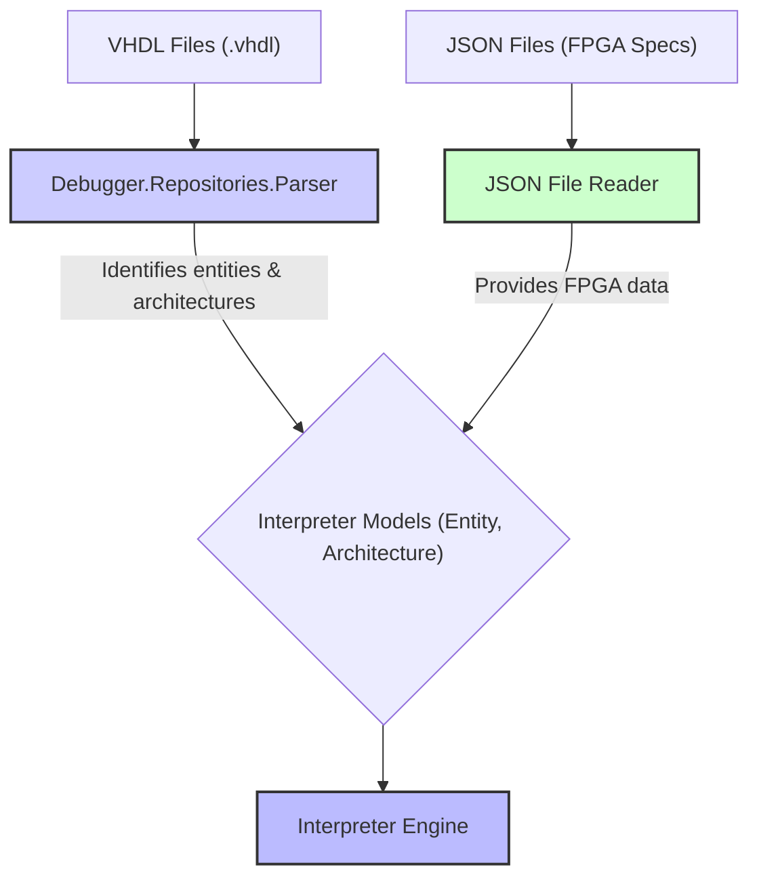

## 7. System Architecture

### 7.1 Platform-Specific Architecture

#### Multiplatform Deployment Strategy

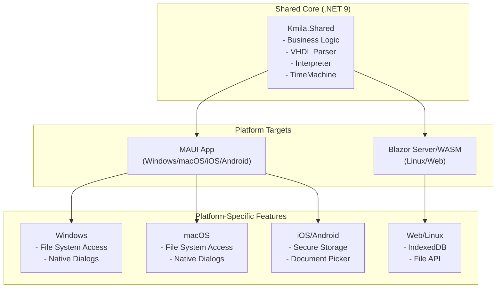

### 7.2 Component Architecture

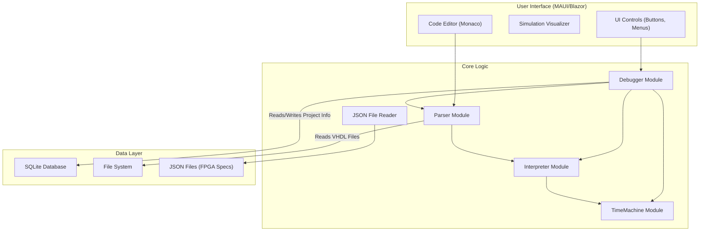

## 8. Application Diagrams

### 8.1 Use Case Diagram

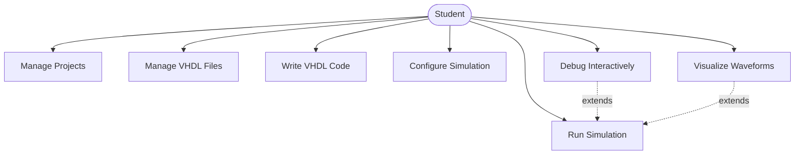

### 8.2 Context Diagram

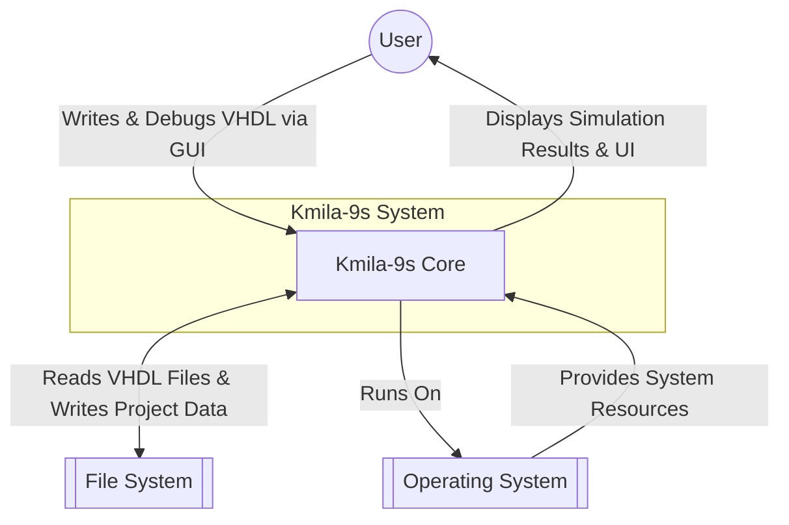

### 8.3 Deployment Diagram

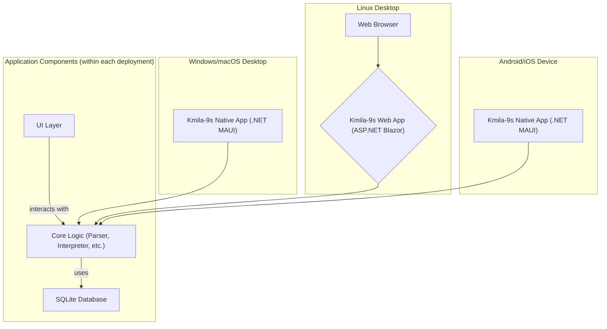

### 8.4 Base app diagram

> **Note:** This diagram is CodeViz-generated. Node labels were originally stamped with the
> absolute path of the machine that generated them (`…`); they
> have been normalized to **repo-relative paths** so they are portable across checkouts.

```mermaid
graph TD

    user["Student/User<br>[External]"]
    file_system["File System<br>[External]"]
    operating_system["Operating System<br>[External]"]
    monaco_editor["Monaco Editor<br>/https://microsoft.github.io/monaco-editor/"]
    sqlite_db["SQLite Database<br>/https://www.sqlite.org/"]
    blazor_bootstrap["BlazorBootstrap Components<br>/https://blazorbootstrap.com/"]
    subgraph kmila_system_boundary["Kmila-9s System<br>App/Kmila"]
        subgraph kmila_maui_app["Kmila (MAUI App)<br>App/Kmila/Kmila"]
            maui_main_page["MainPage<br>App/Kmila/Kmila/MainPage.xaml.cs"]
            maui_form_factor_service["FormFactor Service<br>App/Kmila/Kmila/Services/FormFactor.cs"]
            %% Edges at this level (grouped by source)
            maui_main_page["MainPage<br>App/Kmila/Kmila/MainPage.xaml.cs"] -->|"Uses"| maui_form_factor_service["FormFactor Service<br>App/Kmila/Kmila/Services/FormFactor.cs"]
        end
        subgraph kmila_web_app["Kmila.Web (Blazor App)<br>App/Kmila/Kmila.Web"]
            web_app_root["App.razor<br>App/Kmila/Kmila.Web/Components/App.razor"]
            web_form_factor_service["FormFactor Service<br>App/Kmila/Kmila.Web/Services/FormFactor.cs"]
            %% Edges at this level (grouped by source)
            web_app_root["App.razor<br>App/Kmila/Kmila.Web/Components/App.razor"] -->|"Uses"| web_form_factor_service["FormFactor Service<br>App/Kmila/Kmila.Web/Services/FormFactor.cs"]
        end
        subgraph kmila_shared_lib["Kmila.Shared (Shared Core)<br>App/Kmila/Kmila.Shared"]
            vhdl_parser["VHDL Parser Module<br>App/Kmila/Kmila.Shared/Services/ProgramBuilder.cs"]
            vhdl_interpreter["VHDL Interpreter Module<br>App/Kmila/Kmila.Shared/Services/ProgramBuilder.cs"]
            debugger_module["Debugger Module<br>App/Kmila/Kmila.Shared/Services/ProgramBuilder.cs"]
            time_machine_module["TimeMachine Module<br>App/Kmila/Kmila.Shared/Services/ProgramBuilder.cs"]
            temporal_input_manager["Temporal Input Manager Module<br>App/Kmila/Kmila.Shared/Services/ProgramBuilder.cs"]
            program_builder_service["ProgramBuilder Service<br>App/Kmila/Kmila.Shared/Services/ProgramBuilder.cs"]
            projects_repo["Projects Repository<br>App/Kmila/Kmila.Shared/Repositories/Projects.cs"]
            project_files_repo["ProjectFiles Repository<br>App/Kmila/Kmila.Shared/Repositories/ProjectFiles.cs"]
            application_db_context["ApplicationDbContext<br>App/Kmila/Kmila.Shared/Data/ApplicationDbContext.cs"]
            models["Data Models<br>App/Kmila/Kmila.Shared/Models"]
            editor_page["Editor Page<br>App/Kmila/Kmila.Shared/Pages/Editor.razor"]
            projects_view_page["Projects View Page<br>App/Kmila/Kmila.Shared/Pages/ProjectsView.razor"]
            home_page["Home Page<br>App/Kmila/Kmila.Shared/Pages/Home.razor"]
            create_file_modal["Create File Modal<br>App/Kmila/Kmila.Shared/Modals/CreateFileModal.razor"]
            project_details_modal["Project Details Modal<br>App/Kmila/Kmila.Shared/Modals/ProjectDetailsModal.razor"]
            nav_menu["NavMenu<br>App/Kmila/Kmila.Shared/Layout/NavMenu.razor"]
            main_layout["MainLayout<br>App/Kmila/Kmila.Shared/Layout/MainLayout.razor"]
            %% Edges at this level (grouped by source)
            editor_page["Editor Page<br>App/Kmila/Kmila.Shared/Pages/Editor.razor"] -->|"Uses"| program_builder_service["ProgramBuilder Service<br>App/Kmila/Kmila.Shared/Services/ProgramBuilder.cs"]
            editor_page["Editor Page<br>App/Kmila/Kmila.Shared/Pages/Editor.razor"] -->|"Uses"| projects_repo["Projects Repository<br>App/Kmila/Kmila.Shared/Repositories/Projects.cs"]
            editor_page["Editor Page<br>App/Kmila/Kmila.Shared/Pages/Editor.razor"] -->|"Uses"| project_files_repo["ProjectFiles Repository<br>App/Kmila/Kmila.Shared/Repositories/ProjectFiles.cs"]
            editor_page["Editor Page<br>App/Kmila/Kmila.Shared/Pages/Editor.razor"] -->|"Opens"| create_file_modal["Create File Modal<br>App/Kmila/Kmila.Shared/Modals/CreateFileModal.razor"]
            projects_view_page["Projects View Page<br>App/Kmila/Kmila.Shared/Pages/ProjectsView.razor"] -->|"Uses"| projects_repo["Projects Repository<br>App/Kmila/Kmila.Shared/Repositories/Projects.cs"]
            projects_view_page["Projects View Page<br>App/Kmila/Kmila.Shared/Pages/ProjectsView.razor"] -->|"Opens"| project_details_modal["Project Details Modal<br>App/Kmila/Kmila.Shared/Modals/ProjectDetailsModal.razor"]
            program_builder_service["ProgramBuilder Service<br>App/Kmila/Kmila.Shared/Services/ProgramBuilder.cs"] -->|"Uses"| vhdl_parser["VHDL Parser Module<br>App/Kmila/Kmila.Shared/Services/ProgramBuilder.cs"]
            program_builder_service["ProgramBuilder Service<br>App/Kmila/Kmila.Shared/Services/ProgramBuilder.cs"] -->|"Uses"| vhdl_interpreter["VHDL Interpreter Module<br>App/Kmila/Kmila.Shared/Services/ProgramBuilder.cs"]
            program_builder_service["ProgramBuilder Service<br>App/Kmila/Kmila.Shared/Services/ProgramBuilder.cs"] -->|"Uses"| debugger_module["Debugger Module<br>App/Kmila/Kmila.Shared/Services/ProgramBuilder.cs"]
            program_builder_service["ProgramBuilder Service<br>App/Kmila/Kmila.Shared/Services/ProgramBuilder.cs"] -->|"Uses"| time_machine_module["TimeMachine Module<br>App/Kmila/Kmila.Shared/Services/ProgramBuilder.cs"]
            program_builder_service["ProgramBuilder Service<br>App/Kmila/Kmila.Shared/Services/ProgramBuilder.cs"] -->|"Uses"| temporal_input_manager["Temporal Input Manager Module<br>App/Kmila/Kmila.Shared/Services/ProgramBuilder.cs"]
            vhdl_interpreter["VHDL Interpreter Module<br>App/Kmila/Kmila.Shared/Services/ProgramBuilder.cs"] -->|"Updates"| time_machine_module["TimeMachine Module<br>App/Kmila/Kmila.Shared/Services/ProgramBuilder.cs"]
            debugger_module["Debugger Module<br>App/Kmila/Kmila.Shared/Services/ProgramBuilder.cs"] -->|"Uses"| vhdl_parser["VHDL Parser Module<br>App/Kmila/Kmila.Shared/Services/ProgramBuilder.cs"]
            debugger_module["Debugger Module<br>App/Kmila/Kmila.Shared/Services/ProgramBuilder.cs"] -->|"Uses"| vhdl_interpreter["VHDL Interpreter Module<br>App/Kmila/Kmila.Shared/Services/ProgramBuilder.cs"]
            debugger_module["Debugger Module<br>App/Kmila/Kmila.Shared/Services/ProgramBuilder.cs"] -->|"Uses"| time_machine_module["TimeMachine Module<br>App/Kmila/Kmila.Shared/Services/ProgramBuilder.cs"]
            projects_repo["Projects Repository<br>App/Kmila/Kmila.Shared/Repositories/Projects.cs"] -->|"Uses"| application_db_context["ApplicationDbContext<br>App/Kmila/Kmila.Shared/Data/ApplicationDbContext.cs"]
            project_files_repo["ProjectFiles Repository<br>App/Kmila/Kmila.Shared/Repositories/ProjectFiles.cs"] -->|"Uses"| application_db_context["ApplicationDbContext<br>App/Kmila/Kmila.Shared/Data/ApplicationDbContext.cs"]
            application_db_context["ApplicationDbContext<br>App/Kmila/Kmila.Shared/Data/ApplicationDbContext.cs"] -->|"Manages"| models["Data Models<br>App/Kmila/Kmila.Shared/Models"]
        end
        %% Edges at this level (grouped by source)
        maui_main_page["MainPage<br>App/Kmila/Kmila/MainPage.xaml.cs"] -->|"Hosts"| editor_page["Editor Page<br>App/Kmila/Kmila.Shared/Pages/Editor.razor"]
        maui_main_page["MainPage<br>App/Kmila/Kmila/MainPage.xaml.cs"] -->|"Hosts"| projects_view_page["Projects View Page<br>App/Kmila/Kmila.Shared/Pages/ProjectsView.razor"]
        maui_main_page["MainPage<br>App/Kmila/Kmila/MainPage.xaml.cs"] -->|"Hosts"| home_page["Home Page<br>App/Kmila/Kmila.Shared/Pages/Home.razor"]
        maui_main_page["MainPage<br>App/Kmila/Kmila/MainPage.xaml.cs"] -->|"Hosts"| nav_menu["NavMenu<br>App/Kmila/Kmila.Shared/Layout/NavMenu.razor"]
        maui_main_page["MainPage<br>App/Kmila/Kmila/MainPage.xaml.cs"] -->|"Hosts"| main_layout["MainLayout<br>App/Kmila/Kmila.Shared/Layout/MainLayout.razor"]
        web_app_root["App.razor<br>App/Kmila/Kmila.Web/Components/App.razor"] -->|"Hosts"| editor_page["Editor Page<br>App/Kmila/Kmila.Shared/Pages/Editor.razor"]
        web_app_root["App.razor<br>App/Kmila/Kmila.Web/Components/App.razor"] -->|"Hosts"| projects_view_page["Projects View Page<br>App/Kmila/Kmila.Shared/Pages/ProjectsView.razor"]
        web_app_root["App.razor<br>App/Kmila/Kmila.Web/Components/App.razor"] -->|"Hosts"| home_page["Home Page<br>App/Kmila/Kmila.Shared/Pages/Home.razor"]
        web_app_root["App.razor<br>App/Kmila/Kmila.Web/Components/App.razor"] -->|"Hosts"| nav_menu["NavMenu<br>App/Kmila/Kmila.Shared/Layout/NavMenu.razor"]
        web_app_root["App.razor<br>App/Kmila/Kmila.Web/Components/App.razor"] -->|"Hosts"| main_layout["MainLayout<br>App/Kmila/Kmila.Shared/Layout/MainLayout.razor"]
    end
    %% Edges at this level (grouped by source)
    user["Student/User<br>[External]"] -->|"Interacts with"| maui_main_page["MainPage<br>App/Kmila/Kmila/MainPage.xaml.cs"]
    user["Student/User<br>[External]"] -->|"Interacts with"| web_app_root["App.razor<br>App/Kmila/Kmila.Web/Components/App.razor"]
    editor_page["Editor Page<br>App/Kmila/Kmila.Shared/Pages/Editor.razor"] -->|"Embeds | JavaScript Interop"| monaco_editor["Monaco Editor<br>/https://microsoft.github.io/monaco-editor/"]
    editor_page["Editor Page<br>App/Kmila/Kmila.Shared/Pages/Editor.razor"] -->|"Uses"| blazor_bootstrap["BlazorBootstrap Components<br>/https://blazorbootstrap.com/"]
    projects_view_page["Projects View Page<br>App/Kmila/Kmila.Shared/Pages/ProjectsView.razor"] -->|"Uses"| blazor_bootstrap["BlazorBootstrap Components<br>/https://blazorbootstrap.com/"]
    vhdl_parser["VHDL Parser Module<br>App/Kmila/Kmila.Shared/Services/ProgramBuilder.cs"] -->|"Reads | VHDL Files"| file_system["File System<br>[External]"]
    application_db_context["ApplicationDbContext<br>App/Kmila/Kmila.Shared/Data/ApplicationDbContext.cs"] -->|"Connects to"| sqlite_db["SQLite Database<br>/https://www.sqlite.org/"]
    kmila_maui_app["Kmila (MAUI App)<br>App/Kmila/Kmila"] -->|"Runs On"| operating_system["Operating System<br>[External]"]
    kmila_maui_app["Kmila (MAUI App)<br>App/Kmila/Kmila"] -->|"Accesses"| file_system["File System<br>[External]"]
    kmila_web_app["Kmila.Web (Blazor App)<br>App/Kmila/Kmila.Web"] -->|"Runs On"| operating_system["Operating System<br>[External]"]
    kmila_web_app["Kmila.Web (Blazor App)<br>App/Kmila/Kmila.Web"] -->|"Accesses"| file_system["File System<br>[External]"]

```
---
*Generated by [CodeViz.ai](https://codeviz.ai) on 11/6/2025, 4:00:52 PM*


## 9. Database Schema

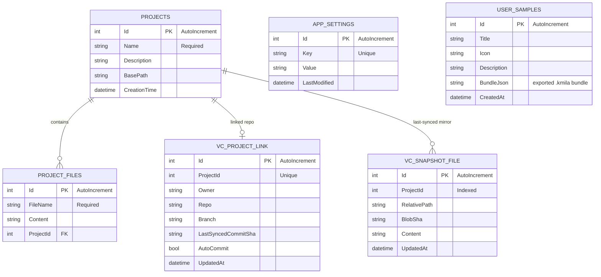
**Version control tables (2026-09-23):** `VC_PROJECT_LINK` holds each project's GitHub remote coordinates + last-synced head + the per-project auto-commit flag; `VC_SNAPSHOT_FILE` is the local mirror of the last push/pull (path → content + git blob sha) that lets status/diff run offline and lets a push upload only changed blobs. `USER_SAMPLES` stores imported `.kmila` bundles promoted to gallery samples. (Alongside these, `SIMULATION_SNAPSHOT` + the Practice tables also exist — see §10.)
**Note:** The following entities from the original documentation are NOT currently implemented:
- SIMULATION_CONFIGS (simulation parameters are passed at runtime, not persisted)
- PORT_CONFIGURATIONS (managed in-memory during simulation)
- PORT_MOMENTS (handled by PortMoment model but not persisted to DB)
- SIMULATION_RESULTS (not implemented)
- BREAKPOINTS (not implemented)

## 10. Shared Project Structure

The `Kmila.Shared` project contains the core logic, UI components, and data models for the Kmila-9s application.

### 10.1 Views and UI Components

> **Note — April 2026 redesign.** The UI went through a design-system rewrite: token-driven CSS (`wwwroot/css/tokens.css` + `pages.css`), first-class dark mode, custom sidebar & topbar replacing Blazor Bootstrap's `Sidebar2`, a bento-grid Projects page, a workbench-style Editor with run-bar + dock + status-bar, and a full set of new Settings / Logs pages. The former `SimulationParametersModal`, `ButtonCollapse`, `FPGATabContent`, `ConfigTabContent`, `RunTabContent`, `BuildProgressDisplay`, `PortMomentExtraInputs`, and `EnhancedRangeSlider` were removed — their responsibilities live in the new components below.

#### Pages
*   **Home.razor** — Landing page: hero band with logo lockup + primary CTA, overview copy, features bento grid (six cards with size variation), closing CTA panel.
*   **ProjectsView.razor** — Project list as responsive card grid (auto-fill at 280px track). Header with live search, count pill, primary **Create new** CTA, ghost **Try a sample** CTA, and **Examples** gallery button that opens a modal showing the pre-wired catalog (Demo Board · Counter Clock · Traffic Light FSM · 8-bit Shift Register). Each catalog entry creates the project with its `.kviz` sidecar and jumps straight onto the Visual tab. Empty / no-match states. Per-project hover reveal of Open + Delete kebab (Rename inline). `/projects/create` route auto-opens the create modal.
*   **Editor.razor** — Workbench: Monaco at top with **four view-tabs** (Code · Blocks · Step replay · Visual — the 4th is the visual-runtime canvas, see `Components/VisualRun/`), **RunBar** (build / run state machine + time + scale + FPGA chip), **EditorDock** (7 tabs: Entities · Schematic · Ports · Waveforms · Runs · Files · Output), **StatusBar**. Handles per-project reload via `OnParametersSetAsync`, marshals `ProgramBuilder` events into `SimulationParameters` + `BuildLog`, auto-switches the active dock tab on build/run transitions. The Visual view-tab is lazy-mounted on first visit (`_visualVisited` latch) — it parses + holds a `VisualRunCoordinator`, so it's heavier than the other tabs. Subscribes to `Traductor.StaticOnLangChanged` (2026-07-19) so the four view-tab labels + the sibling inline `Traductor.T(...)` strings owned directly by this page (unsaved-hint, empty states, Ln/Col abbreviations, split toggle, MD preview/source labels, waveform empty state, `PageTitle`) retranslate immediately on language change — before this the tab labels stayed frozen because none of them were routed through a self-subscribing child component.
*   **Visual.razor** — Thin route wrapper for `/visual/{ProjectId}` direct URL access. Renders `<VisualPanel EmbeddedMode="false">` with a full header (back-button + project title) — same component the Editor's Visual view-tab uses with `EmbeddedMode="true"` to suppress the header. Useful for share-links + Playwright tests.
*   **Learn.razor** — Lesson catalog. Reads from `LessonCatalog`, paints lesson cards with progress badges sourced from `LessonProgressStore`. Entry point for the in-app teaching path that complements the interactive editor.
*   **LessonView.razor** — Per-lesson reader. Renders Markdown content via `MarkdownRenderer`, marks completion in `LessonProgressStore`, and links back to a sample editor session when a lesson has an associated VHDL exercise.
*   **Concepts.razor** — Concepts-track catalog. Reads from `ConceptCatalog` (`wwwroot/Concepts/` bundle, 7 languages) and paints concept cards with progress from `ConceptProgressStore`.
*   **ConceptView.razor** — Per-concept reader with theory content and links into the block-based exercises.
*   **ConceptExerciseView.razor** — Block-exercise runner for a concept. Hosts the block editor and the `ExecutionPlayer` step-through so students build + watch a design execute inline.
*   **Practice.razor** — Practice catalog. Lists auto-graded exercises from `PracticeCatalog` (`wwwroot/Practice/` bundle) grouped by the m1-from-zero / m2-fix-bug / m3-fill-gap modalities, with per-exercise attempt status from `PracticeAttemptStore`.
*   **PracticeView.razor** — Practice workspace. Monaco (or starter/gap scaffold) + Submit; on submit calls the in-process `PracticeEvaluator`, shows the verdict and per-test mismatches, and offers a session export (`PracticeSessionExportService` via `ExportPracticeSessionModal`).
*   **Privacy.razor** — Static privacy-policy page linked from the profile menu / footer.
*   **Settings.razor** — Skeleton preference surface with four token-styled cards (Appearance, Editor, Simulation, Diagnostics). Diagnostics card links to the Logs viewer.
*   **Logs.razor** — Live viewer over `AppLogStore`. Search (message + category), level filter (All / Info+ / Warning+ / Error+), auto-scroll, pause, clear. Renders up to 500 recent entries out of a 2000-entry ring buffer.

#### Components
*   **Breadcrumbs.razor** — Live breadcrumb trail rendered inside the TopBar. Walks `NavigationManager.Uri` for `/`, `/projects`, `/projects/create`, `/editor/{id}`; for editor routes, looks up the project name. Re-renders on `LocationChanged` + `StaticOnLangChanged`. Truncates to last 2 crumbs under 641 px.
*   **ConfigurationsPill.razor** — TopBar dropdown for named simulation configs. Pill trigger shows current name with a warning-dot when `SimulationParameters.IsDirty`. Popover lists saved configs with checkmark on the active one and a hover-reveal delete; actions include Save changes, inline Save as, and deleting by name. All round-trips through `ConfigurationService`.
*   **EditorDock.razor** — Bottom dock on the Editor page. Tab strip with seven slots (Entities · Schematic · Ports · Waveforms · Runs · Files · Output) rendered via named `RenderFragment` parameters and driven by `EditorTab` enum entries. Collapse toggle at the far end, per-tab count pills (Entities, Files, Runs) or ready dots (Waveforms, Output). Active tab + collapsed state + dock height persisted via `EditorDockState` service + `localStorage`. **Independent of `EditorCardTab`** — the dock lives below the Editor's 4-tab view-switcher (Code / Blocks / Step replay / Visual) and stays active regardless of which view-tab is selected at the top.
*   **EditorTabStrip.razor** — Standalone strip extracted from the dock so the same tab UI can render outside the Editor page when needed (e.g. landing previews of the workbench layout).
*   **EnhancedRangeSlider.razor** — Token-styled dual-thumb range slider component used by the time / scale controls and the schematic zoom UI; handles touch + keyboard parity.
*   **RunsPanel.razor** — Content for the **Runs** dock tab. Lists past simulation snapshots saved through `SimulationSnapshotStore`, exposes "Re-run", "Compare", and "Delete" affordances per row. Loads purely by `ProjectId` (no `Sim.State` gate), so saved runs are browsable even while a live sim is in flight; opening one mid-run suspends the live waveform merge (`Editor._liveMergeSuspended`) and a "Return to live run" banner restores the live view.
*   **SchematicViewer.razor** (+ `Schematic/` sub-components) — Renders the layered netlist returned by `LayeredLayout.Layout(Netlist)` as an SVG schematic. Supports per-net highlighting on hover, port-pin labelling, and synchronised cursor selection through `SignalCursorBus` (so clicking a wire highlights the matching trace in `WaveformViewer`). **Debug mode step-through (2026-05-27):** while a live sim runs, Debug mode flips `ReplayState.TrackActiveLines` on and subscribes to `OnLiveStepChanged`; the gate whose `Cell.SourceLine` matches the latest delta's `LiveActiveLines` pulses (`is-active-step`) and the changed-signal wires glow. A Pause/Resume/Step control bar drives the engine via `Replay.Live*`; set breakpoints from the editor gutter/Replay tab to stop on a line (incl. `if`/`when` condition lines, see #5).
*   **EntityResourceUsage.razor** — FPGA resource estimate for an entity. Bento grid of `ResourceMetricBox` cards (FF / LUT / DSP / BRAM / I/O / Clock Domains) with a tokenized info note about estimation accuracy.
*   **EntityView.razor** — Parsed-entity panel. VHDL-syntax-flavored title (`entity <name> is`), port-count chips, compact signal list replacing the former BB Grid. `Current Value` column appears only once the simulation has run.
*   **FilesCard.razor** — Project files list (no BB Grid). Row-per-file: tinted icon tile → mono filename → type chip → inline ghost **Open** → kebab menu with **Rename** (inline edit) + **Delete** (with confirm dialog). Active row gets a left-edge accent bar.
*   **FPGASimpleView.razor** — Compact FPGA-info widget (unchanged).
*   **KmilaThemeSwitcher.razor** — Custom theme dropdown (`<details>` popover). Light / Dark / Auto, with `auto` resolving via `matchMedia`. Persists to `localStorage['kmila-theme']` so the inline `<head>` boot script avoids flash-of-wrong-theme on reload. Mirrors choice into SQLite for future native surfaces.
*   **LanguageChanger.razor** — Rebuilt `<details>` popover matching the FPGA/theme picker pattern. Flags via mono code badges. Pushes the new code into `localStorage` and `window.kmilaCurrentDocsLang` so the Monaco VHDL hover / completion providers translate instantly.
*   **OutputPanel.razor** — Output dock-tab content. Reads from `BuildLog`. Colored rows (info/success/warning/danger) with timestamp, icon, mono message. ARIA live-region so screen readers announce new errors.
*   **PortMomentInput.razor** — Per-IN-port timeline editor. Rebuilt with no off-canvas drawer and no base/extras split: a single flat moments list with a read-only SVG timeline strip above and inline editable rows (time · scale · value · ×) below. Per-datatype value validation with char-whitelisting, maxlength, and a "N/M" counter for vectors. Clock mode replaces the list with a dashed-border info strip.
*   **PortsPanel.razor** — Content for the **Ports** dock tab. Groups `PortMomentInput` instances by entity, sources time / scale / running from `SimulationParameters`, writes port moments back into the service. Dual empty states ("Build first" or "No input ports").
*   **ResourceMetricBox.razor** — Tokenized metric card. Icon chip + mono number + unit + accuracy pill. Variant driven by a semantic (`primary` / `success` / `warning` / `danger` / `info` / `neutral`) that maps to token colors for both light and dark themes.
*   **ResourceProgressBar.razor** — Slim pill-shaped progress bar with four color tiers (success 0–59 %, info 60–79, warning 80–99, danger 100+). Danger tier uses a pulsing diagonal-stripe fill for visual urgency without being obnoxious.
*   **RunBar.razor** — Horizontal strip between Monaco and the dock. FPGA reference chip · time number input + scale select · secondary **Build** · primary **Run** with state machine (Idle → Building… → Pause/Stop → Resume → Run again) · overflow menu (Save · New file). Progress line animates under the bar while running.
*   **StatusBar.razor** — Thin bottom bar. File info (unsaved dot · mono filename · Ln/Col · language chip) on the left; build status chip + resource % of selected FPGA + sim status chip on the right. Build/resource chips are clickable and jump to the matching dock tab.
*   **BlockEditor.razor** — Blocks view-tab surface driven by the in-house `wwwroot/js/kmila-blocks.js` DOM engine (Blockly was retired 2026-05-28). Round-trips with `VhdlBlockBuilder` (VHDL → blocks) and `VhdlBlockEmitter` (blocks → VHDL) so text and blocks stay in sync.
*   **ExecutionPlayer.razor** — Step-through animation player over an `ExecutionTimeline`. Reused across the Concepts exercises, opt-in Learn lessons, and (as `StepReplayPanel`) the editor's Step Replay tab.
*   **StepReplayPanel.razor** — Step Replay editor view-tab. Subscribes to `ReplayState`, renders the `ExecutionPlayer` over the `ReplayBuilder` output, and owns the breakpoint list + live step-through controls.
*   **RunsPanel.razor** — Runs dock-tab content: lists snapshots from `SimulationSnapshotStore` with re-run / compare / replay / delete affordances (see §10.2).
*   **FlowDiagramViewer.razor** — Renders a control-flow diagram for the selected entity via `PlantUmlFlowEmitter`; shares the pan-zoom + `SignalCursorBus` cursor sync used by the schematic.
*   **FsmAnimator.razor** — Animates a finite-state-machine view (`FsmAnimation` model) — highlights the active state and transitions as a live sim advances.
*   **GateAnimator.razor** — Animates gate-level activity (`GateAnimation` model) over the synthesised netlist, pulsing gates as their inputs change.
*   **QuizletPanel.razor** — Inline quiz widget used by the Concepts / Learn tracks to check understanding between content sections.
*   **KmilaTooltip.razor** — Shared CSS-only hover/focus tooltip wrapper (RTL-aware, self-retranslating on `Traductor.StaticOnLangChanged`) used app-wide on icon buttons.
*   **KmilaToastHost.razor** / **KmilaToastService** — App-level toast host + service for transient success/error notifications.
*   **KmilaTextSizeSwitcher.razor** — Text-size (accessibility) picker, sibling to the theme + language switchers.
*   **ProfileMenu.razor** — TopBar profile popover (GitHub sign-in via `GitHubLoginModal` / `GitHubAuth`, links to Privacy).
*   **WaveformViewer.razor** — Inline-SVG digital waveform renderer. Each signal renders a step-function trace (std_logic) or diamond/value-label trace (vectors) into its own `<svg>` strip; the time ruler is a shared sticky-bottom row. **Native overflow scroll** on both axes (pan-zoom intentionally NOT attached here — the body is row-structured, not free-form like Schematic/Flow). Toolbar gives **Zoom-In / Zoom-Out / Reset** with `× 2` steps and a `[200, 2 400 000] px` range; **Reset = fit-to-width** via `kmilaWaveformFitWidth`. **Click any signal label** to hide that row; restored via a chip-bar above the body (hidden set also filters VCD + SVG + PNG exports). Sticky chrome: label column pinned left with a depth-shadow; ruler pinned bottom. JS-side **hover cursor** (`kmilaAttachWaveformHover`) draws a vertical guide + time chip following the mouse so the student can read off any transition's exact time without projecting down to the ruler. Supports a separate **compare mode** when given a list of `SimulationSnapshot`s — N traces overlaid per signal with palette colors. Full architectural narrative + diagrams in [`Documentacion/CHANGELOG_waveform_overhaul_2026-05-22.md`](../../Documentacion/CHANGELOG_waveform_overhaul_2026-05-22.md) and the WaveformViewer section in [`Documentacion/ARCHITECTURE.md`](../../Documentacion/ARCHITECTURE.md).

#### Components — Visual Runtime (`Components/VisualRun/`)
*   **VisualPanel.razor** — The visual-runtime canvas as a self-contained component. Mounted by `Visual.razor` (full-page) and by `Editor.razor` (4th view-tab, `EmbeddedMode="true"`). Owns the toolbar (add widget · wire · save · run/stop · settings), runbar (speed slider 0.5×/1×/10×/Free + custom ms-per-tick input + Pause/Continue + scrub slider + tick-breakpoint chips), properties pane (per-widget config including button bounce checkbox + a **trash button** beside the close × for in-place widget removal — 2026-07-19), wire-overlay SVG (dashed lines from each widget pin to a port-name chip at the canvas edge), and the `KMILA_VISUAL_RING_BUFFER` setting read. Canvas dimensions are managed by `RecomputeCanvasBounds` (grow-AND-shrink with 2-step hysteresis — 2026-07-19 replacement for the older grow-only `EnsureCanvasFitsWidgets`); shrinking releases pixels no longer occupied by any widget so the pan-clamp cannot lock reachable content off-screen on phones. Parameters: `ProjectId`, `EmbeddedMode` (true suppresses the page-header bar so the Editor's breadcrumb + view-tab strip stand in).
*   **WidgetPalette.razor** — Collapsible-category widget picker on the left rail (or the top horizontal strip on phones). Widgets grouped into **Inputs** (button · switch · multi-switch · keypad-matrix), **LEDs** (led · led-array · matrix-3x3 · matrix-3x3-rgb), **Displays** (seven-seg · seven-seg-bank · lcd-hd44780), and **Actuators** (buzzer-piezo · stepper); each group's open state persists to `localStorage['kmila-visual-palette-groups']` as a comma-joined enum-name list. Inputs + LEDs open by default. Emits `OnSelected(type)` on click and HTML5 `OnDragStart(type)` / `OnDragEnd()` so `VisualPanel.OnCanvasDrop` can spawn the widget at the drop point.
*   **VisualCanvas.razor** — Drag-and-position grid that renders the widget list out of `KvizDoc.Components` and surfaces selection + drag-move + delete events back to its parent. Wraps each widget in a `.kviz-cell` with `@onpointerdown`; the canvas itself takes pointer-move/up for drag math. Drag is **scale-aware** (2026-07-19): on pointerdown the current CSS `transform: scale()` factor is captured via `window.kmilaGetTransformScale(".visual-page__canvas-wrap")` and later pointer deltas are divided by it, so widgets track the finger 1:1 even at non-1× zoom.
*   **LedWidget.razor** — Single LED bound to one `std_logic` port. ON / OFF / `'Z'` / `'X'` palettes; flat or glow render mode per config.
*   **ButtonWidget.razor** — Momentary push button. Press = drive `'1'`, release = drive `'0'` (or whichever values the config maps). When `config.bounce: true`, press / release enqueue 6 ticks of alternating chatter through `VisualRunCoordinator.EnqueueBounce(port, values)` — drained one value per tick so slowing the speed slider reveals each cycle.
*   **SwitchWidget.razor** — Latching toggle. Click flips between two values, the canvas redraws the lever, and the bound port holds the new value until the next click.
*   **LedArrayWidget.razor** — N-bit row of LEDs bound to a `std_logic_vector` port (or per-bit via the bit-slice UI). Per-bit ON / OFF readout based on `LatestSlicedValue`.
*   **StepperWidget.razor** — 4-coil unipolar stepper graphic with rotor. Bound to four single-bit pins (`phaseA / phaseB / Ān / B̄n`); decodes the energized coils into rotor angle.
*   **SevenSegmentWidget.razor** — 7-segment digit. **Raw mode**: 8 single-bit pins (a..g + dp), each lit by its own port value. **Decoded mode**: a single 4-bit `value` pin driven through `HexPatterns[]` lookup (digits 0–F).
*   **Additional widgets** — the full palette (see `Services/VisualRun/KvizWidgetCatalog.cs`) also ships **MultiSwitchWidget** (bank of latching switches), **KeypadWidget** (matrix keypad), **LedMatrixWidget** / **RgbMatrixWidget** (3×3 mono / RGB LED matrices), **SevenSegmentBankWidget** (multi-digit 7-seg bank), **LcdWidget** (HD44780 character LCD), and **BuzzerWidget** (piezo buzzer). Each binds to design ports through the same slice-aware wiring path as the widgets above.

#### Components — Visual Wiring
*   **VisualWiringModal.razor** — Wiring overlay. Direction-filtered dropdowns (only IN-ports for input widgets, only OUT-ports for output widgets); per-widget pin set adapts to widget type (e.g., 7-seg mode-dependent). Multi-bit ports expand into per-bit options via `IsMultiBitPin` + `CompatibleOptions(pin)` — selecting `bus[3]` writes `name[3]` into the binding.

#### Layout
*   **MainLayout.razor** — Shell: mounts `NavMenu` + `TopBar` + content article. Applies `.content--wide` when the current route is `/editor/…` so the workbench fills the full viewport (ordinary pages keep the 1440 px reading cap). Subscribes to `NavigationManager.LocationChanged` so the class flips immediately on navigation.
*   **NavMenu.razor** — Custom-built sidebar (no BB `Sidebar2`). Logo lockup + version chip, three sections: **Workspace** (Projects / New), **Your projects** (live list with counts, auto-refreshes on `Projects.OnListChanged`), and **System** (Settings · Logs). Collapsible to an icons-only rail on desktop; off-canvas drawer on mobile via `SidebarState` service.
*   **TopBar.razor** — Hamburger (mobile) · breadcrumbs · Configurations pill · FPGA picker · language · theme. All `<details>` popovers auto-close on outside-click / Escape via a global handler in the inline `<head>` script.

#### Modals
*   **ConfigurationModal.razor** — Kept as the "Manage configs" power surface — reachable from future "Manage…" entry on the Configurations pill. Handles save / load / delete / export / import of `.k-config` files.
*   **CreateFileModal.razor** — Create-file form.
*   **MarkdownModal.razor** — Markdown preview triggered when **Build** runs against a `.md` file.
*   **ProjectDetailsModal.razor** — Create-project form. Cleaner labeled inputs with a live sanitised-folder-name preview (the disk path that will hold the project).
*   **FileDetailsModal.razor** — File-details / rename surface for a project file.
*   **TemplateGalleryModal.razor** — Project-template gallery (`ProjectTemplateService` + `wwwroot/Templates/`: academic · counter · empty · fsm · library). Creating from a template scaffolds the project files.
*   **ExportSchematicModal.razor** — Export the current schematic (SVG/PNG) via `SchematicExporter`.
*   **ExportWaveformModal.razor** — Export the current waveform (SVG / PNG / VCD) via `WaveformExporter`.
*   **ExportPracticeSessionModal.razor** — Export a graded practice session via `PracticeSessionExportService`.
*   **GitHubLoginModal.razor** — GitHub sign-in dialog backed by `GitHubAuth` (used by the feedback path + profile menu).
*   **VisualWiringModal.razor** — Widget-to-port wiring overlay for the Visual runtime (detailed under *Components — Visual Wiring* above; the file lives in `Modals/`).

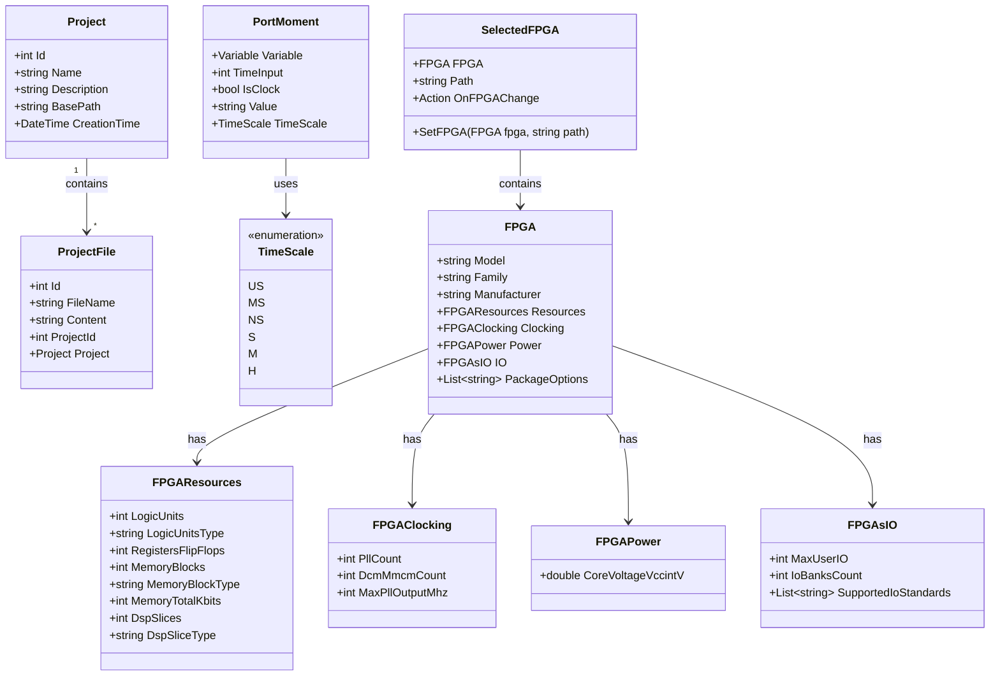

### 10.2 Backend and Logic

#### Services
*   **ProgramBuilder.cs** — Builds + simulates VHDL using Debugger / TimeMachine / Interpreter. Accepts both `.vhd` and `.vhdl`. Exposes `OnSimulationCompleted`, `OnSimulationEnded`, `OnProgressAdvanced`, `OnBuildError` events that the Editor page marshals to UI state.
*   **ConfigurationService.cs** — Save / load / delete of named simulation configs (.k-config semantics, stored in SQLite). Fires `OnConfigurationsChanged` so the `ConfigurationsPill` auto-refreshes its list.
*   **Traductor.cs** — i18n service with 7 languages. Reactive reload on `AppSettings.KEY_LANGUAGE` change via `ApplicationDbContext.StaticOnValueChanged`. Supports optional `ILogger<Traductor>` injection.
*   **IFormFactor.cs** — Interface for device form factor / platform detection.
*   **EditorSessionStore.cs** — Persists per-project editor session state (open file, scroll/cursor position, dock layout) so reopening a project restores the workbench exactly where the student left it.
*   **RecentProjectsTracker.cs** — Bounded MRU of recently opened projects, surfaced on Home and ProjectsView. Trims when the cap is reached.
*   **ProjectBundleService.cs** — Export/import of full project bundles (project + files + active configuration) for sharing assignments between students or handing in homework.
*   **UserAssetStore.cs** — Filesystem abstraction for user-supplied assets (custom VHDL packages, lesson attachments, exported waveforms). Centralises path resolution across MAUI / Web hosts.
*   **WaveformExporter.cs** — Static helper that renders a `WaveformData` to a standalone SVG string (`BuildSvg`) and paginates a long time range into fixed-span pages (`PaginateRange`) for multi-page exports. **VCD** output is built directly inside `WaveformViewer.BuildVcd` (closer to the per-signal hide filter); **PNG** is the SVG rasterised through the shared `kmilaSvgToPngBase64` canvas helper. All three honour the per-signal hide set ([`CHANGELOG_waveform_overhaul_2026-05-22.md`](../../Documentacion/CHANGELOG_waveform_overhaul_2026-05-22.md) §1).
*   **SimulationSnapshotStore.cs** — Persists past simulation runs (signals, ports, time bounds) so the Runs dock tab can show history and the Compare action can diff them.
*   **StimulusBuilder.cs** — Translates the editor's port-moments timeline into the `List<StimulusEvent>` shape that `Interpreter.Models.SimulationConfig` expects, including expansion of clock-mode ports into auto-toggling `ClockConfig`s.
*   **SignalCursorBus.cs** — Cross-component event bus for "selected signal" + "cursor at time T" so `WaveformViewer`, `SchematicViewer`, and `PortsPanel` stay synchronised on hover/click without component-to-component wiring.
*   **MarkdownRenderer.cs** — Markdown → HTML rendering for `LessonView` and `MarkdownModal`. Sanitised; respects the active language so code-fence labels translate.
*   **LessonCatalog.cs** — In-memory catalog of bundled lessons. Read on app start; consumed by `Learn.razor`.
*   **LessonProgressStore.cs** — Per-user lesson progress flags persisted in SQLite. Used by Learn / LessonView for badges and the "Continue where you left off" CTA on Home.
*   **AutoErrorReporter.cs** — Hooks into `AppDomain.CurrentDomain.UnhandledException` and Blazor circuit error events; routes serialised reports through `FeedbackHelper`.
*   **FeedbackHelper.cs** — Glue for the user-feedback flow: opens GitHub issue templates pre-filled with environment + recent log lines from `AppLogStore`.
*   **GitHubAuth.cs** — Optional sign-in helper for the feedback path; used to attach an authenticated identity to issue submissions when the user opts in.
*   **ConsoleToLoggerWriter.cs** — Redirects raw `Console.Out` writes (used by older parser/interpreter paths) into `ILogger<T>` so they end up in the Logs page alongside structured logs.
*   **ReplayBuilder.cs / ReplayState.cs** — `ReplayBuilder` converts a completed `WaveformData` into an `ExecutionTimeline` (≤200 frames, cursor-cached evaluation) for the Step Replay tab. `ReplayState` (scoped) holds the current timeline, the line-breakpoint set, and the live `DeltaCycleEngine` attach/detach + per-delta active-line bookkeeping that drives live step-through in the schematic + editor gutter.
*   **SimulationCoordinator.cs / TimelineRunner.cs** — `SimulationCoordinator` centralises build+run orchestration shared across surfaces (editor, practice grader); `TimelineRunner` advances a design over a timeline of stimulus for the animation/replay paths.
*   **SchematicExporter.cs / SchematicSimplifier.cs** — `SchematicExporter` renders the synthesised `Netlist` to standalone SVG/PNG (used by `ExportSchematicModal`). `SchematicSimplifier` collapses/cleans the netlist (`Interpreter.Synthesis`) before layout so the schematic reads clearly.
*   **PlantUmlFlowEmitter.cs** — Emits a control-flow diagram description for `FlowDiagramViewer`.
*   **ConceptCatalog.cs / ConceptProgressStore.cs** — In-memory catalog of bundled concepts (read from `wwwroot/Concepts/`, 7 languages) + per-user completion flags (SQLite via prefixed `AppSettings` keys). Consumed by `Concepts` / `ConceptView` / `ConceptExerciseView`.
*   **VhdlBlockBuilder.cs / VhdlBlockEmitter.cs / BlockProgram.cs** — The block-editor round-trip: `VhdlBlockBuilder` parses VHDL into the block model, `VhdlBlockEmitter` emits VHDL back from blocks, `BlockProgram` holds the pre-baked exercise block catalogs (byte-equivalent to the old Blockly workspace JSON).
*   **ProjectTemplateService.cs** — Backs `TemplateGalleryModal`; scaffolds a new project from a `wwwroot/Templates/` template (academic · counter · empty · fsm · library).
*   **TourCatalog.cs** — Catalog of in-app guided tours / onboarding steps.
*   **GitHubAuth.cs** — GitHub sign-in helper (device/OAuth flow) backing `GitHubLoginModal`, `ProfileMenu`, and the feedback path.
*   **LibraryCompilerFactory.cs** — Constructs + configures the `LibraryCompiler` (IEEE + user libraries, hash-keyed cache) for the current host, resolving user-library paths through `UserAssetStore`.
*   **FileSystemBlobStore.cs** — Filesystem blob storage abstraction (compiled-library cache, exported artifacts) shared across MAUI / Web hosts.
*   **KmilaToastService.cs** — Transient toast notifications surfaced through `KmilaToastHost`.

**Practice grading services (`Services/Practice/`):**
*   **PracticeCatalog.cs** — Loads practice exercises from the `wwwroot/Practice/` bundle (`manifest.json` + the `m1-from-zero` / `m2-fix-bug` / `m3-fill-gap` folders), exposing them to `Practice` / `PracticeView`.
*   **PracticeEvaluator.cs** — The **in-process** auto-grader. For fill-gap it splices candidate code into the starter, builds the candidate VHDL (ephemeral `ProgramBuilder`), runs it against reference test cases (reference outputs built once from the solution and cached), compares selected output ports at sampled times, and returns a ranked verdict (BuildError > RuntimeError > WrongAnswer > Solved). *(Distinct from the sibling offline `PracticeValidator` authoring tool.)*
*   **PracticeAttemptStore.cs** — Persists per-exercise attempt verdicts (SQLite via prefixed `AppSettings` keys) for status badges + history.
*   **PracticeSessionExportService.cs** — Serialises a graded session for export via `ExportPracticeSessionModal`.
*   **LineDiff.cs** — Line-level diff helper used by the fix-a-bug / fill-gap modalities and mismatch reporting.

**Local simulation API services (`Services/Api/`):**
*   **SimulationApiEndpoints.cs / SimulationApiHandlers.cs / SimulationApiModels.cs** — The shared `/api/v1` surface (`/health`, `/projects`, `/projects/{id}/files`, `/simulate`). `Endpoints` maps routes for the Web Minimal-API host; `Handlers` holds the host-agnostic bodies called from both Web and the MAUI `HttpListener` host; `Models` are the request/response DTOs.
*   **HeadlessSimulator.cs** — Runs a build+simulate entirely off-UI for API callers (used by the SimulatorBench harness).
*   **SandboxProjectStore.cs / SandboxJanitor.cs** — Ephemeral per-request project sandboxes for the API + a background janitor that reaps stale ones.
*   **LocalApiTokenProvider.cs / ILocalApiHost.cs** — Bearer-token issuance/validation for the local API and the host abstraction implemented by `Kmila.Web` (Kestrel) and `Kmila/Services/EmbeddedApiHost.cs` (`HttpListener` on native heads).

**Export services (`Services/Export/`):**
*   **IFileExportService.cs** — Host-agnostic file-save abstraction (browser download vs native save dialog) used by the schematic / waveform / practice-session exporters.

**Visual Runtime services (`Services/VisualRun/`):**
*   **VisualRunCoordinator.cs** — Drives `DeltaCycleEngine` one tick at a time on its own loop task; no engine fork. Between ticks drains `InputStateMap` into bound design input ports via `Variable.Value =`, which triggers `SignalAttributeHandler._activeFlags` and natural external-stimulus propagation. **Owns**: auto-clock (8-tick half-period default, skips ports listed in the `userDrivenPorts` ctor arg) · `CustomTickDelayMs` override · `TickBreakpoints` HashSet + `OnBreakpointHit` event + `_lastBreakTick` sentinel · `LatestSlicedValue(binding)` slice-aware port read · `EnqueueBounce(port, values)` chatter FIFO (drained one entry per tick) · async `WaitForStopAsync` for clean Stop-render. Read the seam paragraph in `Documentacion/VISUAL_MODE.md` before changing anything here — `DeltaCycleEngine` is intentionally untouched.
*   **InputStateMap.cs** — Thread-safe `port-name → value` dictionary. Buttons / switches / steppers write through it; coordinator reads from it once per tick.
*   **FrameRing.cs** — Bounded ring buffer of past tick snapshots (`KMILA_VISUAL_RING_BUFFER` setting, default 2000). Powers the scrub slider via `Nearest(tick)` / `TryGetByTick(tick)`. While paused, the page writes the scrub-frame's `PortValues` directly into `port.Value` so widgets re-read (Resume's first tick overwrites).
*   **KvizDoc.cs / KvizSerializer.cs** — Schema v1 JSON sidecar (`*.kviz`) sitting next to the matching `.vhd`. Holds the widget list (id · type · position · port bindings · config). The Projects gallery seeds these for the 4 catalog examples.
*   **VisualSpeed.cs** — Speed enum (Half / Normal / Fast / Free) + `FromSliderIndex(int)` / `ToSliderIndex()` mapping. `CustomTickDelayMs` on the coordinator overrides this when non-null.
*   **SliceHelper.cs** — Binding-string parser. `Parse("bus[7:0]") → (portName: "bus", BitSlice(7, 0))`. `Extract(fullValue, slice)` returns the substring of a `std_logic_vector` after MSB-first indexing. Used everywhere a widget reads a multi-bit port.
*   **KvizWidgetCatalog.cs** — Metadata for every placeable widget type (pin set, default config, palette group). The `WidgetPalette` + `VisualWiringModal` read it to know each widget's pins and direction constraints.

**UI state services (shared across components — avoid component → component wiring):**
*   **SidebarState.cs** — Drives the custom sidebar: `IsCollapsed` (desktop rail mode) + `IsMobileOpen` (off-canvas drawer). TopBar hamburger toggles the drawer, sidebar subscribes for re-render.
*   **EditorDockState.cs** — Active tab (`EditorTab` enum) + collapsed flag. Persisted to `localStorage` by `EditorDock`. Other components (Editor, RunBar) call `SetActive` to auto-focus the right tab on build/run transitions.
*   **SimulationParameters.cs** — The Run-bar state machine in service form. Fields: `Time`, `Scale`, `State` (`SimState` enum: Idle / Building / BuiltOk / BuildError / Running / Paused / Complete), `Progress`, `PortMoments`, `LoadedName`, `IsDirty`. Any mutation of time / scale / port moments flips `IsDirty` so the Configurations pill shows its yellow marker. `GetPortMomentsForRun()` returns port moments minus empty-value rows (kept in-buffer for the UI but dropped before being handed to `ProgramBuilder`).
*   **BuildLog.cs** — Bounded in-memory log for the **Output** dock tab. Entries carry a `BuildLogLevel` (Info / Success / Warn / Error) — named distinctly from `Microsoft.Extensions.Logging.LogLevel` to avoid clashing with the broader in-app logger below.
*   **AppLogStore.cs** — Thread-safe ring buffer of `AppLogEntry` (timestamp + `LogLevel` + category + message + exception). Backs the `/logs` page. Max 2000 entries, trims oldest when full.
*   **InMemoryLoggerProvider.cs** — Registers as an `ILoggerProvider` in both Web and MAUI startup. Every `ILogger<T>` write anywhere in the app fans out to Console + `AppLogStore` so diagnostics show up in the in-app Logs viewer without requiring a terminal (critical for mobile builds).

#### Repositories
*   **Projects.cs** — CRUD on projects. Fires `OnListChanged` after every successful Create / Remove / Update so the sidebar & Projects page stay in sync without polling.
*   **ProjectFiles.cs** — CRUD on files. Implements real `RemoveAsync` (deletes DB row + disk file) and `RenameAsync` (disk rename + DB update, duplicate-name refused).
*   **JSONFileReader.cs** — Reads FPGA device specs from JSON. Two constructors — one for ASP.NET Core (IWebHostEnvironment), one for MAUI (package-open delegate). Optional `ILogger<JSONFileReader>` injection.

#### Models
*   **Project.cs**: Represents a project in the application
*   **ProjectFile.cs**: Represents a file in a project
*   **PortMoment.cs**: Represents a moment when a port changes value
*   **TimeScale.cs**: Enumeration defining simulation time scales
*   **ToastMessages.cs**: Utility class for creating toast messages
*   **SelectedFPGA.cs**: State management for selected FPGA device with change notifications
*   **FPGA.cs**: Main FPGA device model containing all device specifications
*   **FPGAResources.cs**: FPGA resource specifications (Logic Units, Registers, Memory, DSP)
*   **FPGAClocking.cs**: FPGA clocking specifications (PLL, DCM/MMCM)
*   **FPGAPower.cs**: FPGA power specifications (Core voltage)
*   **FPGAsIO.cs**: FPGA I/O specifications (User I/O, Banks, Standards)
*   **AppSettings.cs**: Key-value pairs for application settings stored in SQLite (language preferences, theme, etc.)
*   **KmilaConfiguration.cs**: Simulation configuration model for .k-config files (FPGA settings, time configuration, port moments)
*   **WaveformData.cs**: Serialisable waveform (per-signal traces + time bounds) produced by `WaveformData.FromSignalHistory`; the payload persisted inside a `SimulationSnapshot` and rendered by `WaveformViewer`
*   **SimulationSnapshot.cs**: A persisted past run (project · entity · port count · duration · inline `WaveformData` JSON) backing the Runs tab + Compare
*   **ExecutionTimeline.cs**: Frame-based timeline (`ExecutionTimelineDoc`) that `ReplayBuilder` emits and `ExecutionPlayer` / `StepReplayPanel` animate
*   **Concept.cs / ConceptExercise.cs**: Concepts-track content model + its block-based exercise definition
*   **Lesson.cs**: Learn-track lesson model (Markdown body, optional `inlinePlayer` timeline, sample VHDL)
*   **FsmAnimation.cs / GateAnimation.cs**: Animation models driving `FsmAnimator` / `GateAnimator`
*   **EditorSession.cs / EditorPaneState.cs**: Persisted per-project editor session + split-pane layout (backing `EditorSessionStore`)
*   **Schematic/GateDocumentation.cs**: Per-gate documentation metadata for the schematic viewer (glyphs in `Components/Schematic/GateGlyphs.cs`)
*   **SchematicColourPalette.cs / SchematicExportRequest.cs / WaveformExportRequest.cs**: Schematic colour theming + the export-request DTOs for the schematic / waveform export modals
*   **Practice/** — `PracticeModels.cs` (exercise · test case · verdict · modality enum), `PracticeDbEntities.cs` (persisted attempt rows), `PracticeSessionExportRequest.cs` (session-export DTO)
```mermaid
graph TD
    subgraph "UI Layer"
        Home[Home.razor]
        ProjectsView[ProjectsView.razor]
        Editor[Editor.razor]
        Settings[Settings.razor]
        Logs[Logs.razor]
        RunBar[RunBar.razor]
        EditorDock[EditorDock.razor]
        StatusBar[StatusBar.razor]
        TopBar[TopBar.razor]
        NavMenu[NavMenu.razor]
    end

    subgraph "UI State Services"
        SimState[SimulationParameters]
        DockState[EditorDockState]
        SidebarState[SidebarState]
        BuildLog[BuildLog]
        AppLog[AppLogStore]
    end

    subgraph "Business Services"
        ProgramBuilder[ProgramBuilder]
        ConfigService[ConfigurationService]
        Traductor[Traductor i18n]
    end

    subgraph "Repository Layer"
        ProjectsRepo[Projects]
        ProjectFilesRepo[ProjectFiles]
        JSONFileReader[JSONFileReader]
    end

    subgraph "Data Layer"
        AppDbContext[ApplicationDbContext]
        SQLite[(SQLite)]
        JSONFiles[(JSON device specs)]
    end

    subgraph "External"
        DebuggerParser[Debugger.Parser]
        TimeMachine[TimeMachine]
        Interpreter[Interpreter]
        InMemLog[InMemoryLoggerProvider]
    end

    NavMenu --> SidebarState
    TopBar  --> SidebarState
    TopBar  --> ConfigService

    Editor --> RunBar
    Editor --> EditorDock
    Editor --> StatusBar
    Editor --> ProgramBuilder
    Editor --> SimState
    Editor --> BuildLog
    Editor --> DockState

    RunBar     --> SimState
    StatusBar  --> SimState
    StatusBar  --> DockState
    EditorDock --> DockState

    ProgramBuilder --> DebuggerParser
    ProgramBuilder --> TimeMachine
    ProgramBuilder --> Interpreter

    ProjectsView  --> ProjectsRepo
    ProjectsRepo  --> AppDbContext
    ProjectFilesRepo --> AppDbContext
    ConfigService --> AppDbContext
    Traductor     --> JSONFiles
    JSONFileReader --> JSONFiles
    AppDbContext  --> SQLite

    InMemLog -.->|captures ILogger writes| AppLog
    Logs     --> AppLog
```
### 10.2.bis Version control, samples & feedback (2026-09-23)

New files added in the v1.27.0 batch (all in `Kmila.Shared` unless noted):

*   **Components/VersionControl/SourceControlPanel.razor** — the **Source Control** dock-tab UI: link/create repo, changes list (A/M/D vs. the local snapshot), per-file unified diff, commit → push, pull, history, and the per-project auto-commit toggle. Gated on GitHub sign-in and hidden in the WASM demo.
*   **Services/VersionControl/IProjectVersionControl.cs + ProjectVersionControl.cs** — the home-grown VC engine: status/diff (offline, vs. `VcSnapshotFile`), `CommitAndPushAsync` (uploads only changed blobs; full working set defines the tree), `PullAsync` (fast-forward; conflict-guarded), history, link/unlink, `TryAutoCommitAsync`.
*   **Services/VersionControl/GitHubRemote.cs** — thin GitHub Git Data API layer (blobs → trees → commits → refs, list-commits, create/list repos), all calls routed through `GitHubAuth.SendApiAsync` so the token never leaves `GitHubAuth`.
*   **Models/VersionControl/{VcProjectLink, VcSnapshotFile, VcTypes}.cs** — the two SQLite tables (see §9) + the shared result/status/commit records.
*   **GitHubAuth.cs** (extended) — `internal SendApiAsync` authed-request seam + dynamic OAuth scope (`GetPrivateScopeAsync`/`SetPrivateScopeAsync`, `public_repo` ↔ `repo`).
*   **Services/UserSampleService.cs + Models/UserSample.cs + Modals/ImportModeModal.razor + Models/ImportModeResult.cs** — import-as-sample: the mode chooser (raw project vs. gallery sample) and the writable user-sample store surfaced in the Examples gallery (`ProjectsView`).
*   **Pages/ProjectsView.Counters.cs** — the two built-in counter samples (`contador_9`, `contador_9999`): VHDL + raw `.kviz` wiring + testbench, injected via `ExampleDef.ExtraFiles`.
*   **Components/SatisfactionPrompt.razor** — the occasional survey invite (mounted in `MainLayout`); links out to `/satisfaction`; flags persisted in `AppSettings`.
*   **FeedbackHelper.cs** (extended) — `BuildKmilaReportUrl` (real `kmila.com.mx/bug-report` contract), `SatisfactionUrl`, `DownloadUrl` (all language-aware).
*   **ProgramBuilder.cs** (extended) — `RunTestbenchAsync` + `OnReport` for Workbench mode (reuses `SourceElaborator`/`HeadlessSimulator`; the port-moment path is unchanged).

### 10.3 Component Interactions

The core Build → Run loop after the April 2026 redesign. `RunBar` owns the user-facing button state; `Editor` is the orchestrator; `SimulationParameters` and `EditorDockState` are the shared state that makes it all reactive without prop-drilling.

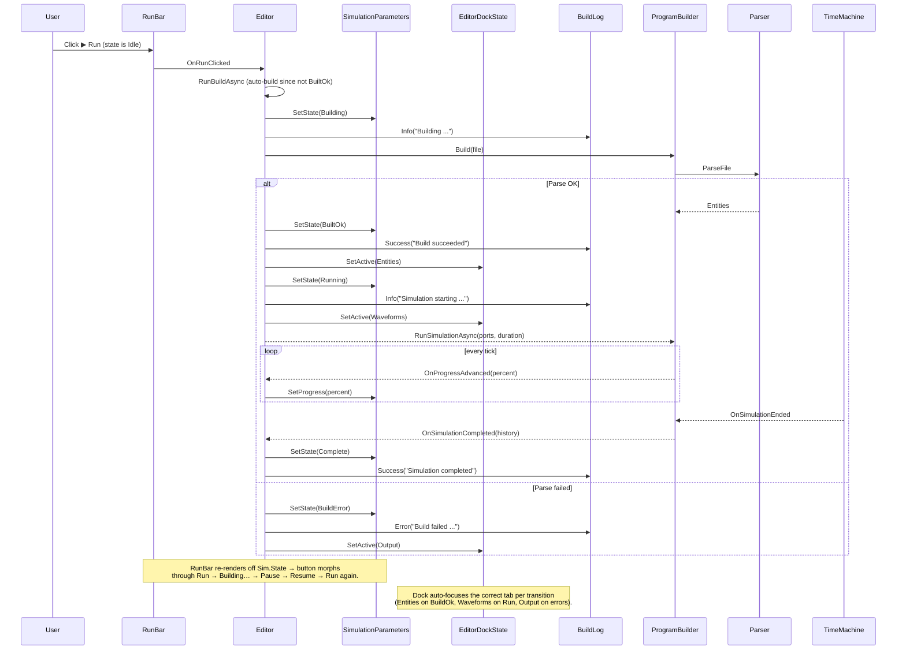

A simpler view of pause / stop:

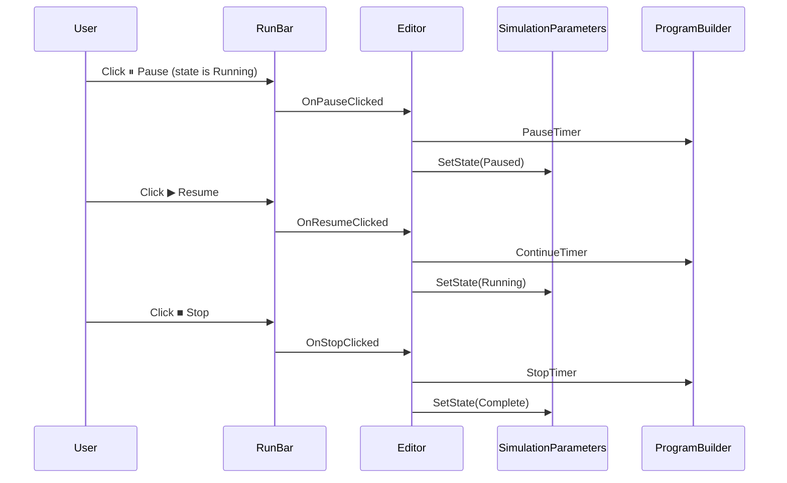

## 11. Implementation Details

### 11.1 File System Abstraction

The application implements platform-specific file handling through an abstraction layer:

```csharp
public interface IFileSystem
{
    Task<string> ReadFileAsync(string path);
    Task WriteFileAsync(string path, string content);
    Task<IEnumerable<string>> GetFilesAsync(string directory);
    bool FileExists(string path);
}
```

*   **Desktop (Windows/macOS)**: Direct file system access
*   **Mobile (iOS/Android)**: Secure storage and document picker
*   **Web (Linux/Browser)**: IndexedDB via JavaScript interop

### 11.2 Performance Optimization

#### Memory Management
*   Token pooling to reduce GC pressure
*   Lazy AST node creation
*   String interning for identifiers
*   Expression result caching
*   Delta compression for state storage

#### Platform-Specific Optimizations
*   **Desktop**: Parallel processing for multiple VHDL processes
*   **Mobile**: Memory-efficient single-threaded execution with UI yielding
*   **Web**: Web Workers via JavaScript interop for background processing

### 11.3 Simulation Tick Resolution (important note)

> **Heads-up — fixed-tick Nyquist limit.** The batch simulator advances in
> discrete ticks. By default one tick is `TimeClock.NS_PER_TICK = 10 ns`,
> which means the fastest clock the engine can represent without aliasing
> is **50 MHz** (two ticks per period = 20 ns period). Any clock frequency
> above ~50 MHz — whether it comes from the Run-bar override or from the
> selected FPGA's PLL default — gets clamped by `Math.Max(1, …)` on the
> half-period calculation and ends up toggling every single tick, which
> is indistinguishable from 50 MHz in the waveform. In other words,
> configuring a 100 MHz clock and a 200 MHz clock both render the same
> square wave.

This is a fundamental consequence of discrete-time simulation, not a bug
in the injector. Finer time resolution is available as a user preference
in **Settings → Simulation → Tick resolution**:

| Mode | Tick | Max faithful clock | Cost per run | When to use |
|------|------|-------------------|--------------|-------------|
| **Default** (baseline) | 10 ns | 50 MHz | Fastest, lowest memory | Learning-oriented / 50 MHz-class designs — matches every lesson and snapshot captured before v1.14.x |
| **High precision** | 1 ns | 500 MHz | ~10× tick count: ~10× slower, ~10× more `SignalHistory` memory | Accurately visualising 100 MHz+ clocks, fine-grained propagation delays |
| **Adaptive** (auto) | computed per-run from the effective clock frequency | matches the clock | Only pays the precision cost for runs that actually need it | Recommended for most users once validated — fast for slow designs, accurate for fast ones |

Default mode is preserved for backwards compatibility: existing projects,
lessons, and `SimulationSnapshot` JSON blobs all encode tick counts
against the 10 ns scale, so switching a saved run to a finer resolution
would re-scale its time axis. The preference is persisted globally
through `AppSettings` (key `KMILA_TICK_RESOLUTION_MODE`) and read at
`ProgramBuilder.RunSimulationAsync` time, so changing the mode takes
effect on the next Run — no app restart required.

**Implementation:** `StimulusBuilder.BuildConfig` already takes
`tickResNs` as a parameter. The mode only changes how that parameter is
computed upstream — the simulator itself is agnostic to the value and
just counts ticks. `WaveformData.FromSignalHistory` is called with the
same `tickResNs` so time labels on the waveform stay truthful.

## 12. Testing Strategy

### Test Coverage Areas

*   **Unit Tests**: Tokenizer, Parser, Interpreter, Expression Evaluator
*   **Integration Tests**: Parser-Interpreter, TimeMachine, Input Manager integration
*   **E2E Tests**: Full simulation workflows, UI workflows, platform-specific features
*   **Performance Tests**: Load testing, memory profiling, benchmarks

## 13. Security Considerations

*   **Input Validation**: All VHDL input is sanitized and validated before parsing
*   **Sandboxed Execution**: Simulation runs in isolated context
*   **File System Access**: Limited to project directories
*   **Memory Limits**: Configurable memory caps for simulation states
*   **Cross-Platform Security**:
    *   Desktop: OS-level file permissions
    *   Mobile: App sandboxing and secure storage
    *   Web: Browser sandbox and CORS policies

## 14. Deployment

### CI/CD Pipeline

The application uses GitHub Actions for continuous integration and deployment:

*   **Source Control**: GitHub Repository
*   **CI Pipeline**: .NET Build → Run Tests → Code Analysis
*   **Platform Builds**:
    *   Windows MSI
    *   macOS DMG
    *   Android APK/AAB
    *   iOS IPA
    *   Blazor WASM
*   **Distribution**:
    *   Microsoft Store (Windows)
    *   Apple App Store (macOS/iOS)
    *   Google Play Store (Android)
    *   Web Hosting (Linux/Browser)
    *   GitHub Releases (Direct downloads)

### Build & Self-Host (Web)

The web version is `App/Kmila/Kmila.Web` (Blazor Server, .NET 9). Kmila's code is split across **6 git
repos** — `Kmila`, `Interpreter`, `Parser`, `Debugger`, `LibraryCompiler`, `TimeMachine` — so a single
clone can't be built; they must sit side-by-side in one workspace (see [Manual](#option-b--manual)).
You can build **the easy way** ([scripts](#option-a--one-command-scripts)) or **by hand**
([manual](#option-b--manual)); both are below, plus a [config reference](#configuration--data) and
[troubleshooting](#troubleshooting).

Two build methods everywhere: **native** (`dotnet publish` → run with the .NET runtime) or **Docker**
(a container image). Pick native if you have/ want .NET on the host; Docker if you'd rather not.

#### Prerequisites

| For | Install |
|---|---|
| **git** (always) | `apt install git` · `dnf install git` · `brew install git` · [git-scm.com](https://git-scm.com) |
| **Native build** | **.NET 9 SDK** — [dotnet.microsoft.com/download](https://dotnet.microsoft.com/download) · macOS `brew install dotnet-sdk` · Linux `curl -fsSL https://dot.net/v1/dotnet-install.sh \| bash -s -- --channel 9.0` (needs `libicu`) |
| **Docker build** | **Docker + Compose** — [docs.docker.com/get-docker](https://docs.docker.com/get-docker/) · Linux `curl -fsSL https://get.docker.com \| sh` |

**Repo source.** The default clone base is `https://github.com/Kmila9s/<repo>.git`. While those mirrors
are private, point the tooling at another source with the `KMILA_REPO_BASE` env var — e.g. an SSH base
`ssh://git@host:port/kmila-9s` (it's joined with `/<Repo>.git`).

#### Option A — one-command scripts

The scripts (in this directory) clone all 6 repos into a self-contained workspace
(default `~/Downloads/kmila-build`), force `net9.0`, and build. Nothing else on your machine is touched.

```bash
# macOS / Linux / Windows (Git Bash or WSL)
./build.sh                 # native: dotnet publish  (needs the .NET 9 SDK)
./build.sh --docker        # build the Docker image   (needs Docker)
./build.sh --native --run  # build, then start on http://localhost:8080
# options: --workdir <dir>  --port <n>  --branch <b>   (env: KMILA_REPO_BASE)
```
```powershell
# Windows (native PowerShell)
./build.ps1                 # -Mode native (default) | -Mode docker ; -Run ; -WorkDir ; -Port
```

**Linux install as a service.** `install.sh` (run with `sudo`) detects the distro, installs the .NET 9
SDK (or Docker for `--docker`), builds, and registers a **systemd** service on `:8080`:

```bash
sudo ./install.sh                # native + systemd service (default)
sudo ./install.sh --docker       # Docker container instead
sudo ./install.sh --no-service   # install deps + build only
# → http://<host>:8080 ; manage with: systemctl {status|restart|stop} kmila
```

#### Option B — manual

If you'd rather not use the scripts, here is exactly what they do.

**1. Get the code — into the required layout.** Every project must sit at the workspace root, and the
`Kmila` repo specifically at `App/Kmila` (its projects reference the siblings via `../../../<name>`):

```bash
mkdir kmila-build && cd kmila-build
for r in Interpreter Parser Debugger LibraryCompiler TimeMachine; do
  git clone https://github.com/Kmila9s/$r.git "$r"
done
git clone https://github.com/Kmila9s/Kmila.git App/Kmila
```
Resulting layout: `kmila-build/{Interpreter, Parser, Debugger, LibraryCompiler, TimeMachine, App/Kmila}`.

**2a. Build & run — native.** The libraries multi-target the MAUI heads
(`net9.0;net9.0-android;net9.0-ios;net9.0-maccatalyst`); forcing `net9.0` skips them so **no MAUI
workload is required** (and `ios`/`maccatalyst` can't build off macOS anyway). Publish the **`.csproj`**,
never a `.sln` (the sln pulls in the MAUI app head):

```bash
dotnet publish App/Kmila/Kmila.Web/Kmila.Web.csproj \
  -c Release -f net9.0 -p:TargetFrameworks=net9.0 -o publish
ASPNETCORE_URLS=http://+:8080 dotnet publish/Kmila.Web.dll   # → http://localhost:8080
```

**2b. Build & run — Docker.** The build context must be the workspace root (it holds `App/Kmila` + the
siblings). Stage the recipe from `deploy/`, then build & run:

```bash
cp App/Kmila/deploy/Dockerfile App/Kmila/deploy/.dockerignore App/Kmila/deploy/docker-compose.yml .
docker build -t kmila-web .
docker compose up -d          # → http://localhost:8080  (logs: docker compose logs -f)
docker compose down           # stop (data kept) ;  down -v to also wipe the volume
```

**3. Run as a systemd service (Linux, manual).** This is what `install.sh` automates after the native
publish above:

```bash
sudo useradd --system --home-dir /var/lib/kmila --create-home --shell /usr/sbin/nologin kmila
sudo mkdir -p /opt/kmila /var/lib/kmila/.config
sudo cp -a publish/. /opt/kmila/
sudo chown -R kmila:kmila /opt/kmila /var/lib/kmila
sudo sed "s#__DOTNET__#$(command -v dotnet)#" App/Kmila/deploy/kmila.service \
  | sudo tee /etc/systemd/system/kmila.service >/dev/null
sudo systemctl daemon-reload && sudo systemctl enable --now kmila
# logs: journalctl -u kmila -f
```

#### Configuration & data

- **Port / binding:** `ASPNETCORE_URLS` (e.g. `http://+:8080`). Docker maps it via the compose `ports:`.
- **Where data lives** (SQLite DB, imported FPGA/dictionary/library packs, compiled-library cache):
  - **native:** under `SpecialFolder.ApplicationData/KmilaData` — Linux `~/.config/KmilaData`,
    macOS `~/Library/Application Support/KmilaData`, Windows `%APPDATA%\KmilaData`; plus the API sandbox
    at `~/.kmila`. Relocate by setting `HOME` / `XDG_CONFIG_HOME` (the systemd unit points them at
    `/var/lib/kmila`).
  - **Docker:** everything under the named **`kmila-data`** volume at `/data`. Survives restarts /
    rebuilds / `down`; wipe with `docker compose down -v`.
- **Behind HTTPS.** Blazor Server needs a persistent WebSocket (SignalR) connection, so any reverse
  proxy **must allow WebSocket upgrades**. Terminate TLS at the proxy (a commented Caddy service is in
  `deploy/docker-compose.yml`), set `ASPNETCORE_FORWARDEDHEADERS_ENABLED=true`, and drop the public
  `8080:8080` mapping so only the proxy is exposed.
- **Container internals:** `App/Kmila/deploy/` holds the multi-stage `Dockerfile`
  (`dotnet/sdk:9.0` → `dotnet/aspnet:9.0`), `docker-compose.yml`, `.dockerignore`, and `kmila.service`.

#### Troubleshooting

- **`NETSDK1147 … workloads must be installed: android` (or ios/maccatalyst)** — you didn't force a
  single framework. Add `-f net9.0 -p:TargetFrameworks=net9.0` to `dotnet publish` (the scripts +
  Dockerfile already do). Never publish the `.sln`.
- **Docker: `Access to the path '/app/KmilaData' is denied`** — `GetFolderPath(ApplicationData)`
  returns empty until its dir exists; the `deploy/Dockerfile` entrypoint pre-creates `$XDG_CONFIG_HOME`.
  Only relevant if you hand-roll your own image.
- **Clone fails / asks for credentials** — the GitHub mirrors are private until published; use
  `KMILA_REPO_BASE` to point at a source you can reach, or add credentials.
- **Port already in use** — change `ASPNETCORE_URLS` / `--port` (native) or the compose `ports:` mapping.
- **Blank page / disconnects behind a proxy** — the proxy is dropping WebSockets; enable WS upgrades and
  `ASPNETCORE_FORWARDEDHEADERS_ENABLED=true`.

> Verified 2026-09-21: `build.sh --native` (clone → publish → HTTP 200) and `--docker` (image build) on
> macOS/arm64; `install.sh --native` end-to-end on a clean `ubuntu:24.04` container (apt + .NET 9 SDK via
> `dotnet-install.sh` + publish). Docker image ≈ 571 MB.

## 15. Project Structure
```markdown

### Kmila.Shared
├── Components/
│   ├── BlockEditor.razor
│   ├── Breadcrumbs.razor
│   ├── ConfigurationsPill.razor
│   ├── EditorDock.razor
│   ├── EditorTabStrip.razor
│   ├── EnhancedRangeSlider.razor
│   ├── EntityResourceUsage.razor
│   ├── EntityView.razor
│   ├── ExecutionPlayer.razor
│   ├── FilesCard.razor
│   ├── FlowDiagramViewer.razor
│   ├── FPGASimpleView.razor
│   ├── FsmAnimator.razor
│   ├── GateAnimator.razor
│   ├── KmilaTextSizeSwitcher.razor
│   ├── KmilaThemeSwitcher.razor
│   ├── KmilaToastHost.razor
│   ├── KmilaTooltip.razor
│   ├── LanguageChanger.razor
│   ├── OutputPanel.razor
│   ├── PortMomentInput.razor
│   ├── PortsPanel.razor
│   ├── ProfileMenu.razor
│   ├── QuizletPanel.razor
│   ├── ResourceMetricBox.razor
│   ├── ResourceProgressBar.razor
│   ├── RunBar.razor
│   ├── RunsPanel.razor
│   ├── SchematicViewer.razor
│   ├── StatusBar.razor
│   ├── StepReplayPanel.razor
│   ├── WaveformViewer.razor
│   ├── Schematic/
│   │   └── GateGlyphs.cs
│   └── VisualRun/
│       ├── ButtonWidget.razor        BuzzerWidget.razor
│       ├── KeypadWidget.razor        LcdWidget.razor
│       ├── LedArrayWidget.razor      LedMatrixWidget.razor
│       ├── LedWidget.razor           MultiSwitchWidget.razor
│       ├── RgbMatrixWidget.razor     SevenSegmentBankWidget.razor
│       ├── SevenSegmentWidget.razor  StepperWidget.razor
│       ├── SwitchWidget.razor        VisualCanvas.razor
│       ├── VisualPanel.razor         WidgetPalette.razor
├── Data/
│   └── ApplicationDbContext.cs
├── Interfaces/
│   ├── IRepository.cs
│   └── IJsonFileReader.cs
├── Layout/
│   ├── MainLayout.razor
│   ├── NavMenu.razor
│   └── TopBar.razor
├── Models/
│   ├── AppSettings.cs
│   ├── Concept.cs
│   ├── ConceptExercise.cs
│   ├── EditorPaneState.cs
│   ├── EditorSession.cs
│   ├── ExecutionTimeline.cs
│   ├── FPGA.cs  FPGAResources.cs  FPGAClocking.cs  FPGAPower.cs  FPGAsIO.cs
│   ├── FsmAnimation.cs
│   ├── GateAnimation.cs
│   ├── KmilaConfiguration.cs
│   ├── Lesson.cs
│   ├── PortMoment.cs
│   ├── Project.cs
│   ├── ProjectFile.cs
│   ├── SchematicColourPalette.cs
│   ├── SchematicExportRequest.cs
│   ├── SelectedFPGA.cs
│   ├── SimulationSnapshot.cs
│   ├── TimeScale.cs
│   ├── ToastMessages.cs
│   ├── WaveformData.cs
│   ├── WaveformExportRequest.cs
│   ├── Practice/
│   │   ├── PracticeModels.cs
│   │   ├── PracticeDbEntities.cs
│   │   └── PracticeSessionExportRequest.cs
│   └── Schematic/
│       └── GateDocumentation.cs
├── Pages/
│   ├── Concepts.razor
│   ├── ConceptView.razor
│   ├── ConceptExerciseView.razor
│   ├── Editor.razor  (+ Editor.razor.css)
│   ├── Home.razor
│   ├── Learn.razor
│   ├── LessonView.razor
│   ├── Logs.razor
│   ├── Practice.razor
│   ├── PracticeView.razor
│   ├── Privacy.razor
│   ├── ProjectsView.razor  (+ ProjectsView.CapstoneCalc.cs)
│   ├── Settings.razor
│   └── Visual.razor
├── Repositories/
│   ├── Projects.cs
│   ├── ProjectFiles.cs
│   └── JSONFileReader.cs
├── Services/
│   ├── AppLogStore.cs
│   ├── AutoErrorReporter.cs
│   ├── BlockProgram.cs
│   ├── BuildLog.cs
│   ├── ConceptCatalog.cs
│   ├── ConceptProgressStore.cs
│   ├── ConfigurationService.cs
│   ├── ConsoleToLoggerWriter.cs
│   ├── EditorDockState.cs
│   ├── EditorSessionStore.cs
│   ├── FeedbackHelper.cs
│   ├── FileSystemBlobStore.cs
│   ├── GitHubAuth.cs
│   ├── IFormFactor.cs
│   ├── InMemoryLoggerProvider.cs
│   ├── ISimEndNotifier.cs        (WebSimEndNotifier.cs)
│   ├── KmilaToastService.cs
│   ├── LessonCatalog.cs
│   ├── LessonProgressStore.cs
│   ├── LibraryCompilerFactory.cs
│   ├── MarkdownRenderer.cs
│   ├── PlantUmlFlowEmitter.cs
│   ├── ProgramBuilder.cs
│   ├── ProjectBundleService.cs
│   ├── ProjectTemplateService.cs
│   ├── RecentProjectsTracker.cs
│   ├── ReplayBuilder.cs          ReplayState.cs
│   ├── SchematicExporter.cs      SchematicSimplifier.cs
│   ├── SidebarState.cs
│   ├── SignalCursorBus.cs
│   ├── SimulationCoordinator.cs
│   ├── SimulationParameters.cs
│   ├── SimulationSnapshotStore.cs
│   ├── StimulusBuilder.cs
│   ├── TimelineRunner.cs
│   ├── TourCatalog.cs
│   ├── Traductor.cs
│   ├── UserAssetStore.cs
│   ├── VhdlBlockBuilder.cs       VhdlBlockEmitter.cs
│   ├── WaveformExporter.cs
│   ├── Api/                      (headless /api/v1 surface)
│   │   ├── HeadlessSimulator.cs
│   │   ├── ILocalApiHost.cs
│   │   ├── LocalApiTokenProvider.cs
│   │   ├── SandboxJanitor.cs     SandboxProjectStore.cs
│   │   ├── SimulationApiEndpoints.cs
│   │   ├── SimulationApiHandlers.cs
│   │   └── SimulationApiModels.cs
│   ├── Export/
│   │   └── IFileExportService.cs
│   ├── Practice/                 (in-process auto-grader)
│   │   ├── PracticeCatalog.cs
│   │   ├── PracticeEvaluator.cs
│   │   ├── PracticeAttemptStore.cs
│   │   ├── PracticeSessionExportService.cs
│   │   └── LineDiff.cs
│   └── VisualRun/
│       ├── VisualRunCoordinator.cs
│       ├── InputStateMap.cs
│       ├── FrameRing.cs
│       ├── KvizDoc.cs
│       ├── KvizWidgetCatalog.cs
│       ├── SliceHelper.cs
│       └── VisualSpeed.cs
├── Modals/
│   ├── ConfigurationModal.razor
│   ├── CreateFileModal.razor
│   ├── ExportPracticeSessionModal.razor
│   ├── ExportSchematicModal.razor
│   ├── ExportWaveformModal.razor
│   ├── FileDetailsModal.razor
│   ├── GitHubLoginModal.razor
│   ├── MarkdownModal.razor
│   ├── ProjectDetailsModal.razor
│   ├── TemplateGalleryModal.razor
│   └── VisualWiringModal.razor
├── Assets/
│   └── CapstoneCalc/*.vhd        (embedded example, loaded via manifest resource)
└── wwwroot/
    ├── api-docs/index.html       (vendored Swagger UI shim)
    ├── openapi/v1.json           (committed /api/v1 OpenAPI snapshot)
    ├── css/
    │   ├── tokens.css            (design tokens: palette, spacing, typography)
    │   └── pages.css             (non-scoped page + component styles)
    ├── js/
    │   ├── vhdl.js               (Monaco Monarch tokenizer + 6 providers)
    │   ├── kmila-blocks.js       (in-house block-editor DOM engine)
    │   ├── kmila-blocks-vhdl.js  (VHDL block definitions)
    │   └── vhdl-data/            (per-language keyword/IEEE docs, 7 files)
    ├── Concepts/                 (concept content: en/es/fr/de/ch/jp/ar + exercises + manifest.json)
    ├── Learn/                    (lesson content per language + manifest.json)
    ├── Practice/                 (m1-from-zero / m2-fix-bug / m3-fill-gap + manifest.json)
    ├── Templates/                (academic · counter · empty · fsm · library + manifest.json)
    ├── Devices/                  (34 FPGA device JSON specs)
    └── Dictionaries/
        ├── en.json (English)   es.json (Spanish)   fr.json (French)
        ├── de.json (German)    ch.json (Chinese)   jp.json (Japanese)
        └── ar.json (Arabic)
```

## 16. Documentation Status

### Overview

The Kmila-9s codebase maintains comprehensive XML documentation for all public APIs. As of the latest review (April 2026), **100% of files have complete XML documentation** covering all public methods, properties, and classes.

### Fully Documented Components

All areas of the codebase now have complete XML documentation:

#### Components
*   **Breadcrumbs.razor** - TopBar breadcrumb trail driven by `NavigationManager.Uri`.
*   **ConfigurationsPill.razor** - Named-configuration picker with dirty marker.
*   **EditorDock.razor** - Bottom dock with five tabs (Entities · Ports · Waveforms · Files · Output) + collapse.
*   **EntityResourceUsage.razor** - FPGA resource grid using `ResourceMetricBox`.
*   **EntityView.razor** - Parsed-entity panel with VHDL-styled title and signal list.
*   **FilesCard.razor** - Project-files list with rename/delete kebab menu.
*   **FPGASimpleView.razor** - Compact FPGA information widget.
*   **KmilaThemeSwitcher.razor** - Light / Dark / Auto theme popover, persisted to `localStorage`.
*   **LanguageChanger.razor** - Language popover pushing into `Traductor` + `window.kmilaCurrentDocsLang`.
*   **OutputPanel.razor** - Output dock tab; ARIA live region over `BuildLog`.
*   **PortMomentInput.razor** - Per-IN-port timeline editor with per-datatype validation.
*   **PortsPanel.razor** - Ports dock tab, groups `PortMomentInput` by entity.
*   **ResourceMetricBox.razor** - Tokenized metric card with icon, value, accuracy pill.
*   **ResourceProgressBar.razor** - Pill progress bar with success/info/warning/danger tiers.
*   **RunBar.razor** - Build/Run/Pause/Stop state machine above the dock.
*   **StatusBar.razor** - File info · build status · resource % · sim state.
*   **WaveformViewer.razor** - Inline-SVG digital waveform renderer (no Chart.js). Native scroll, click-to-hide labels, hover time cursor, fit-to-width Reset. See [`Documentacion/CHANGELOG_waveform_overhaul_2026-05-22.md`](../../Documentacion/CHANGELOG_waveform_overhaul_2026-05-22.md).

#### Pages
*   **Editor.razor** - Workbench page; marshals `ProgramBuilder` events into `SimulationParameters` + `BuildLog`.
*   **Home.razor** - Landing page with hero + bento grid.
*   **Logs.razor** - Live viewer over `AppLogStore` with search / level filter / auto-scroll.
*   **ProjectsView.razor** - Projects card grid with sample-project CTA.
*   **Settings.razor** - Skeleton preference surface (Appearance, Editor, Simulation, Diagnostics).

#### Modals
*   **ConfigurationModal.razor** - Manage configs power surface (save/load/delete/export/import).
*   **CreateFileModal.razor** - File creation modal.
*   **MarkdownModal.razor** - Markdown file viewer triggered on Build against `.md`.
*   **ProjectDetailsModal.razor** - Project creation form with sanitised-folder-name preview.

#### Models
*   **Project.cs** - Project entity
*   **ProjectFile.cs** - Project file entity
*   **PortMoment.cs** - Simulation port timing model
*   **TimeScale.cs** - Simulation time scale enum
*   **ToastMessages.cs** - Toast notification utilities
*   **SelectedFPGA.cs** - FPGA selection state management
*   **FPGA.cs** - Main FPGA device model with comprehensive specifications
*   **FPGAResources.cs** - FPGA resource specifications (Logic Units, Memory, DSP, Registers)
*   **FPGAClocking.cs** - FPGA clocking specifications (PLL, DCM/MMCM)
*   **FPGAPower.cs** - FPGA power specifications (Core voltage)
*   **FPGAsIO.cs** - FPGA I/O specifications (User I/O, Banks, Standards)
*   **KmilaConfiguration.cs** - Simulation configuration model with FPGAConfiguration, TimeConfiguration, PortMomentConfiguration

#### Services & Repositories
*   **ProgramBuilder.cs** - Orchestrates VHDL simulation lifecycle; accepts both `.vhd` and `.vhdl`.
*   **ConfigurationService.cs** - Named-config save/load/delete with `OnConfigurationsChanged` event.
*   **Traductor.cs** - 7-language i18n service with optional `ILogger<Traductor>` injection.
*   **IFormFactor.cs** - Form factor abstraction interface.
*   **SimulationParameters.cs** - Run-bar state machine (`SimState` enum · time · scale · port moments · `IsDirty`).
*   **EditorDockState.cs** - Active dock tab + collapsed flag, persisted to `localStorage`.
*   **SidebarState.cs** - Desktop collapse + mobile drawer state for the custom sidebar.
*   **BuildLog.cs** - Bounded in-memory build/run log for the Output dock tab.
*   **AppLogStore.cs** - Thread-safe ring buffer of `ILogger` writes (backs `/logs`).
*   **InMemoryLoggerProvider.cs** - `ILoggerProvider` wiring `ILogger<T>` calls to `AppLogStore`.
*   **Projects.cs** - Project CRUD; fires `OnListChanged` on create/remove/update.
*   **ProjectFiles.cs** - File CRUD with `RemoveAsync` + `RenameAsync`.
*   **JSONFileReader.cs** - FPGA device JSON reader with optional `ILogger<JSONFileReader>`.

#### Data Layer & Interfaces
*   **ApplicationDbContext.cs** - SQLite database context
*   **IRepository.cs** - Generic repository interface
*   **IJsonFileReader.cs** - JSON file reader interface

#### Layout Components
*   **MainLayout.razor** - Main application layout
*   **NavMenu.razor** - Navigation menu component
*   **TopBar.razor** - Top navigation bar

### Code Quality Notes

*   **Traductor.cs** (Kmila.Shared/Services/) - Fully implemented internationalization service supporting 7 languages with reactive event-driven architecture (subscribes to ApplicationDbContext.StaticOnValueChanged), automatic translation reload, and RTL support for Arabic
*   **ProjectFiles.GetByAsync()** and **ProjectFiles.RemoveAsync()** - Currently throw NotImplementedException; documented as such, to be implemented in future releases
*   **IJsonFileReader** - Interface defined with documentation; JSONFileReader provides a more specific implementation

### Documentation Guidelines

When adding new components or modifying existing ones, please follow these guidelines:

1. **Use XML Documentation Comments**: All public classes, methods, properties, and parameters should have `///` comments
2. **Describe Purpose**: Explain what the component does and why it exists
3. **Document Parameters**: Use `<param>` tags for all method parameters
4. **Document Return Values**: Use `<returns>` tags for methods that return values
5. **Add Remarks**: Use `<remarks>` tags to provide additional context and usage notes
6. **Add Examples**: Use `<example>` tags for complex methods where appropriate
7. **Keep it Current**: Update documentation when code changes

### Example Documentation Format

```csharp
/// <summary>
/// Represents a complete FPGA (Field Programmable Gate Array) device specification.
/// This model is deserialized from JSON files containing device specifications
/// from various manufacturers (Xilinx, Altera/Intel, Lattice, etc.).
/// </summary>
/// <remarks>
/// FPGA specifications are loaded from JSON files in the wwwroot/Devices folder
/// and used to validate design resource requirements during simulation.
/// </remarks>
public class FPGA
{
    /// <summary>
    /// Gets or sets the FPGA model identifier.
    /// </summary>
    /// <example>XC6SLX9, EP4CE6, iCE40HX1K, LFE5U-25</example>
    public string Model { get; set; }

    /// <summary>
    /// Gets or sets the FPGA family name.
    /// </summary>
    /// <example>Spartan-6, Cyclone IV E, iCE40, ECP5</example>
    public string Family { get; set; }
}
```

## 17. Contributing

We welcome contributions to Kmila-9s! Please check our GitHub repository for contribution guidelines and open issues.

## 18. License

Kmila-9s is released as free and open-source software. Please refer to the LICENSE file in the repository for specific licensing terms.

## 19. Changelog

### Version 1.27.0 (2026-09-23)

Additive feature batch. **No simulation-core files changed** — the interpreter, runners, `SourceElaborator`, and parser are untouched; the `FastRunnerEquivalence` guard + **172/172** unit tests stay green.

#### Samples & import
*   **Import-as-sample + user-sample store.** Importing a `.kmila` bundle now opens a mode chooser (`Modals/ImportModeModal.razor`): "raw import" (a new project) or "save as sample" (title/icon/description). Saved samples persist in the new `UserSample` table (`Services/UserSampleService.cs`) and appear in the Examples gallery alongside the built-ins.
*   **Bundle schema v2.** `ProjectBundleService` now serializes/restores `ProjectFile.DirectoryPath`, so a project's subfolder layout survives an export/import round-trip. v1 bundles still import.
*   **Two built-in counter samples** — `contador_9` (single 7-seg) and `contador_9999` (4-digit multiplexed bank), with raw `.kviz` pin wiring, frequency dividers, and pre-loaded testbenches (`Pages/ProjectsView.Counters.cs`; `CLK_FREQ=50` sim-scaled so runs advance at seconds scale).

#### Workbench (VHDL testbench) mode
*   The Ports dock tab gained a per-run **stimulus source** selector — the classic **port-moment timeline** or a **VHDL testbench**. Testbench mode elaborates a `*_tb.vhd` over the design (reusing the interpreter's existing `SourceElaborator`/`HeadlessSimulator` path) and surfaces `report` output in the Output tab. `ProgramBuilder.RunTestbenchAsync` + `OnReport`; selection persists per project (`KMILA_PROJECT_TESTBENCH_{id}`). The port-moment path is byte-for-byte unchanged.

#### Per-project source control (GitHub-backed)
*   New **Source Control** dock tab (`EditorTab.SourceControl`, `Components/VersionControl/SourceControlPanel.razor`): link/create a repo, changes list, per-file unified diff, commit → push, pull (fast-forward), history, and opt-in per-project auto-commit-on-save. Our own VC logic in pure C# over GitHub's **Git Data API** (`Services/VersionControl/*`, `Models/VersionControl/*`) — no native git, no external libs; the token stays inside `GitHubAuth` (new `SendApiAsync` seam). OAuth scope is configurable from Settings (`public_repo` ↔ `repo`). Works on MAUI + Blazor-Server heads; hidden in the WASM demo (CORS). Merge/branches are a deferred future phase.

#### Feedback links (no telemetry)
*   "Report to Kmila servers" (Settings + per-error rows in Logs) opens `kmila.com.mx/bug-report` pre-filled (title/message/category/version/platform/timestamp); an occasional `SatisfactionPrompt` links to `/satisfaction`. Both are browser hand-offs — the app POSTs nothing. `Privacy.razor` updated.

#### WASM demo
*   A **simulation-busy overlay** (`Editor.razor`, gated on `OperatingSystem.IsBrowser()`) explains that the single-threaded browser demo pauses until a run finishes, and links to the desktop app (`/download`). The CSS spinner keeps animating on the compositor thread during the freeze.

#### Misc
*   **Website** button on Home → `https://kmila.com.mx`.

Header stamped **1.27.0 / September 24, 2026**.

---

### Version 1.26.1 (2026-09-21)

#### One-command build & install scripts (new)

*   **`App/Kmila/build.sh`** (macOS/Linux, + Windows Git Bash/WSL) and **`App/Kmila/build.ps1`** (native Windows) clone the 6 repos (`Kmila`, `Interpreter`, `Parser`, `Debugger`, `LibraryCompiler`, `TimeMachine`) into a self-contained workspace (default `~/Downloads/kmila-build`), force `net9.0` across the multi-targeted graph (`-p:TargetFrameworks=net9.0 -f net9.0`, so **no MAUI workload**), and build either `--native` (`dotnet publish`) or `--docker` (image). `--run` starts it on `:8080`. Clone source is `https://github.com/Kmila9s/<repo>.git`, overridable via `KMILA_REPO_BASE`.
*   **`App/Kmila/install.sh`** (Linux, `sudo`) detects the package manager (apt/dnf/pacman/zypper), installs prerequisites — the **.NET 9 SDK** via `dotnet-install.sh` (+ `libicu`) for native, or Docker via `get.docker.com` for `--docker` — runs `build.sh`, and installs a **systemd** unit (`kmila.service`) running as a dedicated `kmila` user on `:8080` (`--no-service` to skip).
*   Container assets consolidated into **`App/Kmila/deploy/`** (`Dockerfile`, `docker-compose.yml`, `.dockerignore`, `kmila.service`) — the single source of truth the scripts stage from.
*   Verified: `build.sh --native` (clone → publish → HTTP 200) and `--docker` on macOS/arm64; `install.sh --native` end-to-end on a clean `ubuntu:24.04` container. Header stamped **1.26.1 / September 21, 2026**.

---

### Version 1.26.0 (2026-09-17)

#### Docker web self-hosting (new)

*   New `Dockerfile`, `docker-compose.yml` and `.dockerignore` at the repo root containerize the Blazor Server web head (`App/Kmila/Kmila.Web`). Multi-stage `dotnet/sdk:9.0` → `dotnet/aspnet:9.0`, publishing the `.csproj` (not the `.sln`), listening on `:8080`.
*   **No MAUI workload:** `Kmila.Shared` + the transitive libs multi-target `net9.0-android/ios/maccatalyst`; the build forces the global MSBuild properties `-p:TargetFrameworks=net9.0 -f net9.0` so only `net9.0` is restored/built (the `ios`/`maccatalyst` TFMs can't even be restored on Linux).
*   **Persistence:** runs as a non-root user with `HOME=/data`; the SQLite DB, user-asset packs, library cache and data-protection keys all live in the named `kmila-data` volume at `/data`. The `ENTRYPOINT` pre-creates `$XDG_CONFIG_HOME` because `Environment.GetFolderPath(ApplicationData)` verifies existence and would otherwise return `""` on a fresh volume (sending the DB to a read-only relative path).
*   Healthcheck (`curl /`) + `restart: unless-stopped`; a commented Caddy reverse-proxy snippet documents the WebSocket/TLS requirement for Blazor Server. See §14.

#### Logic-schematic redesign (display-only)

*   **Group-aware swimlane layout** (`Interpreter/Synthesis/Layout/LayeredLayout.cs`, `groupAware` param + `BandGap`): cells sharing a `Cell.SourceLine` are kept in one contiguous horizontal band, so the viewer's translucent group tints stop overlapping (`Contador_9999`: 51 → **0** overlapping box pairs). Fixes every mode, Naive included.
*   **`SchematicSimplifier.SimplifyNetlist`** (pre-layout, produces a *display* netlist — `Synthesizer.Synthesize` output is untouched): passthrough-BUF elision + constant propagation (literals render as small wire **chips**), then `CollapseCaseCascades` fuses a common-selector `case`'s `EQ` column + `MUX` chain into **one** `ROM_LOOKUP` (all-constant branches — the BCD→7-seg decoder + `anodos`) or an N-way `MUX` (signal branches — the digit select). Counter `if/elsif` logic is left intact. `Contador_9999` clean view: **104 → 34 cells**.
*   **Glyphs** (`Components/Schematic/GateGlyphs.cs`): MUX drawn as the textbook trapezoid (incl. the N-way one), `ROM_LOOKUP` as a memory block with an address divider.
*   **Naive stays byte-for-byte literal** and **simulation output is unchanged** — the schematic netlist is display-only (the Simulator has zero references to `Interpreter.Synthesis`).

#### Mac Catalyst export fix

*   Schematic/report exports were written to the invisible per-app sandbox container. Root cause: `Platforms/MacCatalyst/Entitlements.plist` (declaring `app-sandbox=false`) was never applied. Fix: added `<CodesignEntitlements>` in a maccatalyst `PropertyGroup` in `App/Kmila/Kmila/Kmila.csproj`, and hardened `MauiFileExportService.ResolveDocumentsRoot()` to target `/Users/<UserName>` and reject `/Library/Containers/` paths. Verified the signed `.app` now embeds `app-sandbox=false`. Fixes every export feature (all share `IFileExportService`).
*   Header stamped **1.26.0 / September 17, 2026**.

---

### Version 1.25.0 (2026-08-03)

#### Documentation sync with the v1.25.0 codebase

Documentation-only pass — no source changes. The README had drifted from the shipping code (last structurally stamped v1.19.0). This revision brings the structural sections back into agreement with the `v1.25.0` branch of `Kmila.Shared`. No feature history is fabricated for the intermediate versions; the subsystems below were verified against source and are now documented:

*   **§4 External Dependencies** rewritten to match the real `Kmila.Shared.csproj` `ProjectReference`s — **Debugger · Interpreter · LibraryCompiler** (with **Parser** + **TimeMachine** transitive) — and to add **Interpreter.Synthesis** (schematic/netlist backend) and **LibraryCompiler**.
*   **§3 Key Features** gained bullets for the Concepts track, Practice auto-grading, the Block Editor VHDL round-trip, Step Replay & Runs, the Schematic/Flow/Waveform viewers + exporters, and the local `/api/v1` headless-simulation API + Swagger.
*   **§10.1** now documents the shipping Pages (Learn · LessonView · Concepts · ConceptView · ConceptExerciseView · Practice · PracticeView · Visual · Privacy), Components (BlockEditor · ExecutionPlayer · StepReplayPanel · RunsPanel · FlowDiagramViewer · FsmAnimator · GateAnimator · QuizletPanel · KmilaTooltip/Toast/TextSize · ProfileMenu · the full `Components/VisualRun/` widget set), and all 11 Modals (export modals · TemplateGalleryModal · GitHubLoginModal · VisualWiringModal · FileDetailsModal · …).
*   **§10.2** now documents the missing Services and their subfolders — `Services/Practice/` (PracticeCatalog · PracticeEvaluator · PracticeAttemptStore · PracticeSessionExportService · LineDiff), `Services/Api/` (the `/api/v1` surface + `HeadlessSimulator` + sandbox store/janitor), `Services/Export/`, `Services/VisualRun/` (KvizWidgetCatalog) — plus ReplayBuilder/ReplayState · SimulationCoordinator · TimelineRunner · SchematicExporter/Simplifier · PlantUmlFlowEmitter · ConceptCatalog/ConceptProgressStore · VhdlBlockBuilder/VhdlBlockEmitter/BlockProgram · ProjectTemplateService · TourCatalog · GitHubAuth · LibraryCompilerFactory · FileSystemBlobStore · KmilaToastService. Models gained Concept · ConceptExercise · ExecutionTimeline · SimulationSnapshot · WaveformData · Lesson · Fsm/GateAnimation · EditorSession/PaneState · the `Schematic*` set and `Models/Practice/*`.
*   **§15 Project Structure** tree fully refreshed against the current directory listing.
*   Note: `PracticeValidator` is a **separate** sibling authoring/validation tool; the shipping grader is the in-process `Services/Practice/PracticeEvaluator`.
*   Header stamped **1.25.0 / August 3, 2026**.

---

### Version 1.14.1 (2026-05-01)

#### Documentation Re-alignment

*   **§3 Key Features**: Corrected the dock-tab count (5 → **7**) and listed the actual tabs (Entities · Schematic · Ports · Waveforms · Runs · Files · Output). Added bullets for the new **Schematic** tab (backed by `Interpreter.Synthesis.Synthesizer` + `LayeredLayout`), the **Runs** history tab (backed by `SimulationSnapshotStore`), and the **Lesson mode** pages (`Learn.razor` + `LessonView.razor`).
*   **§3 FPGA Resource Validation**: Fixed the device count from "36" to **34** to match the actual `App/Kmila/Devices/` JSON catalogue (AMD/Xilinx Spartan-6 + Artix-7, Intel/Altera Cyclone IV E, Lattice iCE40 HX / iCE40 UltraPlus / ECP5).
*   **§10.1 Pages**: Added `Learn.razor` and `LessonView.razor` (lesson mode entry points). Updated the `Editor.razor` description to call out 7 dock tabs.
*   **§10.1 Components**: Added `EditorTabStrip`, `EnhancedRangeSlider`, `RunsPanel`, and `SchematicViewer` (+ `Schematic/` sub-components). Updated the `EditorDock` description to match the current 7-tab layout, the new persisted dock-height, and the `Runs` count pill.
*   **§10.2 Services**: Documented the previously-missing services that landed during the v1.14 cycle — `EditorSessionStore`, `RecentProjectsTracker`, `ProjectBundleService`, `UserAssetStore`, `WaveformExporter`, `SimulationSnapshotStore`, `StimulusBuilder`, `SignalCursorBus`, `MarkdownRenderer`, `LessonCatalog`, `LessonProgressStore`, `AutoErrorReporter`, `FeedbackHelper`, `GitHubAuth`, `ConsoleToLoggerWriter`.
*   **Header**: Bumped version to 1.14.1 and stamped 2026-05-01.
*   No source changes ship with this revision; behaviour is identical to 1.14.0. The doc gap was a backlog of items that landed without companion README updates.

---

### Version 1.14.0 (2026-04-20)

#### UX redesign — tokens, dark mode, workbench editor

*   **Design system.** New `wwwroot/css/tokens.css` defines the full palette (mandatory brand colors preserved: `#475569`, `#64748b`, `#334155`, `#3C82F6`), spacing, typography, shadows, motion; dark-mode resolved via `[data-bs-theme="dark"]`. Blazor-scoped CSS dropped in favor of a single non-scoped `pages.css` so `:has()` ancestor selectors work.
*   **Custom sidebar + topbar.** Replaced BlazorBootstrap `Sidebar2` and the ad-hoc header with a custom `NavMenu.razor` (collapsible rail on desktop, off-canvas drawer on mobile via `SidebarState`) and a `TopBar.razor` with breadcrumbs + FPGA picker + Configurations pill + language + theme popovers.
*   **Workbench editor.** `Editor.razor` is now a single surface — Monaco on top, `RunBar` with a Build → Build OK → Run → Pause → Resume → Complete state machine, `EditorDock` with five tabs (Entities · Ports · Waveforms · Files · Output) + collapse, and a `StatusBar` (file info · build status · resource % · sim state). The `SimulationParametersModal` / `FPGATabContent` / `ConfigTabContent` / `RunTabContent` / `ButtonCollapse` / `BuildProgressDisplay` / `PortMomentExtraInputs` components were removed; their responsibilities moved into the new components + shared state services (`SimulationParameters`, `EditorDockState`, `BuildLog`).
*   **Monaco intelligence.** Rewrote `wwwroot/js/vhdl.js` with six providers — hover, completion, go-to-definition, references, doc symbols, signature help — covering the VHDL keyword set, IEEE packages, and user declarations. Docs translate with the UI language (EN + ES full; other 5 languages stub back to English) via `wwwroot/js/vhdl-data/{lang}.json`.
*   **Pages.** New `Home.razor` (hero + bento grid + closing CTA), `ProjectsView.razor` (responsive card grid + live search + "Try a sample" button creating a ready-to-run 4-bit counter project *and* a matching config), `Settings.razor` (four placeholder cards), `Logs.razor` (live viewer over `AppLogStore` with search / level filter / auto-scroll / pause).
*   **In-app logging.** Every `ILogger<T>` write in the app fans into `AppLogStore` via the new `InMemoryLoggerProvider`, so `/logs` shows real log traffic (critical on mobile / MAUI where there's no console). Migrated remaining `Console.WriteLine` call sites in `Traductor` lambdas (Web + MAUI) to resolved `ILogger` instances at `LogDebug` level.
*   **Data & repositories.** `Projects.cs` now fires `OnListChanged` on every Create / Remove / Update; the sidebar & Projects page subscribe so their lists refresh without polling. `ProjectFiles.cs` got real `RemoveAsync` (disk + DB) and `RenameAsync` (duplicate-name refusal).
*   **Builder.** `ProgramBuilder.cs` now accepts both `.vhd` and `.vhdl` files (prior version strictly required `.vhdl`).
*   **Fixes.** Editor route now fills the viewport via `MainLayout` computing `IsEditorRoute` + a `LocationChanged` subscription toggling `.content--wide` (replaces an unreliable `:has(.editor-page)` trick). Port-moment reactive loop that wiped just-added empty rows resolved by emitting all rows including empties and pre-setting `_appliedInitial` before emit. Sidebar collapse no longer truncates section labels.
*   **Removed files.** `ButtonCollapse.razor(.css)`, `SimulationParametersModal.razor`, `FPGATabContent.razor`, `ConfigTabContent.razor`, `RunTabContent.razor`, `BuildProgressDisplay.razor`, `PortMomentExtraInputs.razor`, `EnhancedRangeSlider.razor`.

### Version 0.15.1 (2026-02-21)

#### Comprehensive Code Documentation

*   **Kmila.Shared Models**: Added XML documentation to all 16 model files (PortMoment, Project, ProjectFile, TimeScale, ToastMessages, FPGA, FPGAResources, FPGAClocking, FPGAPower, FPGAsIO, SelectedFPGA, AppSettings, KmilaConfiguration, WaveformData)
*   **Kmila.Shared Interfaces**: Added XML documentation to IRepository, IJsonFileReader, IFormFactor
*   **Kmila.Shared Services**: Added XML documentation to Traductor, ConfigurationService, StimulusBuilder, ProgramBuilder
*   **Kmila.Shared Repositories**: Added XML documentation to ProjectFiles, Projects, JSONFileReader
*   **Kmila.Shared Data**: Added XML documentation to ApplicationDbContext
*   **Kmila MAUI**: Added XML documentation to App.xaml.cs, MainPage.xaml.cs, MauiProgram.cs, FormFactor.cs, and all platform-specific files
*   **Kmila.Web**: Added XML documentation to Program.cs, FormFactor.cs

---

### Version 0.15.0 (2026-01-17)

#### Configuration Save/Load System (.k-config)

*   **KmilaConfiguration.cs**: New model for simulation configurations:
    *   `KmilaConfiguration` - Main configuration class with version, name, description, timestamps
    *   `FPGAConfiguration` - FPGA settings (model, family, manufacturer, path)
    *   `TimeConfiguration` - Simulation time settings (value, scale)
    *   `PortMomentConfiguration` / `PortMomentValue` - Port input time-value pairs
    *   JSON serialization/deserialization with `ToJson()` and `FromJson()` methods

*   **ConfigurationService.cs**: New service for configuration management:
    *   `SaveConfigurationAsync()` - Save configuration to SQLite database
    *   `LoadConfigurationAsync()` - Load configuration by name
    *   `GetConfigurationNamesAsync()` - List all saved configurations
    *   `DeleteConfigurationAsync()` - Remove configuration from storage
    *   `ExportConfiguration()` - Export to .k-config file (JSON format)
    *   `ImportConfiguration()` - Import from .k-config file content
    *   `GetLastConfigurationAsync()` - Retrieve most recently used configuration

*   **ConfigurationModal.razor**: New UI component for configuration management:
    *   Save current simulation state with name and description
    *   Load previously saved configurations
    *   Export configurations to .k-config files for sharing
    *   Import configurations from .k-config files

#### FPGA Selector Enhancements

*   **SimulationParametersModal.razor**: Added FPGA fallback selector:
    *   Warning card with dropdown when no FPGA is selected in TopBar
    *   Quick "Change" dropdown in FPGA Details card header for easy switching
    *   Integration with ConfigurationModal in the Config tab (collapsible panel)
    *   Methods: `OnFPGASelected()`, `ApplySelectedFPGAAsync()`, `QuickChangeFPGAAsync()`
    *   `OnConfigurationLoadedAsync()` - Applies loaded configuration settings

#### Bug Fixes

*   **TopBar.razor**: Fixed FPGA dropdown not working:
    *   Used local variable capture (`var fpgaItem = fpga;`) for correct closure binding
    *   Used explicit `System.IO.Path.GetFileNameWithoutExtension()` to avoid ambiguity

*   **Editor.razor**: Fixed dark mode issues:
    *   Editor card header: Changed hardcoded gradient to `var(--bs-tertiary-bg)`
    *   Added `FindMainFile()` method to auto-load main.vhd or first .vhd file when project opens

*   **EntityView.razor**: Fixed dark mode for resources tag:
    *   Added `.resource-box` class with CSS variables for proper dark mode support

*   **MarkdownModal.razor**: Fixed dark mode text color:
    *   Changed `bg-light` to `bg-body-tertiary`
    *   Changed heading colors to `var(--bs-heading-color, var(--bs-body-color))`

#### Editor Enhancements

*   **Editor.razor**: Added markdown split view:
    *   `IsMarkdownFile` property detects .md/.markdown files
    *   Split view with Monaco editor on left, live preview on right
    *   Uses `split-editor-container` CSS for 50/50 layout
    *   Real-time markdown rendering as content changes

#### Service Registration

*   **Program.cs (Web)**: Added `ConfigurationService` with scoped lifetime
*   **MauiProgram.cs (MAUI)**: Added `ConfigurationService` with singleton lifetime
*   **_Imports.razor**: Added `@inject ConfigurationService ConfigService`

---

### Version 0.14.2 (2026-01-17)

#### Reactive Language Switching Architecture

*   **ApplicationDbContext.cs**: Added reactive settings event system:
    *   New `StaticOnValueChanged` event fires after `SetSettingAsync` completes
    *   Enables decoupled, event-driven architecture for settings changes
    *   Components can subscribe to react to configuration changes without tight coupling

*   **Traductor.cs**: Implemented reactive language switching:
    *   Subscribes to `ApplicationDbContext.StaticOnValueChanged` in constructor
    *   Automatically reloads translations when language setting changes via storage event
    *   Added `_settingsReader` callback for reading settings from storage during reload
    *   Added `CancellationTokenSource` for proper async operation cancellation
    *   `InitializeAsync` now accepts optional `settingsReader` parameter for reactive updates
    *   Unsubscribes from events and cancels operations in `Dispose()`

*   **LanguageChanger.razor**: Simplified to use reactive architecture:
    *   Removed direct Traductor service calls - now only saves to DB
    *   Removed `IDisposable` implementation and event subscriptions (no longer needed)
    *   UI uses simple Blazor Bootstrap Dropdown with translate icon
    *   Language change flow: Save to DB -> Event fires -> Traductor reloads -> UI refreshes

*   **MainLayout.razor**: Updated to pass settings reader to Traductor:
    *   `Traductor.InitializeAsync` now receives `DbContext.GetSettingAsync` callback
    *   Enables Traductor to read new language value when storage event fires

#### UI Improvements

*   **SimulationParametersModal.razor**: Reorganized into mobile-friendly tab layout:
    *   **FPGA Tab**: FPGA details and resource utilization
    *   **Config Tab**: Time configuration and input port variables
    *   **Run Tab**: Simulation controls and progress display
    *   Uses Blazor Bootstrap `Tabs` with `NavStyle.Pills` for touch-friendly mobile UI
    *   Responsive padding and grid adjustments for all screen sizes
    *   Button labels show icons only on mobile, full text on larger screens

#### Code Quality

*   Added comprehensive XML documentation to all new reactive architecture components
*   Added Razor component documentation comments to LanguageChanger.razor explaining the reactive flow

---

### Version 0.14.1 (2025-12-15)

#### Bug Fixes

*   **MainLayout.razor**: Fixed translation initialization race condition:
    *   Added `_isLoading` state to prevent child components from rendering before translations are loaded
    *   Shows loading spinner while `Traductor.InitializeAsync()` completes
    *   Ensures `Traductor.T()` calls always return actual translations instead of raw keys like `HOME_FEATURE_PROTOTYPING`
    *   Resolves issue where components would display translation keys during initial render

*   **TopBar.razor**: Improved mobile responsiveness:
    *   Replaced invalid `float-begin` class with proper flexbox layout using `d-flex justify-content-between`
    *   Added responsive CSS with breakpoints for small screens (< 576px) and very small screens (< 400px)
    *   FPGA selector button text truncates with ellipsis to prevent overflow on mobile
    *   "Select FPGA:" label hides on very small screens (< 576px), showing only the device name
    *   Dropdown menu constrained to 90vw max-width for mobile viewports
    *   Reduced padding and font sizes on small devices for better fit
    *   Added `GetFPGADisplayName()` helper method with "---" fallback for empty selection
    *   Added translation support using `Traductor.T("TOPBAR_SELECT_FPGA")`

#### Code Quality

*   Added inline `<style>` block in TopBar.razor with scoped CSS for mobile responsiveness
*   Improved code organization with clearer separation of FPGA selector and settings controls

---

### Version 0.14.0 (2025-12-14)

#### Internationalization (i18n) System

*   **Traductor.cs**: Full implementation of the translation service:
    *   Support for 7 languages: English, Spanish, French, German, Chinese, Japanese, Arabic
    *   Event-driven language switching with `OnLangChanged` event
    *   RTL (Right-to-Left) support for Arabic
    *   JSON-based translation dictionaries
    *   Platform-agnostic file loading via dependency injection

*   **LanguageChanger.razor**: New component for language selection:
    *   Dropdown with flag indicators for each language
    *   Active language highlighting
    *   Persists language preference to SQLite database
    *   Proper IDisposable implementation for event cleanup

*   **AppSettings.cs**: New SQLite model for application settings:
    *   Key-value pair storage for settings
    *   Used for language preference persistence
    *   Helper methods in ApplicationDbContext: `GetSettingAsync()`, `SetSettingAsync()`

*   **Translation Dictionaries**: 7 JSON files in `wwwroot/Dictionaries/`:
    *   `en.json` - English (default)
    *   `es.json` - Spanish
    *   `fr.json` - French
    *   `de.json` - German
    *   `ch.json` - Chinese (Simplified)
    *   `jp.json` - Japanese
    *   `ar.json` - Arabic (RTL)

#### UI Components Updated with i18n

*   **MainLayout.razor**: RTL support via `dir` attribute, loads saved language on startup
*   **TopBar.razor**: Added LanguageChanger component next to theme switcher
*   **NavMenu.razor**: Navigation items now use translation keys
*   **Home.razor**: All text content translated
*   **ProjectsView.razor**: Grid headers, buttons, and dialogs translated
*   **ButtonCollapse.razor**: Editor action buttons translated
*   **FilesCard.razor**: File management UI translated
*   **ProjectDetailsModal.razor**: Project creation form translated
*   **CreateFileModal.razor**: File creation form translated

#### Database Schema Updates

*   Added `APP_SETTINGS` table for storing application settings
*   `ApplicationDbContext.InitDBAsync()` now creates the AppSettings table

#### Bug Fixes

*   **Editor.razor**: Fixed BlazorMonaco ambiguous reference error (`Global` now fully qualified as `BlazorMonaco.Editor.Global`)
*   **Editor.razor**: Fixed `OnDidChangeModelContent` event handler (changed from method call to component parameter)

---

### Version 0.13.2 (2025-12-13)

#### UI Branding & Theming

*   **app.css**: Added Kmila color palette CSS variables:
    *   `--kmila-primary`: #475569 (dark slate blue from logo)
    *   `--kmila-primary-light`: #64748b
    *   `--kmila-primary-dark`: #334155
    *   `--kmila-accent`: #3C82F6

*   **Sidebar2 Customization**: Override Blazor Bootstrap default colors:
    *   `.bb-sidebar2-top-row` - Brand header area
    *   `.bb-sidebar2` - Navigation area background
    *   Nav item hover/active states
    *   Badge styling

#### Android App Icon & Splash Screen

*   **appicon.svg**: Updated background color from .NET purple (#512BD4) to Kmila brand blue (#475569)
*   **appiconfg.png**: Added Kmila logo (wolf + waveform) as icon foreground
*   **Splash screen**: Updated to use brand colors

#### MAUI Resource Loading

*   **JSONFileReader.cs**: Rewrote for proper MAUI support:
    *   Added `Func<string, Task<Stream>>` constructor parameter
    *   Uses `FileSystem.OpenAppPackageFileAsync` for bundled FPGA device files
    *   Includes static list of 37 known FPGA devices
    *   Maintains backward compatibility with file system fallback

*   **MauiProgram.cs**: Updated JSONFileReader registration:
    ```csharp
    builder.Services.AddSingleton<JSONFileReader>(provider =>
        new JSONFileReader(path => FileSystem.OpenAppPackageFileAsync(path)));
    ```

---

### Version 0.13.1 (2025-12-13)

#### Android Deployment Fixes

*   **Editor.razor**: Fixed build error `CS4008: Cannot await 'void'` where `ReleaseBuild()` method was incorrectly awaited. This was blocking Android target builds.

*   **MauiProgram.cs**: Added missing service injections for MAUI/Android platform to achieve feature parity with Web deployment:
    *   `IFormFactor` - Device form factor detection (Phone/Tablet/Desktop)
    *   `JSONFileReader` - Reads JSON configuration files for FPGA definitions
    *   `ProgramBuilder` - VHDL program compilation and building service
    *   `SelectedFPGA` - Tracks the currently selected FPGA device state

#### Platform Parity

The following services are now consistently registered across both Web and MAUI platforms:

| Service | Web | MAUI/Android |
|---------|-----|--------------|
| `IFormFactor` | Singleton | Singleton |
| `ApplicationDbContext` | Scoped | Singleton |
| `Projects` | Scoped | Singleton |
| `ProjectFiles` | Scoped | Singleton |
| `JSONFileReader` | Singleton | Singleton |
| `ProgramBuilder` | Singleton | Singleton |
| `SelectedFPGA` | Singleton | Singleton |

---

### Version 0.13.0 (2025-12-13)

#### Documentation Improvements

*   **Traductor.cs**: Added comprehensive XML documentation explaining:
    *   The service's role as a placeholder for future internationalization (i18n) support
    *   Planned features including multi-language support, language detection, and RTL support
    *   Implementation notes for future development
    *   Usage examples for the planned API

*   **README.md**: Added version information, author details, last updated date, and this changelog section

#### Code Quality Notes

The following items remain documented as placeholders or incomplete implementations for future work:

| Item | Status | Notes |
|------|--------|-------|
| `Traductor.cs` | Fully Implemented | Internationalization with 7 languages (see v0.14.0) |
| `ProjectFiles.GetByAsync()` | Not Implemented | Throws `NotImplementedException` |
| `ProjectFiles.RemoveAsync()` | Not Implemented | Throws `NotImplementedException` |
| `IFileSystem` interface | Referenced but not found | Mentioned in docs but implementation details not in shared code |

---

### Version 1.14.0 (2026-04-19)

Large batch release — a single execution sweep that finished every pending
task from the previous month of work. Grouped by theme:

#### Clock system rework

*   **Hybrid default + override.** `Models/FPGAClocking.cs` gained a
    `GetDefaultSimClockMhz()` helper that returns
    `SystemClockMhz ?? min(MaxPllOutputMhz, 100) ?? 50`. This is the value
    the simulator picks up when the user doesn't override.
*   **Per-project override.** `Services/SimulationParameters.cs` exposes
    `ClockOverrideMhz`, `ClockIsCustom`, `SetClockOverride(int?, int)` and
    `GetEffectiveClockMhz(int)`. `Components/RunBar.razor` surfaces the
    value with a reset button and a warning beside the input about
    possible long simulation times / calculation errors, per the user's
    explicit request.
*   **Manual "mark as clock" removed.** `Components/PortMomentInput.razor`
    no longer has the checkbox. Clock detection is automatic on ports
    named `clk` or `clock` and shown with a "System clock" badge. Legacy
    `"CLK"` moments in existing configs are skipped by `StimulusBuilder`
    for backward compat.
*   **Waveform visibility toggle.** `Components/WaveformViewer.razor`
    gained an eye icon that hides / shows the clock trace via
    `IsClockName` — keeps the viewer uncluttered when the user only
    cares about data signals.

#### Parser / editor integration

*   **Structured diagnostics** flowed up from the Parser project into
    `Pages/Editor.razor`. The `PublishDiagnosticsAsync` method maps them
    to Monaco's `setModelMarkers` payload; markers clear on content change
    via the new JS helper `kmilaSetMonacoMarkers`. Both
    `Kmila.Web/Components/App.razor` and `Kmila/wwwroot/index.html` carry
    the helper so Web and MAUI builds behave identically.

#### Execution view polish

*   Run bar, waveforms and status bar were redesigned to match the rest
    of the app's design language. The waveform viewer now uses
    `contain: inline-size` so wide traces clip cleanly inside the dock.

#### Persistence & history

*   **Snapshots + Runs tab.** `Services/SimulationSnapshotStore.cs` stores
    captured runs (metadata in SQLite + inline `WaveformData` JSON). The
    new "Runs" tab in `Components/EditorDock.razor` lists them, with
    `LoadSnapshotAsync` and `OpenCompareAsync` entry points from
    `Pages/Editor.razor`.
*   **Project bundles.** `Services/ProjectBundleService.cs` packs a whole
    project — metadata, files, saved configs, snapshots — into a single
    JSON `.kmila` file for diff-friendly export / import. Wired into
    `Pages/Settings.razor` with a download button and a 50 MB import
    cap. Imports never overwrite: names collide into
    `"(imported)"` / `"(imported N)"`.

#### Dock UX

*   **Drag-to-resize.** `EditorDock.razor` gained a grabber handle that
    sets a CSS variable `--kmila-dock-height`; `EditorDockState.cs`
    stores the height (clamped 200–1200) alongside the active tab and
    collapse state in localStorage.

#### FPGA picker

*   **Manufacturer / family filter.** `Layout/TopBar.razor` preloads a
    `_fpgaMeta` dictionary at init time and exposes manufacturer chips;
    `FilteredFPGAs()` combines text and manufacturer predicates.

#### Learn module

*   **Five new language stubs.** `digital-fundamentals/01-number-systems`
    now has FR / DE / CH / JP / AR translations alongside EN and ES.
*   **Four new modules.** `discrete-math`, `soc`, `pipelining` and
    `verification` were added to `wwwroot/Learn/manifest.json` with
    English first-lesson bodies and Spanish translations. Ordering:
    discrete-math at 0 (Beginner), soc at 11 (Expert), pipelining at 12
    (Expert), verification at 13 (Advanced).
*   **Continue-banner resilience.** The banner no longer crashes when a
    lesson referenced by the last-read pointer has been renamed or
    removed — it now falls back to the module intro.

#### Dead code / build

*   `WaveformData.TimeLabels` generation loop was pruned. The property
    is kept (returning an empty list) so old snapshot JSON still
    deserializes.
*   `<NoWarn>` suppressions added across every csproj (CS1587 / CS1591 /
    CS1570 / CS1573 / CS1574 / CS1998 / CS8602–8625 / CS8892 / CS0219 /
    CS0618 / CS4014 / NETSDK1206). The full Web build now reports **0
    warnings, 0 errors**.

#### Service registrations

*   `Kmila.Web/Program.cs` and the MAUI `Kmila/MauiProgram.cs` register
    `SimulationSnapshotStore` and `ProjectBundleService` as scoped
    services so they resolve against the current circuit's DB context.

---

## 19.bis. Audit diagrams (2026-05-09)

The cross-module audit identified that several App-layer subsystems (Learn,
Practice, EditorDock, Runs/Snapshot) had no visual coverage in TT1, and that the
existing C4 component / persistence / services diagrams were significantly stale.
The blocks below mirror the canonical sources in `Documentacion/TT1/diagrams/`.

### `fig_5_2_c4_contenedores` — Container diagram (updated)

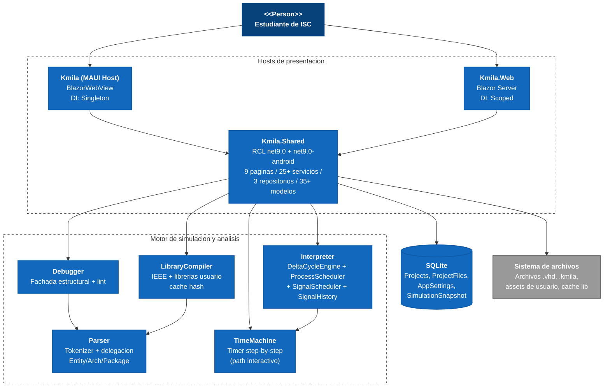

### `fig_5_3_c4_componentes` — Component diagram (rewritten)

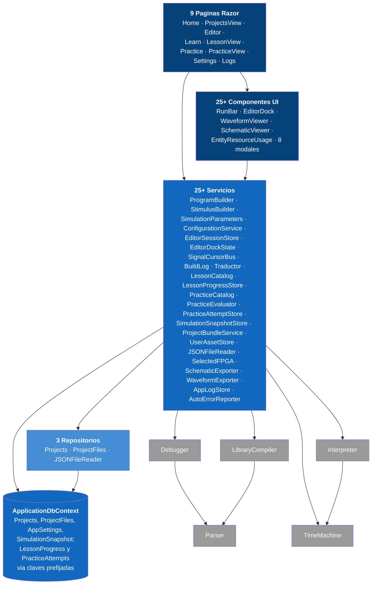

### `fig_5_5_1_clases_persistencia` — Persistence classes (rewritten)

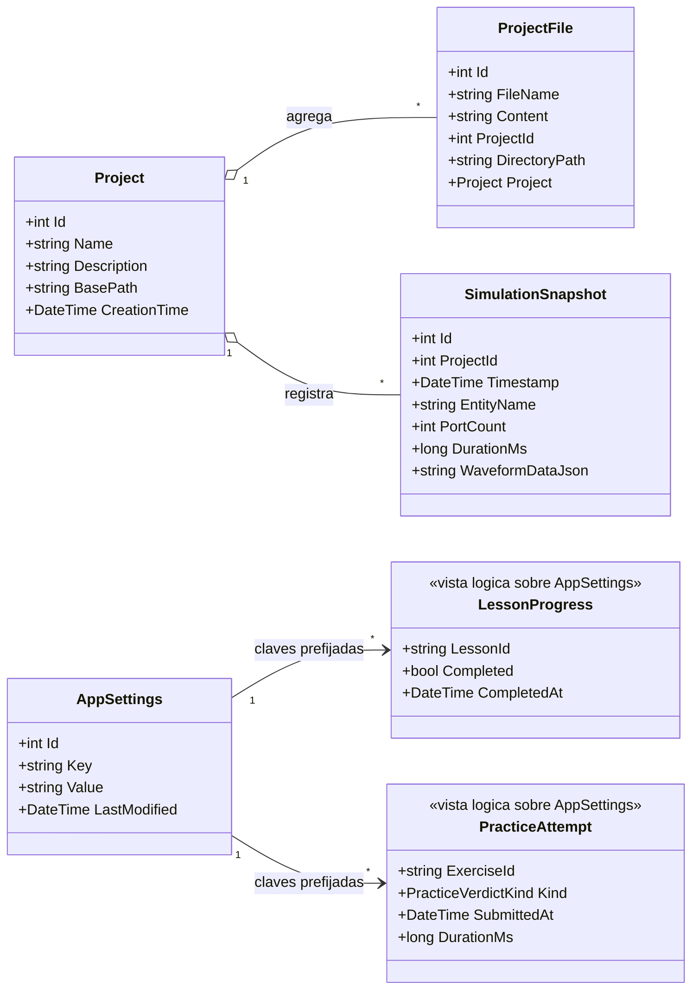

### `fig_5_13_1_app_learn_subsystem` — Learn subsystem (new)

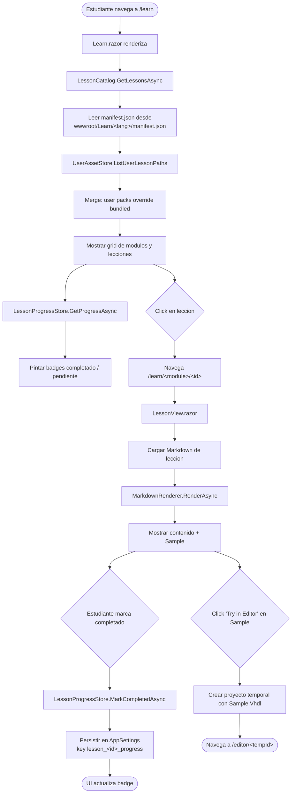

### `fig_5_13_2_app_practice_grading` — Practice grading flow (new)

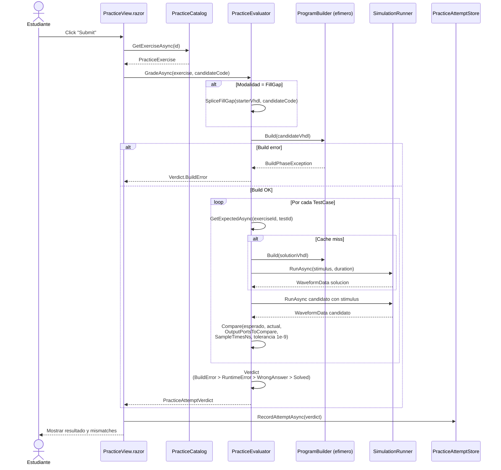

### `fig_5_13_3_app_editordock_composition` — EditorDock composition (new)

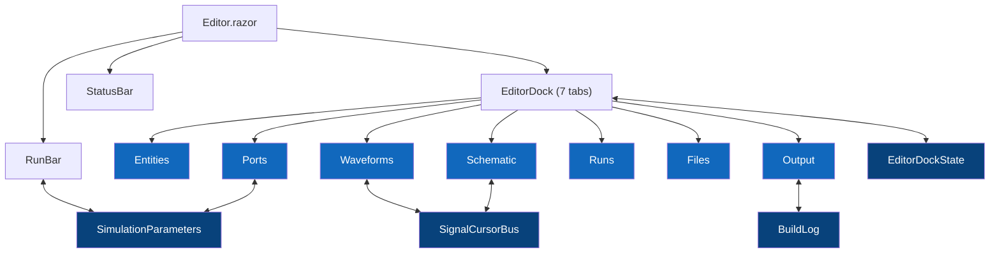

### `fig_5_13_4_app_runs_snapshot` — Runs/Snapshot persistence (new)

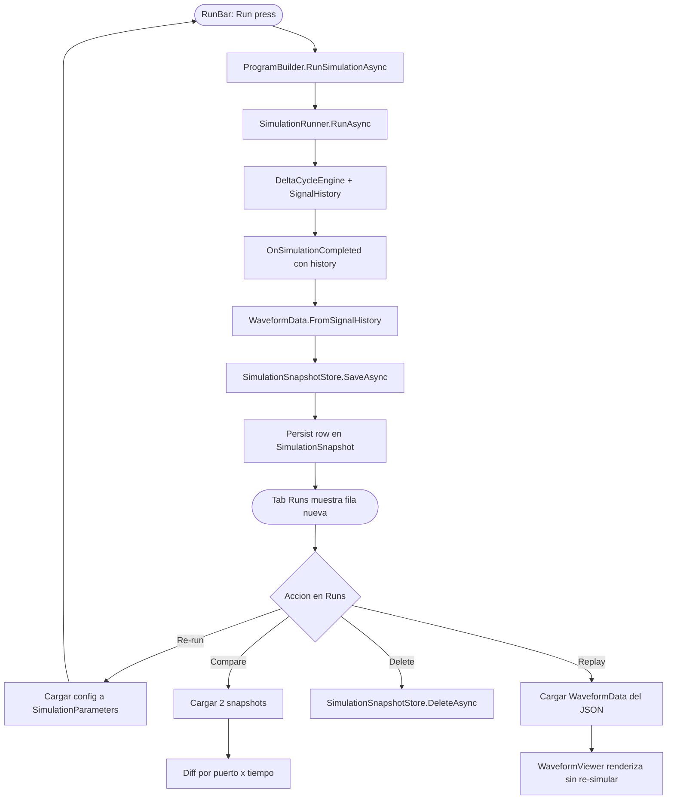

---

## 19.ter. Polish pass (2026-05-17)

Six tasks shipped in one sweep — see `Documentacion/CHANGELOG_concepts_module_2026-05-17.md` for the full per-task breakdown. Highlights from an App-perspective:

### `ExecutionPlayer` reuse beyond `/concepts`

The Concepts-track `Components/ExecutionPlayer.razor` is now reused by two more surfaces:

- **`/learn` lessons that opt in.** A new `inlinePlayer: bool` on `Lesson` makes the catalog load a sidecar `Learn/{lang}/{moduleId}/{lessonId}.timeline.json` and render the player between the Markdown body and the sample CTA. Currently enabled on `concurrent-thinking/02-delta-cycles`, `vhdl-basics/03-signal-vs-variable`, `combinational/01-concurrent-statements`, and `sequential/01-processes`.
- **`/editor/{id}` Step Replay tab.** After every Run, `Services/ReplayBuilder` converts `WaveformData` → `ExecutionTimelineDoc` (≤200 frames, cursor-cached signal evaluation), `Services/ReplayState` (scoped) holds the doc, and `Components/StepReplayPanel.razor` subscribes + renders the player. Step Replay renders as a sibling tab of the Monaco editor (see `EditorCardTab.Replay` in `Editor.razor`), not as a dock slot.
- **Breakpoints + live step-through.** `ReplayState` also owns the line-breakpoint set, the live `DeltaCycleEngine` (`AttachLive`/`DetachLive`), and the per-delta active-line bookkeeping. Key surfaces added 2026-05-27:
  - **Untracked-breakpoint warning (#4):** `RefreshLineMap(source)` rebuilds the signal→line map (and the condition-line set) from current editor content; `IsLineTracked`/`TrackedLines` classify each breakpoint. `Editor.RepaintBreakpointsAsync()` calls the extended JS `kmilaSetMonacoBreakpoints(all, untracked, warnMsg)` → untracked breakpoints render as a hollow dashed grey glyph + ⚠ tooltip; `StepReplayPanel` flags them in its list.
  - **Schematic step-through (#3):** `TrackActiveLines` + `LiveActiveLines`/`LiveActiveSignals` + throttled `OnLiveStepChanged` (see SchematicViewer above).
  - **Condition breakpoints (#5):** `OnLiveConditionEvaluated(line)` subscribes to `DeltaCycleEngine.OnConditionEvaluated` and pauses when a breakpoint sits on an `if`/`elsif`/`case-when` line — caught even though the condition produces no signal change.
- **Mid-run reattach (#11).** `Editor.HydrateWaveformFromLiveEngine()` rebuilds `_waveformData` from `Replay.LiveEngine.History` so a navigate-away-and-back into a running sim shows the run-so-far immediately. Opening a saved run (or compare) while the live sim owns the project sets `_liveMergeSuspended` so progress/completion merges don't clobber the saved view; a "Return to live run" banner (`waveform-saved-banner`) rehydrates from the engine.

### Visual identity

- **Block engine.** Blockly was retired 2026-05-28 in favour of `wwwroot/js/kmila-blocks.js` (backlog #17), a ~36 KB DOM engine. Block definitions for VHDL live in `wwwroot/js/kmila-blocks-vhdl.js`. The slate-brand theme is applied via CSS variables at inject time rather than via `Blockly.Theme.defineTheme`. Serialization format is byte-equivalent to the old Blockly workspace JSON so all pre-baked exercise catalogs (in `BlockProgram.cs`) still match.

### Bugs caught

- **Parser strictness** (`Parser/Repositories/PortsParser`): rejects unknown port types via `Constants.FindTypoSuggestion` (Levenshtein ≤ 2) — catches `STDLOGIC` / `STD_LGIC` slips — and surfaces missing `;` between ports as a `ParserException` instead of letting it cascade into "expected )" downstream. Pre-existing case-mismatch in `Constants.GetDatatype` (`case "INTEGER"` / `"NATURAL"` were uppercase against a lowercased value) fixed at the same time.
- **Monaco markers leak** (`wwwroot/js/kmila-shared-head.js#kmilaSetMonacoMarkers`): now filters via `getEditors()` + `dom.isConnected` + `.editor-monaco` ancestor so build errors no longer paint into Practice's `.practice-monaco` or the Concepts `.kmila-exec-monaco`. Defensive fallback to the all-models behaviour when no `.editor-monaco` is found.
- **File-row burger overflow** (`Components/FilesCard.razor#ToggleMenuAsync`): vertical viewport-clamp with flip-above. New `kmilaViewportHeight()` JS helper. CSS gets `max-height: 80vh; overflow-y: auto; max-width: calc(100vw - 16px)` as a safety net.

### Test status across the polish pass

Parser 40/40 + **2/2 new negative fixtures** (`test_negative_unknown_type.vhdl`, `test_negative_missing_port_semi.vhdl`). Interpreter sweep 54/54. Interpreter `--test-delta` 135/135. TimeMachine 23/23. Debugger exit 0. `dotnet build Kmila.Web` clean. No module regressed.

### Open questions parked for review

`memory/project_polish_pass_2026-05-17_open_questions.md` lists 10 deliberate decisions left for Daniel — most notably the trade-off between vendoring more JS libraries vs accepting CDN dependencies (see the dependency audit conversation that follows this pass).

---

## 19.quater. Practicas-hardening sweep (2026-06-22 → 2026-06-23)

Two consecutive sessions chasing five ESCOM Arquitectura de Computadoras practicas (P1–P4) through the Kmila simulator and a real MachXO2 FPGA. **Operating rule throughout: Kmila adapts to handle the codes, never the other way around.** No practica VHDL was modified for sim-only compatibility.

Phases shipped (full per-fix detail in `Interpreter/README.md` changelog and `Documentacion/HANDOFF_practicas_2026-06-23.md`):

- **0/1** — SimulatorBench baseline + new regression cases locking the multi-hop + constant-array bug classes.
- **2′** — constant `std_logic_vector` arrays as positional aggregates; element-size-aware `DeferredIndex` / `DynamicIndex`; expression-mode dynamic index for `rom(to_integer(unsigned(addr)))`; `Variable.operator==` reference-check trap.
- **B** — named-association aggregates `(0 => pack(170), …, others => …)` + real user-defined function bodies registered in `PackageRegistry` + `CachedScope` perf.
- **D** — case-statement identifier resolution + slice selector extraction.
- **E** — P2A unblock: slice-arg passing through standard functions, INTEGER comparison string fallback (enum literals), `*` width = leftW + rightW.
- **F** — P22 / P3 / P4 status pass. **F.P4** — function-body capture for any `if/case/loop`-nested body, `'length` + array attributes, generic-default substitution in `SourceElaborator`.
- **G.1** — P22 ROM rewrite **paused + reverted** per user request after Phase H opened.
- **H.3** — engine perf: concurrent-task sensitivity gating. **P22 12× faster.**
- **H.1** — direct entity instantiation `entity work.X(arch) port map(...)` verified end-to-end (no code change — already worked via `SourceElaborator`).
- **I.1** — `.vcd` artifacts ship via `insert_project.py`.

**End-of-session state (2026-06-23):**

- **SimulatorBench: 115/115 PASS** (13 new regression cases 120–132).
- **P1: 5/5 PASS.**
- **P2A: ACC = 56, halted = 1** — matches GHDL bit-for-bit and user FPGA-verified on the MachXO2.
- **P22 / P3:** parse + simulate; CPU FSM doesn't fully execute due to ROM-content gaps (P22) and elaboration interactions (P3).
- **P4:** parses + simulates clean in ~4 s for 2 µs.

All ~10 files changed in this sweep are uncommitted (per the user's no-git rule). Full file list + resume commands live in `Documentacion/HANDOFF_practicas_2026-06-23.md`.

### Continuation 2026-06-24 — handoff §6 follow-up

Closed §6 items 1, 3, 5, 6. Items 2 (P22 ROM rewrite) and 4 (P3/P22 ROM content) re-confirmed deferred — both are practica-edit work. **Zero practica VHDL modified.**

- **§6 item 1** — `(others => 'X')` initial-value eager expansion at signal-construction site (`Interpreter/Services/VariableSyntetizer.cs`). Bench case 133 locks the behaviour.
- **§6 item 3 (P3 root cause)** — RHS `(others => '0')` aggregate marker preserved through `Operation.cs::ParseOthersAggregate` and expanded at write time via new `SignalScheduler.cs::ExpandAggregateMarker` helper. Bench case 134 locks it. **P3 internal CPU registers now initialise clean at t = 0**; remaining ACC stall is a practica content bug (eq_sel mux OR-masking — same pattern as P22 Phase G.1) and is out of scope per the rule.
- **§6 item 5** — `*` width tripwire (bench case 135) locks the Phase E `leftW + rightW` numeric_std-aligned widening. No code change.
- **§6 item 6** — function-body caller-scope binding tripwire (bench case 136). Passes today; the elaborator's per-instance renaming creates distinct `FunctionDefinition` entries so there is no cache collision in practice. Workaround proven correct; no code change.

**End-of-continuation state (2026-06-24):**

- **SimulatorBench: 119/119 PASS** (4 new locks 133–136).
- **P1: 5/5 PASS.** **P2A: ACC = 56, halted = 1** — preserved.
- **P3:** parse + simulate; internal-register marker leak fixed; ACC still stalls due to practica `eq_sel` mux design.
- **P22 / P4:** parse + simulate cleanly, no regression.
- **Playwright `00-smoke` + `03-editor/build-run`:** 5/5 PASS.

Per-fix detail in `Interpreter/README.md` Changelog (Continuation 2026-06-24) and `Documentacion/HANDOFF_practicas_2026-06-23.md` §10.

---

## 20. Contact

For questions, support, or feedback, please open an issue on our GitHub repository or contact the development team through the project page.

---
*Last Updated: 2026-06-24 (practicas-hardening §6 follow-up: SimulatorBench 115→119/119 PASS, P3 register marker leak fixed, `*` + function-body rebind tripwires locked)*