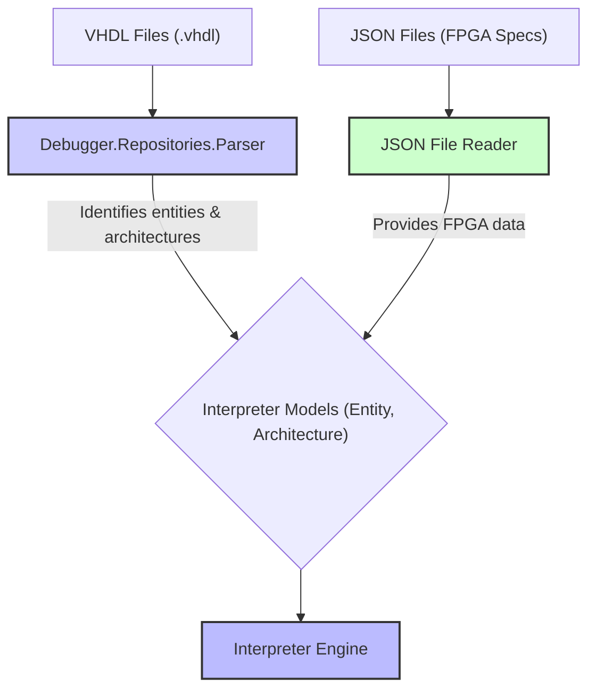
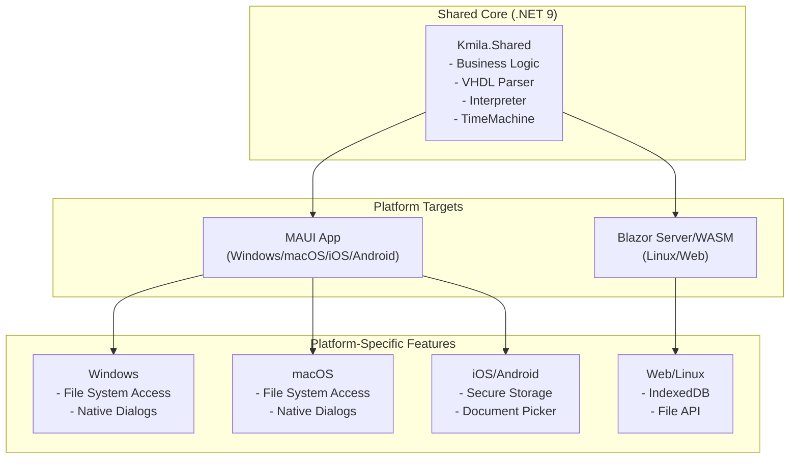
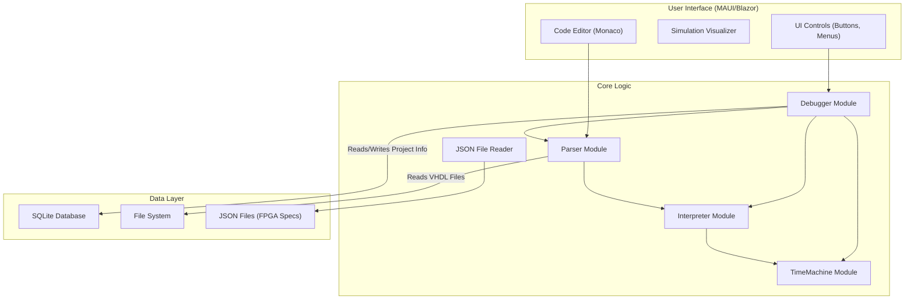
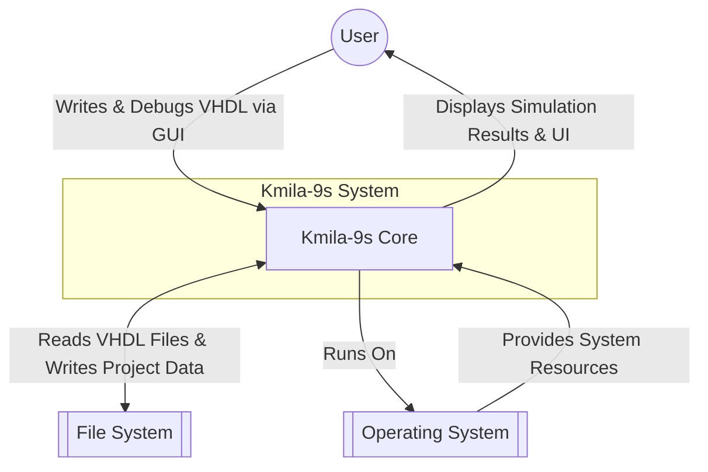
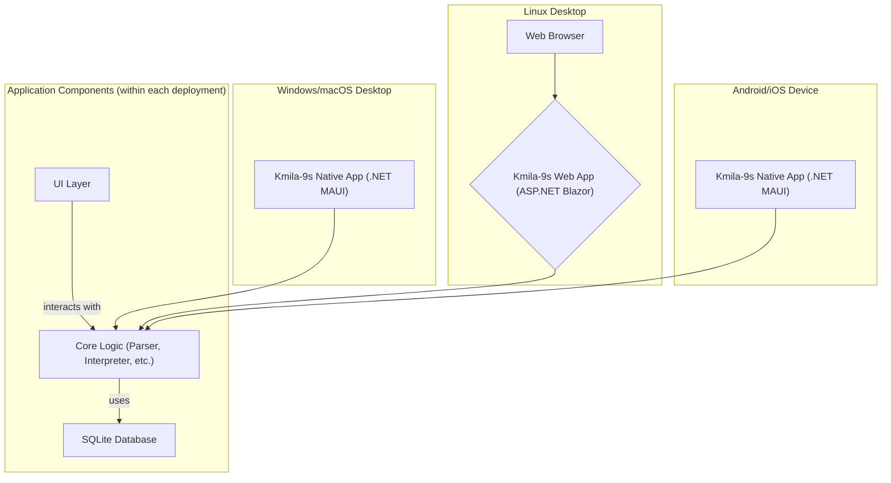
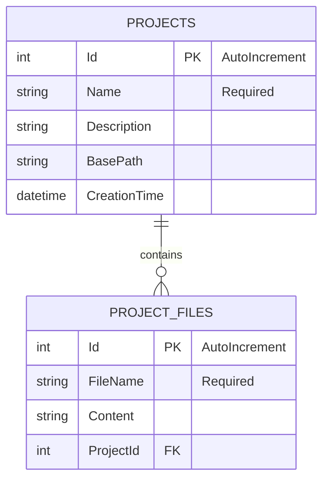
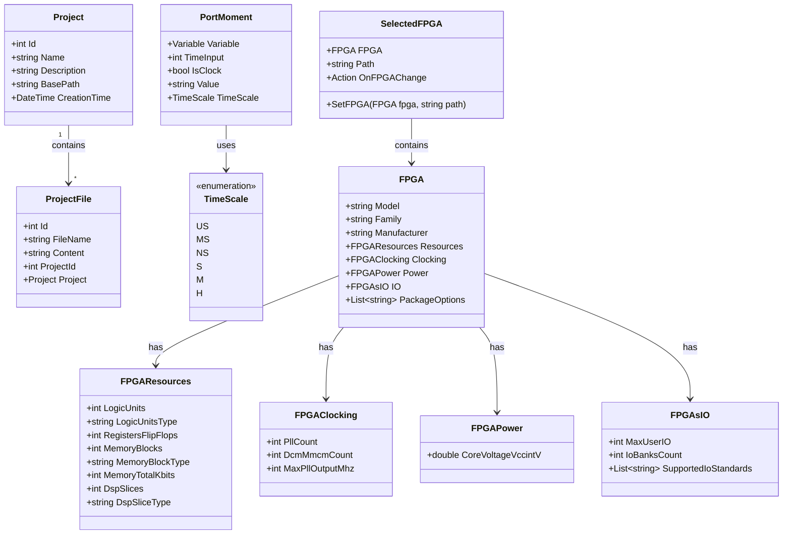
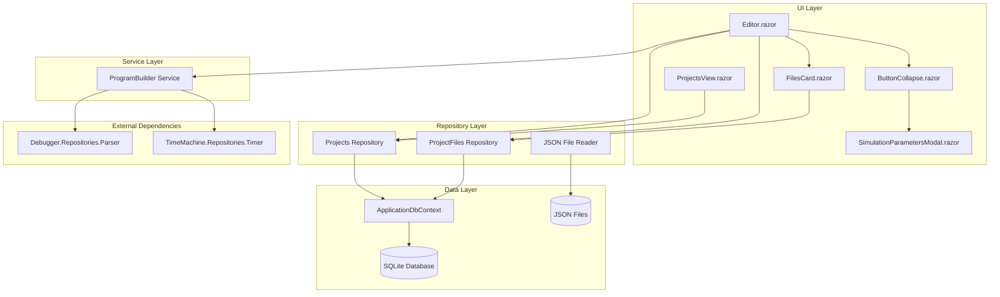
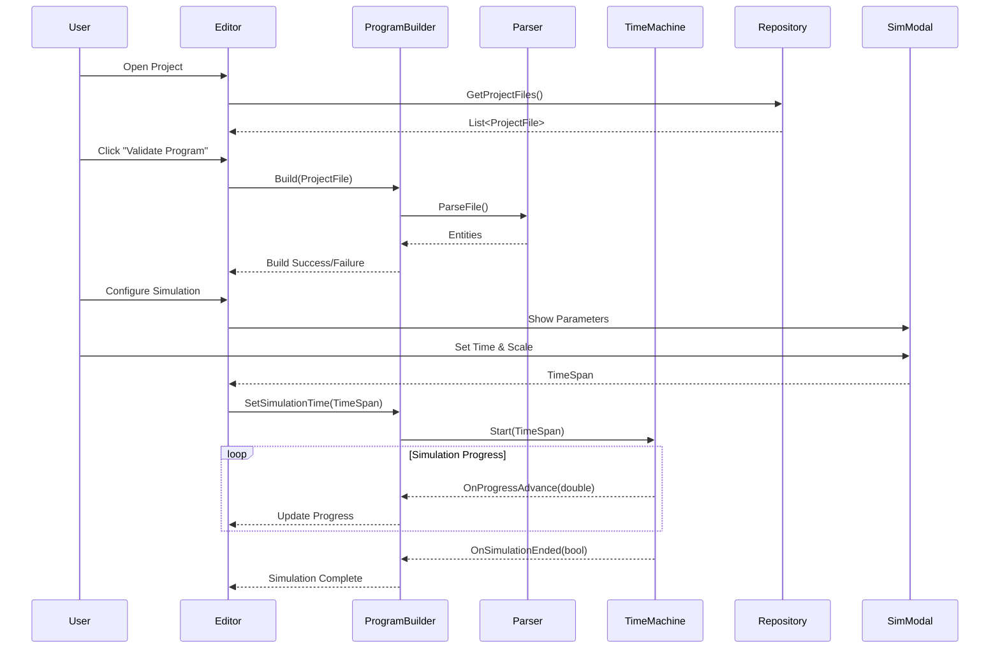

# Kmila-9s: A Multiplatform VHDL Learning and Debugging Tool

**Official Title:** Aplicación Multiplataforma para el Aprendizaje y Depuración de Código VHDL sin Requerimiento de Hardware Físico (Multiplatform Application for Learning and Debugging VHDL Code without Requiring Physical Hardware)

## 1. Overview

Kmila-9s is a multiplatform desktop application, running in a local environment, aimed at debugging VHDL (VHSIC Hardware Description Language) code. Its objective is to facilitate the analysis of programs through simulation and interactive visualization of digital signals, clock cycles, and port states. 

The project aims to support the academic learning of digital design for FPGAs (Field Programmable Gate Arrays), offering a free and open-source tool that strengthens educational practices and allows for a practical understanding of the logic of digital systems without requiring physical hardware.

## 2. The Problem

The teaching of digital systems design and its implementation on FPGAs faces significant barriers:

*   **Economic:** The cost of physical hardware (FPGA boards can cost hundreds of dollars) is a significant financial obstacle for students and institutions.
*   **Pedagogical:** Existing free tools often have a fragmented and unintuitive workflow. For example, GHDL is a powerful command-line simulator but requires integration with GTKWave for signal visualization, which is not ideal for beginners.
*   **Proprietary Limitations:** Commercial tools like ModelSim are robust but have restrictive educational licenses. Free versions of professional environments like Quartus Prime (Intel) and Vivado (AMD/Xilinx) have significant technical limitations.

## 3. Our Solution

Kmila-9s is a free, open-source, multiplatform academic platform focused on the logical and functional debugging of VHDL. Unlike traditional simulators, it offers an integrated experience with an intuitive graphical interface and real-time debugging, all without the need for physical hardware.

### Key Features

*   **Dynamic Variable Visualization:** Observe the states of signals, ports, and internal variables at any time to easily understand digital behavior.
*   **FPGA Resource Validation:** Select target FPGA devices and validate that your design fits within the device's resource constraints (Logic Units, Flip-Flops, BRAM, DSP, I/O Pins) before simulation.
*   **Cross-Platform:** Built with .NET 9 and MAUI, the application is installable and runs autonomously on **Windows, macOS, Android, iOS, and iPadOS**. A web version is also available for **Linux** users.
*   **Standalone and Offline:** The application runs locally without requiring a web service or internet connection.
*   **"Pre-Laboratory" Function:** Allows students to conduct preparatory practices before physical lab sessions, optimizing limited time and resources.
*   **Accessibility:** Practice and study from any computer or mobile device, no longer depending on a physical laboratory.
*   **Rapid Prototyping:** A design that might take weeks to validate in a traditional environment can be verified in a matter of days within the application.

## 4. Technology Stack

### Core Technologies
- **Framework**: .NET 9 (C#)
- **UI Frameworks**: 
  - .NET MAUI (Desktop/Mobile)
  - Blazor (Web)
  - BlazorBootstrap Components
- **Code Editor**: Monaco Editor
- **Database**: SQLite with SQLite-net-pcl
- **Version Control**: GitHub

### External Dependencies
- **VHDL Parser**: Debugger.Repositories.Parser (custom implementation)
- **Simulation Timer**: TimeMachine.Repositories.Timer
- **UI Components**: BlazorBootstrap Grid, Modal, Button, Icon components

## 5. Project Goals

The main objective is to develop an academic platform for the interactive debugging of VHDL code in a local environment, allowing students to simulate and debug digital designs without depending on physical hardware or expensive licenses.

The scope includes:
*   Implementation of a local service capable of running VHDL simulations.
*   Integration of a unified graphical interface for interactive debugging.
*   Validation of the tool as a pedagogical support in subjects related to digital design and reconfigurable systems.

## 6. Technical Documentation

The Kmila-9s simulation engine is composed of several core modules that work together to parse, interpret, and debug VHDL code.

### 6.1 Core Modules

#### a. VHDL Parser Module
*   **What it does:** This module reads raw VHDL source code (.vhdl files) and transforms it into a structured, in-memory representation (an Abstract Syntax Tree or AST). It performs lexical and syntactic analysis to understand the code's structure, including its entities, architectures, signals, and processes.
*   **Why it's required:** The simulation engine cannot work with raw text. The parser provides the foundational, validated structure of the code that the other modules need to understand and execute the design's logic.

**Core Responsibilities:**
*   Lexical Analysis: Breaking down the raw VHDL code into a stream of individual tokens
*   Syntactic Analysis: Validating the sequence of tokens against the VHDL grammar rules
*   Abstract Syntax Tree (AST) Generation: Building a tree-like structure of C# objects
*   Scope Management: Tracking all declared identifiers and their valid scopes

#### b. VHDL Interpreter Module
*   **What it does:** This module acts as the execution engine. It takes the structured data from the Parser and simulates the VHDL code's behavior over time. It processes sequential statements, evaluates expressions, and updates the state of signals and variables to mimic the functionality of the described digital circuit.
*   **Why it's required:** This is the core of the simulation. It brings the static, parsed code to life by executing the logic described, mimicking how a real digital circuit would behave.

**Core Responsibilities:**
*   Expression Evaluation: Calculating the results of operations using the Shunting-yard algorithm
*   Statement Execution: Processing sequential statements within VHDL processes
*   Control Flow Management: Implementing conditional execution logic
*   State Simulation: Managing the state of all declared signals, variables, and ports
*   Event Handling: Simulating how changes in signals trigger different processes

#### c. Debugger Module
*   **What it does:** This module acts as the central orchestrator. It integrates the Parser and Interpreter modules to create a cohesive simulation environment. It is responsible for managing the overall process, from loading VHDL files to controlling the simulation flow and providing the hooks for interactive debugging features like state inspection.
*   **Why it's required:** It ties all the components together into a single, user-facing application. It provides the main entry point and control logic for a user to load, run, and debug their VHDL code.

#### d. TimeMachine Module
*   **What it does:** This module is responsible for capturing and managing the state of the simulation at different points in time. It saves the values of all signals and variables at each simulation step or clock cycle.
*   **Why it's required:** The TimeMachine is the key to powerful, interactive debugging. By storing the simulation's history, it enables features like stepping backward through the code, inspecting past states to see how a value changed, and understanding the cause-and-effect flow of the digital logic.

#### e. Temporal Input Manager Module
*   **What it does:** This module manages time-based input values for VHDL ports during simulation. It allows users to define different input values at specific time points, creating dynamic test scenarios.
*   **Why it's required:** Real digital circuits respond to changing inputs over time. This module enables comprehensive testing by allowing users to simulate realistic input sequences and verify timing-dependent behavior.

**Key Features:**
*   Define multiple input moments for each port with specific time/value pairs
*   Support for different time scales (nanoseconds to hours)
*   Automatic clock signal generation for system clocks
*   Conflict resolution for overlapping time moments
*   Integration with TimeMachine for synchronized playback

#### f. JSON File Reader Module
*   **What it does:** This module is responsible for reading and parsing JSON files that contain FPGA device specifications. It deserializes the JSON data into `FPGA` objects, making device information available to the application.
*   **Why it's required:** To provide the application with a list of available FPGA devices for simulation, allowing users to select a target device and use its specifications in their projects.

### 6.2 High-Level Data Flow



## 7. System Architecture

### 7.1 Platform-Specific Architecture

#### Multiplatform Deployment Strategy



### 7.2 Component Architecture



## 8. Application Diagrams

### 8.1 Use Case Diagram


### 8.2 Context Diagram



### 8.3 Deployment Diagram



### 8.4 Base app diagram

```mermaid
graph TD

    user["Student/User<br>[External]"]
    file_system["File System<br>[External]"]
    operating_system["Operating System<br>[External]"]
    monaco_editor["Monaco Editor<br>/https://microsoft.github.io/monaco-editor/"]
    sqlite_db["SQLite Database<br>/https://www.sqlite.org/"]
    blazor_bootstrap["BlazorBootstrap Components<br>/https://blazorbootstrap.com/"]
    subgraph kmila_system_boundary["Kmila-9s System<br>/mnt/ssd1tb/Codigos/Kmila-9s/App/Kmila"]
        subgraph kmila_maui_app["Kmila (MAUI App)<br>/mnt/ssd1tb/Codigos/Kmila-9s/App/Kmila/Kmila"]
            maui_main_page["MainPage<br>/mnt/ssd1tb/Codigos/Kmila-9s/App/Kmila/Kmila/MainPage.xaml.cs"]
            maui_form_factor_service["FormFactor Service<br>/mnt/ssd1tb/Codigos/Kmila-9s/App/Kmila/Kmila/Services/FormFactor.cs"]
            %% Edges at this level (grouped by source)
            maui_main_page["MainPage<br>/mnt/ssd1tb/Codigos/Kmila-9s/App/Kmila/Kmila/MainPage.xaml.cs"] -->|"Uses"| maui_form_factor_service["FormFactor Service<br>/mnt/ssd1tb/Codigos/Kmila-9s/App/Kmila/Kmila/Services/FormFactor.cs"]
        end
        subgraph kmila_web_app["Kmila.Web (Blazor App)<br>/mnt/ssd1tb/Codigos/Kmila-9s/App/Kmila/Kmila.Web"]
            web_app_root["App.razor<br>/mnt/ssd1tb/Codigos/Kmila-9s/App/Kmila/Kmila.Web/Components/App.razor"]
            web_form_factor_service["FormFactor Service<br>/mnt/ssd1tb/Codigos/Kmila-9s/App/Kmila/Kmila.Web/Services/FormFactor.cs"]
            %% Edges at this level (grouped by source)
            web_app_root["App.razor<br>/mnt/ssd1tb/Codigos/Kmila-9s/App/Kmila/Kmila.Web/Components/App.razor"] -->|"Uses"| web_form_factor_service["FormFactor Service<br>/mnt/ssd1tb/Codigos/Kmila-9s/App/Kmila/Kmila.Web/Services/FormFactor.cs"]
        end
        subgraph kmila_shared_lib["Kmila.Shared (Shared Core)<br>/mnt/ssd1tb/Codigos/Kmila-9s/App/Kmila/Kmila.Shared"]
            vhdl_parser["VHDL Parser Module<br>/mnt/ssd1tb/Codigos/Kmila-9s/App/Kmila/Kmila.Shared/Services/ProgramBuilder.cs"]
            vhdl_interpreter["VHDL Interpreter Module<br>/mnt/ssd1tb/Codigos/Kmila-9s/App/Kmila/Kmila.Shared/Services/ProgramBuilder.cs"]
            debugger_module["Debugger Module<br>/mnt/ssd1tb/Codigos/Kmila-9s/App/Kmila/Kmila.Shared/Services/ProgramBuilder.cs"]
            time_machine_module["TimeMachine Module<br>/mnt/ssd1tb/Codigos/Kmila-9s/App/Kmila/Kmila.Shared/Services/ProgramBuilder.cs"]
            temporal_input_manager["Temporal Input Manager Module<br>/mnt/ssd1tb/Codigos/Kmila-9s/App/Kmila/Kmila.Shared/Services/ProgramBuilder.cs"]
            program_builder_service["ProgramBuilder Service<br>/mnt/ssd1tb/Codigos/Kmila-9s/App/Kmila/Kmila.Shared/Services/ProgramBuilder.cs"]
            projects_repo["Projects Repository<br>/mnt/ssd1tb/Codigos/Kmila-9s/App/Kmila/Kmila.Shared/Repositories/Projects.cs"]
            project_files_repo["ProjectFiles Repository<br>/mnt/ssd1tb/Codigos/Kmila-9s/App/Kmila/Kmila.Shared/Repositories/ProjectFiles.cs"]
            application_db_context["ApplicationDbContext<br>/mnt/ssd1tb/Codigos/Kmila-9s/App/Kmila/Kmila.Shared/Data/ApplicationDbContext.cs"]
            models["Data Models<br>/mnt/ssd1tb/Codigos/Kmila-9s/App/Kmila/Kmila.Shared/Models"]
            editor_page["Editor Page<br>/mnt/ssd1tb/Codigos/Kmila-9s/App/Kmila/Kmila.Shared/Pages/Editor.razor"]
            projects_view_page["Projects View Page<br>/mnt/ssd1tb/Codigos/Kmila-9s/App/Kmila/Kmila.Shared/Pages/ProjectsView.razor"]
            home_page["Home Page<br>/mnt/ssd1tb/Codigos/Kmila-9s/App/Kmila/Kmila.Shared/Pages/Home.razor"]
            simulation_params_modal["Simulation Parameters Modal<br>/mnt/ssd1tb/Codigos/Kmila-9s/App/Kmila/Kmila.Shared/Modals/SimulationParametersModal.razor"]
            create_file_modal["Create File Modal<br>/mnt/ssd1tb/Codigos/Kmila-9s/App/Kmila/Kmila.Shared/Modals/CreateFileModal.razor"]
            project_details_modal["Project Details Modal<br>/mnt/ssd1tb/Codigos/Kmila-9s/App/Kmila/Kmila.Shared/Modals/ProjectDetailsModal.razor"]
            nav_menu["NavMenu<br>/mnt/ssd1tb/Codigos/Kmila-9s/App/Kmila/Kmila.Shared/Layout/NavMenu.razor"]
            main_layout["MainLayout<br>/mnt/ssd1tb/Codigos/Kmila-9s/App/Kmila/Kmila.Shared/Layout/MainLayout.razor"]
            %% Edges at this level (grouped by source)
            editor_page["Editor Page<br>/mnt/ssd1tb/Codigos/Kmila-9s/App/Kmila/Kmila.Shared/Pages/Editor.razor"] -->|"Uses"| program_builder_service["ProgramBuilder Service<br>/mnt/ssd1tb/Codigos/Kmila-9s/App/Kmila/Kmila.Shared/Services/ProgramBuilder.cs"]
            editor_page["Editor Page<br>/mnt/ssd1tb/Codigos/Kmila-9s/App/Kmila/Kmila.Shared/Pages/Editor.razor"] -->|"Uses"| projects_repo["Projects Repository<br>/mnt/ssd1tb/Codigos/Kmila-9s/App/Kmila/Kmila.Shared/Repositories/Projects.cs"]
            editor_page["Editor Page<br>/mnt/ssd1tb/Codigos/Kmila-9s/App/Kmila/Kmila.Shared/Pages/Editor.razor"] -->|"Uses"| project_files_repo["ProjectFiles Repository<br>/mnt/ssd1tb/Codigos/Kmila-9s/App/Kmila/Kmila.Shared/Repositories/ProjectFiles.cs"]
            editor_page["Editor Page<br>/mnt/ssd1tb/Codigos/Kmila-9s/App/Kmila/Kmila.Shared/Pages/Editor.razor"] -->|"Opens"| simulation_params_modal["Simulation Parameters Modal<br>/mnt/ssd1tb/Codigos/Kmila-9s/App/Kmila/Kmila.Shared/Modals/SimulationParametersModal.razor"]
            editor_page["Editor Page<br>/mnt/ssd1tb/Codigos/Kmila-9s/App/Kmila/Kmila.Shared/Pages/Editor.razor"] -->|"Opens"| create_file_modal["Create File Modal<br>/mnt/ssd1tb/Codigos/Kmila-9s/App/Kmila/Kmila.Shared/Modals/CreateFileModal.razor"]
            projects_view_page["Projects View Page<br>/mnt/ssd1tb/Codigos/Kmila-9s/App/Kmila/Kmila.Shared/Pages/ProjectsView.razor"] -->|"Uses"| projects_repo["Projects Repository<br>/mnt/ssd1tb/Codigos/Kmila-9s/App/Kmila/Kmila.Shared/Repositories/Projects.cs"]
            projects_view_page["Projects View Page<br>/mnt/ssd1tb/Codigos/Kmila-9s/App/Kmila/Kmila.Shared/Pages/ProjectsView.razor"] -->|"Opens"| project_details_modal["Project Details Modal<br>/mnt/ssd1tb/Codigos/Kmila-9s/App/Kmila/Kmila.Shared/Modals/ProjectDetailsModal.razor"]
            program_builder_service["ProgramBuilder Service<br>/mnt/ssd1tb/Codigos/Kmila-9s/App/Kmila/Kmila.Shared/Services/ProgramBuilder.cs"] -->|"Uses"| vhdl_parser["VHDL Parser Module<br>/mnt/ssd1tb/Codigos/Kmila-9s/App/Kmila/Kmila.Shared/Services/ProgramBuilder.cs"]
            program_builder_service["ProgramBuilder Service<br>/mnt/ssd1tb/Codigos/Kmila-9s/App/Kmila/Kmila.Shared/Services/ProgramBuilder.cs"] -->|"Uses"| vhdl_interpreter["VHDL Interpreter Module<br>/mnt/ssd1tb/Codigos/Kmila-9s/App/Kmila/Kmila.Shared/Services/ProgramBuilder.cs"]
            program_builder_service["ProgramBuilder Service<br>/mnt/ssd1tb/Codigos/Kmila-9s/App/Kmila/Kmila.Shared/Services/ProgramBuilder.cs"] -->|"Uses"| debugger_module["Debugger Module<br>/mnt/ssd1tb/Codigos/Kmila-9s/App/Kmila/Kmila.Shared/Services/ProgramBuilder.cs"]
            program_builder_service["ProgramBuilder Service<br>/mnt/ssd1tb/Codigos/Kmila-9s/App/Kmila/Kmila.Shared/Services/ProgramBuilder.cs"] -->|"Uses"| time_machine_module["TimeMachine Module<br>/mnt/ssd1tb/Codigos/Kmila-9s/App/Kmila/Kmila.Shared/Services/ProgramBuilder.cs"]
            program_builder_service["ProgramBuilder Service<br>/mnt/ssd1tb/Codigos/Kmila-9s/App/Kmila/Kmila.Shared/Services/ProgramBuilder.cs"] -->|"Uses"| temporal_input_manager["Temporal Input Manager Module<br>/mnt/ssd1tb/Codigos/Kmila-9s/App/Kmila/Kmila.Shared/Services/ProgramBuilder.cs"]
            vhdl_interpreter["VHDL Interpreter Module<br>/mnt/ssd1tb/Codigos/Kmila-9s/App/Kmila/Kmila.Shared/Services/ProgramBuilder.cs"] -->|"Updates"| time_machine_module["TimeMachine Module<br>/mnt/ssd1tb/Codigos/Kmila-9s/App/Kmila/Kmila.Shared/Services/ProgramBuilder.cs"]
            debugger_module["Debugger Module<br>/mnt/ssd1tb/Codigos/Kmila-9s/App/Kmila/Kmila.Shared/Services/ProgramBuilder.cs"] -->|"Uses"| vhdl_parser["VHDL Parser Module<br>/mnt/ssd1tb/Codigos/Kmila-9s/App/Kmila/Kmila.Shared/Services/ProgramBuilder.cs"]
            debugger_module["Debugger Module<br>/mnt/ssd1tb/Codigos/Kmila-9s/App/Kmila/Kmila.Shared/Services/ProgramBuilder.cs"] -->|"Uses"| vhdl_interpreter["VHDL Interpreter Module<br>/mnt/ssd1tb/Codigos/Kmila-9s/App/Kmila/Kmila.Shared/Services/ProgramBuilder.cs"]
            debugger_module["Debugger Module<br>/mnt/ssd1tb/Codigos/Kmila-9s/App/Kmila/Kmila.Shared/Services/ProgramBuilder.cs"] -->|"Uses"| time_machine_module["TimeMachine Module<br>/mnt/ssd1tb/Codigos/Kmila-9s/App/Kmila/Kmila.Shared/Services/ProgramBuilder.cs"]
            projects_repo["Projects Repository<br>/mnt/ssd1tb/Codigos/Kmila-9s/App/Kmila/Kmila.Shared/Repositories/Projects.cs"] -->|"Uses"| application_db_context["ApplicationDbContext<br>/mnt/ssd1tb/Codigos/Kmila-9s/App/Kmila/Kmila.Shared/Data/ApplicationDbContext.cs"]
            project_files_repo["ProjectFiles Repository<br>/mnt/ssd1tb/Codigos/Kmila-9s/App/Kmila/Kmila.Shared/Repositories/ProjectFiles.cs"] -->|"Uses"| application_db_context["ApplicationDbContext<br>/mnt/ssd1tb/Codigos/Kmila-9s/App/Kmila/Kmila.Shared/Data/ApplicationDbContext.cs"]
            application_db_context["ApplicationDbContext<br>/mnt/ssd1tb/Codigos/Kmila-9s/App/Kmila/Kmila.Shared/Data/ApplicationDbContext.cs"] -->|"Manages"| models["Data Models<br>/mnt/ssd1tb/Codigos/Kmila-9s/App/Kmila/Kmila.Shared/Models"]
        end
        %% Edges at this level (grouped by source)
        maui_main_page["MainPage<br>/mnt/ssd1tb/Codigos/Kmila-9s/App/Kmila/Kmila/MainPage.xaml.cs"] -->|"Hosts"| editor_page["Editor Page<br>/mnt/ssd1tb/Codigos/Kmila-9s/App/Kmila/Kmila.Shared/Pages/Editor.razor"]
        maui_main_page["MainPage<br>/mnt/ssd1tb/Codigos/Kmila-9s/App/Kmila/Kmila/MainPage.xaml.cs"] -->|"Hosts"| projects_view_page["Projects View Page<br>/mnt/ssd1tb/Codigos/Kmila-9s/App/Kmila/Kmila.Shared/Pages/ProjectsView.razor"]
        maui_main_page["MainPage<br>/mnt/ssd1tb/Codigos/Kmila-9s/App/Kmila/Kmila/MainPage.xaml.cs"] -->|"Hosts"| home_page["Home Page<br>/mnt/ssd1tb/Codigos/Kmila-9s/App/Kmila/Kmila.Shared/Pages/Home.razor"]
        maui_main_page["MainPage<br>/mnt/ssd1tb/Codigos/Kmila-9s/App/Kmila/Kmila/MainPage.xaml.cs"] -->|"Hosts"| nav_menu["NavMenu<br>/mnt/ssd1tb/Codigos/Kmila-9s/App/Kmila/Kmila.Shared/Layout/NavMenu.razor"]
        maui_main_page["MainPage<br>/mnt/ssd1tb/Codigos/Kmila-9s/App/Kmila/Kmila/MainPage.xaml.cs"] -->|"Hosts"| main_layout["MainLayout<br>/mnt/ssd1tb/Codigos/Kmila-9s/App/Kmila/Kmila.Shared/Layout/MainLayout.razor"]
        web_app_root["App.razor<br>/mnt/ssd1tb/Codigos/Kmila-9s/App/Kmila/Kmila.Web/Components/App.razor"] -->|"Hosts"| editor_page["Editor Page<br>/mnt/ssd1tb/Codigos/Kmila-9s/App/Kmila/Kmila.Shared/Pages/Editor.razor"]
        web_app_root["App.razor<br>/mnt/ssd1tb/Codigos/Kmila-9s/App/Kmila/Kmila.Web/Components/App.razor"] -->|"Hosts"| projects_view_page["Projects View Page<br>/mnt/ssd1tb/Codigos/Kmila-9s/App/Kmila/Kmila.Shared/Pages/ProjectsView.razor"]
        web_app_root["App.razor<br>/mnt/ssd1tb/Codigos/Kmila-9s/App/Kmila/Kmila.Web/Components/App.razor"] -->|"Hosts"| home_page["Home Page<br>/mnt/ssd1tb/Codigos/Kmila-9s/App/Kmila/Kmila.Shared/Pages/Home.razor"]
        web_app_root["App.razor<br>/mnt/ssd1tb/Codigos/Kmila-9s/App/Kmila/Kmila.Web/Components/App.razor"] -->|"Hosts"| nav_menu["NavMenu<br>/mnt/ssd1tb/Codigos/Kmila-9s/App/Kmila/Kmila.Shared/Layout/NavMenu.razor"]
        web_app_root["App.razor<br>/mnt/ssd1tb/Codigos/Kmila-9s/App/Kmila/Kmila.Web/Components/App.razor"] -->|"Hosts"| main_layout["MainLayout<br>/mnt/ssd1tb/Codigos/Kmila-9s/App/Kmila/Kmila.Shared/Layout/MainLayout.razor"]
    end
    %% Edges at this level (grouped by source)
    user["Student/User<br>[External]"] -->|"Interacts with"| maui_main_page["MainPage<br>/mnt/ssd1tb/Codigos/Kmila-9s/App/Kmila/Kmila/MainPage.xaml.cs"]
    user["Student/User<br>[External]"] -->|"Interacts with"| web_app_root["App.razor<br>/mnt/ssd1tb/Codigos/Kmila-9s/App/Kmila/Kmila.Web/Components/App.razor"]
    editor_page["Editor Page<br>/mnt/ssd1tb/Codigos/Kmila-9s/App/Kmila/Kmila.Shared/Pages/Editor.razor"] -->|"Embeds | JavaScript Interop"| monaco_editor["Monaco Editor<br>/https://microsoft.github.io/monaco-editor/"]
    editor_page["Editor Page<br>/mnt/ssd1tb/Codigos/Kmila-9s/App/Kmila/Kmila.Shared/Pages/Editor.razor"] -->|"Uses"| blazor_bootstrap["BlazorBootstrap Components<br>/https://blazorbootstrap.com/"]
    projects_view_page["Projects View Page<br>/mnt/ssd1tb/Codigos/Kmila-9s/App/Kmila/Kmila.Shared/Pages/ProjectsView.razor"] -->|"Uses"| blazor_bootstrap["BlazorBootstrap Components<br>/https://blazorbootstrap.com/"]
    vhdl_parser["VHDL Parser Module<br>/mnt/ssd1tb/Codigos/Kmila-9s/App/Kmila/Kmila.Shared/Services/ProgramBuilder.cs"] -->|"Reads | VHDL Files"| file_system["File System<br>[External]"]
    application_db_context["ApplicationDbContext<br>/mnt/ssd1tb/Codigos/Kmila-9s/App/Kmila/Kmila.Shared/Data/ApplicationDbContext.cs"] -->|"Connects to"| sqlite_db["SQLite Database<br>/https://www.sqlite.org/"]
    kmila_maui_app["Kmila (MAUI App)<br>/mnt/ssd1tb/Codigos/Kmila-9s/App/Kmila/Kmila"] -->|"Runs On"| operating_system["Operating System<br>[External]"]
    kmila_maui_app["Kmila (MAUI App)<br>/mnt/ssd1tb/Codigos/Kmila-9s/App/Kmila/Kmila"] -->|"Accesses"| file_system["File System<br>[External]"]
    kmila_web_app["Kmila.Web (Blazor App)<br>/mnt/ssd1tb/Codigos/Kmila-9s/App/Kmila/Kmila.Web"] -->|"Runs On"| operating_system["Operating System<br>[External]"]
    kmila_web_app["Kmila.Web (Blazor App)<br>/mnt/ssd1tb/Codigos/Kmila-9s/App/Kmila/Kmila.Web"] -->|"Accesses"| file_system["File System<br>[External]"]

```

---
*Generated by [CodeViz.ai](https://codeviz.ai) on 11/6/2025, 4:00:52 PM*


## 9. Database Schema


**Note:** The following entities from the original documentation are NOT currently implemented:
- SIMULATION_CONFIGS (simulation parameters are passed at runtime, not persisted)
- PORT_CONFIGURATIONS (managed in-memory during simulation)
- PORT_MOMENTS (handled by PortMoment model but not persisted to DB)
- SIMULATION_RESULTS (not implemented)
- BREAKPOINTS (not implemented)

## 10. Shared Project Structure

The `Kmila.Shared` project contains the core logic, UI components, and data models for the Kmila-9s application.

### 10.1 Views and UI Components

#### Pages
*   **Editor.razor**: Main page for the VHDL editor, hosts Monaco editor, file explorer, and simulation controls
*   **Home.razor**: Landing page of the application
*   **ProjectsView.razor**: Displays all user projects with create, edit, and delete functionality

#### Components
*   **ButtonCollapse.razor**: Contains main editor buttons (Save, New File, Start Simulation, Validate)
*   **EntityView.razor**: Displays VHDL entity name and ports with resource usage estimation
*   **FilesCard.razor**: Project files card with open and remove functionality
*   **PortMomentExtraInputs.razor**: Allows adding extra time moments for a port
*   **PortMomentInput.razor**: Defines port values at specific times
*   **EnhancedRangeSlider.razor**: Advanced range slider component with dynamic coloring, tooltips, tick marks, and custom labels
*   **FPGASimpleView.razor**: Compact FPGA information display widget showing device specifications

#### Layout
*   **MainLayout.razor**: Main application layout with navigation menu and content area
*   **NavMenu.razor**: Navigation menu displaying project options and created projects
*   **TopBar.razor**: Top navigation bar with FPGA selector and theme switcher

#### Modals
*   **CreateFileModal.razor**: Modal for creating new files in a project
*   **ProjectDetailsModal.razor**: Modal for creating new projects
*   **SimulationParametersModal.razor**: Comprehensive modal for configuring simulation parameters including time/scale, port inputs, FPGA resource validation, and simulation controls (start/pause/resume/restart/stop)



### 10.2 Backend and Logic

#### Services
*   **ProgramBuilder.cs**: Responsible for building and simulating VHDL code using Debugger and TimeMachine modules
*   **IFormFactor.cs**: Interface defining methods for device form factor and platform detection

#### Repositories
*   **Projects.cs**: Manages projects in the database (CRUD operations)
*   **ProjectFiles.cs**: Manages project files in the database (CRUD operations)
*   **JSONFileReader.cs**: Reads FPGA device specifications from JSON files.

#### Models
*   **Project.cs**: Represents a project in the application
*   **ProjectFile.cs**: Represents a file in a project
*   **PortMoment.cs**: Represents a moment when a port changes value
*   **TimeScale.cs**: Enumeration defining simulation time scales
*   **ToastMessages.cs**: Utility class for creating toast messages
*   **SelectedFPGA.cs**: State management for selected FPGA device with change notifications
*   **FPGA.cs**: Main FPGA device model containing all device specifications
*   **FPGAResources.cs**: FPGA resource specifications (Logic Units, Registers, Memory, DSP)
*   **FPGAClocking.cs**: FPGA clocking specifications (PLL, DCM/MMCM)
*   **FPGAPower.cs**: FPGA power specifications (Core voltage)
*   **FPGAsIO.cs**: FPGA I/O specifications (User I/O, Banks, Standards)

### 10.3 Component Interactions



## 11. Implementation Details

### 11.1 File System Abstraction

The application implements platform-specific file handling through an abstraction layer:

```csharp
public interface IFileSystem
{
    Task<string> ReadFileAsync(string path);
    Task WriteFileAsync(string path, string content);
    Task<IEnumerable<string>> GetFilesAsync(string directory);
    bool FileExists(string path);
}
```

*   **Desktop (Windows/macOS)**: Direct file system access
*   **Mobile (iOS/Android)**: Secure storage and document picker
*   **Web (Linux/Browser)**: IndexedDB via JavaScript interop

### 11.2 Performance Optimization

#### Memory Management
*   Token pooling to reduce GC pressure
*   Lazy AST node creation
*   String interning for identifiers
*   Expression result caching
*   Delta compression for state storage

#### Platform-Specific Optimizations
*   **Desktop**: Parallel processing for multiple VHDL processes
*   **Mobile**: Memory-efficient single-threaded execution with UI yielding
*   **Web**: Web Workers via JavaScript interop for background processing

## 12. Testing Strategy

### Test Coverage Areas

*   **Unit Tests**: Tokenizer, Parser, Interpreter, Expression Evaluator
*   **Integration Tests**: Parser-Interpreter, TimeMachine, Input Manager integration
*   **E2E Tests**: Full simulation workflows, UI workflows, platform-specific features
*   **Performance Tests**: Load testing, memory profiling, benchmarks

## 13. Security Considerations

*   **Input Validation**: All VHDL input is sanitized and validated before parsing
*   **Sandboxed Execution**: Simulation runs in isolated context
*   **File System Access**: Limited to project directories
*   **Memory Limits**: Configurable memory caps for simulation states
*   **Cross-Platform Security**:
    *   Desktop: OS-level file permissions
    *   Mobile: App sandboxing and secure storage
    *   Web: Browser sandbox and CORS policies

## 14. Deployment

### CI/CD Pipeline

The application uses GitHub Actions for continuous integration and deployment:

*   **Source Control**: GitHub Repository
*   **CI Pipeline**: .NET Build → Run Tests → Code Analysis
*   **Platform Builds**:
    *   Windows MSI
    *   macOS DMG
    *   Android APK/AAB
    *   iOS IPA
    *   Blazor WASM
*   **Distribution**:
    *   Microsoft Store (Windows)
    *   Apple App Store (macOS/iOS)
    *   Google Play Store (Android)
    *   Web Hosting (Linux/Browser)
    *   GitHub Releases (Direct downloads)

## 16. Project Structure
```markdown

### Kmila.Shared
├── Components/
│   ├── ButtonCollapse.razor
│   ├── EntityView.razor
│   ├── EnhancedRangeSlider.razor
│   ├── FilesCard.razor
│   ├── FPGASimpleView.razor
│   ├── PortMomentInput.razor
│   └── PortMomentExtraInputs.razor
├── Data/
│   └── ApplicationDbContext.cs
├── Interfaces/
│   ├── IRepository.cs
│   └── IJsonFileReader.cs
├── Layout/
│   ├── MainLayout.razor
│   ├── NavMenu.razor
│   └── TopBar.razor
├── Models/
│   ├── Project.cs
│   ├── ProjectFile.cs
│   ├── PortMoment.cs
│   ├── TimeScale.cs
│   ├── ToastMessages.cs
│   ├── SelectedFPGA.cs
│   ├── FPGA.cs
│   ├── FPGAResources.cs
│   ├── FPGAClocking.cs
│   ├── FPGAPower.cs
│   └── FPGAsIO.cs
├── Pages/
│   ├── Editor.razor
│   ├── Home.razor
│   └── ProjectsView.razor
├── Repositories/
│   ├── Projects.cs
│   ├── ProjectFiles.cs
│   └── JSONFileReader.cs
├── Services/
│   ├── ProgramBuilder.cs
│   ├── IFormFactor.cs
│   └── Traductor.cs
└── Modals/
    ├── CreateFileModal.razor
    ├── ProjectDetailsModal.razor
    └── SimulationParametersModal.razor
```

## 16. Documentation Status

### Overview

The Kmila-9s codebase maintains comprehensive XML documentation for most public APIs. As of the latest review (December 2025), **72% of files have complete XML documentation** covering all public methods, properties, and classes.

### Well-Documented Components

The following areas have complete XML documentation:

#### Fully Documented
*   **All Components**: ButtonCollapse, EntityView, EnhancedRangeSlider, FilesCard, PortMomentInput, PortMomentExtraInputs
*   **All Pages**: Editor, ProjectsView, Home
*   **All Modals**: SimulationParametersModal, CreateFileModal, ProjectDetailsModal
*   **All Repositories**: Projects, ProjectFiles, JSONFileReader
*   **All Services**: ProgramBuilder, IFormFactor
*   **Core Models**: Project, ProjectFile, PortMoment, TimeScale, ToastMessages
*   **Data Layer**: ApplicationDbContext
*   **Interfaces**: IRepository
*   **Layout Components**: NavMenu, TopBar (partial), MainLayout

### Components Requiring Documentation

The following files need XML documentation added:

#### High Priority (Missing Documentation)
1. **FPGASimpleView.razor** (Kmila.Shared/Components/) - Compact FPGA information display widget
2. **SelectedFPGA.cs** (Kmila.Shared/Models/) - State management for FPGA selection
3. **FPGA.cs** (Kmila.Shared/Models/) - Main FPGA device model
4. **FPGAResources.cs** (Kmila.Shared/Models/) - FPGA resource specifications
5. **FPGAClocking.cs** (Kmila.Shared/Models/) - FPGA clocking specifications
6. **FPGAPower.cs** (Kmila.Shared/Models/) - FPGA power specifications
7. **FPGAsIO.cs** (Kmila.Shared/Models/) - FPGA I/O specifications
8. **IJsonFileReader.cs** (Kmila.Shared/Interfaces/) - Generic JSON file reader interface

#### Code Quality Notes
*   **Traductor.cs** (Kmila.Shared/Services/) - Empty placeholder class; should be implemented or removed
*   **ProjectFiles.GetByAsync()** and **ProjectFiles.RemoveAsync()** - Currently throw NotImplementedException; should be implemented or removed from interface
*   **IJsonFileReader** - Interface defined but not implemented by JSONFileReader class

### Documentation Guidelines

When adding documentation to the above components, please follow these guidelines:

1. **Use XML Documentation Comments**: All public classes, methods, properties, and parameters should have `///` comments
2. **Describe Purpose**: Explain what the component does and why it exists
3. **Document Parameters**: Use `<param>` tags for all method parameters
4. **Document Return Values**: Use `<returns>` tags for methods that return values
5. **Add Examples**: Use `<example>` tags for complex methods where appropriate
6. **Keep it Current**: Update documentation when code changes

### Example Documentation Format

```csharp
/// <summary>
/// Represents FPGA device specifications including resources, clocking, power, and I/O.
/// </summary>
public class FPGA
{
    /// <summary>
    /// Gets or sets the FPGA model identifier (e.g., "XC7A35T-1CPG236C").
    /// </summary>
    public string Model { get; set; }

    /// <summary>
    /// Gets or sets the FPGA family name (e.g., "Artix-7", "Cyclone V").
    /// </summary>
    public string Family { get; set; }
}
```

## 17. Contributing

We welcome contributions to Kmila-9s! Please check our GitHub repository for contribution guidelines and open issues.

## 18. License

Kmila-9s is released as free and open-source software. Please refer to the LICENSE file in the repository for specific licensing terms.

## 19. Contact

For questions, support, or feedback, please open an issue on our GitHub repository or contact the development team through the project page.