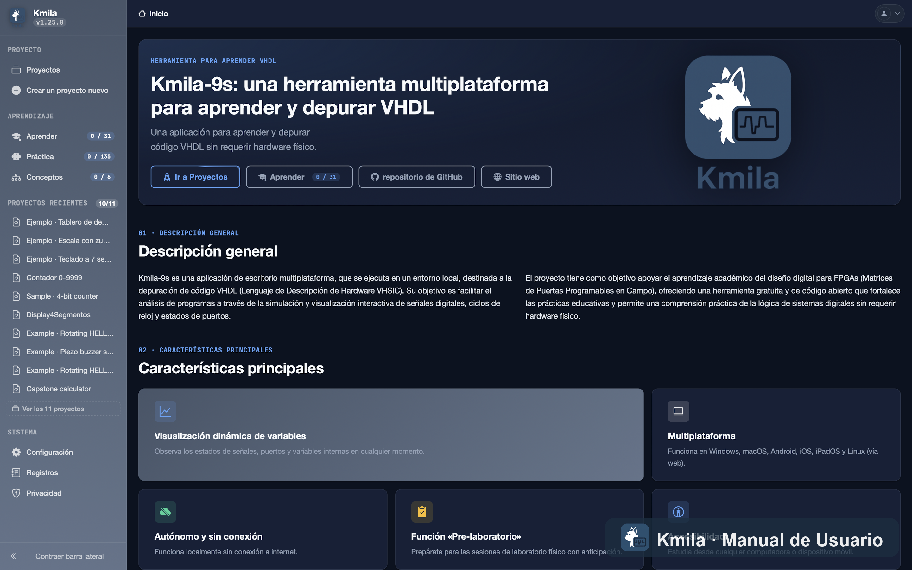

# 1. Primeros pasos: instalar y abrir Kmila

[← Volver al índice](README.md) · Siguiente: [La interfaz de un vistazo →](02-interfaz-general.md)

---

Kmila funciona de cuatro maneras distintas. Todas muestran **la misma
aplicación**; solo cambia la forma de abrirla. Elige la que mejor se adapte a ti.

| Si quieres… | Usa… |
|---|---|
| Tenerla instalada y abrirla con un clic | **App de escritorio o móvil** |
| Usarla desde el navegador en tu red o servidor | **Web local** |
| Probarla ya mismo, sin instalar nada | **Demo en el navegador** |
| Automatizar simulaciones o trabajar por consola | **Terminal (CLI)** |

---

## Opción A — App de escritorio y móvil (lo más cómodo)

Es la versión nativa para **Windows, macOS, Android, iPhone/iPad**. Se instala
como cualquier otra aplicación.

1. Entra al sitio oficial de Kmila (botón **«Sitio web»** de la pantalla de
   inicio) y abre la sección de **descargas**.
2. Descarga el instalador que corresponda a tu sistema.
3. Instálalo y ábrelo. La primera vez verás la **pantalla de inicio** con un
   recorrido guiado de bienvenida.

> ✅ **Consejo** — En macOS la app añade un menú **Archivo ▸ Guardar (⌘S)**
> para guardar tu trabajo con el atajo de siempre.

## Opción B — Web local (desde el navegador)

Pensada para usarla **en tu propia computadora como un servicio local**, o para
que un profesor/administrador la publique en la red del laboratorio. Una vez
que está corriendo, solo abres la dirección que te indiquen (por ejemplo
`http://localhost:8080`) en cualquier navegador moderno.

Si **tú** vas a ponerla en marcha, la forma más sencilla es:

```bash
# Desde la carpeta App/Kmila del proyecto:
./build.sh --native --run      # la compila y la abre en http://localhost:8080
```

o, si prefieres contenedores:

```bash
./build.sh --docker --run      # la ejecuta dentro de Docker
```

> 💡 **¿Sabías que…?** La web local guarda tus proyectos en una base de datos
> en la misma máquina (`kmila.db`). No se envía nada a internet.

## Opción C — Demo en el navegador (sin instalar)

Es Kmila funcionando **por completo dentro del navegador** (tecnología
WebAssembly). Ideal para una primera prueba: abres el enlace de la demo del
sitio oficial y empiezas a usarla al instante.

> ⚠️ **Atención** — En la demo del navegador hay dos límites: la página **se
> queda «congelada» mientras dura una simulación** (está trabajando, espera a
> que termine) y el **control de versiones con GitHub no está disponible**. Para
> esas funciones usa la app de escritorio o la web local.

## Opción D — Terminal (CLI), para usuarios avanzados

Si te gusta la consola, existe el comando **`kmila`** para simular, revisar y
generar resultados sin abrir la interfaz gráfica. Lo ves a fondo en el
[Capítulo 16](16-cli-y-terminal.md). Un ejemplo:

```bash
kmila sim --top-file mi_diseno.vhdl --duration 200ns
```

---

## Tu primera vez en Kmila (recorrido de 2 minutos)

Al abrir Kmila llegas a la **pantalla de inicio**. Desde aquí tienes todo a la
mano:



- A la **izquierda**, la barra de navegación con tus secciones (Proyectos,
  Aprender, Práctica, Conceptos, Configuración…).
- En el **centro**, una presentación de la herramienta y accesos rápidos: **Ir
  a Proyectos**, **Aprender**, el **repositorio de GitHub** y el **Sitio web**.
- Más abajo, un resumen de las **características principales** (visualización de
  señales, modo sin conexión, función «pre-laboratorio», accesibilidad…).

**Para empezar a trabajar**, haz clic en **«Ir a Proyectos»** y sigue con el
[Capítulo 3](03-proyectos.md), donde creamos tu primer proyecto. Si prefieres
aprender VHDL desde cero con lecciones guiadas, ve directo al
[Capítulo 14](14-aprender-practica-conceptos.md).

> ✅ **Consejo** — La primera vez aparece un **recorrido de bienvenida** que
> resalta los botones importantes. Puedes volver a verlo cuando quieras desde
> **Configuración ▸ Apariencia ▸ Repetir tutoriales**.

---

[← Volver al índice](README.md) · Siguiente: [La interfaz de un vistazo →](02-interfaz-general.md)
