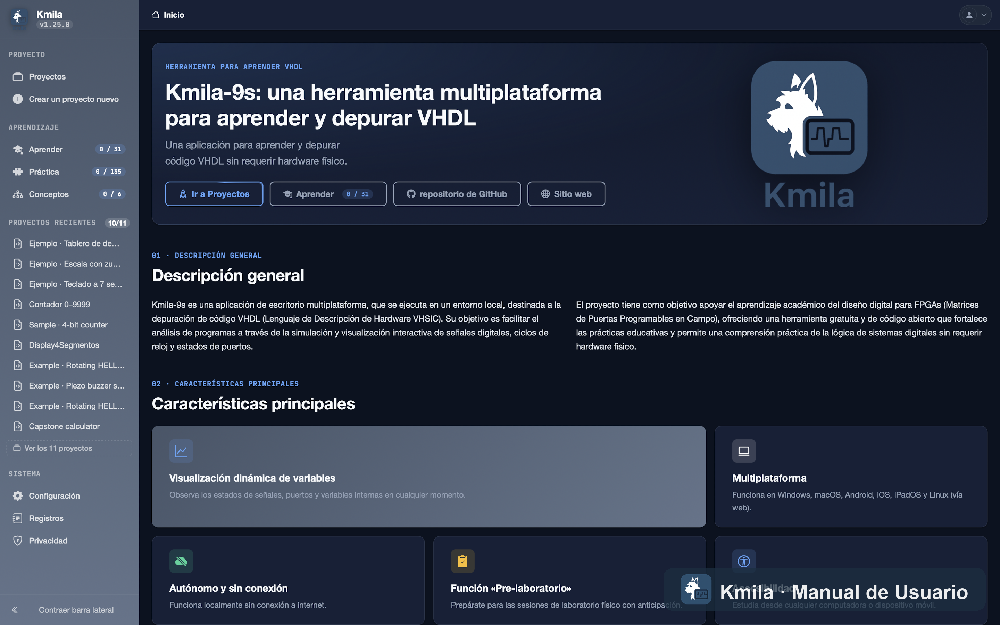
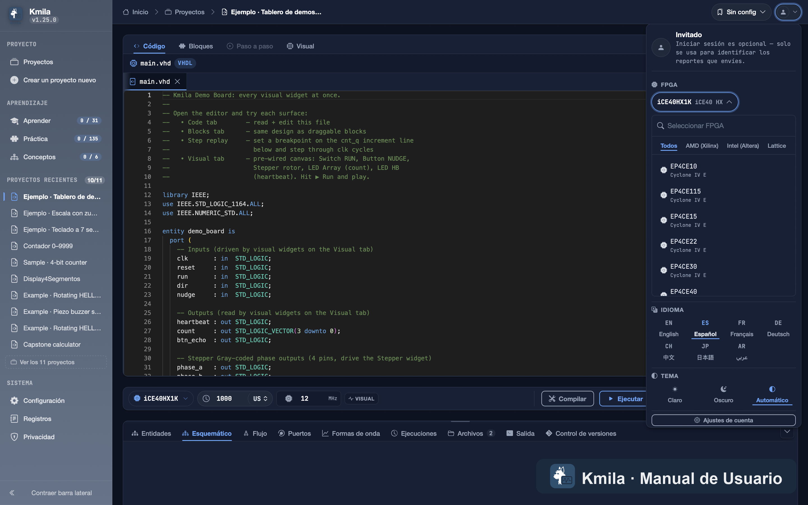

# 2. La interfaz de un vistazo: cómo moverte

[← Primeros pasos](01-primeros-pasos.md) · [Índice](README.md) · Siguiente: [Proyectos →](03-proyectos.md)

---

Kmila tiene siempre la misma estructura, sin importar en qué sección estés: una
**barra lateral** a la izquierda para navegar y una **barra superior** con tu
ubicación y los ajustes rápidos. Si aprendes a leer estas dos barras, no te
perderás nunca.

---

## La barra lateral (izquierda)

Es tu menú principal. Está organizada en grupos:

- **Proyecto**
  - **Proyectos** — la lista de todos tus proyectos.
  - **Crear un proyecto nuevo** — empieza uno desde cero o con una plantilla.
- **Aprendizaje**
  - **Aprender**, **Práctica**, **Conceptos** y **Fuentes**. Junto a cada uno
    verás un contador tipo `2 / 31` que indica **tu avance** (lecciones o
    ejercicios completados del total).
- **Proyectos recientes** — acceso directo a lo último que abriste. Si un
  proyecto está simulando, aquí mismo aparece su **estado en vivo** con botones
  para **pausar, reanudar o detener** y el porcentaje de avance.
- **Sistema**
  - **Configuración**, **Registros** y **Privacidad**.

> ✅ **Consejo** — ¿Pantalla pequeña? Usa **«Contraer barra lateral»** (abajo
> del todo) para dejar solo los iconos y ganar espacio. Vuelve a expandirla con
> el mismo botón.

---

## La barra superior

En la parte de arriba encontrarás, de izquierda a derecha:

- **Rutas de navegación** (migas de pan), por ejemplo **Inicio › Proyectos ›
  Ejemplo · Tablero de demostración**. Haz clic en cualquier parte de la ruta
  para regresar a esa sección.
- La **píldora de configuraciones** (solo cuando estás dentro de un proyecto):
  muestra el preset de simulación activo. La vemos en el
  [Capítulo 6](06-simulacion.md).
- El **menú de perfil** (el icono de persona, a la derecha). Es el centro de los
  ajustes rápidos.

### El menú de perfil: cuenta, FPGA, idioma y tema

Al abrir el menú de perfil tienes a la mano los ajustes que más se usan:

- **Cuenta** — puedes usar Kmila como **invitado** (sin registrarte) o iniciar
  sesión; el inicio de sesión solo hace falta para el control de versiones con
  GitHub.
- **Dispositivo FPGA** — elige la tarjeta de referencia para las estimaciones de
  recursos (pestañas por fabricante: AMD/Xilinx, Intel/Altera, Lattice). Más en
  el [Capítulo 10](10-entidades-y-recursos.md).
- **Idioma** — Kmila está traducido a **siete idiomas** (español, inglés,
  francés, alemán, chino, japonés y árabe). Elige el tuyo en la cuadrícula.
- **Tema** — **Claro**, **Oscuro** o **Automático** (sigue al sistema).

> 💡 **¿Sabías que…?** El idioma no solo cambia los menús: también traduce las
> ayudas y descripciones que aparecen mientras escribes código.

---

## ¿Dónde está cada cosa? (mapa rápido)

| Quiero… | Voy a… |
|---|---|
| Crear o abrir un proyecto | **Proyectos** (barra lateral) → [Cap. 3](03-proyectos.md) |
| Escribir y simular código | Abrir un proyecto → **Editor** → [Cap. 4](04-editor-codigo.md) y [Cap. 6](06-simulacion.md) |
| Ver señales/ondas | Dentro del editor, pestaña **Formas de onda** → [Cap. 7](07-formas-de-onda.md) |
| Aprender VHDL con lecciones | **Aprender** → [Cap. 14](14-aprender-practica-conceptos.md) |
| Cambiar idioma, tema o FPGA | **Menú de perfil** (arriba a la derecha) |
| Revisar errores de la app | **Registros** → [Cap. 18](18-solucion-de-problemas.md) |

---

[← Primeros pasos](01-primeros-pasos.md) · [Índice](README.md) · Siguiente: [Proyectos →](03-proyectos.md)
