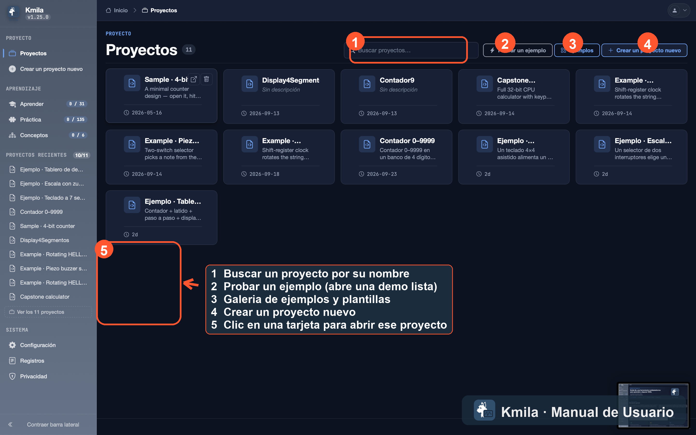
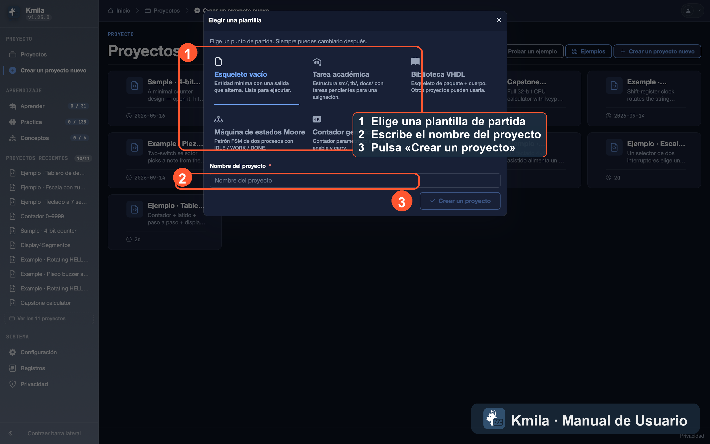
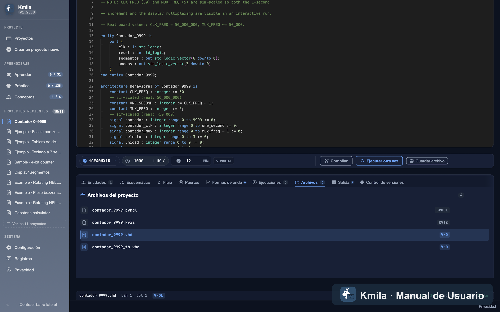

# 3. Proyectos: crear, abrir, plantillas y archivos

[← La interfaz de un vistazo](02-interfaz-general.md) · [Índice](README.md) · Siguiente: [Editor de código →](04-editor-codigo.md)

---

En Kmila, **todo tu trabajo vive dentro de un proyecto**: los archivos VHDL, los
bancos de prueba, la configuración de simulación y el historial de ejecuciones.
Este capítulo te muestra cómo crear proyectos, abrirlos y manejar sus archivos.

## La pantalla de Proyectos

Haz clic en **Proyectos** (barra lateral) para ver tu biblioteca:

1. **Buscar** — filtra tus proyectos escribiendo parte del nombre.
2. **Probar un ejemplo** — abre al instante un proyecto de demostración listo
   para simular. Perfecto para conocer la herramienta.
3. **Ejemplos** — abre la galería de ejemplos y plantillas incluidos.
4. **Crear un proyecto nuevo** — empieza uno desde cero (ver más abajo).
5. **Las tarjetas** — cada tarjeta es un proyecto, con su nombre, descripción y
   fecha. **Haz clic en una tarjeta para abrirla.** Al pasar el cursor por
   encima aparecen los botones para **abrir** o **eliminar** ese proyecto.

---

## Crear un proyecto nuevo

Al pulsar **«Crear un proyecto nuevo»** se abre la ventana **Elegir una
plantilla**. Una *plantilla* es solo un punto de partida con archivos de
ejemplo; **siempre puedes cambiar todo después**.

1. **Elige una plantilla** según lo que vayas a hacer:

   | Plantilla | Ideal para… |
   |---|---|
   | **Esqueleto vacío** | Empezar de cero con lo mínimo que ya compila y corre. |
   | **Tarea académica** | Entregas escolares: trae carpetas `src/`, `tb/` y `docs/`. |
   | **Biblioteca VHDL** | Crear un paquete reutilizable por otros proyectos. |
   | **Máquina de estados Moore** | Practicar una FSM con el patrón IDLE / WORK / DONE. |
   | **Contador genérico** | Un contador configurable con *reset*, *enable* y acarreo. |

2. **Escribe el nombre** del proyecto (es obligatorio, lo marca el asterisco `*`).
3. **Pulsa «Crear un proyecto»**. Kmila lo crea y te lleva directo al editor.

> ✅ **Consejo** — ¿No sabes cuál elegir? Usa **Esqueleto vacío** para
> experimentar o **Contador genérico** para ver algo funcionando enseguida.

---

## Abrir, duplicar o borrar un proyecto

- **Abrir**: haz clic en su tarjeta (o en el botón de abrir que aparece al pasar
  el cursor).
- **Eliminar**: usa el ícono de papelera de la tarjeta.

> ⚠️ **Atención** — Borrar un proyecto quita su contenido de tu equipo. Si te
> interesa conservarlo, **expórtalo primero** (ver «Exportar e importar» más
> abajo).

---

## Los archivos de un proyecto

Dentro del editor, la pestaña **Archivos** (en el panel inferior) lista todos los
archivos del proyecto:

Reconocerás estos tipos:

- **`.vhd` / `.vhdl`** — tu código VHDL (el diseño).
- **`_tb.vhd`** — un *testbench* o banco de pruebas (código que estimula tu
  diseño automáticamente).
- **`.bvhdl`** — el diseño guardado como **bloques** (ver [Cap. 5](05-editor-bloques.md)).
- **`.kviz`** — la configuración del **tablero visual** (ver [Cap. 11](11-runtime-visual.md)).

Para **añadir un archivo** usa el botón **Nuevo archivo** de la barra de
ejecución; para abrir uno, haz clic en su nombre.

---

## Guardar tu trabajo y crear versiones

Kmila marca el proyecto como **MODIFICADO** en cuanto detecta cambios sin
guardar. Desde el selector de proyecto (arriba, junto a las migas de pan) puedes:

- **Guardar cambios** — actualiza la versión actual.
- **Guardar como…** — crea una **nueva versión guardada**, conservando la
  anterior. Útil antes de un cambio grande, para poder volver atrás.

> ✅ **Consejo** — En la app de escritorio funciona el atajo **Ctrl+S** (⌘S en
> macOS) para guardar rápido.

---

## Exportar e importar (llevar un proyecto a otra parte)

En **Configuración ▸ Paquete de proyecto** puedes:

- **Exportar** un proyecto a un archivo (un «paquete») para respaldarlo o
  compartirlo con un compañero o tu profesor.
- **Importar** un paquete que te hayan pasado, para seguir trabajándolo en tu
  Kmila.

> 💡 **¿Sabías que…?** El paquete incluye los archivos del proyecto y su
> configuración, así que al importarlo la otra persona ve exactamente lo mismo
> que tú.

---

[← La interfaz de un vistazo](02-interfaz-general.md) · [Índice](README.md) · Siguiente: [Editor de código →](04-editor-codigo.md)
