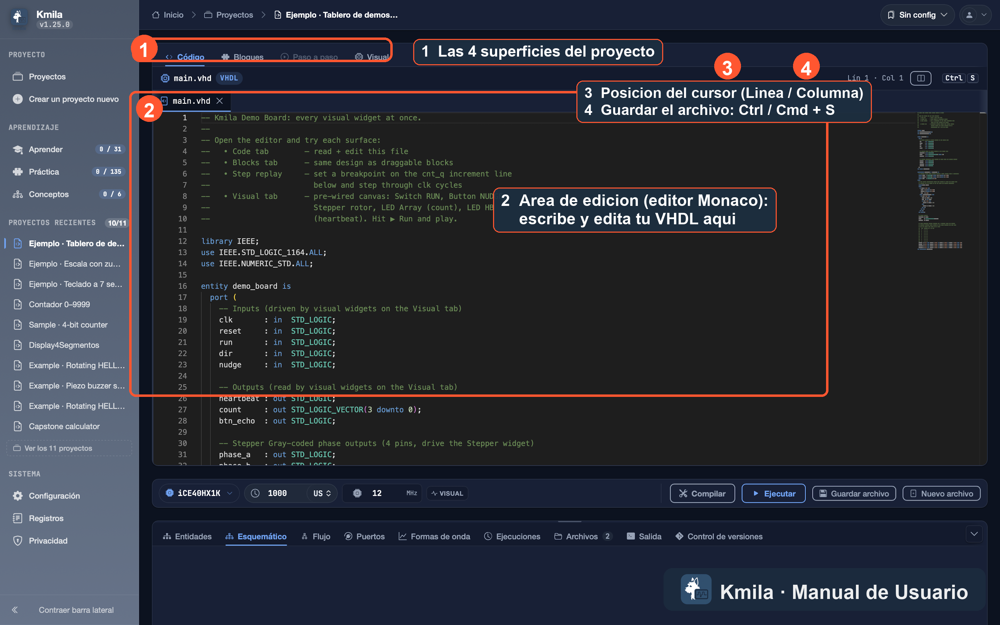
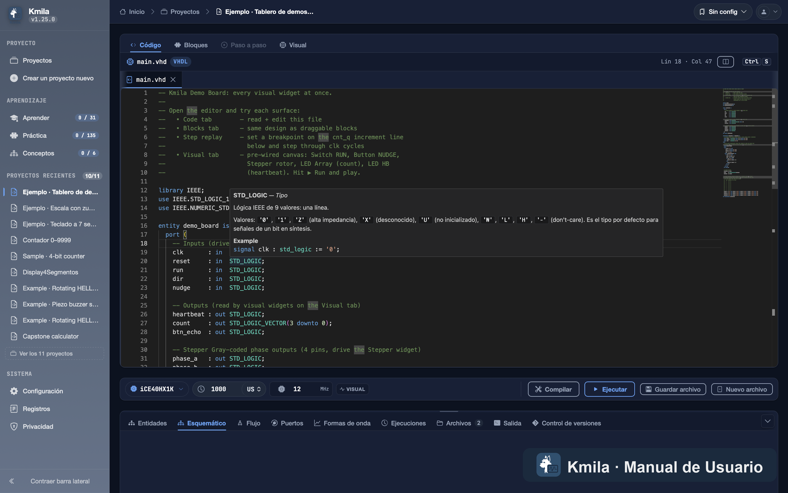
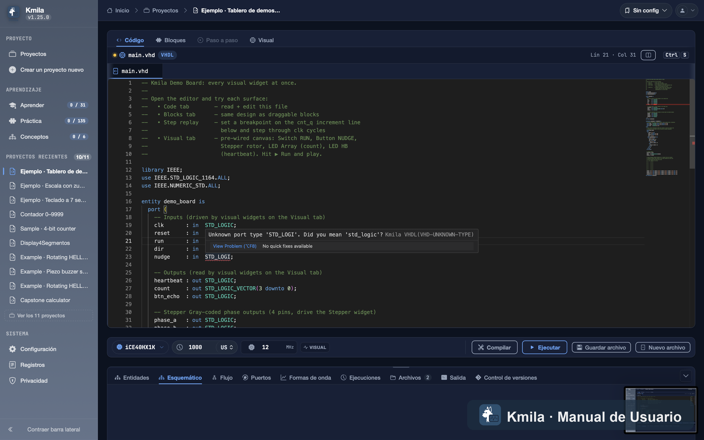

# 4. Editor de código

[← Proyectos](03-proyectos.md) · [Índice](README.md) · Siguiente: [Editor por bloques →](05-editor-bloques.md)

---

El editor es el corazón de Kmila: aquí **escribes y editas** tu código VHDL. Está
construido sobre *Monaco* —el mismo motor del editor Visual Studio Code—, así que
se siente moderno y cómodo.

1. **Las cuatro superficies del proyecto** — son cuatro formas de ver y trabajar
   el mismo diseño; cambias entre ellas con las pestañas de arriba:
   - **Código** — el editor de texto VHDL (esta pantalla).
   - **Bloques** — el mismo diseño como bloques arrastrables ([Cap. 5](05-editor-bloques.md)).
   - **Paso a paso** — reproduce la ejecución instante por instante ([Cap. 12](12-ejecuciones-y-replay.md)).
   - **Visual** — un tablero con LEDs, displays y botones ([Cap. 11](11-runtime-visual.md)).
2. **El área de edición** — donde escribes tu VHDL. Incluye **resaltado de
   sintaxis** (colores por tipo de palabra), **números de línea** y un **minimapa**
   a la derecha para moverte por archivos largos.
3. **Posición del cursor** — indica la **Línea** y **Columna** actuales (útil
   cuando un error menciona «línea 23»).
4. **Guardar** — recuerda guardar con **Ctrl + S** (**⌘ S** en Mac).

---

## Trabajar con varios archivos

Justo debajo de las pestañas de superficie verás las **pestañas de archivo** (por
ejemplo `main.vhd`). Un proyecto puede tener varios archivos abiertos a la vez;
haz clic en cada pestaña para cambiar, y en la **✕** para cerrarla. Para crear
uno nuevo usa **Nuevo archivo** (barra de ejecución) — ver [Cap. 3](03-proyectos.md).

> ✅ **Consejo** — Puedes dividir el editor en dos para ver dos archivos lado a
> lado con el ícono de **dividir** que está junto al indicador de línea/columna.

---

## Ayudas mientras escribes

El editor no solo colorea el código: también te **enseña** mientras trabajas.

### Descripciones al pasar el cursor (tooltips)

Pon el cursor sobre una palabra clave de VHDL y Kmila muestra una tarjeta que la
explica. Por ejemplo, sobre `STD_LOGIC` aparece su descripción y la lista de los
nueve valores lógicos de la norma IEEE (`'0'`, `'1'`, `'Z'`, `'X'`, …):

> 💡 **¿Sabías que…?** Estas ayudas están traducidas a los siete idiomas de la
> interfaz, así que las lees en tu propio idioma.

### Autocompletado inteligente

Al empezar a escribir ciertas estructuras (como un `process`), Kmila ofrece
**plantillas** listas con variantes pedagógicas (proceso combinacional, proceso
síncrono con *reset*, etc.) para guiarte hacia el estilo correcto. Elige una de
la lista y se inserta por ti.

---

## Detección de errores en vivo

No necesitas compilar para empezar a ver problemas. El editor **subraya** lo que
está mal y, al pasar el cursor, muestra un mensaje claro con una **sugerencia de
arreglo** y su código de diagnóstico:

En el ejemplo, al escribir `STD_LOGI` (mal escrito) Kmila avisa *«Unknown port
type 'STD_LOGI'. Did you mean 'std_logic'?»* justo donde está el error, **antes
de compilar**.

> ✅ **Consejo** — Los mensajes técnicos de compilación se muestran en inglés por
> diseño (coinciden con las herramientas estándar de la industria). En el
> [Cap. 18](18-solucion-de-problemas.md) traducimos y explicamos los más comunes.

Cuando quieras una revisión completa, usa **Compilar** y revisa la pestaña
**Salida** — lo vemos en el [Cap. 6](06-simulacion.md).

---

## ¿Y ahora qué?

Con tu código listo, el siguiente paso es **simularlo** para ver cómo se comporta:

- Prefieres construir el diseño sin escribir texto → [Cap. 5: Editor por bloques](05-editor-bloques.md).
- Listo para simular → [Cap. 6: Simular tu diseño](06-simulacion.md).

---

[← Proyectos](03-proyectos.md) · [Índice](README.md) · Siguiente: [Editor por bloques →](05-editor-bloques.md)
