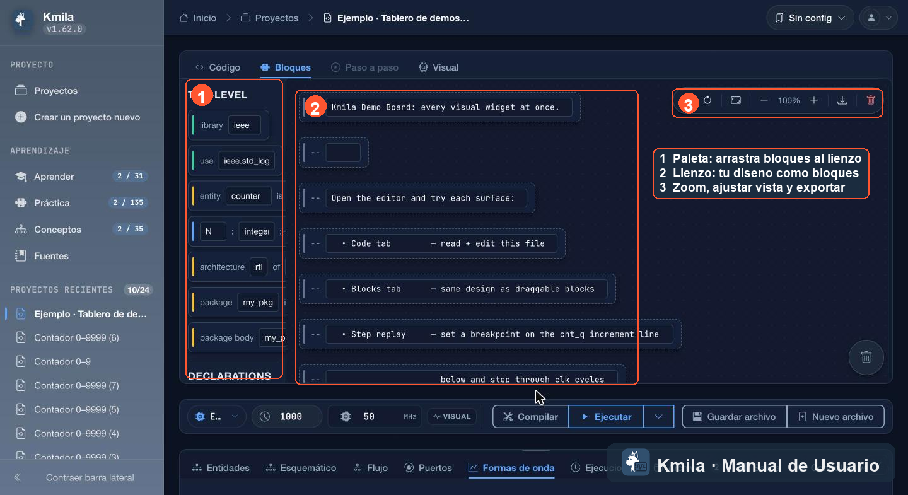

# 5. Editor por bloques

[← Editor de código](04-editor-codigo.md) · [Índice](README.md) · Siguiente: [Simular tu diseño →](06-simulacion.md)

---

El **editor por bloques** te deja construir tu diseño **arrastrando piezas**, sin
escribir texto. Es ideal si estás empezando con VHDL o si prefieres ver la
estructura del código de forma visual. Lo abres con la pestaña **Bloques** del
editor.

1. **La paleta** (izquierda) — contiene los bloques disponibles, agrupados en
   **TOP-LEVEL** (bibliotecas, entidad, arquitectura, paquetes…) y
   **DECLARATIONS** (señales, constantes, procesos…). **Arrástralos al lienzo**
   para usarlos.
2. **El lienzo** (centro) — aquí armas tu diseño encajando bloques. Cada bloque
   tiene huecos donde escribes nombres o eliges opciones (por ejemplo, el nombre
   de la entidad o el tipo de una señal).
3. **La barra de herramientas** (arriba a la derecha) — **acercar/alejar**,
   **ajustar la vista** al contenido, **exportar** el diagrama como imagen y
   **limpiar** el lienzo.

---

## Lo más importante: bloques y código son lo mismo

El editor por bloques y el de **Código** son **dos vistas del mismo diseño**. Lo
que armas con bloques se convierte en VHDL, y el VHDL que escribes se puede ver
como bloques. Así que puedes:

- Empezar con bloques y luego pasar a **Código** para afinar detalles.
- Escribir en **Código** y revisar la estructura en **Bloques**.

> ✅ **Consejo** — En **Configuración ▸ Editor** puedes elegir cómo se
> sincronizan ambas vistas: **Automática** (se actualizan solas al cambiar de
> pestaña) o **Manual** (tú decides cuándo). Lo vemos en el [Cap. 15](15-configuracion.md).

> 💡 **¿Sabías que…?** El diseño por bloques se guarda en un archivo **`.bvhdl`**
> dentro del proyecto (ver [Cap. 3](03-proyectos.md)).

---

## Compilar y simular desde bloques

No necesitas volver a la pestaña Código para probar: los botones **Compilar** y
**Ejecutar** de la barra de ejecución funcionan igual aquí. Kmila convierte tus
bloques a VHDL y lo simula. Todo lo de la simulación se explica en el
[Capítulo 6](06-simulacion.md).

---

## ¿Cuándo conviene usar bloques?

- **Estás aprendiendo** y quieres entender qué piezas forman un diseño VHDL.
- Quieres **evitar errores de sintaxis** (los bloques solo encajan de formas
  válidas).
- Prefieres **ver la estructura** de un diseño de un vistazo.

Cuando ya domines la sintaxis, seguramente te resulte más rápido el editor de
**Código** ([Cap. 4](04-editor-codigo.md)); puedes combinar ambos sin problema.

---

[← Editor de código](04-editor-codigo.md) · [Índice](README.md) · Siguiente: [Simular tu diseño →](06-simulacion.md)
