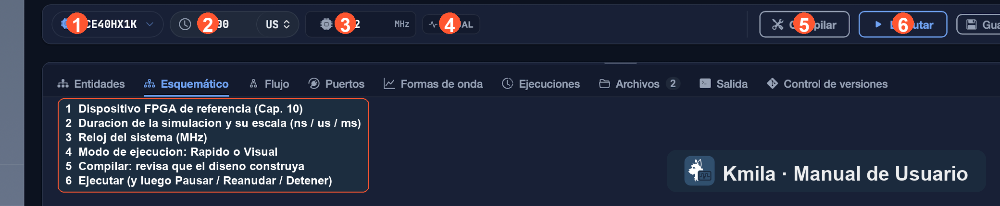
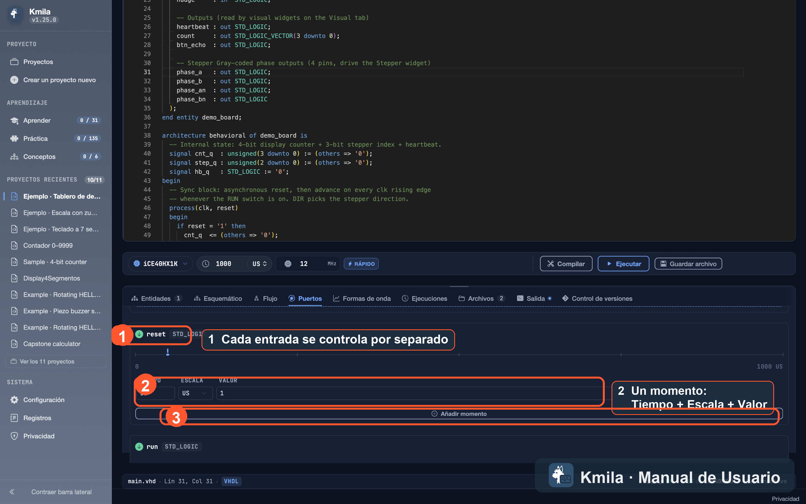

# 6. Simular tu diseño

[← Editor por bloques](05-editor-bloques.md) · [Índice](README.md) · Siguiente: [Formas de onda →](07-formas-de-onda.md)

---

Simular es **hacer que tu diseño «corra»** en la computadora para ver cómo se
comporta: cómo cambian sus señales con el tiempo, si el reloj avanza bien, si las
salidas son las esperadas. Todo esto sin una tarjeta FPGA física.

El flujo es siempre el mismo:

> **1) Ajustas** cómo quieres simular → **2) Compilas** (revisas que construya) →
> **3) Ejecutas** → **4) Revisas** los resultados (ondas, visual, paso a paso).

---

## La barra de ejecución

Todos los controles de simulación están en la **barra de ejecución**, debajo del
editor:

1. **Dispositivo FPGA** — la tarjeta de referencia (para estimar recursos; ver
   [Cap. 10](10-entidades-y-recursos.md)).
2. **Duración y escala** — cuánto tiempo «simulado» quieres correr y en qué
   unidad (**ns**, **µs**, **ms**… hasta segundos, minutos u horas para corridas
   largas).
3. **Reloj del sistema** — la frecuencia del reloj en **MHz**. Puedes
   personalizarla por proyecto; el botón de restablecer vuelve al valor del FPGA.
4. **Modo de ejecución** — alterna entre **Rápido** y **Visual** (ver abajo).
5. **Compilar** — revisa que el diseño **construya** sin errores, sin simular.
6. **Ejecutar** — lanza la simulación. Mientras corre, este botón se convierte en
   **Pausar** y **Reanudar**, y aparece **Detener**.

> ✅ **Consejo** — Junto a **Ejecutar** hay una pequeña flecha para elegir **qué
> archivo** usar como punto de partida (útil si tu proyecto tiene varios).

### Rápido vs. Visual

| Modo | Qué hace | Cuándo usarlo |
|---|---|---|
| **Rápido** | Simula de corrido y te muestra las **formas de onda al final**. Optimizado para corridas largas. | Cuando solo quieres el resultado. |
| **Visual** | Simula **en vivo**, paso a paso, y puedes poner *breakpoints*. | Cuando quieres **ver** qué pasa mientras ocurre. |

---

## Darle entradas a tu diseño

Un diseño necesita que «algo» mueva sus entradas (como el reset, el run, etc.).
Tienes dos formas:

### Opción 1 — Estímulos manuales (pestaña Puertos)

En la pestaña **Puertos** defines, para cada entrada, una lista de **momentos**:
en qué instante cambia y a qué valor.

1. **Cada entrada** (reset, run, …) se configura por separado.
2. **Un «momento»** se define con tres datos: **Tiempo** (el instante),
   **Escala** (ns/µs/ms) y **Valor** (0, 1, …). Por ejemplo, *reset = 1 en el
   instante 50 µs*.
3. Pulsa **«Añadir momento»** para agregar más cambios. La línea de tiempo de
   arriba muestra visualmente las transiciones que programaste.

Además, cualquier señal puede marcarse como **reloj** con un interruptor, para
que conmute automáticamente (ver la captura de la pestaña Puertos con `clk` como
reloj del sistema).

### Opción 2 — Un banco de pruebas (testbench)

Si tu proyecto incluye un archivo `_tb.vhd`, ese *testbench* escribe en VHDL cómo
estimular el diseño (genera el reloj, aplica el reset, etc.). Es la forma habitual
para diseños más grandes. Solo elígelo como archivo de ejecución y pulsa
**Ejecutar**.

---

## Guardar tus ajustes de simulación

¿Usas siempre la misma duración, reloj y estímulos? Guárdalos como una
**configuración con nombre** (archivo `.k-config`) desde la **píldora de
configuraciones** (barra superior). Puedes **guardar, cargar, eliminar** y hasta
**exportar/importar** configuraciones entre proyectos.

> 💡 **¿Sabías que…?** Esto te deja tener, por ejemplo, una config «prueba rápida»
> y otra «corrida larga» y cambiar entre ellas con un clic.

---

## Después de ejecutar: ¿dónde veo los resultados?

Al terminar la simulación, revisa el resultado en la pestaña que prefieras:

- **Formas de onda** — las señales en el tiempo → [Cap. 7](07-formas-de-onda.md).
- **Visual** — el tablero con LEDs y displays → [Cap. 11](11-runtime-visual.md).
- **Paso a paso** — avanzar instante por instante → [Cap. 12](12-ejecuciones-y-replay.md).
- **Salida** — el registro de la compilación y la simulación (errores, avisos).

> ⚠️ **Atención** — Si **Compilar** marca errores, revisa la pestaña **Salida**:
> ahí verás el mensaje y la línea. El [Cap. 18](18-solucion-de-problemas.md)
> explica los errores más comunes.

---

[← Editor por bloques](05-editor-bloques.md) · [Índice](README.md) · Siguiente: [Formas de onda →](07-formas-de-onda.md)
