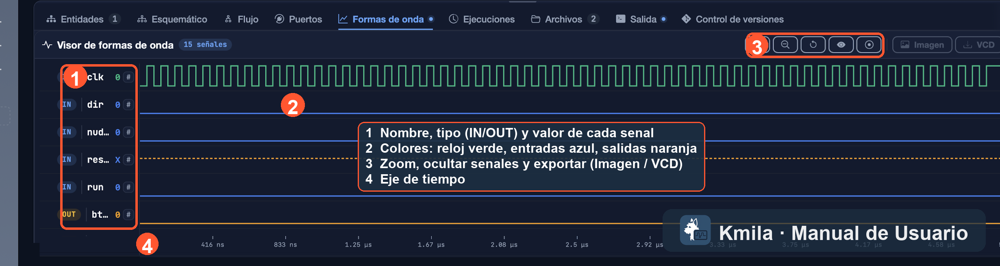
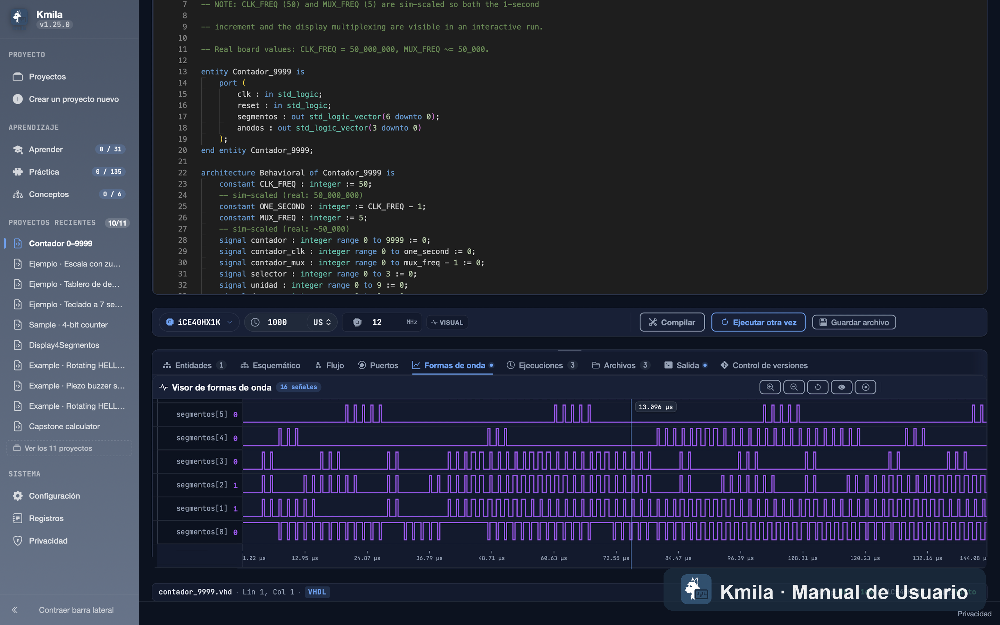

# 7. Formas de onda (señales)

[← Simular tu diseño](06-simulacion.md) · [Índice](README.md) · Siguiente: [Esquemático →](08-esquematico.md)

---

Las **formas de onda** son la forma más clara de ver qué hace tu diseño: muestran
cómo **cambia cada señal con el tiempo**, como en un osciloscopio. Después de
ejecutar una simulación, abre la pestaña **Formas de onda**.

1. **La columna de señales** (izquierda) — el **nombre** de cada señal, su
   **tipo** (`IN` entrada / `OUT` salida) y su **valor** actual.
2. **El área de ondas** — cada señal dibujada en el tiempo. Los **colores** te
   ayudan a identificarlas de un vistazo:
   - 🟢 **verde** → el **reloj**.
   - 🔵 **azul** → las **entradas**.
   - 🟠 **naranja** → las **salidas**.
   - Una línea **punteada** significa que la señal aún está en `X` (sin
     inicializar).
3. **La barra de herramientas** — acercar/alejar, restablecer, **ocultar
   señales**, el **cursor** de lectura y **exportar** (botones **Imagen** y
   **VCD**).
4. **El eje de tiempo** — la escala temporal (ns, µs…) de la simulación.

---

## Leer y ordenar las señales

- **Ver un valor exacto**: mueve el **cursor** sobre las ondas; cada señal muestra
  su valor en ese instante. Puedes cambiar el formato de un bus a **hexadecimal**
  o **decimal**.
- **Ocultar lo que estorba**: usa el botón del **ojo** para esconder señales y
  concentrarte en las que te importan; luego puedes **mostrarlas todas** otra vez.
- **Acercar**: usa el zoom para ver el detalle de un tramo corto.

## Ver un bus «por dentro» (bit a bit)

Cuando una señal es un **bus** (varios bits, como `count` o `segmentos`), puedes
**expandirla en una fila por cada bit** para ver cómo cambia cada uno:

En el ejemplo se ve el barrido de un *display* de siete segmentos: cada bit del
bus `segmentos` en su propia fila, con un cursor de lectura en un instante
concreto.

> 💡 **¿Sabías que…?** Estas ondas son **salida real** del motor de simulación de
> Kmila, no dibujos de ejemplo.

---

## Comparar dos corridas

¿Cambiaste algo y quieres ver el efecto? Con el **modo comparar** puedes
superponer las señales de **dos ejecuciones** distintas, con una leyenda de
colores, sin volver a simular la anterior. Lo vemos en el
[Capítulo 12](12-ejecuciones-y-replay.md).

---

## Exportar las ondas

Dos botones en la barra de herramientas:

- **Imagen** — guarda las ondas como **SVG** o **PNG** (puedes elegir la escala,
  el rango de tiempo completo o un tramo, e incluso dividir en varias páginas).
  Útil para pegarlas en un reporte o tu tesis.
- **VCD** — exporta el formato estándar **VCD**, para abrirlo en visores externos
  como **Surfer** o **GTKWave**.

> ✅ **Consejo** — Para un reporte, **SVG** se ve nítido a cualquier tamaño; para
> pegar rápido en un documento, **PNG** suele bastar.

---

[← Simular tu diseño](06-simulacion.md) · [Índice](README.md) · Siguiente: [Esquemático →](08-esquematico.md)
