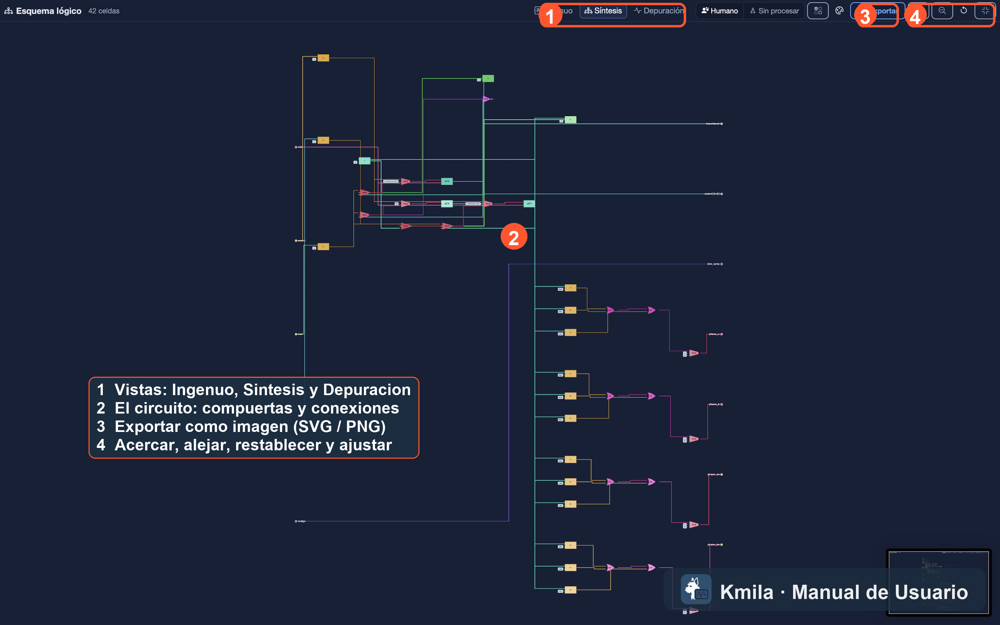
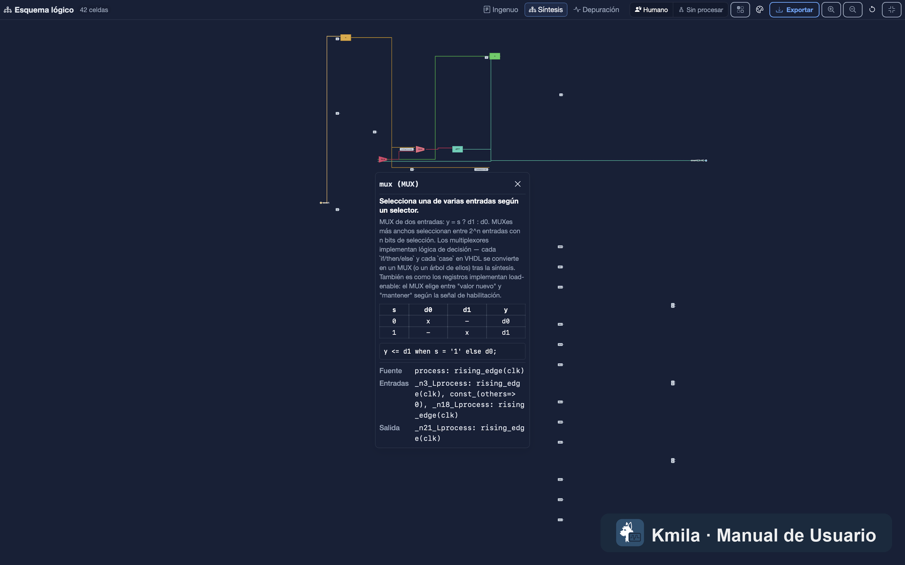
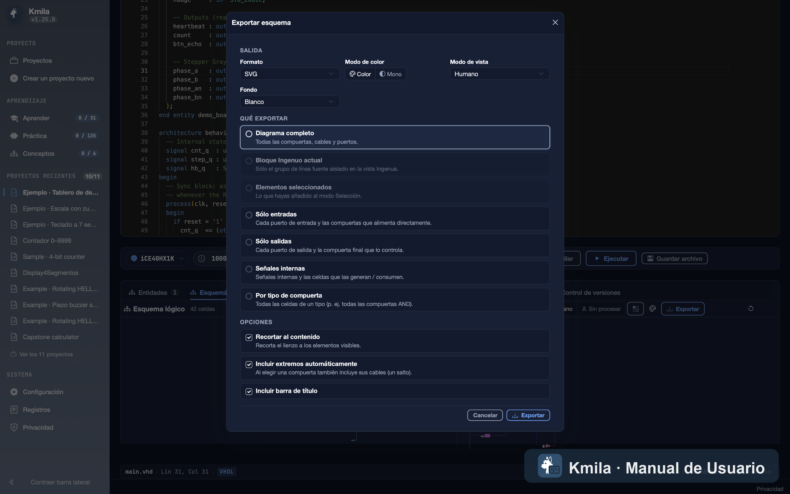

# 8. Esquemático (circuito lógico)

[← Formas de onda](07-formas-de-onda.md) · [Índice](README.md) · Siguiente: [Diagrama de flujo →](09-flujo-control.md)

---

El **esquemático** convierte tu código VHDL en un **dibujo del circuito**: las
compuertas lógicas y las conexiones que implementarían tu diseño en hardware. Es
una forma excelente de **entender** qué estás describiendo realmente. Lo abres en
la pestaña **Esquemático**.

1. **Las vistas** — tres maneras de dibujar el mismo circuito:
   - **Ingenuo** — una traducción directa, sin optimizar (muestra «todo»).
   - **Síntesis** — el circuito **optimizado** en compuertas, como lo haría una
     herramienta real (menos celdas, más parecido al resultado final).
   - **Depuración** — una vista **interactiva** para inspeccionar (ver abajo).
2. **El circuito** — las compuertas (AND, OR, MUX, biestables `dff`…) y los cables
   que las unen, con las entradas a la izquierda y las salidas a la derecha.
3. **Exportar** — guarda el esquemático como imagen (**SVG** o **PNG**).
4. **Controles de vista** — acercar, alejar, restablecer y **ajustar** a la
   pantalla.

> 💡 **¿Sabías que…?** Arriba también puedes cambiar el **estilo** del dibujo
> (por ejemplo, un estilo tipo **RTL** con buses y flechas) para que se parezca
> más a los diagramas de un libro de texto.

---

## Modo Depuración: inspeccionar el circuito

En la vista **Depuración** el esquemático se vuelve interactivo: **haz clic en
una compuerta, un cable o un puerto** para inspeccionarlo. Para algunas compuertas
aparece un **panel explicativo** con su **tabla de verdad** y el **fragmento de
VHDL** que la originó:

Así puedes conectar cada pieza del circuito con la línea de código que la produjo.
También puedes **seleccionar** varias celdas, **añadir notas** y entrar al
**modo de reproducción** para ver cómo cambian las señales sobre el propio
esquemático.

---

## Exportar el esquemático

Al pulsar **Exportar** se abre una ventana con opciones:

Puedes elegir:

- **Formato** — **SVG** (nítido a cualquier tamaño) o **PNG** (con escala 1×, 2×
  o 3×).
- **Color** — a **color** o **monocromático** (ideal para imprimir).
- **Fondo** — blanco, oscuro o transparente.
- **Qué exportar** — todo el circuito o solo una parte, con opciones para recortar
  el espacio en blanco e incluir dependencias.

> ✅ **Consejo** — Para tu tesis o un reporte, **SVG monocromático con fondo
> blanco** se ve profesional y se imprime perfecto.

---

[← Formas de onda](07-formas-de-onda.md) · [Índice](README.md) · Siguiente: [Diagrama de flujo →](09-flujo-control.md)
