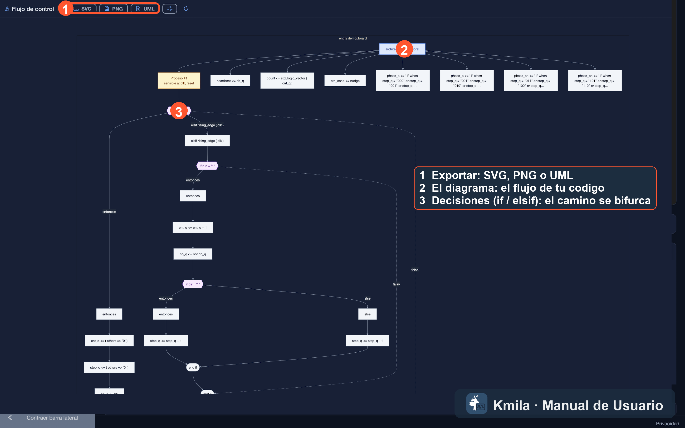

# 9. Diagrama de flujo

[← Esquemático](08-esquematico.md) · [Índice](README.md) · Siguiente: [Entidades y recursos →](10-entidades-y-recursos.md)

---

El **diagrama de flujo** muestra la **lógica** de tu código como un diagrama: por
dónde «pasa» la ejecución, qué decisiones toma (`if`, `elsif`) y en qué orden
ocurren las cosas dentro de cada proceso. Es muy útil para **entender o depurar**
el comportamiento, sin leer línea por línea. Lo abres en la pestaña **Flujo**.

1. **Exportar** — guarda el diagrama como **SVG**, **PNG** o **UML** (ver abajo),
   además de los controles para **ajustar** y restablecer la vista.
2. **El diagrama** — el flujo de tu diseño: arriba la **entidad** y la
   **arquitectura**, de ahí salen los **procesos** y las asignaciones, y cada
   proceso baja mostrando sus pasos.
3. **Las decisiones** — los **rombos** (como `if reset = '1'` o
   `elsif rising_edge(clk)`) son los puntos donde el camino **se bifurca**; las
   etiquetas **«entonces»** y **«falso/else»** indican por dónde sigue según la
   condición.

---

## Cómo leerlo

Sigue las flechas de arriba hacia abajo:

- **Entidad → Arquitectura** — el punto de partida.
- **Procesos y asignaciones** — cada bloque de trabajo (por ejemplo
  `heartbeat <= hb_q`, o el `Proceso #1 sensible a: clk, reset`).
- **Decisiones** — en cada rombo el flujo toma un camino u otro. Por ejemplo:
  *«si reset = 1, entonces… ; si no, en el flanco de reloj…»*.
- **Fin** — los nodos `end if` / fin de proceso cierran cada rama.

> 💡 **¿Sabías que…?** Comparar este diagrama con tu código es una forma rápida de
> detectar lógica que **nunca se ejecuta** o ramas que olvidaste.

---

## Exportar el diagrama

- **SVG** / **PNG** — para pegar el diagrama en un reporte o presentación.
- **UML** — genera el diagrama en formato **PlantUML**, ideal para incluirlo en
  documentación técnica o en tu tesis (es el formato con el que se generan muchas
  de las figuras de documentos formales).

> ✅ **Consejo** — Si vas a seguir editando el diagrama en otra herramienta,
> exporta **UML**; si solo quieres la imagen final, usa **SVG**.

---

[← Esquemático](08-esquematico.md) · [Índice](README.md) · Siguiente: [Entidades y recursos →](10-entidades-y-recursos.md)
