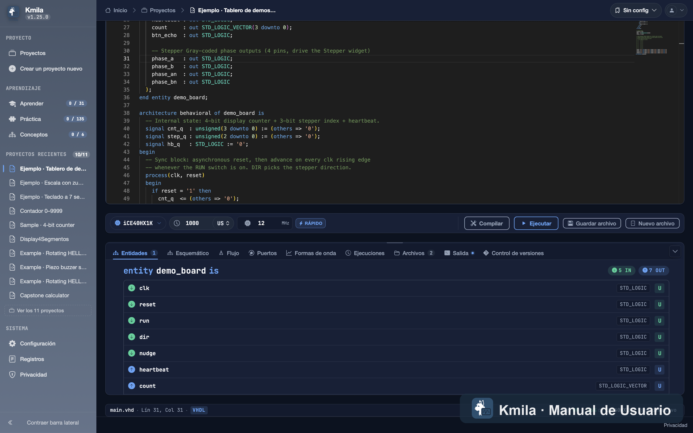
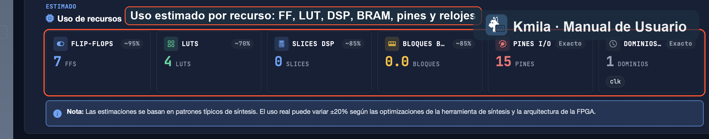
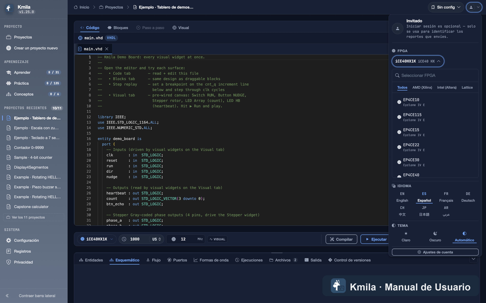

# 10. Entidades y uso de recursos (FPGA)

[← Diagrama de flujo](09-flujo-control.md) · [Índice](README.md) · Siguiente: [Runtime visual →](11-runtime-visual.md)

---

Dos pestañas del panel inferior te ayudan a **entender la estructura** de tu
diseño y a saber **cuánto «cabría»** en una FPGA real: **Entidades** y, dentro de
ella, el **uso de recursos**.

## Entidades: la estructura de tu diseño

La pestaña **Entidades** muestra las entidades que Kmila detectó en tu código, con
sus **puertos** (entradas y salidas) y el **tipo** de cada uno:

- Cada puerto aparece como **`IN`** (entrada) o **`OUT`** (salida), con su tipo
  (por ejemplo `STD_LOGIC` o `STD_LOGIC_VECTOR`).
- Un **selector de alcance** te deja ver solo el archivo principal, **todas** las
  entidades del proyecto, una vista **aplanada**, o las de las **bibliotecas**.

> ✅ **Consejo** — Es la forma más rápida de confirmar que tu entidad tiene los
> puertos que esperas, con los tipos correctos, antes de simular.

---

## Uso de recursos: ¿cabe en mi FPGA?

Más abajo, Kmila **estima** cuántos recursos de la FPGA usaría tu diseño:

Cada tarjeta es un tipo de recurso:

- **Flip-Flops (FF)** — elementos de memoria (registros).
- **LUTs** — las tablas que implementan la lógica combinacional.
- **Slices DSP** — bloques de multiplicación/aritmética.
- **Bloques BRAM** — memoria interna.
- **Pines I/O** — las patas físicas de entrada/salida.
- **Dominios de reloj** — cuántos relojes distintos usa (aquí, `clk`).

Cada tarjeta muestra el **valor estimado** y una indicación de **precisión**:
un porcentaje (como `~95%`) es el **margen de incertidumbre** de la estimación,
mientras que **«Exacto»** (pines y relojes) es un conteo seguro.

> ⚠️ **Atención** — Como dice la **nota**, el uso real puede variar **±20 %**
> según la herramienta de síntesis y la FPGA concreta. Úsalo como **guía**, no
> como cifra definitiva.

---

## Elegir la FPGA de referencia

El cálculo se hace contra una **tarjeta FPGA** concreta. La eliges desde el
**menú de perfil** (barra superior), con un catálogo organizado por fabricante
(**AMD/Xilinx**, **Intel/Altera**, **Lattice**). Al cambiar de dispositivo, la
estimación **se recalcula** automáticamente.

> 💡 **¿Sabías que…?** Si tu tarjeta no está en el catálogo, puedes **crear una
> FPGA personalizada** en **Configuración ▸ FPGAs personalizadas** ([Cap. 15](15-configuracion.md)).

---

[← Diagrama de flujo](09-flujo-control.md) · [Índice](README.md) · Siguiente: [Runtime visual →](11-runtime-visual.md)
