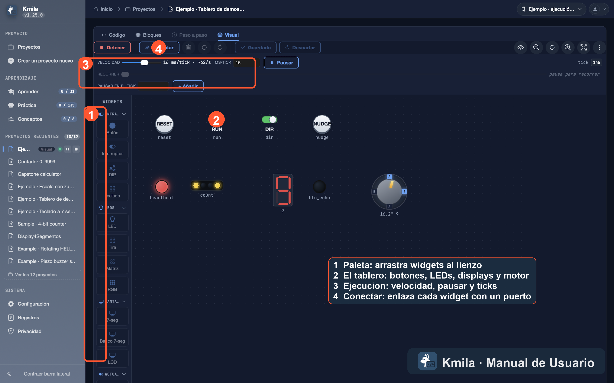
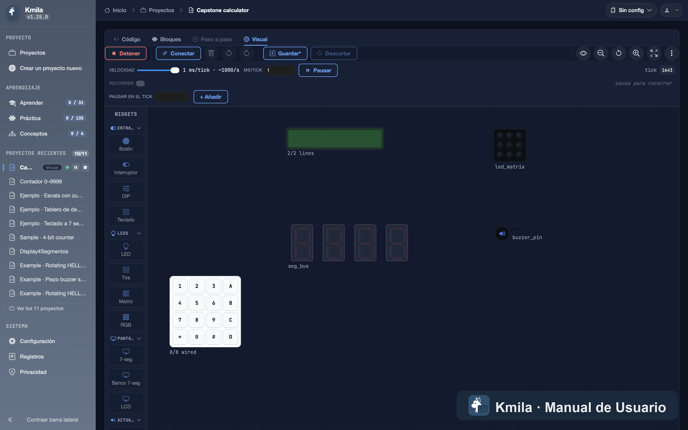

# 11. Runtime visual: LEDs, displays y botones

[← Entidades y recursos](10-entidades-y-recursos.md) · [Índice](README.md) · Siguiente: [Ejecuciones y paso a paso →](12-ejecuciones-y-replay.md)

---

El **runtime visual** es la parte más divertida de Kmila: convierte tu diseño en
un **tablero interactivo** con LEDs, displays de 7 segmentos, botones,
interruptores, pantallas LCD, un motor a pasos y más. Puedes **presionar** los
controles para mover las entradas y **ver** las salidas encenderse en tiempo
real, como si tuvieras la tarjeta física enfrente.

Lo abres con la pestaña **Visual** del editor (o ejecutando en modo **Visual**,
ver [Cap. 6](06-simulacion.md)).

1. **La paleta de widgets** (izquierda) — los componentes que puedes agregar,
   agrupados en **Entradas** (botón, interruptor, DIP, teclado), **LEDs** (LED,
   tira, matriz, RGB), **Pantallas** (7 segmentos, banco de 7 segmentos, LCD) y
   **Actuadores** (buzzer, motor a pasos). **Arrástralos al lienzo.**
2. **El tablero** (lienzo) — donde colocas y usas los widgets. En el ejemplo hay
   botones (**RESET**, **NUDGE**), interruptores (**RUN**, **DIR**), un LED
   (`heartbeat`), displays de 7 segmentos (`count`), un LED `btn_echo` y un
   **motor a pasos** girando.
3. **Los controles de ejecución** — **velocidad** de la simulación,
   **ms por tick**, **pausar/continuar**, el **tick** actual y los
   **breakpoints** («pausar en el tick»).
4. **Conectar** — enlaza cada widget con un **puerto** de tu diseño (ver abajo).

---

## Conectar un widget a tu diseño

Para que un botón mueva una entrada, o un LED muestre una salida, hay que
**conectarlos**:

1. Arrastra el widget que quieras desde la **paleta** al **tablero**.
2. Pulsa **Conectar**: se abre una ventana para **asignar cada pin del widget a
   un puerto** compatible de tu entidad (por ejemplo, el interruptor **RUN** al
   puerto `run`).
3. Pulsa **Ejecutar** (o **Continuar**) y empieza a interactuar.

> ✅ **Consejo** — Un **LED** solo se conecta a una **salida**; un **botón** o
> **interruptor**, a una **entrada**. Kmila solo te deja hacer conexiones válidas.

---

## Interactuar y controlar el tiempo

- **Presiona** botones e interruptores para cambiar las entradas mientras corre.
- Ajusta la **velocidad** si va muy rápido o muy lento.
- Usa **Pausar** para congelar la imagen, y **«pausar en el tick»** para detenerte
  automáticamente en un instante exacto (como un *breakpoint*).

Kmila incluye widgets avanzados; aquí un ejemplo con **pantalla LCD**, **matriz de
LEDs**, **banco de 7 segmentos**, **teclado 4×4** y **buzzer** funcionando juntos:

> 💡 **¿Sabías que…?** La disposición de tu tablero se guarda en un archivo
> **`.kviz`** del proyecto, así que la recuperas tal cual la dejaste.

---

[← Entidades y recursos](10-entidades-y-recursos.md) · [Índice](README.md) · Siguiente: [Ejecuciones y paso a paso →](12-ejecuciones-y-replay.md)
