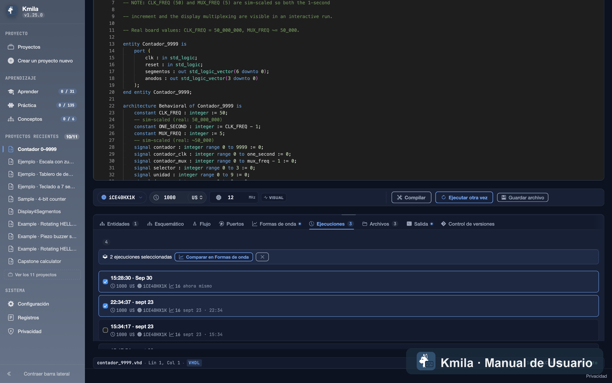
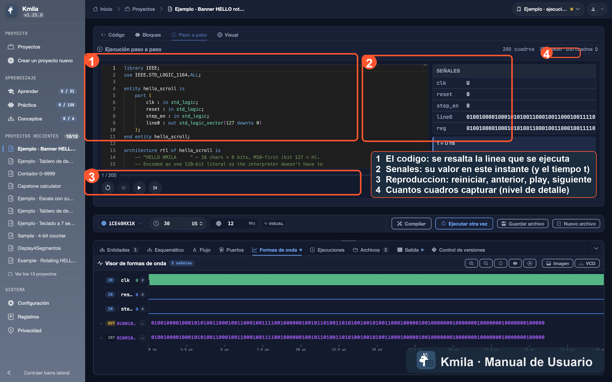

# 12. Ejecuciones y paso a paso

[← Runtime visual](11-runtime-visual.md) · [Índice](README.md) · Siguiente: [Control de versiones →](13-control-de-versiones.md)

---

Kmila guarda un **historial de tus simulaciones** y te deja **reproducirlas
instante por instante**. Son dos herramientas distintas que se complementan: la
pestaña **Ejecuciones** (el historial) y la superficie **Paso a paso** (la
reproducción detallada).

## Historial de ejecuciones y comparar

Cada vez que simulas, Kmila guarda esa corrida. En la pestaña **Ejecuciones** las
ves todas, con su **fecha**, **duración**, **dispositivo** y **número de señales**:

Lo más útil: **selecciona dos corridas** y pulsa **«Comparar en Formas de onda»**.
Kmila las **superpone** en el visor con una leyenda de colores, para que veas el
efecto de un cambio en tu diseño **sin volver a simular** la versión anterior.

> ✅ **Consejo** — Ideal para los ejercicios de «corrige el error»: compara la
> corrida con el error contra la corregida y ve exactamente qué cambió.

---

## Paso a paso: reproducir la ejecución

La superficie **Paso a paso** reproduce la simulación como una película que
puedes **pausar y avanzar cuadro por cuadro**. En cada instante te muestra qué
línea de código se está ejecutando y qué valen las señales:

1. **El código** — se **resalta la línea** que se ejecuta en ese instante.
2. **Señales** — el **valor de cada señal** en ese momento, junto con el **tiempo
   `t`** correspondiente.
3. **Controles de reproducción** — **reiniciar**, **anterior**, **reproducir** y
   **siguiente**, más un deslizador para saltar a cualquier cuadro y un control de
   **velocidad**.
4. **Cuántos cuadros** capturar — elige el **nivel de detalle** (más cuadros = más
   fino, pero más pesado).

> 💡 **¿Sabías que…?** Ver la línea resaltada mientras cambian las señales es la
> forma más clara de entender **por qué** tu diseño hace lo que hace —y de
> encontrar el punto exacto donde algo sale mal.

---

[← Runtime visual](11-runtime-visual.md) · [Índice](README.md) · Siguiente: [Control de versiones →](13-control-de-versiones.md)
