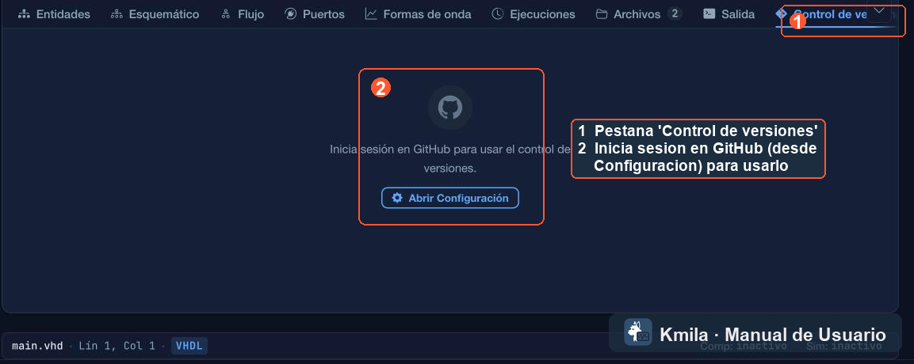

# 13. Control de versiones (Git)

[← Ejecuciones y paso a paso](12-ejecuciones-y-replay.md) · [Índice](README.md) · Siguiente: [Aprender, Práctica y Conceptos →](14-aprender-practica-conceptos.md)

---

El **control de versiones** te permite llevar un **historial de cambios** de tu
proyecto y respaldarlo en **GitHub**, igual que hacen los programadores. Es útil
para no perder trabajo, volver a una versión anterior o colaborar. Lo encuentras
en la pestaña **Control de versiones** del panel inferior.

1. La pestaña **Control de versiones** (en el dock, junto a *Salida*).
2. La primera vez te pedirá **iniciar sesión en GitHub** para poder usarlo; el
   botón **«Abrir Configuración»** te lleva al lugar donde conectas tu cuenta.

---

## Conectar tu cuenta de GitHub

1. Ve a **Configuración ▸ Cuenta** (o pulsa **«Abrir Configuración»** en el panel).
2. **Inicia sesión en GitHub** y autoriza a Kmila.
3. Vuelve a la pestaña **Control de versiones**: ahora verás los **archivos con
   cambios** y podrás **confirmar** (commit) y **sincronizar** tu proyecto.

> ⚠️ **Atención** — Conectar GitHub usa **tu cuenta personal**. Hazlo tú mismo
> desde la pantalla de Kmila; por seguridad, esta acción no debe hacerla nadie
> más por ti.

> ⚠️ **Atención** — En la **demo del navegador (WASM)** el control de versiones
> **no está disponible** (por restricciones de seguridad del navegador). Usa la
> app de escritorio o la web local para esta función (ver [Cap. 1](01-primeros-pasos.md)).

---

## Para qué sirve

- **Guardar versiones** de tu diseño con un mensaje que describa el cambio.
- **Volver atrás** si algo se rompió.
- **Respaldar** tu proyecto en la nube (GitHub).
- **Colaborar** con un compañero o entregar tu trabajo.

> 💡 **¿Sabías que…?** Si solo quieres versiones locales sin GitHub, recuerda que
> también puedes usar **«Guardar como…»** para crear versiones guardadas dentro de
> Kmila (ver [Cap. 3](03-proyectos.md)).

---

[← Ejecuciones y paso a paso](12-ejecuciones-y-replay.md) · [Índice](README.md) · Siguiente: [Aprender, Práctica y Conceptos →](14-aprender-practica-conceptos.md)
