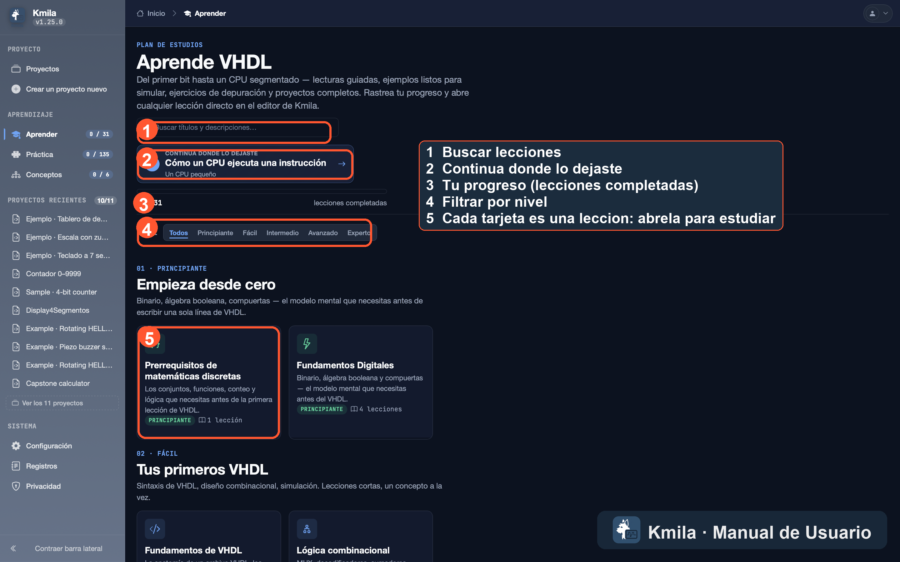
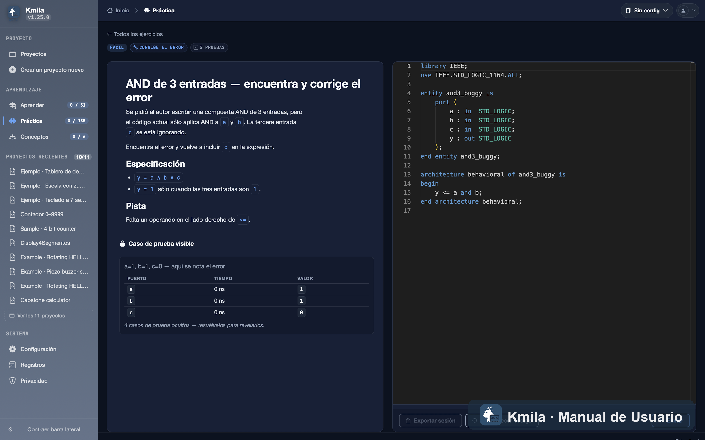
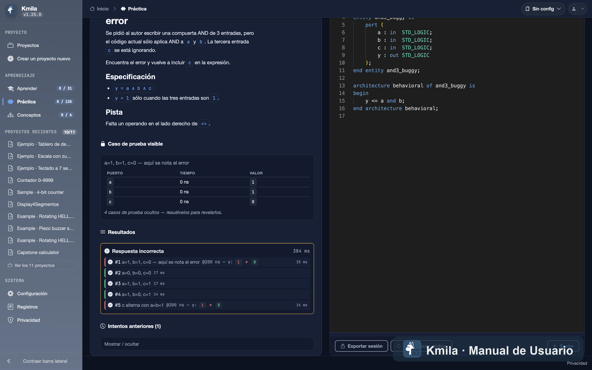
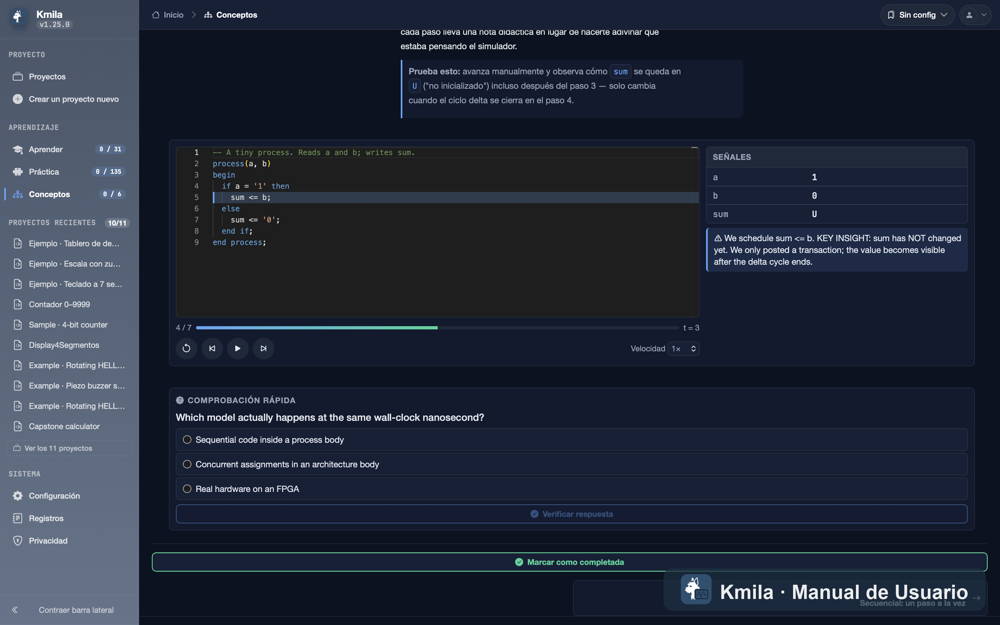

# 14. Aprender, Práctica y Conceptos

[← Control de versiones](13-control-de-versiones.md) · [Índice](README.md) · Siguiente: [Configuración →](15-configuracion.md)

---

Kmila no es solo un simulador: también es una **plataforma para aprender VHDL**
desde cero. Tiene tres secciones de aprendizaje en la barra lateral —**Aprender**,
**Práctica** y **Conceptos**— y una de **Fuentes** (bibliografía).

## Aprender: el curso guiado

**Aprender** es un **plan de estudios** completo, del primer bit hasta un CPU,
con lecturas, ejemplos y proyectos:

1. **Buscar** — encuentra una lección por título o descripción.
2. **Continúa donde lo dejaste** — retoma la última lección con un clic.
3. **Tu progreso** — cuántas lecciones has completado (p. ej. `0 / 31`).
4. **Filtrar por nivel** — Principiante, Fácil, Intermedio, Avanzado, Experto.
5. **Las lecciones** — cada tarjeta es una lección; haz clic para abrirla.

Dentro de una lección encontrarás **lecturas claras**, a veces un botón **«Prueba
este ejemplo»** que abre un proyecto listo en el editor, y **figuras animadas e
interactivas** (por ejemplo, el recorrido de una compuerta o una máquina de
estados) para entender los conceptos moviéndolos tú mismo.

> 💡 **¿Sabías que…?** El curso está alineado con el plan de estudios de ESCOM;
> además de por nivel, puedes agruparlo por **asignatura**.

---

## Práctica: ejercicios que se califican solos

En **Práctica** resuelves ejercicios y Kmila los **evalúa automáticamente**. Hay
tres modalidades:

- **Desde cero** — escribes la solución completa.
- **Corrige el error** — te damos un diseño con un fallo y tú lo arreglas.
- **Rellena el hueco** — completas la parte que falta.

Cuando ejecutas, el **autoevaluador** corre una serie de casos y te dice cuáles
pasaron y cuáles no:

El veredicto va de peor a mejor: **error de compilación → error de ejecución →
respuesta incorrecta → resuelto**. Así sabes exactamente qué corregir.

---

## Conceptos: el «modelo mental» de VHDL

**Conceptos** explica **cómo piensa** VHDL por dentro: lo secuencial vs. lo
concurrente, y el famoso **ciclo delta** (cómo se programan los cambios de señal
en un mismo instante de tiempo):

Incluye un reproductor paso a paso del modelo de ejecución y la serie de figuras
de **«anatomía del hardware»** (de una compuerta a una FPGA completa).

---

## Fuentes

La sección **Fuentes** reúne la **bibliografía** (referencias tipo IEEE) que
respalda las lecciones, por si quieres profundizar o citarla en un trabajo.

---

[← Control de versiones](13-control-de-versiones.md) · [Índice](README.md) · Siguiente: [Configuración →](15-configuracion.md)
