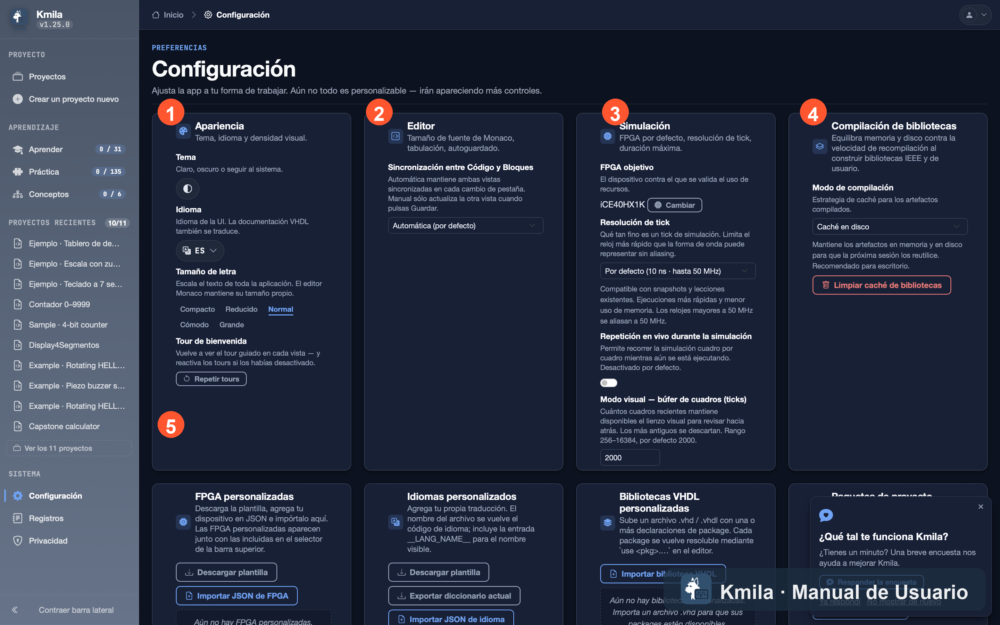
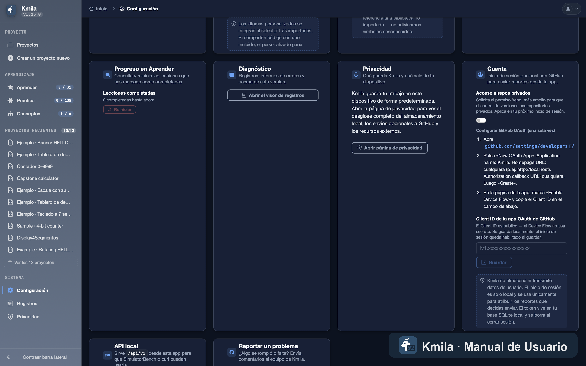
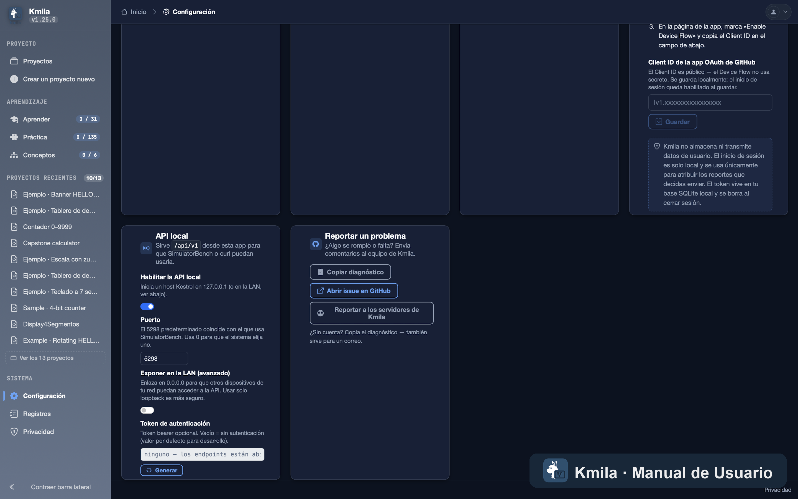

# 15. Configuración

[← Aprender, Práctica y Conceptos](14-aprender-practica-conceptos.md) · [Índice](README.md) · Siguiente: [Uso por terminal (CLI) →](16-cli-y-terminal.md)

---

En **Configuración** (barra lateral ▸ Sistema) ajustas Kmila a tu forma de
trabajar. Los ajustes están organizados en tarjetas:

1. **Apariencia** — el **tema** (claro/oscuro/automático), el **idioma** de la
   interfaz (7 disponibles), el **tamaño de letra** y **Repetir tours** (para
   volver a ver el recorrido guiado).
2. **Editor** — la **sincronización entre Código y Bloques**: **Automática**
   (ambas vistas siempre al día) o **Manual** (se actualizan al guardar).
3. **Simulación** — el **FPGA por defecto**, la **resolución de tick**, la
   **repetición en vivo** durante la simulación y el **búfer de cuadros** del
   modo visual.
4. **Compilación de bibliotecas** — la estrategia de **caché** de lo ya compilado
   (en disco o en memoria) y un botón para **limpiar la caché**.
5. **Tus personalizaciones** (fila de abajo) — agrega **FPGAs**, **idiomas** y
   **bibliotecas VHDL** propios, y **exporta/importa paquetes de proyecto**.

> ✅ **Consejo** — Si Kmila se siente lento tras muchos cambios, **Limpiar la
> caché de bibliotecas** (tarjeta 4) suele ayudar; se recompila en la siguiente
> corrida.

---

## Cuenta, privacidad y diagnóstico

Más abajo en Configuración encontrarás los ajustes de **sistema**: tu **cuenta**
(iniciar sesión, conectar GitHub), opciones de **privacidad** y el **reporte de
errores**:

- **Cuenta** — inicia sesión (necesario solo para el control de versiones con
  GitHub, [Cap. 13](13-control-de-versiones.md)).
- **Privacidad** — qué se guarda localmente y qué puede salir; puedes activar o
  desactivar el envío automático de reportes de error.
- **Progreso de aprendizaje** — puedes **reiniciarlo** si quieres empezar de nuevo.

---

## API local (para usuarios avanzados)

Kmila puede exponer una **API local** (`/api/v1`) para que **otras herramientas**
controlen las simulaciones desde tu propia máquina:

Desde aquí administras el **token** de acceso de la API. Es una función avanzada;
si no sabes para qué sirve, no necesitas tocarla. (Más sobre la API en el
[Cap. 16](16-cli-y-terminal.md), con el comando `kmila serve`.)

---

[← Aprender, Práctica y Conceptos](14-aprender-practica-conceptos.md) · [Índice](README.md) · Siguiente: [Uso por terminal (CLI) →](16-cli-y-terminal.md)
