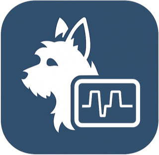

# Manual de Usuario de Kmila

**Aprende y depura VHDL sin necesidad de hardware físico.**

> Este manual te explica, paso a paso y con lenguaje sencillo, cómo usar cada
> sección de Kmila: desde crear tu primer proyecto hasta simular un diseño,
> leer sus formas de onda y resolver errores comunes.

---

## ¿Para quién es este manual?

Para cualquier persona que use Kmila: estudiantes que empiezan con VHDL,
docentes que preparan prácticas y usuarios avanzados que quieren aprovechar
todas las herramientas de análisis y simulación. **No necesitas tener una
tarjeta FPGA ni instalar herramientas pesadas**: Kmila simula todo en tu
computadora.

## ¿Qué es Kmila, en una frase?

Una aplicación donde **escribes** código VHDL, lo **simulas** y **ves** cómo
se comporta —señales, ciclos de reloj, esquemáticos y hasta un tablero visual
con LEDs y displays—, todo de forma local e interactiva.

---

## Antes de empezar: requisitos

Kmila viene en varias presentaciones ("cabeceras"); usa la que más te
convenga. El [Capítulo 1](01-primeros-pasos.md) explica cómo obtener cada una.

| Presentación | Para quién | Qué necesitas |
|---|---|---|
| **App de escritorio** (Windows, macOS, Android, iOS) | Uso diario cómodo | Descargar e instalar la app |
| **Web local** (navegador) | Usar desde un servidor propio o red local | Un navegador moderno |
| **Demo en el navegador** (WASM) | Probar sin instalar nada | Solo un navegador |
| **Terminal** (CLI) | Automatizar o usar por consola | La herramienta `kmila` |

---

## Contenido

### Primeros pasos
1. [Primeros pasos: instalar y abrir Kmila](01-primeros-pasos.md)
2. [La interfaz de un vistazo: cómo moverte](02-interfaz-general.md)
3. [Proyectos: crear, abrir, plantillas y archivos](03-proyectos.md)

### Escribir y simular
4. [Editor de código](04-editor-codigo.md)
5. [Editor por bloques](05-editor-bloques.md)
6. [Simular tu diseño](06-simulacion.md)
7. [Formas de onda (señales)](07-formas-de-onda.md)

### Analizar el diseño
8. [Esquemático (circuito lógico)](08-esquematico.md)
9. [Diagrama de flujo](09-flujo-control.md)
10. [Entidades y uso de recursos (FPGA)](10-entidades-y-recursos.md)
11. [Runtime visual: LEDs, displays y botones](11-runtime-visual.md)
12. [Ejecuciones y paso a paso](12-ejecuciones-y-replay.md)
13. [Control de versiones (Git)](13-control-de-versiones.md)

### Aprender y configurar
14. [Aprender, Práctica y Conceptos](14-aprender-practica-conceptos.md)
15. [Configuración](15-configuracion.md)
16. [Uso por terminal (CLI)](16-cli-y-terminal.md)

### Ayuda
17. [Preguntas frecuentes (FAQ)](17-preguntas-frecuentes.md)
18. [Solución de problemas y errores](18-solucion-de-problemas.md)

---

## Cómo leer este manual

A lo largo del texto verás estos avisos:

> ✅ **Consejo** — una recomendación para hacerte la vida más fácil.

> ⚠️ **Atención** — algo que conviene revisar para evitar confusiones.

> 💡 **¿Sabías que…?** — contexto breve para entender qué ocurre por dentro.

En las imágenes, los **recuadros y círculos de color** señalan dónde hacer
clic o qué mirar, y los **números** indican el orden de los pasos.

---

## Una nota sobre las imágenes

Las capturas de este manual corresponden a Kmila en **español** con **tema
oscuro**. La mayoría provienen de la app de escritorio (versión 1.25); algunas
pantallas más recientes se muestran desde la versión web (1.62). La interfaz es
la misma en todas las presentaciones, así que lo que ves aplica por igual
aunque uses otra.

---

*Kmila — Trabajo Terminal, ESCOM · Instituto Politécnico Nacional*

